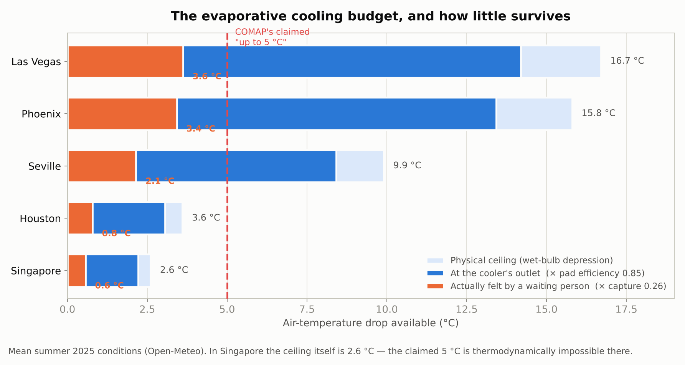
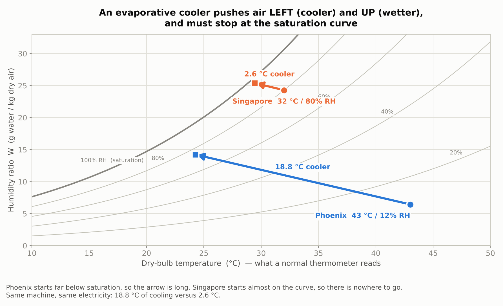
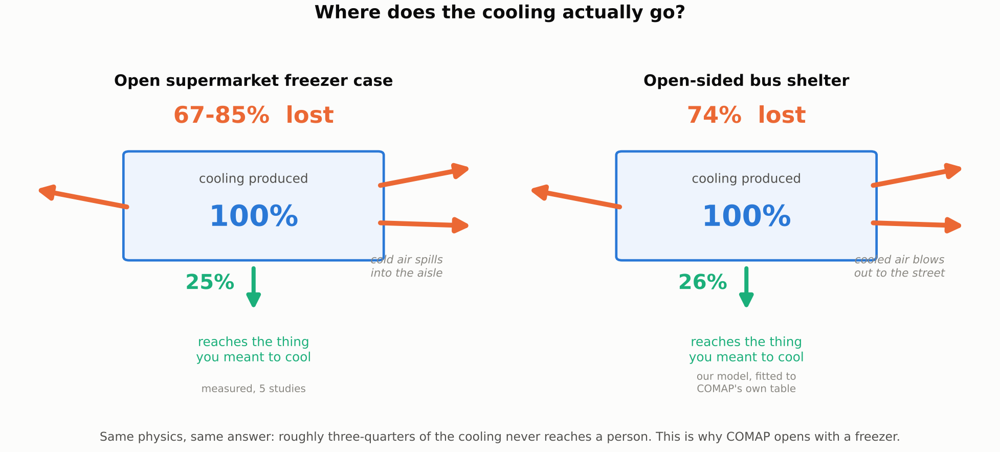
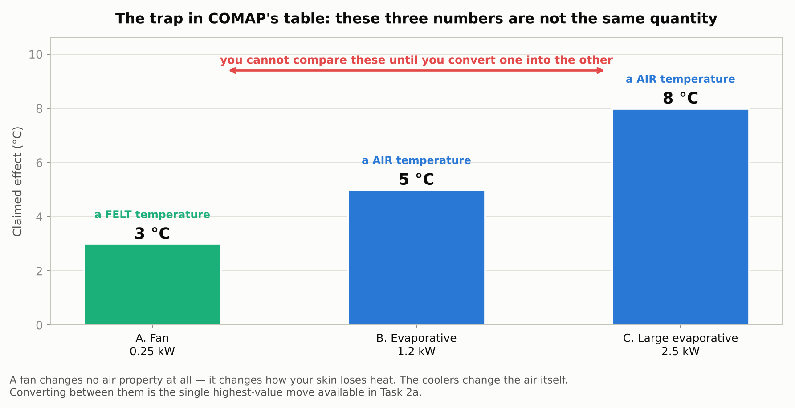
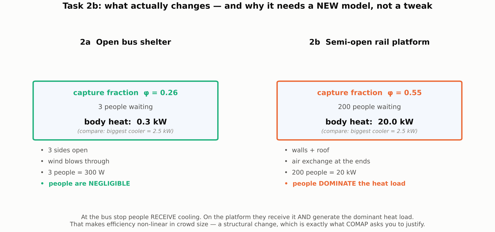

# Problem B — Tasks 1 and 2 only

Everything here uses physics you already know: `Q = mcΔT`, latent heat, and conservation of
mass. Five figures are in `himcm_b/figs/`. Every number was computed this session and can be
regenerated with `python3 lesson_numbers.py`.

---

## What the two tasks actually ask

Copy this into your document as headings. Judges tick these off.

**Task 1 — Understand the problem (the open freezer case)**
- [ ] What aspects of a freezer case should go into a measure of cooling efficiency?
- [ ] Should efficiency depend **only** on energy use? *(This is a yes/no question. Answer it.)*
- [ ] Justify the quantities you include.
- [ ] Use this to **motivate** the models below. *(So Task 1 must set up Task 2, not float free.)*

**Task 2a — The bus stop**
- [ ] Develop a measure of cooling efficiency for an open-sided shelter.
- [ ] Consider: size of cooled area, climate, energy use, **number of people benefiting**.
- [ ] Compare the three systems from their table.

**Task 2b — The rail station**
- [ ] Revise the model for a semi-open waiting area.
- [ ] State **what changed**, **why it was necessary**, **how it improved** the model.

> Note that COMAP tells you what to consider in 2a: area, climate, energy, **and people**. Three
> of those four are about where the cooling goes and who receives it — not about the machine.
> That is a hint, and most teams will ignore it.

---

## The three physics ideas you need

### Idea 1 — Evaporation is a huge energy sink

| To do this to 1 kg of water | Energy |
|---|---|
| Warm it by 1 °C | 4.18 kJ |
| **Evaporate it** | **≈ 2450 kJ** |

Evaporating water takes about **600× more energy** than warming it by a degree. That energy
has to come from somewhere — and it comes from the surrounding air, which therefore gets
colder. This is sweating, and it is how an evaporative cooler works.

### Idea 2 — Warm air holds more water, so humidity sets a hard limit

Air can only hold so much water vapour, and that limit roughly doubles every 10 °C.

**The wet-bulb temperature** `T_wb` is the coldest temperature you can reach by evaporating
water into air. Wrap a wet cloth on a thermometer and blow on it: evaporation cools the cloth,
the warm air heats it, and it settles where those balance. That balance point is `T_wb`.

**The wet-bulb depression is your entire cooling budget:**

```
WBD = T_air − T_wb
```

| City (mean summer) | Air temp | RH | **Budget (WBD)** |
|---|---|---|---|
| Phoenix | 34.9 °C | 23% | **15.8 °C** |
| Seville | 29.1 °C | 43% | **9.9 °C** |
| Houston | 28.1 °C | 76% | **3.6 °C** |
| Singapore | 27.4 °C | 82% | **2.6 °C** |

No evaporative cooler, at any price, can beat that number.



**Look at what this figure says.** COMAP claims "lowers air temperature up to 5 °C." In
Singapore the physical ceiling is **2.6 °C** — the claim is *impossible* there, before you even
account for the air blowing away. You can say that with a number on page 3.

The same thing on a psychrometric chart, which is worth drawing by hand once:



### Idea 3 — Mixing: cold air plus hot air

Mix cold supply air with hot outside air. Conserving mass and energy gives the familiar
weighted average:

```
T_mixed = φ · T_cold + (1 − φ) · T_hot
```

where **φ (phi) is the capture fraction** — the share of the air you are breathing that
actually came out of the cooler. Everything in Problem B turns on φ.

> ⚠️ **One trap.** When you mix two air streams, average their **humidity ratio** `W`
> (grams of water per kg of air), *never* their relative humidity. RH is a percentage of a
> limit that itself changes with temperature, so averaging it is meaningless. In our worked
> case the correct answer is 20% RH; averaging RH gives 28%.

---

## Task 1 — The open freezer case

### The structure that works: propose, then demolish

Don't just list factors. Offer three definitions and kill each one. This is quick to write and
it demonstrates reasoning rather than recall.

**Definition 1: "Efficiency = energy used per hour."**
❌ *Killed by:* a freezer that is switched off uses zero energy and scores perfectly, while
the food spoils. **An efficiency needs a useful output on top, not just a cost underneath.**

**Definition 2: "Efficiency = heat removed ÷ electricity used" (the engineering COP).**
❌ *Killed by:* an open case with a huge air curtain pulls in masses of warm shop air and
removes *more* heat per unit of electricity — so it scores **better** while doing its real job
worse. Thermodynamic efficiency actively rewards waste here.

**Definition 3: "Efficiency = degrees of cooling per kW."**
❌ *Killed by:* degrees *where*? The cold aisle floor is not the ice cream. You must say what
the cooling was *for*.

**Definition 4 (yours): useful service delivered ÷ resources consumed**, where "useful" means
it reached the thing you meant to cool.

### Answer the yes/no question explicitly

> **"Should efficiency depend only on energy use?" — No.** It must also account for (a) how
> much of the cooling reaches the target rather than the room, (b) how much product is actually
> being kept cold, (c) whether the food stays *safe*, not merely cool, and (d) the water, money
> and waste heat consumed alongside electricity.

### The number that bridges Task 1 to Task 2

Across five independent studies, infiltration through the air curtain of an open refrigerated
display case accounts for **67–85% of the total cooling load**. So the freezer's capture
fraction φ is roughly **0.15–0.33**.

Hold onto that. In Task 2 you will derive φ for the bus shelter independently — and get the
same answer.



> ### 🏆 Standout move #1
> **Give the freezer a number, not an adjective.** Nearly every team will write "some cold air
> escapes." You write: *"67–85% of an open case's cooling load is infiltration through the air
> curtain (five studies), so its capture fraction is 0.15–0.33."* Then in Task 2 you derive
> 0.26 for the bus shelter from COMAP's own table. The analogy stops being a metaphor and
> becomes a measurement. **This is the cheapest high-value paragraph in the whole paper.**

---

## Task 2a — The bus stop

### Step 0: Spot the trap in their table



The fan's **3 °C is a feeling**. The coolers' **5 °C and 8 °C are air temperatures**. These are
different physical quantities. A fan changes *no* air property whatsoever — it changes how fast
your skin loses heat. Dividing 3 by 0.25 and 5 by 1.2 and comparing the answers is comparing
metres with kilograms.

Also: their table writes energy as "kW/hr", which is not a unit — kW is already a rate. Say so
in one polite sentence in your assumptions. It signals that you check dimensions.

### Step 1: Build the chain

Four steps, each one line of algebra:

```
(1) BUDGET      WBD = T_air − T_wb                         how much cooling is physically available
(2) DEVICE      T_out = T_air − ε · WBD                    what comes out of the machine  (ε ≈ 0.85)
(3) DELIVERY    T_shelter = φ·T_out + (1−φ)·T_air          what survives the wind
(4) PEOPLE      N = λ · (H/2)                              how many are standing in it
```

Step (4) is **Little's law**: if buses come every `H` minutes and passengers arrive randomly,
the average wait is `H/2`, so `N = arrival rate × H/2`. Standard, citable, one line.

### Step 2: Define efficiency

```
                 Σ (people present) × (degrees of cooling they actually feel) × (hours)
Efficiency  =    ─────────────────────────────────────────────────────────────────────
                                    Σ (kWh consumed)
```

Units: **person·°C·hours per kWh**. It covers all four things COMAP asked for — area and
climate enter through steps 1–3, energy is the denominator, people are in the numerator.

### Step 3: The move that wins Task 2a

Here is the thing almost nobody will do.

**COMAP's table is not data to use. It is a target to hit.**

Their column says *"Effect on **Shelter**"* — not "effect at the device outlet". So the 5 °C and
8 °C are already **after** the cold air has mixed with the wind. That means the table secretly
contains the capture fraction, and you can extract it.

Take the pad efficiency from the literature (ε = 0.85, a normal value), and fit **one** unknown
— the shelter's effective open area — so your model reproduces **both** numbers at once:

```
fitted effective open area      :  10.7 m²        (sensible for a bus shelter)
→ capture fraction, small/large :  0.26 / 0.44
→ cooling lost to the sky       :  74% / 56%

predicted vs COMAP's 5 °C       :  −0.21 °C  ✓
predicted vs COMAP's 8 °C       :  +0.21 °C  ✓
```

**Two targets, one adjustable number.** That is one more constraint than you have freedom, so
hitting both within ±0.21 °C is not fitting — it is a genuine **test that your physics is
right**, using the only data COMAP gave you.

And the capture fraction you get, **0.26**, lands inside the freezer's measured 0.15–0.33.

> ### 🏆 Standout move #2
> **Calibrate against the problem statement, then validate.** Most papers assume. An AI-written
> paper will take "5 °C" as a constant and apply it in Singapore, which is physically
> impossible. You instead *derive* a hidden parameter from their numbers, check it against an
> independent literature value, and report the residual. Put the ±0.21 °C in a box.

### Step 4: Compare the three systems honestly

Now run all three through the chain in two contrasting climates. One sentence of warning from
my own run: because the fan uses only 0.25 kW, it wins on raw comfort-per-kWh almost
everywhere — by a factor of 7 or more. Don't fight that result; **explain** it. The fan is
cheap because it doesn't change the air at all, only the person.

**[Your work]** Pick your two cities and run it. Also test what happens if you define
efficiency in terms of *safety* (people pulled out of dangerous heat) rather than comfort —
the ranking may change, and if it does, you have a genuine finding.

---

## Task 2b — The rail station



### The obvious revision (do this)

Walls and a roof mean less wind-driven exchange, so **φ goes up** — more of your cooling stays
where you put it. Replace the open-shelter mixing with a **zone balance**:

```
T_zone = ( Q_supply·T_supply + Q_leak·T_outside + G/(ρc_p) ) / ( Q_supply + Q_leak )
```

where `G` is the heat generated inside. Then check the limits, which is free marks:
no leakage → `T_zone = T_supply` ✓; huge leakage → `T_zone = T_outside` ✓.

### The revision that will actually impress (do this too)

Ask what else changed when you moved from a shelter to a station. **The crowd.**

| | Bus shelter | Rail platform |
|---|---|---|
| People waiting | 3 | 200 |
| Body heat at ~100 W each | **0.3 kW** | **20 kW** |
| Biggest cooler in the table | 2.5 kW | 2.5 kW |

At the bus stop, three people are thermally irrelevant. On a crowded platform, the passengers
are a **20 kW heat source** — eight times larger than the largest cooling device COMAP offers
you.

> **So the structural change is this: at the bus stop, people only *receive* cooling. On the
> platform, people simultaneously receive the cooling and *are* the dominant heat load.**

That makes efficiency **non-linear in crowd size**, and it answers all three of COMAP's
questions at once:

- *What changed?* People moved from the output side of the model to both sides.
- *Why was it necessary?* Because 20 kW cannot be neglected against a 2.5 kW device, while
  0.3 kW can.
- *How did it improve the model?* The old model predicts cooling gets more efficient
  indefinitely as the crowd grows (more beneficiaries, same energy). The new one shows that
  past some density the crowd's own heat wins, so **there is an optimal crowd size** — which
  the old model could not represent at all.

> ### 🏆 Standout move #3
> **Find that optimum and put a number on it.** "Our revised model predicts efficiency peaks at
> about N people and declines beyond it, a behaviour the bus-stop model cannot produce." That
> is a *new result produced by the revision*, which is exactly what "how did the revision
> improve the model" is asking for. Most teams will answer that question with "it is more
> realistic."

---

## Your four standout moves, in one place

| # | Move | Where | Why it beats the field |
|---|---|---|---|
| 1 | Give the freezer's waste a **number** (67–85%) | Task 1 | Turns the analogy into a measurement |
| 2 | **Fit** COMAP's table, don't consume it; report the ±0.21 °C residual | Task 2a | Validation against the only data given |
| 3 | Crowd becomes a **heat source**; find the optimal crowd size | Task 2b | A genuinely new result from the revision |
| 4 | Show the claimed 5 °C is **impossible** in a humid city | Both | One sentence, unforgettable, undeniable |

And one piece of discipline that matters more than any of them: **the fan's "3 °C" and the
coolers' "5 °C" are different quantities.** Teams that miss this get every later comparison
wrong. Teams that spot it and fix it have already out-thought most of the field.

---

## What I left for you

1. Choose the two venues and get real geometry and ridership.
2. Decide how to put "felt" and "air" degrees on one scale. The simple route is an
   apparent-temperature formula you can compute in a spreadsheet; the rigorous route is the
   ASHRAE 55 "cooling effect". Either is defensible — **justify your choice**.
3. Run the three systems in your two climates and see whether the ranking flips.
4. Find the optimal crowd size in 2b.
5. Draw your own versions of these figures. Mine are a starting point, not a submission.

---

## References

Use these as a starting point and **check each one says what you claim** before citing it.

**Evaporative cooling physics**
- EnergyPlus Engineering Reference, *Evaporative Coolers* — the `T_out = T_db − ε(T_db − T_wb)`
  equation. https://bigladdersoftware.com/epx/docs/8-1/engineering-reference/page-084.html

**Open freezer cases (the 67–85%)**
- Kettering University, *Keeping Cool* — ~70% of load from the air curtain.
  https://kettering.edu/news/keeping-cool
- Brunel University thesis — infiltration ≥85% of cooling load.
  https://bura.brunel.ac.uk/bitstream/2438/7456/1/FulltextThesis.pdf
- Amin et al. (2011), infiltration of open refrigerated cavities — up to 80%.
  https://www.aa.washington.edu/files/faculty/dabiri/pubs/A%20Comprehensive%20study%20on%20the%20effects%20of%20fluid%20dynamics%20of%20air%20curtain%20and%20geometry,%20on%20infiltration%20rate%20of%20open%20refrigerated%20cavities%202011.pdf

**Comfort / "feels like"**
- ASHRAE Standard 55 — comfort, elevated air speed, the cooling effect.
  https://en.wikipedia.org/wiki/ASHRAE_55
- Steadman apparent temperature (Bureau of Meteorology form):
  `AT = T + 0.33e − 0.70v − 4.00`, `e = (RH/100)·6.105·exp(17.27T/(237.7+T))`.
  https://community.tempest.earth/t/steadman-apparent-temperature-australian-apparent-temperature/2248

**Weather data**
- Open-Meteo Historical Weather API — free, hourly, includes wet-bulb temperature directly.
  https://open-meteo.com/en/docs/historical-weather-api

**Real-world hook for your write-up**
- Doha's air-conditioned bus shelters reportedly run 24 hours a day, 7 days a week.
  https://thepeninsulaqatar.com/article/24/08/2013/bus-stop-wait-is-not-cool
