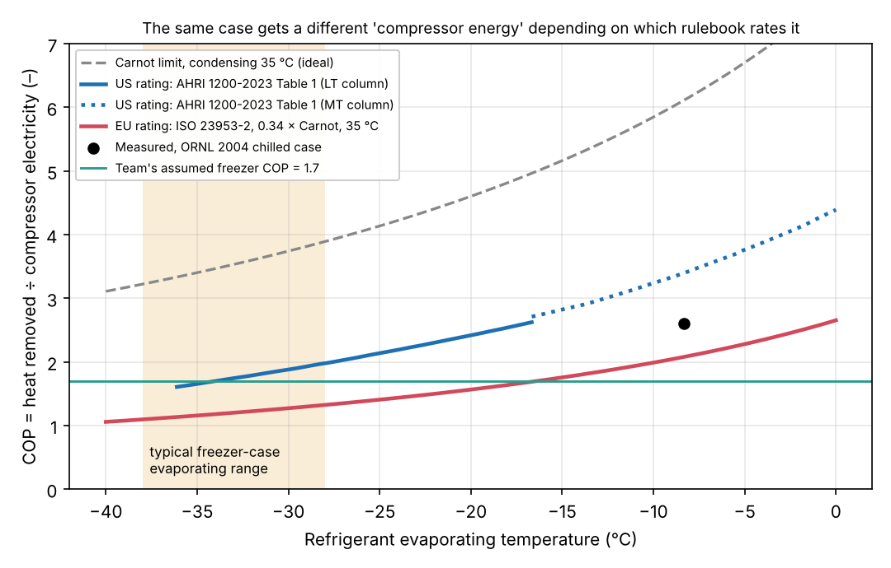
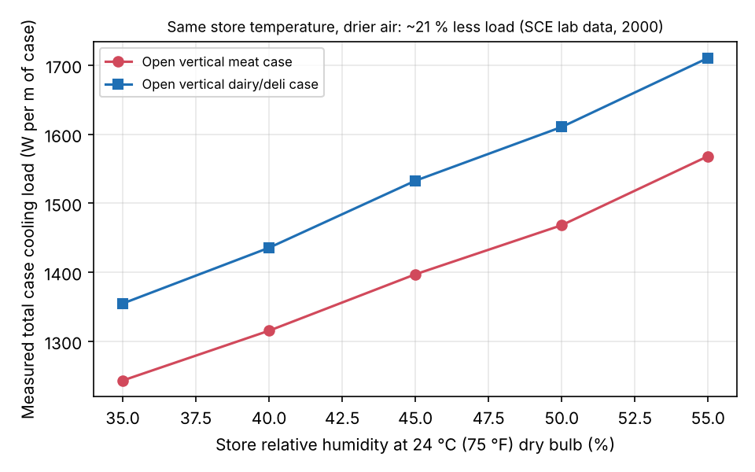

# T03: Evidence table for open refrigerated display cases (freezer focus)

HiMCM 2026 Problem B research memo. This is not paper text. Read it, check it, and then write the paper in your own words.

**How to read the tags**
- **[VERIFIED: source]** means I opened the primary document (or an official copy of it) and read the number myself.
- **[VERIFIED-SECONDARY: source]** means I read the number in a reliable document that cites the original, but I did not open the original.
- **[ABSTRACT-ONLY]** means I saw only the abstract or a catalogue record.
- **[DERIVED]** means I calculated it from verified inputs. The code is `code/T03_evidence_calcs.py` and its output is `code/T03_output.txt`.
- **[ASSUMED: reason]** means it is my own assumption.

Every downloaded source was saved to `sprint_out/dl_T03/` so you can re-check it.

---

## 0. The six words you need (plain language first)

| Word | Plain meaning | Symbol and units |
|---|---|---|
| **Open display case** ("multideck" if vertical) | A supermarket fridge or freezer with no door. A thin downward sheet of cold air, the **air curtain**, is supposed to keep the cold in. | - |
| **Refrigeration load** (also "cooling load", "heat extraction rate") | The heat the case's cooling coil must remove every second to keep the food cold. | Q, in W or kW (US papers use Btu/h; 1 W = 3.412 Btu/h) |
| **Infiltration** | Warm, damp store air that gets mixed into the curtain and ends up at the cooling coil. It must be cooled down, and its water must be frozen out. | Share of Q, in % |
| **Electricity use** | What the meter reads: compressor, fans, lights, anti-sweat heaters and defrost heaters. | E, in kWh/day |
| **COP** (coefficient of performance) | Heat removed per unit of compressor electricity. A COP of 2 means 1 kWh of electricity removes 2 kWh of heat. | COP = Q / P_compressor, no units. US rules use **EER** = COP × 3.412, in Btu/Wh. |
| **TDA** (total display area) | The area of food a shopper can see, measured as a projected (flat) area. Regulators divide energy by this. | ft² (US) or m² (EU) |

The key idea for the team: **load is not electricity.** Load (heat) is turned into electricity through a COP, and then fans, lights, anti-sweat heaters and defrost heaters are added on top. Every official metric makes its own assumption about the COP. Section 3 shows that the US and the EU assume very different COPs.

---

## 1. The evidence table

Confidence key: **H** = primary source read, conditions clear. **M** = primary source but read from a figure or with unclear conditions, or a solid secondary source. **L** = abstract, slide, vendor or forum source.

MT means medium-temperature (chilled, about 0 to 5 °C food). LT means low-temperature (frozen, about −18 °C food).

### 1A. How much of the case's load is infiltration?

| # | Quantity | Value | Unit | Case and test conditions | Source (link) | Exact quote or location | Conf. |
|---|---|---|---|---|---|---|---|
| A1 | Infiltration share of total load, MT open vertical **meat** case | **81** | % | 8 ft Hussmann Impact M3, 75 °F (24 °C) dry bulb, 55 % RH, condensing temperature 95 °F (35 °C), R-404A | Faramarzi, Sarhadian & Sweetser (2000), ACEEE Summer Study, Panel 3 Paper 10. [pdf](https://www.aceee.org/files/proceedings/2000/data/papers/SS00_Panel3_Paper10.pdf) | Fig. 2, p. 3.130: "Refrigeration Load Percentage Breakdown … at 75oF Dry Bulb and 55% Relative Humidity". Bar label 81 % | H |
| A2 | Same, MT open vertical **dairy/deli** case | **78** | % | 8 ft Tyler L6DL8, same conditions | same | Fig. 2. Abstract p. 3.125: "infiltration constituted about 80% of the total cooling load of open vertical cases" | H |
| A3 | Same, **frozen-food narrow island ("coffin")**, which is a horizontal LT case | infiltration **≈24**, radiation **≈43**, conduction ≈18 | % | 8 ft Hill Phoenix ONIZ(F), −12 °F (−24 °C) discharge air, same room | same | Fig. 2, stacked bar. p. 3.130: "The role of infiltration relatively diminishes for the coffin case while radiation takes over". I matched the numbers to the legend order myself. | M |
| A4 | Same, 8 ft MT open multideck, baseline case | **82.2** (10,674 of 12,989 Btu/h); text says "over 80%" | % | 24 °C db / 18 °C wb (55 % RH), discharge air 30 °F, saturated evaporating temperature 17 °F | Walker, Faramarzi & Baxter (2004), *Investigation of Energy-Efficient Supermarket Display Cases*, ORNL/TM-2004/292. [pdf](https://info.ornl.gov/sites/publications/Files/Pub57417.pdf) | Table ES-1, p. xxiii: "Infiltration Load (Btu/hr) 10,674" and "Total Refrigeration Load (Btu/hr) 12,989". The share is [DERIVED] | H |
| A5 | "Typical open multi-deck" breakdown | infiltration **73**, radiation 12, lights 8, conduction 4, fans 3 | % | Not stated (cites Faramarzi 1999) | Sarhadian, Faramarzi, Coburn, Lutton, Navaz & Walker (2004), ACEEE Summer Study, Panel 3 Paper 23. [pdf](https://www.aceee.org/files/proceedings/2004/data/papers/SS04_Panel3_Paper23.pdf) | Fig. 2, p. 3-278. Text p. 3-276: "roughly 70% to 80% of the total cooling load" | M |
| A6 | Low-front MT open cabinet, display opening raised to **2.0 m** | **≥ 85** | % | **Climate class 0 (20 °C, 50 % RH)**. Chilled (M1), not a freezer | Al-Sahhaf (2013), PhD thesis, Brunel University. [record](https://bura.brunel.ac.uk/handle/2438/7456), [pdf](http://bura.brunel.ac.uk/bitstream/2438/7456/1/FulltextThesis.pdf) | Abstract: "although corresponds to 31% of the total mass flow rate, was found to be responsible for at least 85% of the total cooling load". Class 0 choice: §3.2.1, p. 30 | H |
| A7 | Literature range quoted in the same thesis | 70–80 | % | Literature | same | Abstract: "70% to 80% of the cabinet's cooling load is due to ambient air infiltration" | M |
| A8 | Howell & Adams (1991), "up to 75 %" | 75 | % | Vertical open case | Only seen in search snippets that cite it | Not opened | L |
| A9 | Gaspar et al. (2011), 66/67–77 % | 67–77 | % | Vertical open case | Only seen in search snippets | Not opened | L |
| A10 | Share of curtain-entrained air that actually reaches the coil | **31 %** (Brunel). **30–35 %** (Navaz et al. 2005, 1.0 m opening). **100 of 325 cfm ≈ 31 %** (ORNL) | % of entrained air | as above | Brunel thesis §9.2 p. 185. Navaz is [VERIFIED-SECONDARY] via the Brunel thesis p. 140. ORNL p. 28–29 | ORNL: "total ambient airflow that is entrained in the air curtain is 325 ft3/min … net infiltrated flow that reaches the case evaporator is 100 ft3/min" | H/M |

**I found no measured infiltration share for an open *vertical* freezer (LT multideck) case.** Every number from 67 to 85 % comes from chilled (MT) cases. The only measured LT case (A3) is a horizontal coffin, and there infiltration is only about 24 %.

### 1B. Load per metre and air-curtain geometry

| # | Quantity | Value | Unit | Conditions | Source | Location or quote | Conf. |
|---|---|---|---|---|---|---|---|
| B1 | Load, MT open multideck (baseline) | 12,989 Btu/h over 8 ft = **1,561 W/m** | W/m | ASHRAE 72-98 test | ORNL/TM-2004/292 | Table ES-1. Manufacturer rating is 1,561 Btu/h/ft, measured 1,624 (Table 7, p. ~29) | H |
| B2 | Load, MT open multideck (current product) | 972–1,303 Btu/h/ft = **0.93–1.25 kW/m** | W/m | ASHRAE-72-2005, unlit shelves | Hillphoenix O5DM-NRG tech sheet. [pdf](https://www.hillphoenix.com/wp-content/uploads/2019/05/O5DM-NRG-display-case-tech-reference-sheet-9.0.pdf) | "Guidelines and control settings" table | H |
| B3 | Rated capacity of the SCE test cases | meat 1,120, dairy 1,492 Btu/hr-ft. **Frozen coffin 369 Btu/hr-ft (0.35 kW/m)**. Frozen reach-in 1,400 Btu/hr per door | Btu/hr-ft | Manufacturer ratings | ACEEE 2000 | Table 2, p. 3.127 | H |
| B4 | LT single-deck (frozen food) load | 587 Btu/h/ft = **0.56 kW/m**. Evaporator −17 °F (−27 °C), discharge air −5 °F (−21 °C) | W/m | ASHRAE-72-2005 | Hillphoenix O2MZD tech sheet. [pdf](https://www.hillphoenix.com/wp-content/uploads/2019/05/O2MZD-display-case-tech-recference-sheet-4.pdf) | Guidelines table, "Frozen Food 587 562 … -17 -5 155" | H |
| B5 | Brunel low-front cabinet load, 1.2 m long, 2.0 m opening | 2,231 W (class 0) → **4,525 W (class 3)** | W | CFD, validated | Brunel thesis | Table 7.1, p. 144 | H (CFD) |
| B6 | Discharge-air velocity (DAV) | ORNL MT case: average **186 fpm (0.94 m/s)** after defrost, peak 292 measured (350 published). Hillphoenix O5DM: **140 fpm (0.71 m/s)**. O2MZD frozen: **155 fpm (0.79 m/s)**. Brunel: ~1 m/s; CFD 0.47–0.97 m/s | ft/min, m/s | Sheets say "average velocity immediately after defrost" or "at peak of defrost" | ORNL Table 7. Hillphoenix sheets. Brunel p. 46 and Table 7.1 | quoted values | H |
| B7 | Discharge air grille (DAG, the nozzle) width | ORNL case: **≈ 30–57 mm** [DERIVED from 280 cfm through the DAG on 8 ft ÷ jet speed]. Brunel rebuilt case: 12 cm | mm | - | ORNL p. 28–29 (280 cfm). Brunel p. 35 ("DAG width of 12 cm") | - | M |
| B8 | Air-curtain Reynolds number (based on DAG width) | **≈ 4,200 measured; 3,200 suggested as better** | - | ORNL MT case | ORNL p. 28–29 | "air curtain Reynolds number of approximately 4200 and a turbulence intensity of 18 percent … desired … on the order of 3200" | H |
| B9 | Opening height | **1.275 m** original, rebuilt to 2.0 m (Brunel). 1.0 m (Navaz 2005) | m | - | Brunel p. 35. Navaz via Brunel p. 140 | - | H/M |
| B10 | Best ratio of opening height to DAG width | **15–17** | - | Brunel low-front cabinet | Brunel §9.2, p. 186 | "optimum ratio of the open display height to DAG width was found to be in the range from 15 to 17" | H |

A non-obvious check [DERIVED]: the Reynolds number based on DAG width is Re = V·w/ν. Since flow per metre q = V·w, this means Re = q/ν. **The width cancels out.** ORNL's 280 cfm on 8 ft gives q = 0.054 m²/s. With ν = 1.33×10⁻⁵ m²/s that is Re ≈ 4,100, which matches their "≈4,200". So "Re" here is really just "how much air per metre you blow". This explains why the Brunel thesis (p. 187) warns that Re based on DAG width is "misleading".

### 1C. Temperatures and COP, LT vs MT

| # | Quantity | Value | Unit | Source | Location or quote | Conf. |
|---|---|---|---|---|---|---|
| C1 | US rating product temperature (integrated average of test packages) | **LT 0.0 °F ± 2 (−17.8 °C)**. **MT 38 °F ± 2 (3.3 °C)**. Ice cream −15 °F (−26 °C) | °F | AHRI 1200-2023 (I-P), §4.1.1.2–4.1.1.4, p. 5. [pdf](https://law.resource.org/pub/us/cfr/ibr/inc/ansi/ahri.1200.2023.pdf). Adopted by 10 CFR 431 App. B §2.1 | "shall have an Integrated Average Temperature of 0.0°F ± 2.0°F" | H |
| C2 | EU product temperature classes | **L1: warmest pack ≤ −15 °C, coldest ≤ −18 °C.** L2 ≤ −12/−18. L3 ≤ −12/−15. M2 ≤ +7/≥ −1. M1 ≤ +5/≥ −1 | °C | Reg. (EU) 2019/2024, Annex III, Table 5. [Cellar copy](http://publications.europa.eu/resource/celex/32019R2024) | Table 5(a) | H |
| C3 | Typical refrigerant evaporating temperature, frozen cabinet | **"near −35 °C"**. The EU compressor rating point is "Evaporating −35 °C / Condensing 40 °C" | °C | BIO Intelligence Service (2007), *EuP Lot 12 Final Report*, p. III-18; rating point on p. IV-55 (Table 4-61 context). [pdf](https://susproc.jrc.ec.europa.eu/product-bureau/sites/default/files/contentype/product_group_documents/1581682650/BIO_EuP_Lot_12_Final_Report.pdf) | "frozen cabinet evaporating temperature is near -35 °C" | H |
| C4 | Typical evaporating temperature, US LT case | −17 °F (−27 °C) frozen food, −27 °F (−33 °C) ice cream (single deck) | °F | Hillphoenix O2MZD | table | H |
| C5 | **US assumed compressor EER** (it sets the COP inside the official metric) | LT column: **6.41 Btu/Wh at −25 °F adjusted dew point (COP 1.88)**, 5.48 at −36 °F (COP 1.61), 8.95 at −1 °F (COP 2.62). MT: **11.58 at 15 °F (COP 3.39)**, 13.95 at 26 °F (COP 4.09) | Btu/Wh | AHRI 1200-2023, Table 1, p. 8, plus §5.1.2.1 (adjusted dew point = dew point − 3 °F for LT, − 2 °F for MT; linear interpolation) | Table 1 | H |
| C6 | **EU assumed COP** (ISO 23953-2) | **COP = 0.34 × T₀/(T_c − T₀)**, with T_c = 308.15 K (35 °C). This gives **1.27 at −30 °C** and **1.16 at −35 °C** evaporating; 2.08 at −8.3 °C | - | ISO 23953-2 as reproduced in BIO IS (2007), Box 1-3, p. I-18 and Box 1-6, p. I-41 | "REC = (24h − t_deft)·Φ24−deft·(Tc − Tmrun)/(0.34 Tmrun); Tc = 308,15 K (35 °C…)". The COP values are [DERIVED] | H (formula via secondary copy of the standard) |
| C7 | Measured COP, compressor only, MT open case | **2.61** (12,989 Btu/h ÷ 1,460 W) at SET 17 °F / SCT 95 °F; condenser fans excluded | - | ORNL Table ES-1 [DERIVED] | - | H |
| C8 | Carnot limit, −18 → 35 °C (team's number) | 4.81 | - | [DERIVED] | Uses −18 °C as the evaporating temperature (see Section 6) | - |

See figure `figs/T03_cop_conventions.png`.

### 1D. Where the electricity goes: compressor, fans, lights, anti-sweat heaters, defrost

| # | Case | Compressor (or REC) | Fans | Lights | Anti-sweat | Defrost heaters | Source | Conf. |
|---|---|---|---|---|---|---|---|---|
| D1 | US **open MT** multideck line-up, 24 ft, in-store field data | **79 %** (42.2 kWh/d) | 11 % (5.69) | 10 % (5.18) | 0 | (not listed) | Fricke & Becker (2010), FMI Energy & Technical Services Conference, slides. [pdf](https://19january2021snapshot.epa.gov/sites/static/files/documents/Doored_vs_Open_Refrigeration_Cases_%202010FMI.pdf) | M (slides) |
| D2 | US **doored MT** line-up, same study | 27 % (11.7) | 10 % (4.58) | 27 % (11.93) | **36 % (15.5)** (heaters always on) | - | same | M |
| D3 | US open MT, lab, 8 ft (power, W) | 87 % (1,460 W) | 6.8 % (115 W) | 6.6 % (112 W) | - | off-cycle defrost | ORNL Table ES-1 [DERIVED shares] | H |
| D4 | EU **remote open vertical chilled** multideck (RVC2), 7 m² TDA, class 3M2, average of 5 makers | **REC 90.75 %** (70.16 kWh/d) | 6.66 % | 2.32 % | 0.28 % | - | BIO IS (2007), Table 4-66, p. IV-66 | H |
| D5 | EU **remote open frozen island** (RHF4), 7 m² TDA, class 3L2, 3 makers | **REC 74.9–78.4 %** | 2.3–7.5 % | - | **8.4–12.6 %** | **6.0–8.5 %** | BIO IS (2007), Table 4-68, p. IV-67. Total TEC 81.34 kWh/d | H |
| D6 | LT single deck 8 ft, US (indicative) | 76 % | 3 % | - | 10 % | 12 % | [DERIVED] from Hillphoenix O2MZD ratings (fans 22 W, anti-condensate 82 W, defrost 2,400 W, 2 defrosts/day) + AHRI EER; 30 min per defrost [ASSUMED] | M |
| D7 | Defrost efficiency | "less than 20 % of the electricity used by the defrost heaters is actually used to melt the ice"; about 30 min/day of electric defrost in LT cabinets | - | BIO IS (2007) citing an ADEME study, p. III-10 | [VERIFIED-SECONDARY] | M |

Rule of thumb that all of these support: **open chilled cases: compressor ≈ 80–90 % of electricity. Open freezer cases: compressor ≈ 75–78 %, with heaters (anti-sweat + defrost) ≈ 15–20 %.**

### 1E. Store temperature and humidity → case load, and the official test conditions

| # | Quantity | Value | Conditions | Source | Location or quote | Conf. |
|---|---|---|---|---|---|---|
| E1 | **US test room (ASHRAE 72, used by DOE/AHRI)** | **75.2 °F ± 1.8 (24.0 °C) dry bulb; 64.4 °F ± 1.8 (18.0 °C) wet bulb, which is 49–62 % RH; moisture 0.009–0.011 lb/lb** | - | DOE final rule, 88 FR 66152 (26 Sep 2023), Table III.1, p. 66176 (FR page). [pdf](https://www.govinfo.gov/content/pkg/FR-2023-09-26/pdf/2023-19999.pdf) | Table III.1 | H |
| E2 | **EU test room (Set 1 = ISO 23953 climate class 3)** | **25 °C, 60 % RH, dew point 16.7 °C, 12.0 g/kg** | ice-cream freezers use Set 2: 30 °C / 55 % | Reg. (EU) 2019/2024 Annex III, Table 3 | "Set 1 25 60 16,7 12,0" | H |
| E3 | ISO climate class 0 | 20 ± 1 °C, 50 % RH. Cross-flow along the opening 0.2 m/s | used for the Brunel tests | Brunel thesis Table 3.1, §3.2.1 | "the air velocity … must be 0.2 m/s" | H |
| E4 | Why these conditions are used | **EU:** "The purpose of the standard is not to measure the real life energy consumption but to verify that the product is working in the worst conditions and to provide a tool to compare competing products." **US law:** a test must reflect energy use "during a representative average use cycle" and not be "unduly burdensome" (42 U.S.C. 6314(a)(2)) | - | BIO IS (2007) p. IV-63. 88 FR 66152 p. 66153 | quotes | H |
| E5 | RH 55 → 35 % at 75 °F, MT open vertical | total load **−20.7 % (meat), −20.8 % (dairy)**. Latent load −62 % / −74 %. Compressor power −17.7 % / −19.6 %. Defrost duration −40 % (dairy). Condensate −61.7 % / −73.2 % | 24-hour tests, 5 % RH steps | ACEEE 2000, pp. 3.125, 3.129–3.132 | "resulted in 20.7% and 20.8% reduction in the total cooling loads" | H |
| E6 | **Elasticity** of MT open-case load with respect to RH, at 55 % | **0.57** (both cases). Slope ≈ 16–18 W per metre per %RH | from E5 data | [DERIVED], `T03_rh_sensitivity.png` | - | H |
| E7 | Latent share of total load, MT open vertical, 75 °F / 55 % | meat 4,198 / (1,631×8) = **32 %**; dairy 4,041 / (1,779×8) = **28 %** | - | ACEEE 2000 Figs. 3 and 5 [DERIVED] | - | M |
| E8 | Latent share, Brunel cabinet at class 3 | **38.7 %** (sensible 61.3 %) | - | Brunel Table 7.2, p. 148 | - | H |
| E9 | Class 0 → class 3 (20 °C/50 % → 25 °C/60 %) | total load **+58.2 %**: sensible +41 %, latent +92 % (this includes the extra curtain airflow needed to keep products in class) | CFD, MT low-front | Brunel p. 144 | "The total cooling load of the cabinet was increased by 58.2%" | H |
| E10 | Howell (1993), RH 55 → 35 % | case energy −30 %, defrost −60 %, anti-sweat −70 %, but store air conditioning **+8 %** | - | Cited in Brunel thesis p. 18–19 | [VERIFIED-SECONDARY] | M |
| E11 | Field: open MT line-up energy vs store RH | **1.25 ×** at 45 % RH compared with 20 % RH. Doored line-up was "relatively constant" | 2 Kansas stores | Fricke & Becker slides | quote | M |
| E12 | Infiltration heat per kg of store air into a −18 °C case [DERIVED] | ASHRAE 72: **70.5 kJ/kg (latent 40 %)**. ISO class 3: **75.8 (latent 43 %), +7.5 %**. Class 0: 57.2 (33 %) | air leaves saturated at −18 °C, water leaves as ice | `T03_output.txt` §1 | - | H (physics) |

### 1F. Measured savings: doors, night covers, air curtains

| # | Measure | Saving | Conditions | Source | Location or quote | Conf. |
|---|---|---|---|---|---|---|
| F1 | Glass doors on an open 5-deck MT dairy/deli case (lab) | total cooling load **−68 %**, refrigerant flow −71 %, **compressor power −87 %**. Per the thesis: infiltration −~80 %, radiation −94 %, latent −90 % | ASHRAE 72 lab (SCE) | Faramarzi, Coburn & Sarhadian (2002), *ASHRAE Trans.* 108(1). [IIR record](https://iifiir.org/en/fridoc/performance-and-energy-impact-of-installing-glass-doors-on-an-open-20324) | Abstract: −68 %, −71 %, −87 % [ABSTRACT-ONLY]. Component split [VERIFIED-SECONDARY] from Brunel p. 17 | M |
| F2 | Glass doors (with LED lights, warmer evaporator, 2 defrosts/day instead of 6) on an 8 ft MT meat case | load 1,576 → 315 Btu/h/ft (**−80 %**). Energy 33.3 → 9.6 kWh/day (**−71 %**) | ASHRAE 72 lab, manufacturer | Hillphoenix case study. [pdf](https://www.hillphoenix.com/wp-content/uploads/2018/02/Case-Study-display-case-Adding-Glass-Doors-to-Multi-Deck-Meat-Case-.pdf) | Table 1. Doors-only step: 1,576 → 330 Btu/h/ft, 33.3 → 9.7 kWh/d | M (vendor) |
| F3 | New open vs new doored MT line-up (field, two stores) | compressor **−72 %**, but **total only −18 %** (2.21 → 1.71 kWh/day/ft), because the doored cases added 15.5 kWh/d of anti-sweat heat and more lighting | Kansas, 2 stores | Fricke & Becker (2010) slides | "open display case line-up consumed approximately 1.3 times more energy" | M |
| F4 | Doors on all MT open verticals, whole store (simulated) | store **refrigeration energy −19.5 %**. With other measures, −27.5 % | DOE-2.3 calibrated model, Los Angeles | ORNL/TM-2004/292 §7.6.3, p. 66 | list on p. 66 | H (simulation) |
| F5 | Night blinds, integral open multideck | **−10 to −22 %** of 24 h energy (blind down 12 h); less saving at hotter ambient | 20–35 °C, constant moisture | Datta, Watkins & Tassou (2004), 3rd Int. Conf. Heat Powered Cycles. [record](https://kar.kent.ac.uk/52730/) | Abstract: "energy savings of between 10% and 22%" [ABSTRACT-ONLY] | M |
| F6 | Night covers, store refrigeration load | **−35 % summer, −28 % winter**, with covers on 15.5 h/day | French supermarket audit (ENERTECH) | BIO IS (2007) §3.1.6.7, p. III-7 | [VERIFIED-SECONDARY] | L/M |
| F7 | Night covers, SCE test, 6 h/night | compressor energy **−8.5 %** | SCE Irwindale | WSU Energy Program E3T page (secondary) | not opened | L |
| F8 | Vendor claims, night covers | up to 50 %; "36 % … for every hour it was used" | - | Econofrost brochure | - | L |
| F9 | Improved air curtain, real hardware | **No measurable change.** Prototype infiltration 10,835 vs baseline 10,674 Btu/h (**+2 %**) | ASHRAE 72-98 lab | ORNL Table ES-1, p. xxiii. ACEEE 2004 p. 3-285 | "Despite several attempts to implement air curtain improvements, the infiltration load of the prototype display case remained the same as the baseline." | H |
| F10 | Air curtain, theoretical upper bound | removing all turbulence at the DAG cuts entrainment by **15 %** | CFD | ORNL p. 28 | "complete elimination of turbulence at the discharge air grill will reduce ambient air entrainment by 15 percent" | H (model) |
| F11 | Improved air curtain, whole store (simulated) | refrigeration energy **−5.5 %** | DOE-2.3, LA | ORNL p. 66 | list | H (simulation) |
| F12 | Best DAG velocity profile | a "ramp" profile, fastest on the cabinet side, gives the least entrainment (no single % given) | CFD + PIV | Brunel §9.2 | quote | H |

### 1G. The official efficiency metrics: what each divides by what

| Metric | Who | Formula (what ÷ what) | Units | Test conditions | What it IGNORES | Source |
|---|---|---|---|---|---|---|
| **MDEC** (maximum daily energy consumption) | US DOE, 10 CFR 431.66(e), in force since 27 Mar 2017 (text unchanged in eCFR version of 20 May 2025) | Not a ratio but a **cap that grows with TDA**: open vertical freezer **VOP.RC.L ≤ 2.2 × TDA + 6.85**. Open vertical chilled VOP.RC.M ≤ 0.64 × TDA + 4.07. **Glass-door freezer VCT.RC.L ≤ 0.49 × TDA + 2.61**. Ice-cream VOP.RC.I ≤ 2.79 × TDA + 8.7. Self-contained open freezer VOP.SC.L ≤ 4.25 × TDA + 11.82 | kWh/day, with TDA in ft² | AHRI 1200 + ASHRAE 72: 24 °C / 18 °C wb; LT packages 0 °F | **Open vs closed is a separate class**, so an open freezer only competes with other open freezers. Ignores real store climate, HVAC interaction (case credit), product throughput, food quality beyond the temperature class, refrigerant leakage | [eCFR 431.66](https://www.ecfr.gov/current/title-10/chapter-II/subchapter-D/part-431/subpart-C/subject-group-ECFR4a5fe5c7a4d8a5a/section-431.66) |
| **CDEC** (calculated daily energy consumption, the measured side) | AHRI 1200-2023 §5.1, adopted by 10 CFR 431 App. B | **CDEC = CEC + FEC + LEC + AEC + DEC + PEC (+OEC)** with **CEC = Q_rt·(t − t_dt) / (EER·1000)**. That is, the measured coil load converted to compressor kWh with a *table* EER (C5), plus measured fans, lights, anti-condensate heaters, defrost heaters and drain-pan heaters | kWh/day | as above; night curtains deployed 6 h if sold with the case | The real compressor rack and condenser (the EER is a fixed table value) | [AHRI 1200-2023](https://law.resource.org/pub/us/cfr/ibr/inc/ansi/ahri.1200.2023.pdf); [10 CFR 431 App. B](https://www.ecfr.gov/current/title-10/chapter-II/subchapter-D/part-431/subpart-C/appendix-Appendix%20B%20to%20Subpart%20C%20of%20Part%20431) |
| **TDA** | AHRI 1200 App. D | **TDA = D_h·L + A_e**: projected height of visible product × length + end-wall glass area | ft² | - | Depth and volume of food. Two cases with the same front area but different depth get the same allowance | AHRI 1200-2023 App. D, eq. 5 |
| **ENERGY STAR v5.0** (commercial refrigerators and freezers) | US EPA, from 22 Dec 2022 | kWh/day ≤ a formula in **volume V (ft³)**, e.g. glass-door freezer VCT.SC.L ≤ 0.232 V + 2.36 | kWh/day | DOE test | **Excludes "horizontal open equipment, vertical open equipment, semi-vertical open equipment, remote condensing equipment"**, so no supermarket open case can carry the label | [ENERGY STAR key criteria](https://www.energystar.gov/products/commercial_food_service_equipment/commercial_refrigerators_freezers/key_product_criteria) (H) |
| **EEI** (energy efficiency index) | EU Reg. 2019/2024 (ecodesign) and 2019/2018 (label) | **EEI = AE / SAE**, with AE = 365 × E_daily and **SAE = 365 × P × (M + N × Y) × C**. Vertical/combined supermarket **freezer**: M = 7.5, N = 19.3. Chilled: M = 9.1, N = 9.1. Y = TDA (m²). C = 1.00 (L1), 0.90 (L2/L3). P = 1.10 integral, 1.00 remote | % | Set 1: 25 °C / 60 % RH | **The same M and N are used for open and doored cabinets**, so doors lower the EEI directly. Remote compressor COP is fixed by convention (C6). No HVAC interaction | [Reg. 2019/2024](http://publications.europa.eu/resource/celex/32019R2024), Annex III Tables 3–5, 10 |
| EEI limits | EU 2019/2024 Annex II | from 1 Mar 2021: EEI ≤ 100 % (ice-cream freezers 80 %). **From 1 Sep 2023: EEI ≤ 80 %** (ice-cream 50 %) | % | - | - | Annex II Tables 1–2 |
| EU energy label classes | EU 2019/2018 Annex II | A < 10 ≤ B < 20 ≤ C < 35 ≤ D < 50 ≤ E < 65 ≤ F < 80 ≤ G | EEI % | - | - | [Reg. 2019/2018](http://publications.europa.eu/resource/celex/32019R2018) Table 1 |
| **TEC/TDA** ("EEI" in the UK ECA scheme) | UK Energy Technology List (2009) | total electricity ÷ TDA. Remote open M1 cabinets ≤ 11.45 kWh/day/m² | kWh/day/m² | ISO 23953 | same as above | Cited in Brunel p. 145 [VERIFIED-SECONDARY] |
| Eurovent market averages (TEC/TDA, class 3) | Eurovent certification data | open vertical chilled RVC1/RVC2 (3M2) **12.3**. Frozen glass-door RVF4 (3L1) **28.5**. Frozen semi-vertical RVF1 (3L3) **29**. Frozen open island RHF3/4 (3L3) 13 | kWh/day/m² | class 3 | - | BIO IS (2007) Table 4-63, p. IV-63 (H) |

**Worked example** (from `T03_output.txt` §3). Take a 2.5 m vertical open freezer and assume a projected display height of 1.3 m [ASSUMED]. Then TDA = 3.25 m² = 35.0 ft².
- **US:** VOP.RC.L cap = 2.2 × 35.0 + 6.85 = **83.8 kWh/day**. A glass-door freezer of the same TDA is capped at 0.49 × 35.0 + 2.61 = **19.8 kWh/day**. So the US rule lets the open case use **4.2 ×** as much.
- **EU:** the reference energy, open *or* doored, is SAE/365 = 7.5 + 19.3 × 3.25 = **70.2 kWh/day**. The legal cap since September 2023 is EEI ≤ 80 %, which means **≤ 56.2 kWh/day**. A case that measures 40 kWh/day has EEI 57 % (label class E). One that measures 60 kWh/day is illegal in the EU but legal in the US.
- **The team's case** (2.5 kW load, refrigerant dew point −30 °C) gives compressor energy of **30.6 kWh/day under the US AHRI convention** but **45.2 kWh/day under the EU ISO convention**. Same heat, different rulebook, 48 % more "electricity".

### 1H. "Case credit": refrigerated cases cooling the store

| # | Quantity | Value | Source | Conf. |
|---|---|---|---|---|
| H1 | Definition | The cooling that display cases deliver to the sales floor, because cold air spills out and store air is drawn in. HVAC designers subtract it from the store cooling load and add it to the heating load. | Pitzer & Malone (2005), "Case credits and return air paths for supermarkets", *ASHRAE Journal* 47(2). [IIR record](https://iifiir.org/en/fridoc/case-credits-and-return-air-paths-for-supermarkets-125187) [ABSTRACT-ONLY] | L/M |
| H2 | Rule-of-thumb size | "sensible cooling effect is typically 65%" and "latent cooling effect is about 10%" of listed compressor capacity per lineal foot. Total ≈ 75 % | DOE-2.1E Supplement, quoted on the BLDG-SIM mailing list, 31 Jul 2001. [link](https://onebuilding.org/archive/bldg-sim-onebuilding.org/2001-August/029474.html) | L |
| H3 | Competing rule of thumb | 40 % sensible, 30 % latent, for open cases only | BLDG-SIM post, 8 May 2014, source not given. [link](https://onebuilding.org/archive/bldg-sim-onebuilding.org/2014-May/029473.html) | L |
| H4 | Moving moisture from cases to HVAC | Drier store (55 → 35 % RH): cases −30 % energy, HVAC +8 % | Howell 1993 via Brunel p. 18–19 | M |
| H5 | Physics (no source needed, [DERIVED]) | For a **remote** case, where compressor and condenser are on the roof, heat removed from the store ≈ coil load − electrical heat released inside the case. For a **self-contained (plug-in)** case, the store *gains* the whole electricity input. | energy balance | H |

I could not open the ASHRAE Handbook (Refrigeration, "Retail Food Store Refrigeration" chapter); it is paywalled. Treat H2 and H3 as practitioner rules, not handbook values.

---

## 2. Where the sources contradict each other, and why

1. **Infiltration share: 24 % to 85 %.** These numbers are not really in conflict. They describe *different cases and different test rooms*. Vertical chilled cases at 24 °C / 55 % give 78–82 % (A1, A2, A4). A low-front chilled case with a 2 m opening gives ≥ 85 %, even in a *milder* 20 °C / 50 % room (A6). A horizontal freezer coffin gives only about 24 %, because cold air sinks and stays in a horizontal well and radiation dominates instead (A3). The definitions also differ. Some authors count only "external" loads (Brunel: external loads are "80% to 90%"), and others include lights, fans, defrost and pull-down in the denominator. **Nobody I found measured an open vertical freezer.** The team's "67–85 %" is therefore a chilled-case range borrowed for a freezer.
2. **Doors: −68 to −80 % of *load*, but only −18 % of *electricity* in the field.** Both are right. Doors kill infiltration, so the compressor saves 72–87 %. But the doored cases in the field added anti-sweat heaters that were always on (15.5 kWh/day, 36 % of their energy) and brighter lights (F3). The Hillphoenix −71 % also includes LED lights and fewer defrosts, so it is not "doors only" (F2). Lesson for Task 1: **efficiency must be counted at the meter, not at the coil.**
3. **Night covers: 8.5 % to 35 % (vendors 50 %).** Results depend on hours of use (6 h vs 12 h vs 15.5 h), on what is measured (compressor energy vs total energy vs refrigeration load), and on ambient temperature. Savings fall at hotter ambient (F5).
4. **Air curtains: models promise, hardware doesn't deliver.** CFD gives up to −15 % entrainment (F10), and the simulation assumed −5.5 % store energy (F11). The real prototype changed infiltration by +2 % (F9). Use the measured result as your baseline expectation.
5. **COP: US and EU rulebooks disagree by about 1.5 ×** at freezer temperatures (C5 vs C6; see figure). At −30 °C evaporating, AHRI assumes COP 1.88 and ISO 23953 assumes 1.27. Measured MT compressor COP (2.61) falls between the two conventions (3.39 vs 2.08).
6. **Per-TDA data don't always show doors winning.** In Eurovent's market averages, glass-door frozen cabinets (RVF4, L1) use 28.5 kWh/day/m² and open semi-vertical frozen (RVF1, L3) use 29 (Table 4-63). That is nearly the same, which seems to contradict F1–F3. Possible reasons, none of which I verified: the classes are different (L1 is colder than L3), glass-door freezers carry heavy anti-sweat heating, and the *TDA* of a doored case can differ from an open one of the same size. **Do not cite this as "doors don't help"**. It is an averaging artefact until proven otherwise.
7. **Test rooms differ.** ASHRAE 72 is 24 °C / about 56 % RH (10.4 g/kg). ISO class 3 is 25 °C / 60 % (11.9 g/kg). Per kg of infiltrated air, a freezer pays **7.5 % more** heat under the EU test (E12). Add the COP convention gap from point 5, and US and EU kWh/day numbers for the *same* case are not comparable.

---

## 3. Checks against the shared-context numbers (things to correct)

| Shared-context claim | Verdict | Evidence |
|---|---|---|
| Store air 24 °C / 55 % RH | **Consistent** with the US test room (24.0 °C, 18.0 °C wet bulb, which is about 56 % RH, allowed range 49–62 %). Note that the EU tests at 25 °C / 60 %. | E1, E2 |
| Case air −18 °C | **Consistent**: US LT packages at 0 °F (−17.8 °C); EU class L1. Note that "case air" ≠ product ≠ refrigerant. The refrigerant evaporates at about **−27 to −35 °C**. | C1–C4 |
| COP ≈ 1.7 | **Plausible but convention-dependent.** AHRI assumes 1.65–1.88 at −35 to −30 °C. ISO assumes 1.16–1.27. State which you mean. | C5, C6 |
| **Carnot limit ≈ 4.8 (−18 → 35 °C)** | **Arithmetic right, physics wrong input.** Carnot must use the *refrigerant* evaporating temperature, not the case air. At −30 to −35 °C → 35 °C it is **3.4–3.7**. So the real-to-ideal ratio is about 0.5, not about 0.35. | C3, C8, `T03_output.txt` §2 |
| 2.5 kW for a 2.5 m open vertical freezer (1.0 kW/m) | **Unverified, and probably low.** A verified *chilled* open multideck is already 0.93–1.56 kW/m (B1, B2). The heat per kg of infiltrated air is about 1.9 × larger at −18 °C than at +2 °C (70.5 vs 37.7 kJ/kg, E12). Reasoning only [ASSUMED]: an open vertical freezer of similar geometry could be ~2 kW/m. I found no primary rating sheet for an open vertical LT multideck. Run your models at 1.0 *and* 2.0 kW/m. | B1–B4, E12 |
| Infiltration 67–85 % (Howell & Adams ~75 %; Amin 2011 up to 80 %; Kettering/Navaz ~70 %; Brunel ≥ 85 %) | **Partly verified, mostly for chilled cases.** SCE: 78–81 %. ORNL (Navaz was a co-author): 82 % measured, 70–80 % quoted. Brunel ≥ 85 % is a *chilled low-front* case with the opening enlarged to 2 m, tested at **20 °C / 50 %**, so it is *not* a freezer. Howell & Adams and Amin 2011 were not opened. **Freezer coffin: only ~24 %.** | 1A |
| Per kg of store air: sensible ~42 kJ, latent ~27 kJ, so ~39 % of infiltration load is moisture | **Verified by calculation**: 42.3 + 27.6 kJ/kg, latent 39.5 % at 24 °C / 55 % (40.0 % at the ASHRAE 72 point). Measured *total-load* latent shares are lower for chilled cases: 28–32 % (SCE) and 38.7 % (Brunel, class 3). | E7, E8, E12 |
| Door traffic raises case load 8–27 %, of which ~73 % is moisture | **Not directly verifiable**, but in the right range. Measured elasticity of load to RH is 0.57 (E6). Field: 20 → 45 % RH gave 1.25 × energy (E11). | E5–E11 |
| **"Net heat a case adds to the store = its electricity use"** | **True only for self-contained (plug-in) cases.** Most supermarket open cases are *remote*: the compressor and condenser sit outside, so the store is net **cooled** by roughly (coil load − in-case electrical heat). That cooling is the "case credit". This changes the winter "partly recovered" argument: what the store sees is a *heating penalty* equal to the case credit, not the electricity. | H1–H5 |

---

## (a) Key findings with numbers

1. **Infiltration is 78–82 % of the load of open vertical *chilled* cases at the US test condition, but only about 24 % for a horizontal freezer coffin.** No primary measurement exists in what I found for an open *vertical freezer*. (A1–A4, A3)
2. **Air-curtain tuning has a small measured payoff.** The redesigned prototype changed infiltration by +2 %, and the theoretical maximum from removing turbulence is −15 %. **Doors cut the coil load by 68–80 %**. Night blinds save 10–22 % of daily energy. (F1, F2, F5, F9, F10)
3. **At the meter, doors saved only 18 % in the field.** Compressor energy fell 72 %, but always-on anti-sweat heaters (15.5 kWh/day, 36 % of the doored case's use) and lights ate most of it. Any efficiency measure must count fans, lights, heaters and defrost, not just the coil. (F3, D1–D2)
4. **The regulators do not agree on what "efficient" means for an open freezer.**
   - US: a cap on kWh/day that grows with display area. The open freezer gets its own class, worth 2.2 kWh/day per ft² against 0.49 for glass doors, which is about 4.5 ×.
   - EU: EEI = actual ÷ reference energy. The reference line is the *same for open and doored* cabinets, so openness is penalised.
   - ENERGY STAR: excludes open and remote cases entirely.
   - The assumed compressor COP differs about 1.5 × between US (AHRI table) and EU (0.34 × Carnot, 35 °C). (1G, C5, C6)
5. **Drier store air pays off strongly:** 55 → 35 % RH cut open-case load about 21 % (elasticity 0.57). A 20 °C / 50 % → 25 °C / 60 % store raised a chilled cabinet's load by 58 %. (E5, E6, E9)

## (b) Verified vs assumed

- **Verified (primary, read by me):** 10 CFR 431.66 equations; App. B CDEC structure; AHRI 1200-2023 temperatures, EER table and TDA formula; ASHRAE 72 test room (via DOE 2023 rule); EU 2019/2024 and 2019/2018 formulas, tables and limits; ENERGY STAR exclusions; SCE ACEEE 2000 and 2004 numbers; ORNL/TM-2004/292 Table ES-1, Re, flows and simulation savings; Brunel thesis numbers; Hillphoenix tech sheets and door case study; BIO IS Lot 12 energy splits, Eurovent averages and the ISO REC formula (a secondary copy of the standard's formula).
- **Verified-secondary / abstract-only:** Faramarzi et al. 2002 door study (−68/−71/−87 %); Datta et al. 2004 night blinds; Navaz 2005 (30–35 %); Howell 1993 (RH effects); ENERTECH night covers; UK ECA threshold; Fricke & Becker (slides, not the paper).
- **Not verified:** Howell & Adams 1991 (75 %); Amin et al. 2011 (80 %); Gaspar 2011; SCE 8.5 % night-cover figure; any ASHRAE Handbook text; any case-credit percentage beyond forum quotes; any open vertical LT multideck load per metre.
- **Assumed by me:** projected display height 1.3 m in the worked example; 30 min per defrost in D6; ν = 1.33×10⁻⁵ m²/s; outlet air saturated at case temperature in E12.

## (c) Decisions the team must make

1. **Freezer case type.** Should the Task 1 freezer be an *open vertical* LT case, which is rare in US stores and has no measured infiltration share I could find, or a *horizontal coffin/island*, which has verified data (24 % infiltration, 43 % radiation) and EU base-case energy (81 kWh/day for 7 m²)? If you keep the vertical case, say clearly that the 67–85 % share is borrowed from chilled cases.
2. **Which COP convention.** AHRI (US) or ISO 23953 (EU)? Pick one and cite it. Use the *refrigerant* evaporating temperature (−30 to −35 °C) in any Carnot comparison.
3. **Which "efficiency" denominator.** The regulators divide (or scale) by **display area**, the shopper's view. Your "useful service" could instead be food kept in its temperature class, or display area × hours open. Decide, and explain how your choice differs from DOE and EU.
4. **Electricity or heat.** Whether to count case credit / heating penalty (store-level boundary) or stop at the case boundary (as all regulators do).

## (d) How this feeds the rest of the paper

- **Task 1 (freezer).** Use 1G as the "what regulators measure and what they ignore" paragraph. That is the justification the problem asks for ("Should efficiency depend only on energy use?"). Use 1D for the electricity split. Use F3 for the headline "coil vs meter" insight. Use 1E for the climate dependence that becomes the ingredient carried into the bus stop.
- **Capture fraction φ.** ORNL gives a measured "air-curtain capture" anchor. Only ~31 % of entrained air (100 of 325 cfm) reaches the coil, and the net infiltrated flow is 13 % of fixture airflow (A10). This is the freezer analogue of your bus-shelter φ.
- **Bus stop / rail station.** The air-curtain lesson carries over: *opening height ÷ jet width ≈ 15–17* (B10). Momentum, not buoyancy, controls entrainment (Brunel conclusion 2). Measured improvements are small. Doors (enclosure) beat curtains.
- **Validation.** Compare your model's infiltration share at 24 °C / 55 % with 78–82 % (chilled), and your RH sensitivity with elasticity 0.57.
- **Memo/blog.** "The best air curtain is a door, but only if you don't heat the door" (F3).

## (e) Weaknesses and open questions

- No primary data for an **open vertical freezer** load per metre, infiltration share or DAV. The best LT data are a single-deck (B4) and an island (D5).
- Several key studies (Faramarzi 2002, Fricke & Becker paper, Howell) were read only through abstracts, slides or citing documents.
- ASHRAE 72 and ISO 23953 themselves are paywalled. Their conditions came through DOE's rule, the EU regulation and the Brunel thesis. The ISO REC formula came from the 2007 BIO report's reproduction of EN ISO 23953:2005; a later edition might differ.
- The coffin infiltration/radiation split (A3) was read from a stacked bar chart by matching legend order.
- Case-credit percentages are practitioner rules of thumb.
- Unresolved: why Eurovent's per-TDA averages show frozen glass-door ≈ open semi-vertical (Section 2, point 6).
- DOE proposed new CRE standards (NOPR Oct 2023, 88 FR 70196; NODA 2024). I confirmed that the 2017 levels are still the codified text as of the eCFR version of 20 May 2025, but I did not check for any final rule after that.

---

## Sources (all opened unless marked)

1. U.S. DOE, 10 CFR 431.66 (eCFR, versions 2025-01-01 and 2025-05-20). https://www.ecfr.gov/ (downloaded via the eCFR API; `dl_T03/cfr431_66.txt`)
2. U.S. DOE, 10 CFR Part 431 Subpart C, Appendix B (eCFR). `dl_T03/cfr431_appB.txt`
3. U.S. DOE (2023). Final rule, test procedure for CRE, 88 FR 66152, 26 Sep 2023. https://www.govinfo.gov/content/pkg/FR-2023-09-26/pdf/2023-19999.pdf
4. AHRI (2023). ANSI/AHRI Standard 1200 (I-P)-2023. https://law.resource.org/pub/us/cfr/ibr/inc/ansi/ahri.1200.2023.pdf
5. European Commission (2019). Regulation (EU) 2019/2024 (ecodesign, refrigerating appliances with a direct sales function). OJ L 315, 5.12.2019, p. 313. http://publications.europa.eu/resource/celex/32019R2024
6. European Commission (2019). Delegated Regulation (EU) 2019/2018 (energy labelling). OJ L 315, p. 155. http://publications.europa.eu/resource/celex/32019R2018
7. US EPA, ENERGY STAR Commercial Refrigerators and Freezers v5.0, key product criteria. https://www.energystar.gov/products/commercial_food_service_equipment/commercial_refrigerators_freezers/key_product_criteria
8. Faramarzi, R., Sarhadian, R., Sweetser, R. (2000). Assessment of Indoor Relative Humidity Variations on the Energy Use and Thermal Performance of Supermarkets' Refrigerated Display Cases. ACEEE Summer Study, 3.125–3.136. https://www.aceee.org/files/proceedings/2000/data/papers/SS00_Panel3_Paper10.pdf
9. Sarhadian, R., Faramarzi, R., Coburn, B., Lutton, J., Navaz, H., Walker, D. (2004). Paving the Path for a New Generation of High-Efficiency Supermarket Refrigerated Display Cases. ACEEE Summer Study, 3-275–3-286. https://www.aceee.org/files/proceedings/2004/data/papers/SS04_Panel3_Paper23.pdf
10. Walker, D.H., Faramarzi, R.T., Baxter, V.D. (2004). Investigation of Energy-Efficient Supermarket Display Cases. ORNL/TM-2004/292. https://info.ornl.gov/sites/publications/Files/Pub57417.pdf
11. Al-Sahhaf, A.A. (2013). Investigation of the entrainment and infiltration rates through air curtains of open low-front refrigerated display cabinets. PhD thesis, Brunel University. http://bura.brunel.ac.uk/bitstream/2438/7456/1/FulltextThesis.pdf
12. BIO Intelligence Service (2007). Preparatory Studies for Eco-design Requirements of EuPs, Lot 12: Commercial refrigerators and freezers, Final Report. https://susproc.jrc.ec.europa.eu/product-bureau/sites/default/files/contentype/product_group_documents/1581682650/BIO_EuP_Lot_12_Final_Report.pdf
13. Hillphoenix. Case Study of Adding Glass Doors to Multi-Deck Meat Case. https://www.hillphoenix.com/wp-content/uploads/2018/02/Case-Study-display-case-Adding-Glass-Doors-to-Multi-Deck-Meat-Case-.pdf
14. Hillphoenix. O5DM-NRG and O2MZD tech reference sheets (URLs in the table).
15. Fricke, B.A., Becker, B.R. (2010). Energy Use and Sales Productivity of Doored and Open Vertical Refrigerated Display Cases (slides). https://19january2021snapshot.epa.gov/sites/static/files/documents/Doored_vs_Open_Refrigeration_Cases_%202010FMI.pdf
16. Faramarzi, R.T., Coburn, B.A., Sarhadian, R. (2002). Performance and energy impact of installing glass doors on an open refrigerated display case. ASHRAE Transactions 108(1). [abstract only] https://iifiir.org/en/fridoc/performance-and-energy-impact-of-installing-glass-doors-on-an-open-20324
17. Datta, D., Watkins, R., Tassou, S. (2004). Effect of Night Blinds on Open Integral Display Cabinets. 3rd Int. Conf. Heat Powered Cycles. [abstract only] https://kar.kent.ac.uk/52730/
18. Pitzer, R.S., Malone, M. (2005). Case credits and return air paths for supermarkets. ASHRAE Journal 47(2). [abstract only] https://iifiir.org/en/fridoc/case-credits-and-return-air-paths-for-supermarkets-125187
19. BLDG-SIM mailing list (2001, 2014) on DOE-2 case credits. [practitioner forum] links in H2/H3.
20. U.S. DOE (2024). CRE energy conservation standards NODA. https://www.energy.gov/sites/default/files/2024-08/cre-ecs-noda.pdf (opened; used only for rulemaking status)

Code and output: `sprint_out/code/T03_evidence_calcs.py` and `sprint_out/code/T03_output.txt`. Figures: `sprint_out/figs/T03_cop_conventions.png` and `sprint_out/figs/T03_rh_sensitivity.png`.
