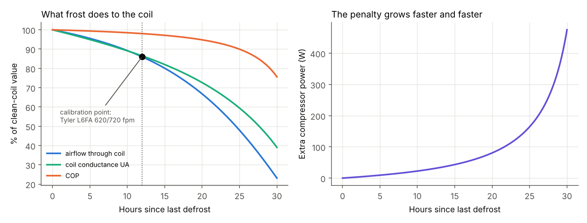
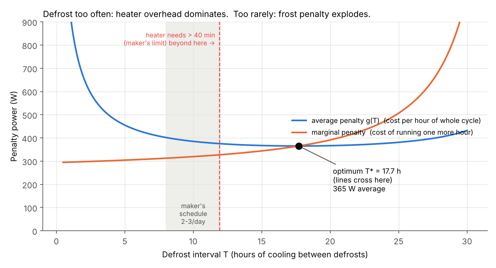
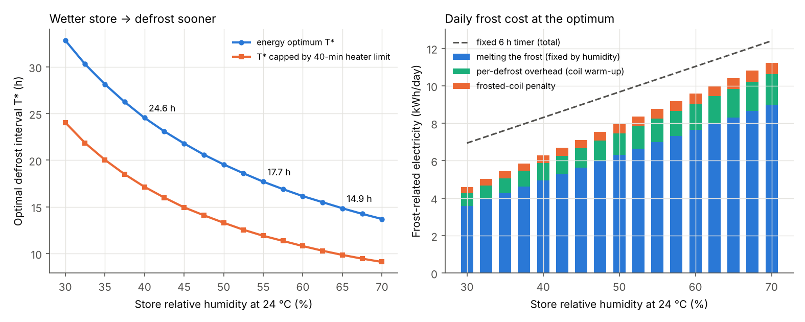
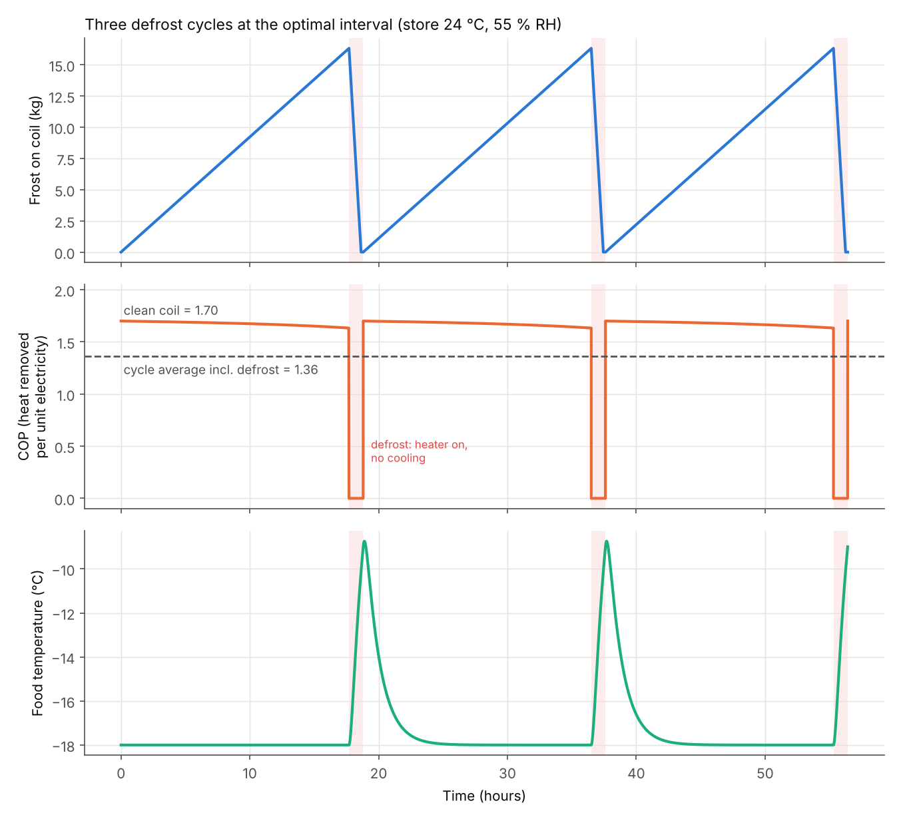
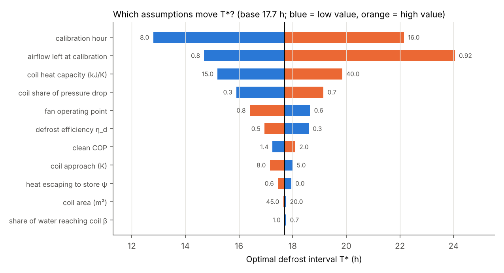

# T04: Frost on the coil and the best time between defrosts

*Research and modelling memo for the HiMCM 2026 Problem B team (Task 1, the freezer case). This memo is for the team to learn from. It is not paper text: rewrite it in your own words.*

Code: `sprint_out/code/T04_frost_model.py`. Its full printed output is in `sprint_out/code/T04_output.txt`.
Figures: `sprint_out/figs/T04_*.png`.

---

## 0. The answer in five lines

1. Store air that falls into an open freezer case carries water. The coil is far colder than the frost point, so the water lands on it as ice. For our base case (a 2.5 m case in a store at 24 °C and 55 % RH) that is about **0.92 kg of frost per hour, or 22 kg per day** (model result, Section 2).
2. Frost harms the coil in two ways. It **blocks airflow**, because it fills the gaps between the fins. It also **insulates the coil**, because frost is mostly trapped air. To keep the food cold, the machine has to run its coil colder, and its COP (heat moved per unit of electricity) falls.
3. If energy were the only concern, the **best defrost interval would be T\* ≈ 18 h** (about 1.3 defrosts per day). In practice the heater cannot melt that much frost within the maker's 40-minute limit. The **practical optimum is therefore T ≈ 12 h (2 per day)**, which matches the maker's own recommendation of 2–3 per day. The cost curve has a very flat bottom: any interval from 13 to 23 h is within 2 % of the minimum.
4. **The wetter the store, the sooner you must defrost.** Going from 40 % to 55 % to 65 % RH moves T\* from 24.6 h to 17.7 h to 14.9 h. The heater-limited interval moves from 17 h to 12 h to 10 h. T\* is almost exactly inversely proportional to how fast frost grows, so the rule becomes **"defrost when about 16 kg of frost is on the coil", whatever the humidity**.
5. **The sawtooth is mostly the defrost "teeth", not the slow slope.** Between defrosts the COP slides only 2–4 % (1.70 to 1.67 at 12 h, to 1.63 at 18 h). Averaged over a whole cycle, defrosts included, the effective COP is **about 1.36, which is 20 % below the clean-coil figure**.

---

## 1. Why water becomes frost, and why frost hurts (plain words)

**Air carries invisible water.** We describe this with the *humidity ratio* W: grams of water vapour per kilogram of dry air. Warm air can hold much more than cold air. The team's psychrometric code (`himcm_b/core.py`, which uses the ASHRAE saturation formula) gives:

- store air at 24 °C and 55 % RH: **W = 10.24 g/kg** [VERIFIED: computed with `core.py`, ASHRAE Hyland–Wexler]
- case air at −18 °C and 90 % RH: **W = 0.82 g/kg** [ASSUMED: the team's case condition]

**Why it becomes ice rather than water.** Cool any surface below the *frost point* of the air touching it and water vapour leaves the air. If the surface is below 0 °C, the vapour turns straight into ice crystals (the same process that puts frost on a car windscreen on a clear night). The evaporator coil (the finned radiator inside the case where the refrigerant boils) sits at about −24 to −29 °C. It is the coldest thing in the case, so almost all the water ends up there. Tyler's open frozen-food case lists a suction temperature of −20 °F (−28.9 °C) with air entering the coil at −10 °F (−23.3 °C) [VERIFIED: Tyler L6FA manual, p. 4]. Frosting happens "whenever the surface temperature of the evaporator is below 0 °C and humid air passes by" [VERIFIED: Cai, Stoustrup & Rasmussen 2008, §2.3].

**Why frost hurts. There are two separate effects:**

1. **It blocks the air path.** A coil is a stack of thin metal fins a few millimetres apart, with a fan pushing air through the gaps. As frost thickens, the gaps narrow. The fan then delivers less air, and this effect speeds up as the gaps close. Frost "substantially reduces the airflow through heat exchangers… several hours later, the airflow path may be nearly or completely blocked" [VERIFIED: Cai et al. 2008, §4.1, citing Chen et al. 2003]. Measured on a real case: in Tyler's open frozen-food case the main (primary) air jet moves at **620 fpm before defrost and 720 fpm after**, so the airflow is about 14 % lower just before a defrost [VERIFIED: Tyler L6FA manual, p. 13].
2. **It insulates.** Frost is a lacy network of ice with air trapped inside. Its thermal conductivity (about 0.1–0.4 W/m·K, depending on density) is hundreds of times lower than aluminium's. A frost layer is like putting a thin sweater on the coil. Frost "increases the thermal resistance between the fin and airflow" [VERIFIED: Cai et al. 2008, §4.1].

**What the machine does about it.** The case still needs the same cooling. With less air and a worse heat path, the refrigerant must boil at a colder temperature to push the same heat across. A colder evaporator makes the compressor work harder for each kW of heat it moves, so COP falls [VERIFIED as a mechanism: Cai et al. 2008, §5.1, Figs. 5–6]. Removing the frost costs energy too: heaters melt it off, and the warmth they leave behind must be pumped out again. That is the trade-off this memo optimises.

---

## 2. The frost stock-and-flow model (the ODE)

**Plain words.** Think of the coil as a bucket. Water flows in at a rate set by how much air falls into the case and how much wetter that air is than the case air. Nothing flows out until we defrost, and then the bucket is emptied.

**Equation** (the same form as Cai et al. 2008, their eq. 6 [VERIFIED]):

$$\frac{dm_f}{dt} = \beta \,\dot m_{inf}\,\big(W_{store}(t) - W_{case}\big)$$

| Symbol | Meaning | Units | Base value |
|---|---|---|---|
| m_f | frost mass on the coil | kg | 0 just after a defrost |
| t | time since the last defrost ended | h | — |
| ṁ_inf | mass of store air entering the case through the air curtain | kg/s (×3600 for kg/h) | 0.0272 kg/s [ASSUMED: from the team's 2.5 kW, 75 % infiltration, `freezer.py`] |
| W_store, W_case | humidity ratio of store air and case air | kg water / kg dry air | 0.01024 and 0.00082 |
| β | share of the incoming water that freezes onto the coil, not onto food or shelves | – | 1.0 [ASSUMED. Tested at 0.7; it hardly changes T\*, see §8] |

**Worked example.** dm_f/dt = 1 × 0.0272 kg/s × (0.01024 − 0.00082) × 3600 s/h = **0.922 kg/h**. After 12 hours that is 11.1 kg of ice, about a full bucket of water [model output].

**Intuition.** The frost grows in a straight line while the store's humidity is constant. It becomes a real differential equation, one we have to integrate, when W_store changes hour by hour (door traffic, weather, the store's air conditioning). The code does this with `scipy.integrate.solve_ivp` and a day/night humidity profile (§6.4). This confirms the team's timescale argument that frost deserves an ODE. The cycle length is different, though (see §10, contradiction 1).

**Is 22 kg of ice per day believable?** A US energy-audit patent estimates the ice per defrost in exactly this way: the case's daily latent (moisture) load divided by the number of defrosts per day [VERIFIED: US Patent 6,968,295, "Method of and system for auditing the energy-usage of a facility"]. The energy check in §4 also comes out consistent with published defrost efficiencies. The one maker's frost figure found is for a *covered* freezer: Hussmann's glass-walled, lidded island FWGH-L is rated at **"Defrost Water 0.5 lb/ft/day (0.7 kg/m)"**, rated at a 75 °F / 55 % RH store [VERIFIED: Hussmann FWGH-L data sheet, 2016, p. 2]. Our open multideck makes 22.1/2.5 = 8.8 kg/m/day, about **13 times more**. That is the right direction and a plausible size for an open front versus glass lids, but it is not a validation. No measured frost mass for an *open* low-temperature case was found [say this plainly in the paper].

---

## 3. From frost to lost efficiency

This is the chain: **frost mass → blocked fraction → airflow and coil conductance → evaporating temperature → COP → extra power**.

### 3.1 Blocked fraction
$$b = \frac{m_f}{m_{cap}}, \qquad \sigma = 1-b$$
- b is the share of the open fin-gap volume filled with frost and σ is the share still open (both without units). m_cap (kg) is the frost mass that would completely fill the gaps.
- **Calibration (our one fitted number).** m_cap is chosen so that airflow falls to 620/720 = 86 % after a 12 h cycle at the maker's rating condition of 75 °F / 55 % RH (Tyler rates the case at 75 °F & 55 % RH, "absolute maximum") [VERIFIED: Tyler L6FA p. 4. ASSUMED: that the "before defrost" velocity applies after 12 h, the longer recommended interval]. The result is **m_cap = 31.4 kg**.
- **Plausibility check.** With an assumed coil air-side area of 30 m² and a 6.2 mm fin gap (4 fins per inch) [ASSUMED: typical display-case coil, no source found], 31.4 kg fills the gaps at a frost density of **338 kg/m³**. Forced-convection frost has 300–500 kg/m³, while fluffy natural-convection frost has 10–50 kg/m³ [VERIFIED: Kandula, NASA, "On the Effective Thermal Conductivity of Frost…", citing Brian et al. 1969 and Coles 1954]. So the calibration lands in a physical range.
- **Warning about a textbook correlation.** Hayashi et al. (1977) give ρ_f = 650·exp(0.227·T_s) with T_s in °C, valid only for −18.6 < T_s < −5 °C [VERIFIED: Kandula, NASA "Correlation of Water Frost Porosity…", eq. 4]. Hermes et al. (2013, COBEM) print the exponent as 0.277, so one of the two sources has a typo [VERIFIED discrepancy]. A freezer coil at about −25 °C is outside that range, and plugging −20 °C in gives about 7 kg/m³, which is far too low. **Do not use Hayashi for a freezer coil.** That is why we calibrate instead.

### 3.2 Airflow: where the fan meets the coil
$$\Delta p_{fan} = \Delta p_{max}\Big(1-\tfrac{V^2}{V_{max}^2}\Big), \qquad \Delta p_{system} = R_0\Big[(1-r_c) + \tfrac{r_c}{\sigma^2}\Big]V^2$$
- V is the air volume flow (m³/s) and Δp is pressure (Pa). r_c is the coil's share of the clean system's resistance: 0.5 [ASSUMED]. The clean operating flow is 70 % of the fan's free-delivery flow [ASSUMED].
- The fan settles where the two pressures are equal. As σ shrinks, the coil term r_c/σ² grows, and the flow drops faster and faster. This is the qualitative behaviour shown in Cai et al. 2008, Fig. 4 [VERIFIED qualitatively].
- **Worked example (12 h).** b = 11.1/31.4 = 0.353, so σ = 0.647, which gives airflow = 86.0 % of clean (this is the calibration point).

### 3.3 Coil conductance
$$\frac{1}{UA} = \frac{1}{UA_0}\Big(\frac{V_0}{V}\Big)^{0.6} + \frac{\delta}{k_f A}, \qquad \delta = b\,\frac{g}{2}$$
- UA (kW/K) measures how well the coil passes heat. The clean value is UA₀ = 0.687 kW/K, from a 6 K coil approach and a 4 K air temperature drop [ASSUMED: approach ≈ Tyler's 5.6 K]. The exponent 0.6 is the usual way the air-side coefficient scales with flow [ASSUMED]. δ is the frost thickness (m), g the fin gap (m), A the air-side area (m²). k_f is the frost conductivity from Yonko & Sepsy (1967): k_f = 0.024248 + 0.731×10⁻³ρ + 0.1183×10⁻⁵ρ² W/m·K, valid for ρ < 573 kg/m³ [VERIFIED: quoted in Kandula, NASA, eq. 1b]. At ρ = 338 this gives k_f = 0.41 W/m·K.
- **Worked example (12 h).** δ = 0.353 × 3.1 mm = 1.09 mm. The frost resistance is 0.00109/(0.41×30) = 0.09 K/kW. The air resistance is 1.456 × 0.86^−0.6 = 1.59 K/kW. So UA = 1/(0.09 + 1.59) = 0.594 kW/K, which is **86.5 % of clean**.

### 3.4 Evaporating temperature and COP
$$\varepsilon = 1-e^{-UA/(\dot m_a c_p)}, \qquad T_e = T_{case} - \frac{Q}{\varepsilon\,\dot m_a c_p}, \qquad COP = \eta_{II}\,\frac{T_e+273.15}{T_{cond}-T_e}$$
- ε is the coil effectiveness (no units). ṁ_a is the airflow through the coil (kg/s). c_p = 1.006 kJ/kg·K. Q = 2.5 kW is the cooling load. T_cond = 35 °C. η_II is the "second-law efficiency", meaning how close the machine gets to the ideal Carnot machine. It is held constant at 1.7/4.22 = 0.403 so that COP = 1.7 when the coil is clean [ASSUMED: team's COP. The Carnot COP at the −24 °C evaporating temperature is 4.22].
- **Worked example (12 h).** NTU = 0.594/(0.621×0.86×1.006) = 1.105, so ε = 0.669. Then T_e = −18 − 2.5/(0.669×0.537) = **−24.96 °C** (0.96 K colder than clean). COP = 0.403 × 248.2/60.0 = **1.666**. Extra power is ΔP = 2.5/1.666 − 2.5/1.700 = **30 W**.
- **Intuition.** Each 1 K colder evaporator costs about 3–4 % more compressor power. Frost costs little at first, but because the airflow collapses, the penalty climbs steeply (Fig. 2).

*Fig. 2. Left: airflow, coil conductance and COP against hours since defrost (base case). The dot is the one calibration point. Right: the extra compressor power climbs slowly, then explodes as the fin gaps close.*

| Hours since defrost | Frost (kg) | Airflow | UA | T_e (°C) | COP | Extra power |
|---|---|---|---|---|---|---|
| 4 | 3.7 | 96.6 % | 96.0 % | −24.23 | 1.692 | 7 W |
| 8 | 7.4 | 92.0 % | 91.6 % | −24.54 | 1.681 | 17 W |
| 12 | 11.1 | 86.0 % | 86.5 % | −24.96 | 1.666 | 30 W |
| 16 | 14.8 | 77.8 % | 80.3 % | −25.58 | 1.645 | 49 W |
| 20 | 18.4 | 66.8 % | 72.6 % | −26.59 | 1.612 | 81 W |
| 24 | 22.1 | 52.2 % | 62.5 % | −28.47 | 1.552 | 140 W |

---

## 4. What one defrost costs

**Plain words.** A low-temperature case usually defrosts with **electric heaters** on the coil ("for low temperature applications, electric defrost is the most commonly used" [VERIFIED: Cai et al. 2008, §2.3]). The heater must warm the cold metal and the ice, and then melt the ice. Much of its heat misses the frost and warms the case, the food and the air. Afterwards the compressor has to pump that heat back out. The food also warms up while the cooling is off.

$$E_{heat} = \frac{C_{coil}(T_{term}-T_e) + m_f\,(c_{ice}\,(0-T_e) + h_{if})}{\eta_d}$$
$$E_{recool} = \frac{C_{coil}(T_{term}-T_e) + (1-\psi)(1-\eta_d)E_{heat}}{COP_0}, \qquad E_{def} = E_{heat}+E_{recool}$$

| Symbol | Meaning | Value |
|---|---|---|
| P_h | heater power | 5.4 kW [VERIFIED amps: Tyler L6FA 8 ft = 15.0 A, 208 V, "3 PH"; ASSUMED: P = √3·V·I. If you read it as single-phase, P = 3.1 kW. Then the model's 40-min limit would be reached after only ~6 h, which contradicts the maker's 2–3 per day at 40 min, so the 3-phase reading is the self-consistent one] |
| C_coil | heat capacity of the coil metal | 25 kJ/K [ASSUMED: ~30 kg of aluminium and copper] |
| T_term | heater shuts off when the coil reaches this temperature | 55 °F = 12.8 °C [VERIFIED: Tyler L6FA] |
| h_if, c_ice | latent heat of melting; specific heat of ice | 334 kJ/kg; 2.05 kJ/kg·K [standard values] |
| η_d | defrost efficiency: share of heater energy that reaches coil + frost | 0.40 [ASSUMED. Published values found: 30.3 % and up to ~48 %, but for household refrigerators (Purdue IRACC paper 1182 and a heater study), not display cases] |
| ψ | share of the stray heat that escapes to the store rather than being re-cooled | 0.3 [ASSUMED. L6FA fans keep running during electric defrost (manual p. 6), so some warm air spills out] |
| t_down | heater time E_heat/P_h plus a drip time of 10 min | [VERIFIED drip: Hillphoenix O2DMZD, 8–10 min run-off] |

**Worked example (12 h cycle, 11.1 kg of frost, T_e = −24.96 °C).**
Coil: 25 × (12.8 + 24.96) = 944 kJ. Frost: 11.1 × (2.05×24.96 + 334) = 4276 kJ. Heater: (944 + 4276)/0.4 = 13 050 kJ = **3.62 kWh**, which takes 13 050/5.4 = 40.3 min of heater time. Re-cool: (944 + 0.7×0.6×13 050)/1.7 = 3780 kJ = **1.05 kWh**. Total **E_def = 4.67 kWh per defrost**.

**Check against the real case.** Tyler gives the L6FA electric defrost as 2–3 per day, 40 min (spec sheet p. 4; the chart on p. 12 says 35 min) [VERIFIED. Note that the manual contradicts itself]. Our model needs 40 min for a 12 h cycle at the rating condition, so it reproduces the maker's numbers without being tuned to them. In this example, frost melting uses 4276/13 050 = **33 % of the heater's energy**, inside the published 30–48 % range [VERIFIED range, household fridges].

**Two kinds of defrost cost (this matters for the optimum).**
- **Fixed per defrost:** warming and re-cooling the coil metal, K ≈ **0.97 kWh** each time, however little frost there is.
- **Per kg of frost:** melting it plus re-cooling the stray heat, **0.334 kWh per kg**. Over a day this depends only on how much water came in, not on how often you defrost.

---

## 5. The optimal interval: a renewal-reward problem

### 5.1 Setting it up
Each cycle (cool for T hours, then defrost for t_down) repeats identically. Probability and economics call this a *renewal process*, and the cost of a repeating cycle is judged by its **average cost per hour**:

$$g(T) = \frac{E_{def}(T) + \int_0^T \Delta P(t)\,dt}{T + t_{down}(T)} \quad [\text{kW}]$$

- The numerator is everything one cycle costs on top of a clean, frost-free machine: the defrost energy plus the extra compressor energy wasted while frost built up (the area under the curve in Fig. 2, right).
- The denominator is the cycle length.
- This is the same mathematics as the classic "when should I replace a machine that is wearing out?" problem.

### 5.2 The optimality condition, derived in plain words
Setting dg/dT = 0 and rearranging gives

$$\underbrace{\frac{d}{dT}\Big[E_{def}(T) + \int_0^T\Delta P\,dt\Big]\Big/\frac{d}{dT}\big[T+t_{down}\big]}_{\text{marginal cost rate: what one more hour costs}} \;=\; \underbrace{g(T^*)}_{\text{average cost rate so far}}$$

**Meaning.** It works like your grade average. A new test score below your average pulls the average down, and one above pulls it up. Each extra hour without defrosting "scores" the extra power the frost is wasting *right now*, plus the melting energy that hour's frost will need later. While that hourly cost is below the cycle's average cost per hour, carrying on lowers the average. Once it rises above the average, every extra hour drags the average up, so **defrost now**. At T\* the two are equal, which is where the two lines cross in Fig. 3.

**The neat simplification.** The melting cost per kg is the same whatever T you pick, so it adds the same amount to both sides and cancels (apart from a small effect through t_down). If we ignore t_down, the condition becomes

$$\Delta P(T^*)\cdot T^* - \int_0^{T^*}\Delta P\,dt = K$$

In words: **defrost when the gap between the rectangle ΔP(T)·T and the area under the ΔP curve equals the fixed defrost overhead K.**

**A hand-calculable toy version.** If the penalty grows like ΔP = b·t² (a fair fit up to about 16 h), then (2/3)·b·T³ = K and

$$T^* = \Big(\frac{3K}{2b}\Big)^{1/3}.$$

Worked example: K = 0.97 kWh = 970 Wh, and b = 29.6 W/(12 h)² = 0.206 W/h². So T\* = (3×970/(2×0.206))^{1/3} = (7063)^{1/3} = **19.2 h**. The full model gives 17.7 h. If the penalty grew in a straight line instead (ΔP = a·t), you would get T\* = √(2K/a). That is the same square-root rule as the "economic order quantity" in operations research.

### 5.3 Results (base case, 24 °C / 55 % RH)

*Fig. 3. Blue: the average penalty g(T). Orange: the marginal penalty. The optimum is where they cross. The grey band is the maker's schedule (2–3 per day). The red dashed line marks where the heater would need more than its 40-min limit.*

| Interval T | Defrosts/day | Melting (kWh/day) | Overhead | Frost penalty | **Total (kWh/day)** | Heater on | Frost (kg) |
|---|---|---|---|---|---|---|---|
| 6 h (conservative timer) | 3.66 | 6.73 | 3.50 | 0.12 | **10.35** | 24 min | 5.5 |
| 8 h | 2.77 | 6.81 | 2.67 | 0.17 | **9.64** | 29 min | 7.4 |
| 12 h (maker, 2/day) | 1.87 | 6.90 | 1.82 | 0.28 | **9.00** | 40 min | 11.1 |
| **17.7 h = T\*** | 1.28 | 6.98 | 1.27 | 0.51 | **8.77** | 56 min | 16.3 |
| 24 h | 0.94 | 7.10 | 1.00 | 0.93 | **9.04** | 75 min | 22.1 |

For comparison, the clean-coil compressor uses **35.3 kWh/day**. All numbers are model outputs.

- **Unconstrained optimum: T\* = 17.7 h, with an average penalty of 365 W.** Check: at T\* the marginal rate is 365 W and the average is 365 W.
- **Flat bottom:** every T from 12.8 to 22.9 h is within 2 % of the minimum. Precision does not matter much; avoiding very short intervals does.
- **Heater limit:** beyond T = 11.9 h the heater would need more than 40 min. With that limit, **the best you can do is about 12 h (2 per day), costing only 2.8 % more than the unconstrained optimum.** This independently reproduces the maker's 2–3 per day. Read it as a validation of the model, not as proof.
- **Most of the frost bill cannot be fixed by timing.** About 7 kWh/day (≈ 80 %) is the melting of water that came in anyway. Choosing T only moves the overhead and the frost penalty. Going from a 6 h timer to T\* saves 1.6 kWh/day, which is 15 % of the frost-related electricity but only 3.5 % of the case's total electricity (35.3 + 10.35 → 35.3 + 8.77).

**Comparison with the literature.** For a *medium-temperature* case, Cai et al. found an energy-optimal interval of 5–6 h. They also showed that a timer set for 20 °C / 50 % RH, when the store was at 25 °C, wasted 126 % extra energy on the defrost-related part [VERIFIED: Cai et al. 2008, §5.4, §6. Their "daily energy" counts only defrost + extra energy, and their absolute kJ figures look very small, so do not quote those]. Da Silva & Hermes (2018) confirm that an optimal runtime exists. They find it **gets shorter when inlet-air relative humidity rises or heater power rises**, and longer with more coil surface [VERIFIED: abstract, Int. J. Refrig. 89:142–148]. Our model shows the same humidity direction.

---

## 6. How T\* and energy change with store humidity

*Fig. 4. Left: the optimal interval against store RH at 24 °C (blue), and the same optimum with the 40-min heater cap (orange). Right: daily frost-related electricity at the optimum, split into its parts. The dashed line is a fixed 6 h timer.*

| Store RH (24 °C) | Frost rate | T\* (energy) | T (heater-capped) | Penalty at T\* | Clean compressor |
|---|---|---|---|---|---|
| 30 % | 0.46 kg/h | 32.9 h | 24.1 h | 4.60 kWh/d | 29.6 kWh/d |
| 40 % | 0.65 kg/h | 24.6 h | 17.2 h | 6.28 | 31.9 |
| 45 % | 0.74 kg/h | 21.8 h | 15.0 h | 7.11 | 33.0 |
| 55 % (base) | 0.92 kg/h | 17.7 h | 11.9 h | 8.77 | 35.3 |
| 65 % | 1.11 kg/h | 14.9 h | 9.9 h | 10.41 | 37.6 |
| 70 % | 1.20 kg/h | 13.7 h | 9.1 h | 11.22 | 38.8 |

### 6.1 The scaling law (non-obvious)
On a log-log plot, **T\* ∝ (frost rate)^−0.93**. In other words, T\* is almost inversely proportional to how fast frost grows. The optimal frost load at defrost hardly moves: **m\* ≈ 15–16.5 kg at every humidity** (exponent +0.07). This is because the airflow collapse makes the penalty depend sharply on *how much frost is on the coil* rather than on the clock. In the toy model with ΔP ∝ mⁿ you get m\* ∝ r^{1/(n+1)}, which is close to constant when n is large.
**Practical meaning:** "defrost every X hours" is the wrong kind of rule. "Defrost when the coil carries ~16 kg of frost" (in practice: when the airflow or the coil pressure drop reaches a set level) is close to optimal in every season. This matches Cai et al.'s finding that one average optimal frost-thickness threshold loses less than 4 % against the true optimum [VERIFIED: Cai et al. 2008, §3.1].

### 6.2 Every kg of water is paid for twice
- Freezing it **onto** the coil: the compressor removes 2835 kJ/kg at COP 1.7, which is **0.463 kWh/kg**. This is the "latent load" the team already counts.
- Melting it **off**: heater plus re-cooling, **0.334 kWh/kg**. This is **72 % on top** of the latent cost, and the team's current model leaves it out.

So the true electricity cost of moisture is about 1.7 times the latent load alone.

### 6.3 Link to the store's front door
The team found that door traffic makes the store more humid. Example: the door raises store RH from 45 % to 55 %.
- Clean compressor: 33.0 → 35.3 kWh/day (+7 %).
- Frost-related: 7.11 → 8.77 kWh/day (+23 %).
- **Total case electricity: 40.1 → 44.1 kWh/day (+10 %).** The defrost channel makes the door's effect about 1.4 times what a compressor-only model shows.

**Field cross-check (order of magnitude only).** Henderson & Khattar measured about 10 kWh/day of store refrigeration energy per 1 % RH (Store B, Indianapolis), and about 12–15 kWh/day per % RH once anti-sweat heaters are included [VERIFIED: OSTI abstract 20002333, ASHRAE Trans. 105(1), 1999]. Our model gives about 0.23 (compressor) + 0.17 (frost) ≈ **0.40 kWh/day per % RH for one 2.5 m freezer case**. So their measured store-level figure equals about 25 of our cases, which is plausible for a supermarket. This is a consistency check, not a validation. Tassou & Datta found that store RH affects the frosting rate "much more" than store temperature does, and that fixed-time defrost can be too frequent or too rare depending on RH [VERIFIED: IIR abstract, ASHRAE Trans. 1999].

### 6.4 Timers versus demand defrost
- **Across seasons.** A timer set for a humid summer (65 %: T = 14.9 h) used in a dry winter (30 % RH) costs 5.09 instead of 4.60 kWh/day (+11 %). A cautious worst-case 6 h timer costs **6.94 instead of 4.60 kWh/day (+51 %)**. The maker's sheets say schedules are "based on worst case conditions" and set at commissioning [VERIFIED: Cai et al. 2008, §2.4].
- **Within a day.** We modelled the store as 60 % RH while open (08:00–22:00) and 40 % RH at night [ASSUMED profile], with the ODE stepped hour by hour over 60 days. Results: 6 h timer 9.88 kWh/day; 12 h timer 8.51; timer at T\* 8.16; demand defrost at 16 kg 8.11 (the best threshold). Because a ~20 h cycle already spans day and night, daily swings average out. **Demand defrost pays off mainly across seasons and weather, not within a day.**

---

## 7. "Cooling efficiency is a sawtooth, not a single number": what the model says

*Fig. 1. Three cycles at T\* (base case). Top: frost builds linearly and is melted off. Middle: COP slides slowly, then drops to zero during each defrost (heater on, no cooling). The dashed line is the cycle-average effective COP. Bottom: an indicator of food temperature (see the caveat below).*

- **The slope of the saw is gentle.** COP falls by 2 % (at 12 h) to 3.9 % (at 17.7 h) between defrosts.
- **The teeth are what matter.** Counting heater and re-cool electricity, the effective COP over a full cycle is
  - 1.315 with a 6 h timer,
  - 1.355 at 12 h,
  - 1.362 at T\*,
  - against **1.70 for a clean coil, i.e. about 20 % lower.**
- **So the claim needs refining.** It is true that efficiency is not a single number. But the useful number is the **cycle average**, and it sits well below the clean-coil COP. A single steady-state COP (the team's 1.7) overstates real efficiency by about a quarter (1.70/1.36 = 1.25). For our paper, the efficiency of a freezer case should be **defined over a full defrost cycle** (or a whole day). That is what regulators already do: the US DOE test procedure for commercial refrigeration (via ASHRAE 72) runs a 24-hour test that must include a full defrost cycle [VERIFIED: DOE AHT waiver notice, energy.gov, citing 10 CFR 431.63(d)(1) and ASHRAE 72-2005].
- **Food temperature (indicator only).** The heater runs longer when it has more frost to melt, so each defrost warms the food more: +4.7 K (6 h interval), +7.1 K (12 h), +9.1 K (18 h). These figures come from the team's lumped food model (τ = 67 min) and an assumed case air rising towards −2 °C with a 10-min time constant during defrost [ASSUMED. No measured profile found]. The absolute values are uncertain and probably too high for the centre of a pack. The direction is solid: **longer intervals mean fewer but bigger warm-ups.** Cai et al. found energy and food quality pulling in opposite directions (energy optimum 5 h, quality optimum 11 h, medium-temperature case) [VERIFIED: Cai et al. 2008, §5.4]. Which direction wins for frozen food needs a quality model we do not have.

---

## 8. Sensitivity: which assumptions matter?

*Fig. 5. One-at-a-time ranges for every assumed parameter, showing the effect on T\* (base 17.7 h).*

- **The calibration dominates.** Which hour the 620/720 airflow applies to (8 h or 16 h) moves T\* from 12.8 to 22.2 h. How much airflow is left at that point (80–92 %) moves it from 14.7 to 24.1 h. Coil heat capacity (15–40 kJ/K) moves it from 15.2 to 19.9 h.
- **Almost no effect:** β (the share of water reaching the coil), coil area, and ψ. This is because the calibration absorbs them: if less water reaches the coil, the fitted m_cap shrinks to match.
- **Monte Carlo** (400 draws, uniform over every range above): T\* has a median of 24.8 h at 40 % RH (5–95 % range: 16.1–35.8), 17.9 h at 55 % (11.6–25.9), and 15.0 h at 65 % (9.7–21.8). **The ratio T\*(40 %)/T\*(65 %) = 1.65, with a 5–95 % range of only 1.63–1.68.** The absolute interval is uncertain by about ±40 %, but *how it shifts with humidity* is very robust. The shift is the claim to put in the paper.

---

## 9. Validation and consistency checks performed

| Check | Result |
|---|---|
| Units | Every term in g(T) is kWh/h = kW. The frost rate is (kg/s)·(kg/kg)·(s/h) = kg/h. ✔ |
| Optimality condition holds numerically | Marginal rate 365 W = average rate 365 W at T\*. ✔ |
| Limiting cases | Dry store: frost rate → 0, so T\* → ∞ (never defrost). ✔ Zero overhead K → T\* → 0 (always defrost), as the formula says. ✔ |
| Heater time against the maker | Model 40 min at 12 h vs Tyler's 35–40 min at 2–3 per day. ✔ (not tuned) |
| Defrost efficiency | 33 % of heater energy melts frost, inside the 30–48 % published range (household). ✔ |
| Implied frost density | 338 kg/m³, inside the forced-convection range of 300–500. ✔ |
| Frost per metre against a maker's rating | Open case 8.8 kg/m/day vs Hussmann lidded island 0.7 kg/m/day. The direction is right (13×); the cases are not directly comparable. |
| Store-level humidity effect | ~0.4 kWh/day per %RH per case vs ~10 kWh/day per %RH per store. Plausible. |
| Toy formula against full model | 19.2 h vs 17.7 h. ✔ |

---

## 10. Contradictions with the shared context

1. **"Coil frost time constant ~6 h" is too short for a low-temperature case.** Makers specify 2–3 electric defrosts per day for an open frozen-food multideck (an 8–12 h interval) [VERIFIED: Tyler L6FA]. Covered or low-infiltration freezers are set to 1 per day [VERIFIED: Hillphoenix O2DMZD low-temperature island, 1 per day; Hillphoenix JNRZHSA glass-door, 1 per day, 46 min fail-safe; Hussmann FWGH-L lidded island, "Frequency (hours between defrost) 24"]. Our model gives 12–18 h at 55 % RH. A 5–6 h interval belongs to *medium-temperature* cases [VERIFIED: Cai et al. 2008]. The ODE argument still holds, just with a longer timescale.
2. **The 2.5 kW load for a 2.5 m open freezer case may be low.** The Tyler L6FA open frozen multishelf case is rated at **1742 Btu/h per ft**, which is 1.67 kW/m, or about **4.2 kW for 2.5 m** [VERIFIED rating, Tyler L6FA p. 4 (1999). It applies at the "absolute maximum" ambient of 75 °F / 55 % RH. Newer cases may be lower; not verified]. Every absolute number in this memo scales with that load.
3. **A single COP of 1.7 is not the case's efficiency.** Once defrost heaters and re-cooling are counted, the cycle-average COP is about 1.36 (−20 %). Defrost-related electricity is about 9 kWh/day against 35 kWh/day for the compressor. In `freezer.py`, defrost sits in a 13 % "lights, fans, defrost" *refrigeration load* bucket, but most of the defrost cost is *heater electricity*, which is a separate line.
4. **The door/humidity effect (+8–27 % on load) understates the effect on electricity.** Moisture is paid for twice (§6.2). In the 45 → 55 % example, electricity rises by 10 % while the compressor alone rises by 7 %.
5. **Carnot convention (a clarification, not an error).** The team's 4.8 uses −18 °C (the service temperature) as the cold side. Real evaporators run at −24 to −29 °C. Using −24 °C gives 4.22, and Tyler's −28.9 °C suction gives 3.82. Both conventions are defensible, but the paper must say which one it uses.

---

## (a) Key findings with numbers

1. Frost forms at about **0.92 kg/h (22 kg/day)** on a 2.5 m open freezer case at 24 °C / 55 % RH. Melting it off costs **0.33 kWh per kg**, which adds **72 %** to the latent cost of that moisture.
2. The energy-optimal defrost interval is **T\* ≈ 18 h**, with a flat bottom (13–23 h within 2 %). The heater's 40-min limit caps it at **≈ 12 h (2 per day)**, at only 2.8 % extra cost. This matches the maker's recommendation of 2–3 per day.
3. **T\* is roughly inversely proportional to the frost rate:** 24.6 h → 17.7 h → 14.9 h for 40 → 55 → 65 % RH, and the ratio T\*(40 %)/T\*(65 %) = 1.65 is robust (1.63–1.68). The best *frost load* at defrost is almost constant (~16 kg), so defrost should be triggered by frost, not by the clock.
4. Choosing the defrost interval well saves only about 1.6 kWh/day (6 h timer vs optimum: −15 % of the frost cost, −3.5 % of the case's total). Lowering store humidity is the bigger lever: 45 → 55 % RH adds 4 kWh/day per case (+10 %).
5. The efficiency "sawtooth" has a gentle slope (−2 to −4 % COP between defrosts) and deep teeth. The **cycle-average COP of about 1.36 is 20 % below the clean-coil COP of 1.70.**

## (b) Verified versus assumed

- **Verified (sourced):** Tyler L6FA open frozen case data (2–3 electric defrosts per day; 35–40 min; 55 °F termination; 15.0 A at 208 V for 8 ft; 1742 Btu/h/ft at 75 °F / 55 %; 620/720 fpm air before and after defrost; −20 °F suction / −10 °F air). Hillphoenix O2DMZD (1 defrost per day, 8–10 min run-off, 45 min fail-safe). Hussmann FWGH-L (24 h; 0.7 kg/m/day defrost water). The frost growth equation's form (Cai et al. 2008, eq. 6). Hayashi density correlation and its range; Yonko–Sepsy conductivity. Frost density ranges (Brian 1969 via Kandula). The existence of an optimum and its direction with RH (Zakrzewski 1984; Da Silva & Hermes 2018; Cai et al. 2008). Store RH effects (Henderson & Khattar 1999; Tassou & Datta 1999). DOE 24 h test including defrost.
- **Assumed:** the team's base case (2.5 kW, 75 % infiltration, COP 1.7, −18 °C / 90 % case air, 35 °C condensing). β = 1. Coil area 30 m² and fin gap 6.2 mm. Fan curve shape, r_c = 0.5, operating point 0.7. 6 K approach and 4 K air drop. h ∝ flow^0.6. η_d = 0.4 (literature values are for household fridges). ψ = 0.3. Coil heat capacity 25 kJ/K. That the 620 fpm reading applies after 12 h. The 3-phase power formula. The air temperature profile during defrost and the lumped food model. The day/night humidity profile. Constant second-law efficiency as T_e changes.
- **Not found:** any measured frost mass per defrost for an open low-temperature case, and any measured capacity-vs-time curve for such a case. Full texts of Da Silva & Hermes 2018, Tassou & Datta, and Henderson & Khattar were behind paywalls or blocked; only their abstracts were used.

## (c) Decisions the team must make

1. **Define freezer efficiency over a full defrost cycle (or 24 h), not at a single moment.** This is the recommendation; it matches DOE practice.
2. Decide whether to keep 2.5 kW or move to a source-backed ~4 kW for a 2.5 m case (contradiction 2).
3. Decide whether the paper presents the full chain of §3 or only the toy model of §5.2 (T\* = (3K/2b)^{1/3}) with the full model in an appendix. For a 25-page paper, the toy model plus Figs. 1 and 4 is probably enough.
4. Decide whether the defrost cost enters the Task 1 efficiency measure as a separate term ("energy spent undoing the moisture") or is folded into the cycle-average COP.
5. Decide whether to treat food temperature during defrost as a constraint (service quality) or leave it qualitative.

## (d) How this feeds the rest of the paper

- **Task 1 (what to include in freezer efficiency):** it justifies including (i) moisture, not just temperature, (ii) time-averaging over the defrost cycle, and (iii) food temperature excursions as a service-quality term. "Should efficiency depend only on energy use?" No: the defrost timing that saves energy also changes how warm the food gets.
- **The spine (actual temperature matters for food):** the defrost temperature spike is a case where *the food's actual temperature* is the service at stake.
- **Nested boundaries / door effect:** moisture from the door costs twice, through the compressor and through defrost (§6.2–6.3). That strengthens the team's best idea.
- **Task 4 (balancing performance, energy and cost):** defrost scheduling is a small, clean example of an optimisation with a Pareto trade-off (energy vs food warming) and a hard constraint (heater time).
- **Bus shelter and rail station:** evaporative coolers have no frost, but the same *renewal-reward* logic applies to pad cleaning and scaling, and to cleaning fan filters. Say this in one sentence; don't build it.
- **Guidelines and memo to the COO:** "Use demand defrost (by airflow or pressure drop) instead of a fixed timer; it saves up to ~1/3 of defrost-related energy in dry seasons. Store humidity matters more than the defrost schedule."

## (e) Weaknesses and open questions

- The degradation curve rests on **one calibration point** (620/720 fpm) and an assumed hour for it. Absolute T\* is uncertain by about ±40 %; the humidity *trend* is robust.
- In a supermarket **rack system**, many cases share one suction pressure, so a single case cannot lower its own evaporating temperature. Frost would then show up as a *capacity shortfall* (a warmer case and warmer food) rather than a COP loss. The model assumes COP loss, as in a stand-alone condensing unit.
- A weaker air curtain (lower discharge velocity as airflow falls) may *increase infiltration*. That would add a feedback (more frost leading to more frost) that the model ignores, and it would shorten T\*.
- Frost is not uniform: it builds faster on the front rows, which probably makes blockage happen sooner than our uniform-layer model predicts.
- Defrost efficiency η_d is taken from household-refrigerator studies.
- The food warming figures are an indicator only.
- Hot-gas defrost (3–4 per day, 22–25 min on the L6FA) would change the overhead K and therefore T\*. It was not modelled.

---

## Sources

1. Cai, J., Stoustrup, J., Rasmussen, B.D. (2008). *An Active Defrost Scheme with a Balanced Energy Consumption and Food Quality Loss in Supermarket Refrigeration Systems.* Proc. 17th IFAC World Congress, Seoul, pp. 9374–9379. doi:10.3182/20080706-5-KR-1001.1934. PDF: https://vbn.aau.dk/ws/files/56213490/ifacwc_2008_2.pdf (eq. 1, 6, 7; §2.3–2.4, §3.1, §5–6; Figs. 4–11).
2. Tyler Refrigeration (1999/2000). *L6FA Multi-Shelf Frozen Food Merchandiser, Installation & Service Manual.* https://www.hillphoenix.com/wp-content/uploads/2020/02/L6FA.pdf (p. 4 spec sheet; p. 12 defrost chart; p. 13 air velocities).
3. Hillphoenix. *O2DMZD Low Temp Island Merchandiser, technical reference sheet* (rev. 12-12-19). https://www.hillphoenix.com/wp-content/uploads/2019/05/O2DMZD-display-case-tech-reference-sheet-7.pdf
4. Hillphoenix. *JNRZHSA technical reference sheet* (low-temperature glass-door case). https://www.hillphoenix.com/wp-content/uploads/2019/05/JNRZHSA-display-case-tech-reference-sheet-11.pdf (1 defrost per day, 0 min run-off, 46 min fail-safe, 48 °F termination).
5. Hussmann (2016). *Excel FWGH-L Frozen Merchandiser Data Sheet* (wide island with glass walls and lids), P/N 0540997_E. https://www.hussmann.com/ns/Technical-Documents/0540997_E_FWGHL.pdf (p. 2: 280–310 Btu/h/ft; "Frequency (hours between defrost) 24"; "Defrost Water 0.5 lb/ft/day (0.7 kg/m)"; 8 ft electric defrost 15.38 A / 3200 W at 208 V; 60 min fail-safe).
6. Kandula, M. (NASA KSC, ~2011). *Correlation of Water Frost Porosity in Laminar Flow over Flat Surfaces.* https://ntrs.nasa.gov/api/citations/20110011501/downloads/20110011501.pdf (eq. 4: Hayashi correlation and its validity range).
7. Kandula, M. (NASA KSC). *On the Effective Thermal Conductivity of Frost Considering Mass Diffusion and Eddy Convection.* https://ntrs.nasa.gov/api/citations/20110001592/downloads/20110001592.pdf (eq. 1b: Yonko & Sepsy 1967; frost density ranges after Brian et al. 1969 and Coles 1954).
8. Hermes, C.J.L., Nascimento, V.S., Loyola, F.R. (2013). *A Dimensionless Correlation for the Frost Density.* COBEM 2013. https://www.abcm.org.br/anais/cobem/2013/PDF/564.pdf (eq. 1: Hayashi printed with 0.277; eq. 3: Hermes et al. 2009).
9. Da Silva, D.L., Hermes, C.J.L. (2018). *Optimal defrost cycle for air coolers revisited: a study of fan-supplied tube-fin evaporators.* Int. J. Refrig. 89:142–148, doi:10.1016/j.ijrefrig.2018.02.009 (abstract via IIR: https://iifiir.org/en/fridoc/optimal-defrost-cycle-for-air-coolers-revisited-a-study-of-141209). Conference version: Purdue IRACC 2018, https://docs.lib.purdue.edu/iracc/1839
10. Zakrzewski, B. (1984). *Optimal defrost cycle for the air cooler.* Int. J. Refrig. 7(1):41–45 (abstract via IIR: https://iifiir.org/en/fridoc/optimal-defrost-cycle-for-the-air-cooler-76897).
11. Henderson, H.I., Khattar, M. (1999). *Measured impacts of supermarket humidity level on defrost performance and refrigerating system energy use.* ASHRAE Trans. 105(1). Abstract: https://www.osti.gov/biblio/20002333
12. Tassou, S.A., Datta, D. (1999). *Influence of supermarket environmental parameters on the frosting and defrosting of vertical multideck display cabinets.* ASHRAE Trans. (abstract via IIR: https://iifiir.org/en/fridoc/influence-of-supermarket-environmental-parameters-on-the-frosting-and-18221).
13. US Patent 6,968,295. *Method of and system for auditing the energy-usage of a facility* (ice per defrost = daily latent load / defrosts). https://image-ppubs.uspto.gov/dirsearch-public/print/downloadPdf/6968295
14. Household defrost efficiency: Purdue IRACC paper 1182 (https://docs.lib.purdue.edu/iracc/1182) and a glass-tube heater study, ~30.3 % and up to ~48 % (seen via search snippets only; check full text before citing numbers).
15. US DOE, AHT petition for waiver notice (24-hour test with full defrost, ASHRAE 72-2005, 10 CFR 431.63). https://www.energy.gov/eere/buildings/articles/aht-petition
16. Clodic, D., Borlein, C., Zoughaib, A. (2005). *Defrosting of vertical low temperature open display case: what are the needed improvements?* IIR conference (abstract: heating wires in canopy, honeycomb and shelves waste energy during defrost). https://iifiir.org/en/fridoc/defrosting-of-vertical-low-temperature-open-display-case-what-are-the-22230

## Files

- `sprint_out/code/T04_frost_model.py`: the whole model (Case class; renewal-reward optimiser; humidity sweep; day/night ODE simulation; tornado; Monte Carlo). Runtime about 10 s.
- `sprint_out/code/T04_output.txt`: the printed numbers quoted above.
- `sprint_out/figs/T04_sawtooth.png`, `T04_degradation.png`, `T04_optimum.png`, `T04_humidity.png`, `T04_tornado.png`
- `sprint_out/dl_T04/`: downloaded source PDFs and text extracts (Cai 2008, Tyler L6FA, Hillphoenix O2DMZD, Kandula ×2, Hermes 2013).
