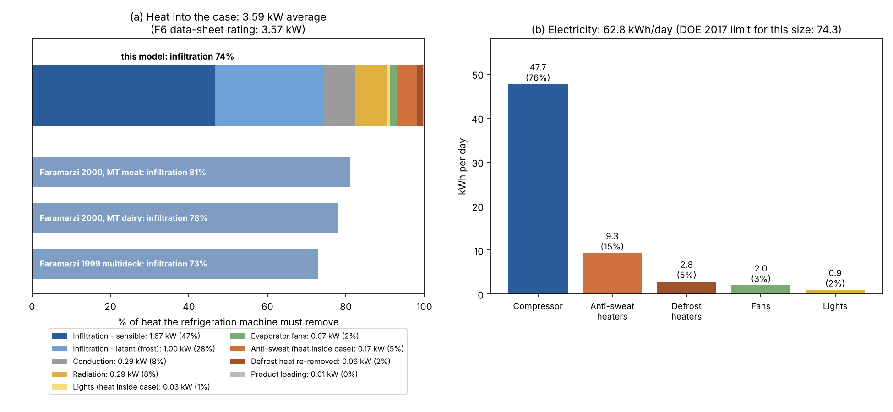
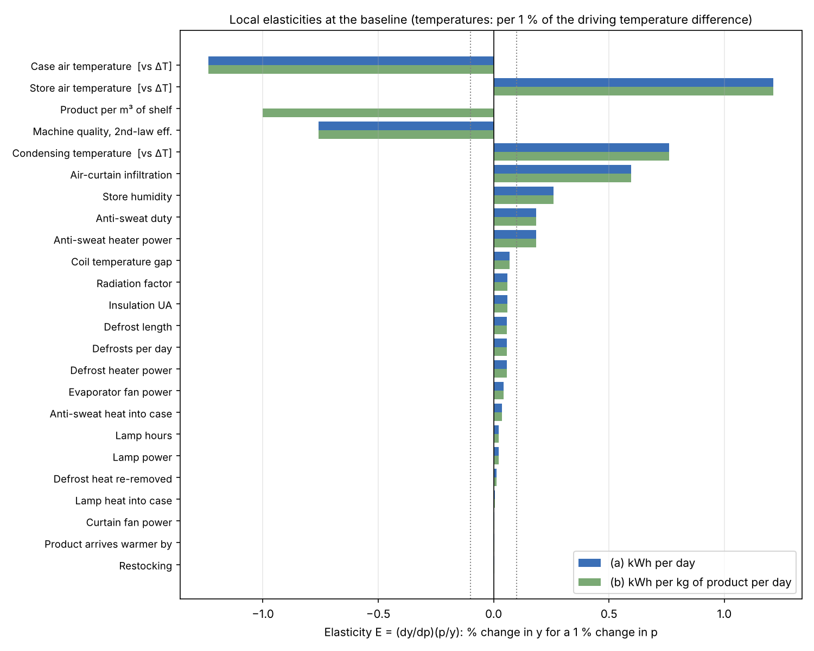
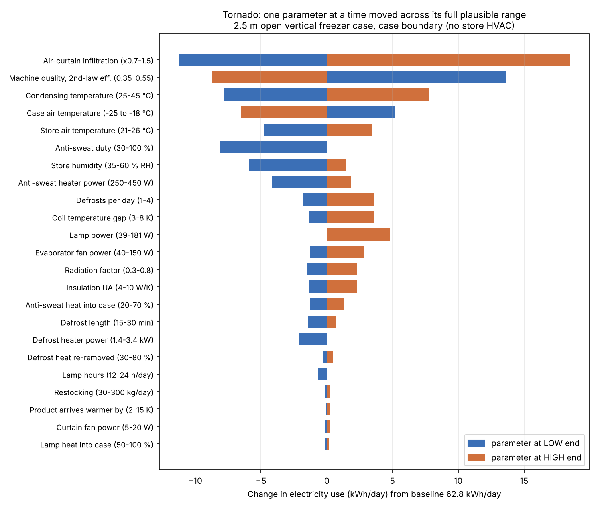
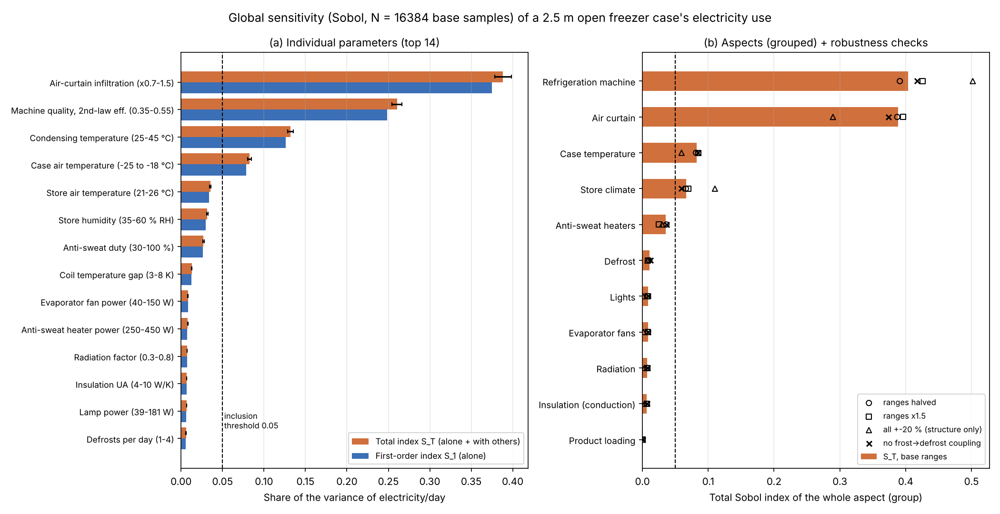
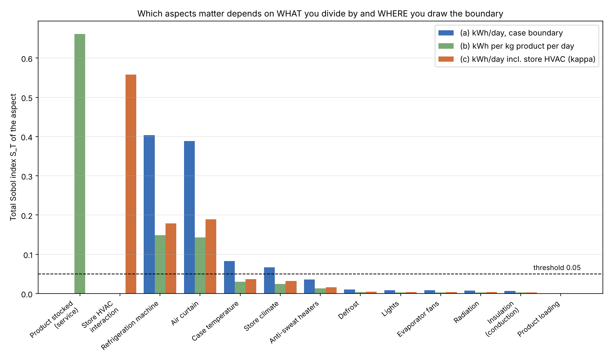

# T05: Which aspects of a freezer case belong in a cooling-efficiency measure?

*Research memo for the HiMCM 2026 Problem B team (Task 1). This is not paper text. Read it, check the sources, then rewrite it in your own words.*

**Files**
- Model: `sprint_out/code/T05_model.py`. Run `python3 T05_model.py` to print the baseline.
- Analysis: `sprint_out/code/T05_sensitivity.py`. It computes elasticities, the tornado, Sobol indices and robustness checks in about 35 s. The numbers it produces are saved in `T05_results.json`.
- Figures: `sprint_out/figs/T05_load_breakdown.png`, `T05_tornado.png`, `T05_elasticity.png`, `T05_sobol.png`, `T05_outputs_compare.png`.
- Downloaded sources: `sprint_out/dl_T05/` (the Hussmann data sheet, two ACEEE papers, and the extracted text of AHRI 1200-2023).

---

## 0. The answer in one paragraph

We built a heat-and-electricity budget for a real 2.5 m open freezer case, with no fitted parameters, and checked it against the manufacturer's rating. It reproduces the rated refrigeration load to within 1% (3.59 kW against 3.57 kW). It also reproduces the published infiltration share: 74%, where the literature reports 67–81%. We then varied all 25 inputs across ranges that each have a stated source or reason. **Four aspects explain about 94% of the variation in daily electricity use:**

1. the **refrigeration machine** (how good the compressor and condenser are);
2. the **air curtain** (how much warm store air leaks in);
3. the **case temperature setpoint**;
4. the **store's own air** (its temperature and humidity).

A fifth aspect, the **anti-sweat heaters**, is only a modest source of variation. It survives our rule anyway, because each 10% cut in heater use saves 1.9% of electricity. Insulation, radiation, lights, fans, defrost and restocking each explain less than about 1% of the variation, so they do not need their own terms in the measure.

The most useful finding is a different one. **Which aspects "matter" depends heavily on two choices the team makes: what you divide by, and where you draw the boundary.**
- Measure electricity per kg of food on the shelf, and how full the shelves are (a store habit, not a property of the case) explains 66% of the variation.
- Include the store's air conditioning or heating, and that single number explains 56%.

So the efficiency measure must fix those two choices first. Done properly, our sensitivity analysis independently rebuilds the structure regulators already use: electricity per m² of display area, at fixed store conditions, with the food held at a fixed temperature (U.S. DOE rules, using the AHRI 1200 rating method).

---

## 1. The case we model and why

The shared context speaks of a "typical 2.5 m open vertical low-temperature case". We anchored every hardware number to one real, current product: the **Hussmann Excel F6 Multi-Deck Frozen Food case**, which has six display levels and an air curtain. We used its 8-ft (2.448 m) model, scaled to 2.5 m. [VERIFIED: Hussmann Corp., *Excel F6 Technical Data Sheet*, P/N 0522419_H, Oct 2017, pp. 2–5. A local copy is in `dl_T05/hussmann_F6_datasheet.pdf`.] The sheet says the case meets the U.S. DOE 2017 efficiency standard.

Anchoring to one data sheet gives us a full, mutually consistent set of numbers from a single source:

| Quantity on the F6 sheet (8-ft model) | Value | Page |
|---|---|---|
| Discharge (curtain) air temperature | −8 °F = **−22.2 °C** | p. 3 |
| Evaporator (coil refrigerant) temperature | −16 °F = **−26.7 °C** | p. 3 |
| Refrigeration load (parallel rack) | **1,490 Btu/h per ft** → 3.57 kW for 2.5 m | p. 3 |
| Defrost | every **12 h**, electric, failsafe **30 min** | p. 3 |
| Defrost water (melted frost) | **8.2 lb per ft per day** (±15%) | p. 3 |
| Evaporator fans | 4 × 12 W = **72 W** | p. 4 |
| Air-curtain ("ambient") fans | **9 W** | p. 4 |
| Anti-sweat heaters, "constant on" | 180 W + 200 W = **380 W** | p. 4 |
| Defrost heaters (all elements) | **3,330 W** (U-shaped elements alone: 1,370 W) | p. 4 |
| Lights | LED canopy **38.6 W** … T8 fluorescent 2 rows + rail **177 W** | p. 4 |
| AHRI total display area (TDA) | **1.14 m² per m** → 2.85 m² (30.7 ft²) | p. 5 |
| Usable volume | **0.72 m³ per m** → 1.80 m³ | p. 5 |

---

## 2. The model, step by step

**In plain words:** heat leaks into the cold case through several routes. A refrigeration machine pumps that heat out, and the machine runs on electricity. Some electrical devices also sit inside or on the case: lights, fans, heaters that stop the case edges from sweating, and heaters that melt ice off the coil. These use electricity directly, and some of their heat also ends up inside the case, where the machine has to pump it out again.

### 2.1 Infiltration: store air leaking in through the air curtain

**Plain words.** The open front is "sealed" only by a sheet of cold air blowing downward. That sheet drags some warm, damp store air into the case. The machine must then do two jobs:
- cool that air down (the **sensible** load), and
- freeze its water vapour into frost on the coil (the **latent** load).

**Equations**

$$\dot Q_{inf,s}=\dot m_{inf}\,c_p\,(T_{store}-T_{DA}),\qquad \dot Q_{inf,l}=\dot m_{inf}\,(W_{store}-W_{DA})\,h_{sg}$$

| Symbol | Meaning | Unit |
|---|---|---|
| $\dot m_{inf}$ | mass of store air entering the case per second | kg/s |
| $c_p$ | heat needed to warm 1 kg of air by 1 K = 1.006 | kJ/(kg·K) |
| $T_{store}, T_{DA}$ | store air temperature, case discharge-air temperature | °C |
| $W$ | humidity ratio: kg of water vapour per kg of dry air | kg/kg |
| $h_{sg}$ | energy released when 1 kg of vapour turns straight into ice ≈ 2,834 kJ/kg (2,501 to condense + 333 to freeze) | kJ/kg |

Here $W_{store}$ is computed from temperature and relative humidity using the vapour-pressure formula over liquid water. $W_{DA}$ is the moisture that saturated air holds at −22 °C, computed with the formula over **ice**, because the coil is frosted. [VERIFIED: ASHRAE *Handbook – Fundamentals* 2017, ch. 1, eqs. 5 (ice) and 6 (water), Hyland–Wexler. The code gives 103.26 Pa over ice at −20 °C. ASHRAE's table value is about 103.2 Pa; we quoted that from memory, so re-check it against the handbook table.]

**How we get $\dot m_{inf}$ without guessing.** The F6 sheet tells us how much frost the coil collects: 8.2 lb/ft/day, which is **30.4 kg/day** for 2.5 m. Frost can only come from store air, so:

$$\dot m_{inf}=\frac{\text{frost per day}}{86{,}400\ \text{s}\times(W_{store}-W_{DA})}$$

**Worked example (baseline: store at 24 °C and 55% RH, which are the ASHRAE 72 test conditions).**
- $W_{store}$ = 0.01024, $W_{DA}$ = 0.00052, so ΔW = 0.00972 kg/kg (9.7 g of water per kg of air).
- $\dot m_{inf}$ = 30.4 / (86,400 × 0.00972) = **0.036 kg/s**. That is about 30 litres of store air per second.
- Sensible load = 0.036 × 1.006 × (24 − (−22.2)) = **1.67 kW**.
- Latent load = 0.036 × 0.00972 × 2,834 = **1.00 kW**.

**What this means:** per kg of store air the case swallows, about 46 kJ goes on cooling it and 27.5 kJ on freezing its water. **Moisture is 37% of the infiltration load.** This is a small but real factor: drying the store air is almost as valuable as cooling it.

### 2.2 Conduction through the insulated walls

**Plain words:** heat creeps through the foam walls, faster when the inside and outside temperatures are further apart.

$$\dot Q_{cond}=UA\,(T_{store}-T_{DA})$$

- $UA$ is how leaky the walls are, in W per K of temperature difference.
- Baseline UA = 6.25 W/K. [ASSUMED: about 50 mm of polyurethane foam with conductivity ≈ 0.023 W/(m·K) gives U ≈ 0.46 W/(m²·K), over roughly 6 m² of wall per metre of case length. The F6 sheet does not give insulation data.]

**Worked example:** 6.25 × 46.2 = 289 W = **0.29 kW**.

**What this means:** insulation is cheap and already good, so it is a small share (8%).

### 2.3 Radiation through the open front

**Plain words:** warm ceilings, walls and shoppers glow with invisible infrared light. The cold food absorbs it.

$$\dot Q_{rad}=\varepsilon F\,\sigma\,A_{open}\left[(T_{store}+273.15)^4-(T_{prod}+273.15)^4\right]$$

| Symbol | Meaning | Value |
|---|---|---|
| $\sigma$ | Stefan–Boltzmann constant | 5.67×10⁻⁸ W/(m²·K⁴) |
| $A_{open}$ | opening area, taken as the TDA | 2.85 m² |
| $T_{prod}$ | product surface temperature, °C | $T_{DA}$ + 4 K ≈ −18 °C |
| $\varepsilon F$ | lumped emissivity × view factor (how much of the warm room the food "sees") | 0.5 [ASSUMED, range 0.3–0.8] |

The +4 K for $T_{prod}$ is ASSUMED. It is chosen because AHRI 1200 rates low-temperature cases at an average product temperature of 0 °F (−17.8 °C). [VERIFIED: AHRI 1200-2023, §4.1.1.]

**Worked example:** 0.5 × 5.67×10⁻⁸ × 2.85 × (297.15⁴ − 255.15⁴) = **0.29 kW**.

### 2.4 Electrical devices

Each device uses electricity directly. A fraction $f$ of its heat lands inside the case; the rest heats the store.

| Device | Power at 2.5 m | Fraction of its heat into the case | Source |
|---|---|---|---|
| Lights (LED) | 39 W, on 24 h/day | $f_L$ = 0.75 | power [VERIFIED: F6 p. 4]; hours = DOE/AHRI test assumption; $f_L$ [ASSUMED] |
| Evaporator fans | 73.5 W | 1.0 (they sit in the cold air stream) | [VERIFIED: F6 p. 4] |
| Curtain fans | 9 W | 0 (outside the case) | [VERIFIED: F6 p. 4] |
| Anti-sweat heaters | 388 W, constant on | $f_A$ = 0.45 | power [VERIFIED: F6 p. 4]; $f_A$ [ASSUMED: a patent background quoted in a search result says "roughly half" for door frames, but we could not open it] |
| Defrost heaters | 3.40 kW × 2 per day × 25 min | $f_{def}$ = 0.5 must be pumped out again afterwards | power and frequency [VERIFIED: F6 pp. 3–4]; 25 min [ASSUMED, below the 30 min failsafe]; $f_{def}$ [ASSUMED] |

**Defrost coupling.** Defrost length grows with the amount of frost:

$$t_{def}=t_{def,0}\,(0.46+0.54\,\text{frost}/\text{frost}_0),\ \text{capped at 30 min}$$

The slope comes from one measurement: cutting store humidity from 55% to 35% cut the latent load by 74% and the defrost duration by 40%. [VERIFIED: Faramarzi, Sarhadian & Sweetser 2000, abstract. That test used a medium-temperature dairy case, so carrying the slope over to a freezer is ASSUMED.]

**Product loading.** Restocked food arrives slightly warmer than the case:

$$Q_{prod}=m_{restock}\,c_{frozen}\,\Delta T_{arr}$$

- Baseline: 100 kg/day × 1.9 kJ/(kg·K) × 5 K = 0.26 kWh per day, which averages to **0.011 kW**. [ASSUMED values.]

### 2.5 The refrigeration machine

**Plain words:** a refrigerator is a heat pump. Pumping heat "uphill", from the −27 °C coil to a 35 °C condenser outdoors, costs work. The bigger the temperature gap, the more work it costs. Physics sets a best possible ratio (the Carnot limit). Real machines achieve a fraction $\eta_{II}$ of it.

$$COP=\eta_{II}\,\frac{T_{ev}}{T_{cd}-T_{ev}},\qquad T_{ev}=T_{DA}-\Delta T_{coil}\ \text{(in kelvin)}$$

| Symbol | Meaning | Baseline |
|---|---|---|
| COP | kWh of heat removed per kWh of electricity | — |
| $T_{ev}$ | evaporator temperature | — |
| $T_{cd}$ | condensing temperature | 35 °C [VERIFIED: the ASHRAE 72 tests in Sarhadian et al. 2004 ran at a saturated condensing temperature of 95 °F] |
| $\Delta T_{coil}$ | how much colder the coil is than the curtain air | 4.4 K [VERIFIED: F6, −8 °F air vs −16 °F evaporator] |
| $\eta_{II}$ | "second-law efficiency": the fraction of the ideal machine actually achieved | 0.45 [ASSUMED, range 0.35–0.55; see the check below] |

**Worked example:**
- $T_{ev}$ = −22.2 − 4.4 = −26.6 °C = 246.6 K.
- Carnot COP = 246.6 / (308.15 − 246.6) = **4.0**.
- COP = 0.45 × 4.0 = **1.81**.

**Check against the industry rating method.** AHRI 1200 calculates compressor energy from a fixed table of EER (cooling Btu/h per watt). [VERIFIED: AHRI 1200-2023, Table 1, Eq. 2.]
- For a low-temperature case, use an "adjusted dew point" 3 °F below the evaporator temperature: −19 °F gives **EER 6.98 Btu/(W·h)**.
- Converting, COP = 6.98 / 3.412 = **2.05**. That implies $\eta_{II}$ ≈ 0.51 if the condenser is at 35 °C.
- Our baseline (1.81) is slightly worse than this idealised rating value, which is reasonable for real-world condensing temperatures.

### 2.6 Daily electricity

$$E_{day}=\underbrace{\frac{24(\dot Q_{inf,s}+\dot Q_{inf,l}+\dot Q_{cond}+\dot Q_{rad}+P_{fan})+f_L E_L+f_A E_A+f_{def}E_{def}+Q_{prod}}{COP}}_{\text{compressor}}+E_L+E_{fans}+E_A+E_{def}$$

- All E terms are in kWh/day.
- The optional store-HVAC version adds $\kappa\,Q_{store,cold}$. Here $Q_{store,cold}$ = 72 kWh/day is the net "cold" the case dumps into the store. κ runs from −0.33 (summer: the AC saves electricity at COP ≈ 3) to +0.33 (winter: a heat pump at COP ≈ 3 must replace it) [ASSUMED]. Teammate T07 owns this in detail.

### 2.7 Baseline results and validation

| Result | Model | Independent check | Status |
|---|---|---|---|
| Average heat into the case | **3.59 kW** | F6 rating: 1,490 Btu/h/ft → **3.57 kW** | Agrees to 0.6%. Only the infiltration flow came from the F6 sheet; conduction, radiation and heater shares were not fitted. |
| Infiltration share of load | **74%** | 67–81% for open vertical cases (Faramarzi 2000: about 80%; Sarhadian 2004, Fig. 2, citing Faramarzi 1999: 73%) | Inside the range |
| Moisture share of infiltration | **37%** | team estimate 39% | Agrees |
| Electricity | **62.8 kWh/day** | DOE 2017 limit for VOP.RC.L: 2.2 × TDA(ft²) + 6.85 = **74.3 kWh/day** [VERIFIED: 10 CFR 431.66(e)] | Below the limit, as the data sheet claims |
| Same, rated the AHRI way (EER 6.98) | **55.8 kWh/day** | ≤ 74.3 | Passes with a margin |
| Store RH 55 → 35% | load −11% | measured −20.8% (medium-temperature dairy case, Faramarzi 2000, Fig. 5) | Model is **about half as humidity-sensitive** as the measurement (see §6) |

Where the electricity goes (baseline, `T05_load_breakdown.png`):

| Use | kWh/day | Share |
|---|---|---|
| Compressor | 47.7 | 76% |
| Anti-sweat heaters | 9.3 | 15% |
| Defrost heaters | 2.8 | 5% |
| Fans | 2.0 | 3% |
| LED lights | 0.9 | 2% |

**Energy-balance check on defrost (a non-obvious one).**
- Melting 30.4 kg of frost needs 30.4 × 334 kJ/kg = **2.8 kWh/day**.
- At baseline, the heaters supply only **2.8 kWh/day**.
- So the heaters alone could not also warm the metal coil. The F6 uses "electric **reverse-air** defrost": reversing fans blow store air through the coil, so the store supplies much of the defrost heat (F6 p. 3 "Electric Reverse Air Defrost"; p. 1 lists the reversing fan).

**What this means:** frost is paid for **twice**. The compressor removes 2,834 kJ per kg to make it, then heaters or store air put 334 kJ per kg back to melt it.

---

## 3. Local sensitivity: elasticities

**Plain words.** An elasticity answers: "if I change this input by 1%, by what % does the output change?"

$$E=\frac{\partial y}{\partial p}\cdot\frac{p}{y}$$

- **E = 0.6** means a 10% change in p gives a 6% change in y.
- We computed it by nudging each input ±1% around the baseline (central differences).

**Temperatures are a trap for beginners.** "1% of 24 °C" means nothing, because 0 °C is an arbitrary zero. For the store, case and condensing temperatures we therefore use the % change in y for a 1% change in the **temperature difference that drives the heat flow**:
- 46 K between store and case air;
- 61.6 K between condenser and coil.

We also report % per kelvin.

**Outputs:**
- (a) electricity per day;
- (b) electricity per kg of food on display per day. Product mass = 1.80 m³ usable volume × 250 kg/m³ = 450 kg [ASSUMED loading density, range 150–400].

Electricity per m² of display area has **exactly the same elasticities as (a)**, because the display area is fixed by the case geometry.

| Parameter | E for (a) kWh/day | E for (b) kWh/kg/day | Per-unit sensitivity |
|---|---|---|---|
| Case air temperature $T_{DA}$ [vs ΔT] | **−1.24** | −1.24 | −2.7% per K warmer |
| Store air temperature [vs ΔT] | **+1.21** | +1.21 | +2.6% per K |
| Machine quality $\eta_{II}$ | **−0.76** | −0.76 | — |
| Condensing temperature [vs lift] | **+0.76** | +0.76 | +1.2% per K |
| Air-curtain infiltration | **+0.60** | +0.60 | — |
| Store humidity | **+0.26** | +0.26 | +0.47% per RH point |
| Anti-sweat heater power | **+0.19** | +0.19 | — |
| Anti-sweat duty | **+0.19** | +0.19 | — |
| Coil temperature gap | +0.07 | +0.07 | +1.5% per K |
| Radiation factor | +0.06 | +0.06 | — |
| Insulation UA | +0.06 | +0.06 | — |
| Defrost (power, number per day, length: each) | +0.06 | +0.06 | — |
| Evaporator fan power | +0.04 | +0.04 | — |
| Anti-sweat heat fraction into case | +0.04 | +0.04 | — |
| Lamp power, lamp hours | +0.02 | +0.02 | — |
| Defrost heat re-removed | +0.01 | +0.01 | — |
| Restocking, arrival ΔT, curtain fans, lamp heat fraction | < 0.01 | < 0.01 | — |
| Loading density (kg/m³) | 0 | **−1.00** | — |

**Hand check.** The infiltration elasticity should roughly equal (infiltration share of the heat) × (compressor share of electricity) = 0.74 × 0.76 = 0.565. The code gives 0.596. The small extra comes from the frost driving longer defrosts. ✔

**What this means:**
- **Infiltration is 74% of the heat but only 60% of the electricity sensitivity.** The heaters (about 20% of electricity) do not care about the air curtain.
- The case temperature has a **negative** elasticity: a warmer case uses less energy. Any measure built on "energy alone" therefore rewards a case that lets the food warm up (see §5).

---

## 4. Tornado chart: each input swept over its full range, one at a time

**Swing** = electricity with the input at its high end minus electricity at its low end (baseline 62.8 kWh/day):

| Input | Swing (kWh/day) |
|---|---|
| Infiltration ×0.7–1.5 | **29.7** (−11.2 / +18.5) |
| Machine quality | **22.3** |
| Condensing temperature | **15.5** |
| Case temperature | **11.7** |
| Store temperature | 8.2 |
| Anti-sweat duty | 8.1 |
| Store humidity | 7.4 |
| Anti-sweat power | 6.0 |
| Defrosts per day | 5.4 |
| Coil gap | 4.9 |
| Lamp power (LED → T8) | 4.8 |
| Fan power | 4.1 |
| Radiation | 3.8 |
| Insulation | 3.7 |
| All others | < 2.6 |

**How a tornado differs from an elasticity:** the elasticity measures how steep the response is. The tornado multiplies that steepness by how far the input can **realistically** move. That is why lamp power jumps up the tornado ranking: its range (39 → 181 W) is a 4.6× change.

**How we chose the range for infiltration.** We set ×0.7 to ×1.5 because those multipliers make the model's infiltration share span **67% to 81%**, exactly the published range. The Brunel ≥ 85% figure would need ×2.0.

---

## 5. Global sensitivity: Monte Carlo + Sobol indices

**Plain words.** Imagine 16,384 × 27 = 442,368 imaginary freezer cases, each with every input drawn at random from its range (uniform distributions, Sobol quasi-random sampling, SALib 1.6). Their electricity use varies: the 5–95% range is **43 to 86 kWh/day**. Sobol indices split that variation ("variance") into the shares caused by each input.

- **First-order index $S_1$**: the share of variance an input causes *by itself*. Formally, $S_1=\mathrm{Var}(E[y|p])/\mathrm{Var}(y)$: how much the average output moves when you know only p.
- **Total index $S_T$**: the share it causes by itself **plus** through teamwork with other inputs. Formally, $S_T=E[\mathrm{Var}(y|\text{everything except }p)]/\mathrm{Var}(y)$.
- **$S_T − S_1$** is the interaction part. Example: infiltration costs more when the machine is bad, because compressor energy = load ÷ COP is a *product*. If you only ever looked at infiltration alone, you would miss that extra.
- If $S_T$ ≈ 0, the input can be **fixed at any value without changing the answer**. This is the "factor fixing" use of $S_T$ (Saltelli et al. 2008).

Estimator: Saltelli et al. (2010) / Jansen, as implemented in SALib (Herman & Usher 2017). The 95% bootstrap confidence intervals are ±0.01 or smaller.

### 5.1 Results: electricity per day, case boundary

| Aspect (group of inputs) | $S_1$ | $S_T$ |
|---|---|---|
| Refrigeration machine ($\eta_{II}$, $T_{cond}$, coil gap) | 0.389 | **0.403** |
| Air curtain (infiltration) | 0.375 | **0.388** |
| Case temperature setpoint | 0.079 | **0.082** |
| Store climate (T, RH) | 0.064 | **0.067** |
| Anti-sweat heaters | 0.036 | 0.036 |
| Defrost | 0.010 | 0.011 |
| Lights | 0.008 | 0.009 |
| Evaporator fans | 0.008 | 0.008 |
| Radiation | 0.007 | 0.007 |
| Insulation | 0.007 | 0.007 |
| Product loading | 0.001 | 0.000 |

Top single inputs by $S_T$:

| Input | $S_T$ |
|---|---|
| Infiltration | 0.388 |
| $\eta_{II}$ | 0.260 |
| $T_{cond}$ | 0.132 |
| $T_{DA}$ | 0.082 |
| $T_{store}$ | 0.035 |
| RH | 0.032 |
| Anti-sweat duty | 0.027 |

**Why $S_1$ ≈ $S_T$ here:** the sum of all $S_1$ values is **0.979**, so only about 2% of the variance comes from interactions. Over these ranges the model is nearly additive. **What this means:** each aspect can be judged on its own, and a simple additive efficiency score will not be badly misleading.

### 5.2 Same analysis, two other outputs (`T05_outputs_compare.png`)

| Aspect | (a) kWh/day | (b) kWh per kg of product | (c) kWh/day including store HVAC |
|---|---|---|---|
| Product stocked (loading density) | 0 | **0.661** | 0 |
| Store HVAC weight κ | 0 | 0 | **0.558** |
| Refrigeration machine | 0.403 | 0.149 | 0.178 |
| Air curtain | 0.388 | 0.143 | 0.189 |
| Case temperature | 0.082 | 0.030 | 0.037 |
| Store climate | 0.067 | 0.025 | 0.032 |
| Anti-sweat heaters | 0.036 | 0.013 | 0.016 |

**What this means:** the *denominator* and the *boundary* are the two biggest "aspects" of all.
- Divide by kg of food, and **how full the store keeps the shelves** dominates. That is a merchandising habit, not a property of the case.
- Count the store's air conditioning, and **the season and the building's HVAC** dominate.

A fair measure of the **case** must therefore pin both down before ranking anything else.

### 5.3 Robustness of the ranking (group $S_T$, electricity per day)

| Aspect | Base ranges | Ranges halved | Ranges ×1.5 | Every input ±20% ("pure structure") | No frost→defrost link |
|---|---|---|---|---|---|
| Refrigeration machine | 0.403 | 0.391 | 0.426 | 0.502 | 0.417 |
| Air curtain | 0.388 | 0.387 | 0.396 | 0.289 | 0.374 |
| Case temperature | 0.082 | 0.081 | 0.085 | 0.059 | 0.085 |
| Store climate | 0.067 | 0.066 | 0.070 | **0.110** | 0.060 |
| Anti-sweat heaters | 0.036 | 0.036 | 0.025 | 0.030 | 0.037 |
| Defrost | 0.010 | 0.011 | 0.008 | 0.008 | 0.012 |
| Lights / fans / radiation / insulation | ≤ 0.009 | ≤ 0.009 | ≤ 0.008 | ≤ 0.003 | ≤ 0.009 |

The top four stay above 0.05 and the bottom six stay below 0.012 in every scenario.

Note that halving or enlarging *every* range by the same factor barely moves the indices, because Sobol indices are *relative* shares. The test that really matters is the "±20%" column. It removes our judgement about ranges, and the same four aspects still win.

---

## 6. The inclusion rule

**The rule:** an aspect enters the efficiency measure as its own term if **either** of these holds.

- **(A) It differentiates real cases:** group $S_T$ ≥ **0.05**. It explains at least 5% of the spread in daily electricity across plausible cases. Factor fixing with $S_T$ comes from Saltelli et al. (2008). The 0.05 cut-off is a common rule of thumb, not a law. We saw it only in vendor documentation (Ionworks sensitivity-analysis guide, via a search result), so treat it as **our choice** [ASSUMED].
- **(B) It is a lever worth rewarding:** some input in it has |E| ≥ **0.10**. A 10% improvement in that aspect changes electricity by at least 1%. [ASSUMED threshold.] For scale: the DOE tightened the VOP.RC.L standard from 2.27 to 2.2 kWh/ft² per day in 2017, a ~3% step [VERIFIED: 10 CFR 431.66(d) vs (e)]. A 1% lever is therefore about a third of a regulatory step.

An aspect that fails both stays inside the model as a fixed constant. **Its electricity is still on the meter;** it just does not deserve its own weight or input in the measure.

**How the cut-off changes the answer:**

| Threshold for (A) | Aspects that pass (A) |
|---|---|
| 0.01 | top 4 + anti-sweat + defrost |
| 0.03 | top 4 + anti-sweat |
| **0.05** | the top 4 |
| 0.10 | machine + air curtain only |

Rule (B) adds anti-sweat back at any threshold up to 0.05.

### 6.1 Which aspects survive, and what role each one plays

The second key idea: survivors are not all "scored". The sensitivity analysis says **what matters**. Who controls it decides **how it enters the measure**.

| Aspect | Passes by | Who controls it | Role in the efficiency measure |
|---|---|---|---|
| **Air curtain / infiltration** | A (0.39), B (0.60) | case designer | **Score it.** Heat leakage per m² of opening. This is the case's core "capture" quality; it links to φ in our spine. |
| **Refrigeration machine (COP)** | A (0.40), B (0.76) | store's rack and condenser, often shared by 20+ cases | **Score it separately**, as a second factor: E = load ÷ COP + direct. Regulators fix it with a standard EER table so that cases compare fairly (AHRI 1200 Table 1). |
| **Case / product temperature** | A (0.08), B (−1.24) | setpoint | **Make it a constraint, not a score.** Energy falls 10% if the curtain air goes from −22 to −18 °C. "Energy only" would reward warmer, less safe food. AHRI pins the average product temperature at 0 ± 2 °F. |
| **Store climate (T, RH)** | A (0.07), B (1.21, 0.26) | store HVAC, door traffic, weather | **Standardise it or report it.** It is not the case's fault. The rating standard fixes 75.2 °F / 55% RH (ASHRAE 72). For our venues it becomes the "climate conditions" input. |
| **Anti-sweat heaters** | B only (0.19) | case designer and controls | **Score it.** Direct electricity. 15% of the total and almost fully avoidable with humidity-based control. |
| Defrost | fails (0.011, 0.06) | — | Fixed constant. Its cost already shows up through humidity and infiltration (frost). |
| Insulation | fails (0.007, 0.06) | — | Fixed constant |
| Radiation | fails (0.007, 0.06) | — | Fixed constant (but see the caveat below) |
| Lights | fails (0.009, 0.02) | — | Fixed constant |
| Evaporator fans | fails (0.008, 0.04) | — | Fixed constant |
| Product loading | fails (0.000, 0.002) | — | Fixed constant |

**The denominator ("service").** Use **total display area (TDA)**, not kg of food. TDA is fixed by the design and is what the shopper sees. Kg of food would hand 66% of the variance to how full the shelves are (§5.2). DOE normalises by TDA for exactly this kind of reason.

**The boundary.** Measure the case at its own boundary, and report the store-HVAC interaction separately. If included, κ swamps everything else (S_T = 0.56) and has opposite signs in summer and winter.

### 6.2 How this answers COMAP's Task 1 question

*"What aspects of a freezer case should be considered when measuring cooling efficiency? Should efficiency depend only on energy use?"*

- **Five aspects drive energy:** how well the air curtain keeps store air out, how efficient the refrigeration machine is, the temperature the case is held at, the store's air temperature and humidity, and the anti-sweat heaters.
- **Energy alone is not enough.** The single most elastic input, the case temperature (E = −1.24), shows that an energy-only measure would reward letting the food warm up. So efficiency must be measured *per unit of service delivered* (display area kept open to shoppers) *while* the food is held at a fixed safe temperature *under* stated store conditions.
- This is exactly the shape of the existing U.S. rating: kWh/day per ft² of TDA, at 0 °F product, at 75 °F / 55% RH. Our model reached it from first principles, which is strong validation for the paper.

---

## 7. Where the answer depends strongly on assumptions (flags)

1. **The boundary (κ).** Including store HVAC changes the top aspect from "machine" to "season/HVAC". This is a definition choice, not physics. Decide it explicitly (T07).
2. **The denominator.** Per kg of food versus per m² of display area completely reorders the list (§5.2).
3. **Grouping.** If conduction and radiation are pooled into one "envelope" aspect, its elasticity is **0.12** and it passes rule B. Reported separately, each is 0.06 and fails. Decide the grouping before applying the rule, and state it.
4. **Lights.** With LED lighting (the baseline), E = 0.02. With old T8 tubes (177 W per 8 ft), E = **0.09**, just under the 0.10 line. On older stock, lights would be borderline.
5. **Humidity sensitivity is probably under-estimated.** The model gives −11% load for RH 55 → 35%. Faramarzi 2000 measured −20.8% on an open medium-temperature case. If the true slope is about 2× ours, store climate's S_T would likely rise towards ~0.1 (not re-run). It survives either way, but its weight would grow. The likely cause: we hold the infiltration mass flow fixed and use a simple coil model.
6. **Anti-sweat heat fraction ($f_A$) and defrost re-removal ($f_{def}$)** are pure assumptions. Neither changes any inclusion decision (both are below 0.04 in E), but they shift the anti-sweat share by a few points.
7. **$\eta_{II}$ range 0.35–0.55** is assumed. It is bracketed by the AHRI EER-implied 0.51 and the team's COP 1.7 (0.42). It dominates the "machine" group, which passes in every scenario.
8. **Uniform distributions** were used for all inputs. Nothing suggests a different shape, but it is untested.

---

## 8. Things in the shared context this work contradicts or refines

| Shared-context number | What we found | Source |
|---|---|---|
| Load ~2.5 kW for a 2.5 m open vertical freezer case | **~3.6 kW** (1,490 Btu/h/ft). 2.5 kW is about 30% low. | Hussmann F6 data sheet, p. 3 [VERIFIED] |
| Case air −18 °C | Curtain (discharge) air is **−22 °C**. **−18 °C is the product temperature** (0 °F rating point). | F6 p. 3; AHRI 1200 §4.1.1 [VERIFIED] |
| Carnot limit 4.8 (−18 → 35 °C) | The machine's cold side is the **coil at −26.7 °C**, so Carnot = **4.0**. Using case air overstates the ideal by 20%. | F6 evaporator −16 °F [VERIFIED] |
| COP ~1.7 | Plausible: it implies $\eta_{II}$ = 0.42. The AHRI rating table implies **2.05** (EER 6.98). Use 1.7–2.0 and say which. | AHRI 1200 Table 1 [VERIFIED] |
| Sensible ~42 kJ/kg, latent ~27 kJ/kg, 39% moisture | **46 / 27.5 kJ/kg, 37% moisture.** Sensible rises because the case air is −22 °C, not −18 °C. | this model |
| Infiltration 67–85% | Confirmed. Model 74%. The 85% end needs about 2× our baseline infiltration. | Faramarzi 2000; Sarhadian 2004 [VERIFIED] |
| Door traffic raises case load 8–27% | Our model: +10 RH points → +5.6% load. To reach +27% needs roughly +20 RH points at the *measured* slope (Faramarzi: +26% for 35 → 55% RH), or about 2× that at our model's slope. Treat 27% as an upper bound. | Faramarzi 2000, Fig. 5 [VERIFIED]; model |

---

## (a) Key findings

1. A bottom-up model with **no fitted parameters** reproduces the manufacturer's rating: **3.59 vs 3.57 kW**. Infiltration is **74%** of the heat. Electricity is **62.8 kWh/day**, under the DOE limit of **74.3**.
2. **Four aspects explain ~94% of the variance** in daily electricity:

   | Aspect | Group $S_T$ |
   |---|---|
   | Machine | 0.40 |
   | Air curtain | 0.39 |
   | Case temperature | 0.08 |
   | Store climate | 0.07 |

   Anti-sweat heaters add a fifth through elasticity (E = 0.19). Insulation, radiation, lights, fans, defrost and restocking are each ≤ 0.011 in $S_T$.
3. **Case temperature has elasticity −1.24.** Every 1 K warmer saves 2.7% of energy. So efficiency must not depend on energy alone: product temperature must be a constraint.
4. **The denominator and the boundary outrank every hardware aspect.**
   - Shelf fullness has $S_T$ = 0.66 if you divide by kg of food.
   - Store HVAC has $S_T$ = 0.56 if you include it.

   Fix both by definition: per m² of display area, at the case boundary.
5. **The model is nearly additive** (ΣS₁ = 0.98). A simple decomposed measure, *E = (heat leakage ÷ COP) + direct electricity*, normalised per m² of display area, loses almost nothing.

## (b) Verified vs assumed

- **Verified** (document opened and number read):
  - all F6 hardware values (load, temperatures, fans, heaters, lights, defrost, frost, TDA, volume);
  - the AHRI 1200 EER table, CDEC equation, adjusted dew point rule and 0 °F rating;
  - the DOE VOP.RC.L limits 2.27 and 2.2 × TDA + 6.85;
  - Faramarzi 2000: about 80% infiltration; RH 55 → 35% gives latent −74%, compressor −19.6%, defrost −40%, total load −20.8%;
  - Sarhadian 2004 / Faramarzi 1999 split: 73 / 12 / 8 / 4 / 3%;
  - ASHRAE 72 test conditions of 75.2 °F / 55% RH and 95 °F condensing (Sarhadian 2004).
- **Assumed** (reason given in §2 and in the `PARAMS` table in `T05_model.py`):
  - $\eta_{II}$, UA, εF, $f_L$, $f_A$, $f_{def}$, defrost duration, product loading, loading density, κ;
  - all range end-points not tied to a data sheet;
  - the 0.05 and 0.10 thresholds;
  - transferring the medium-temperature defrost slope to a freezer.

## (c) Decisions the team must make

1. **Denominator:** display area (recommended), kg of food, or "kg × hours held at spec"?
2. **Boundary:** case only (recommended for Task 1), or case plus store HVAC (T07)?
3. **Thresholds:** 0.05 / 0.10 (recommended) or stricter. State the choice *before* showing the results.
4. **Grouping:** "envelope" (conduction + radiation) pooled or separate? This flips one decision.
5. **Machine treatment:** score the COP separately, or fix it with the AHRI table so the case is judged alone?

## (d) How this feeds the rest of the paper

- **Task 1:** the surviving aspects become the "quantities to include", and §6.2 is the justification. Figures: tornado plus Sobol.
- **Spine:** the inclusion logic is portable to every later step.
  - **Score** what the device controls. Here that means capture (φ = 1 − leakage) and COP.
  - **Constrain** the service. Food temperature here becomes *felt* temperature at the bus stop (T10).
  - **Standardise** the climate. Store RH here becomes outdoor climate for the bus stop and rail station.
  - **Normalise** by service. Display area here becomes cooled area × people (T09).
- **T06 (metric design):** use our finding that energy-only metrics reward warmer cases as a limiting-case test.
- **T07 (nested store):** κ is the hook. Our 72 kWh_th/day of cold dumped into the store is its input.
- **T04 (frost):** the defrost energy balance (melt energy ≈ heater energy, and frost paid for twice).
- **T01/T02 (air curtain):** these explain *why* infiltration has the largest controllable S_T. A 10% infiltration cut gives 6% less electricity.

## (e) Weaknesses and open questions

- This is a **steady daily-average model**. It has no transients, door/defrost cycles in time, or product-temperature ODE (T04 owns that).
- The infiltration rate comes from one data-sheet frost value (±15%). It is **not** derived from curtain physics, and it does not respond to store temperature (buoyancy).
- The model under-predicts measured humidity sensitivity by about 2× (§7, item 5).
- **No data on low-temperature open cases specifically.** The literature shares (Faramarzi) are for medium-temperature cases. We could not obtain the ASHRAE Refrigeration Handbook chapter on display cases, the DOE engineering-analysis spreadsheets for VOP.RC.L, or any source for the anti-sweat heat fraction.
- Sobol indices describe *variance across plausible cases*, not *savings potential*. An aspect can be low-variance yet cheap to fix (for example, anti-sweat controls). Rule B exists for exactly this reason.
- Non-energy aspects (food quality, merchandising visibility, the cold-aisle comfort of shoppers) cannot be ranked by an energy sensitivity analysis. They enter as service definitions and constraints by argument, not by $S_T$.

---

## Sources

1. Hussmann Corp. (2017). *Excel F6 Multi-Deck Frozen Food – Technical Data Sheet*, P/N 0522419_H, Oct 2017, pp. 2–5. https://www.hussmann.com/ns/Technical-Documents/0522419_H_F6.pdf
2. AHRI (2023). *ANSI/AHRI Standard 1200 (I-P)-2023: Performance Rating of Commercial Refrigerated Display Merchandisers and Storage Cabinets*. §3.2, §4.1.1, §5.1.2.1 (Eqs. 1–2), Table 1. https://law.resource.org/pub/us/cfr/ibr/inc/ansi/ahri.1200.2023.pdf
3. U.S. Code of Federal Regulations, 10 CFR 431.66, *Energy conservation standards and their effective dates*, paragraphs (d)(1) and (e) (VOP.RC.L). eCFR text, downloaded by T03 (`sprint_out/dl_T03/cfr431_66.xml`).
4. Faramarzi, R., Sarhadian, R., Sweetser, R.S. (2000). *Assessment of Indoor Relative Humidity Variations on the Energy Use and Thermal Performance of Supermarkets' Refrigerated Display Cases*. ACEEE Summer Study 2000, pp. 3.125–3.136 (abstract; Figs. 1, 2, 5). https://www.aceee.org/files/proceedings/2000/data/papers/SS00_Panel3_Paper10.pdf. The Fig. 2 percentages were read from the PDF text layer; check them against the rendered figure.
5. Sarhadian, R., Faramarzi, R., Coburn, B.A., Lutton, J., Navaz, H., Walker, D. (2004). *Paving the Path for a New Generation of High-Efficiency Supermarket Refrigerated Display Cases*. ACEEE Summer Study 2004, pp. 3-275 to 3-280 (Fig. 2, which cites Faramarzi 1999). https://www.aceee.org/files/proceedings/2004/data/papers/SS04_Panel3_Paper23.pdf
6. ASHRAE (2017). *Handbook – Fundamentals*, ch. 1 (Psychrometrics), eqs. 5–6 (Hyland & Wexler 1983).
7. Saltelli, A. et al. (2008). *Global Sensitivity Analysis: The Primer*. Wiley. (Factor fixing with total indices.)
8. Saltelli, A. et al. (2010). "Variance based sensitivity analysis of model output. Design and estimator for the total sensitivity index." *Computer Physics Communications* 181, 259–270.
9. Herman, J., Usher, W. (2017). "SALib: An open-source Python library for sensitivity analysis." *Journal of Open Source Software* 2(9), 97.
10. Hindmond, J., Henderson, H. (1998). *Refrigerated display case demand defrost controller: Field demonstration results*. OSTI 355090. Reports a 63% cut in defrost heater energy on low-temperature cases; used only as context for defrost ranges. https://www.osti.gov/biblio/355090
