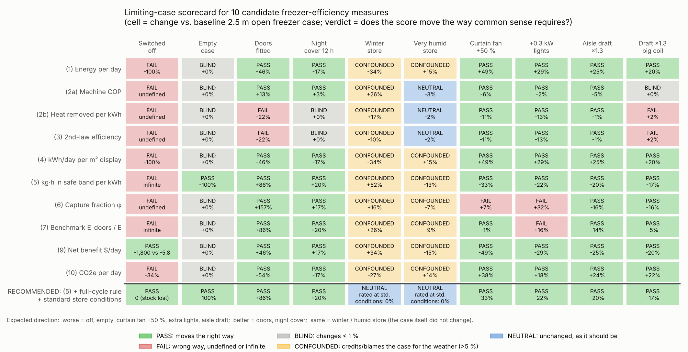
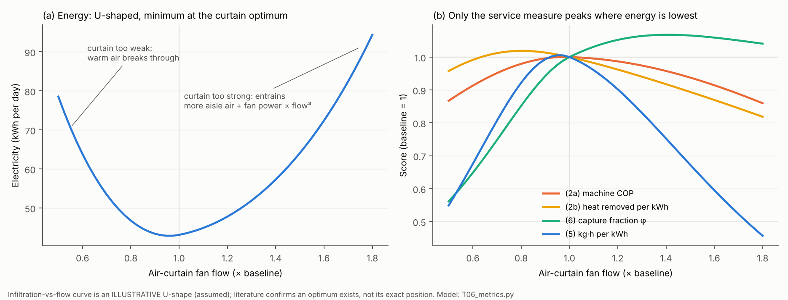
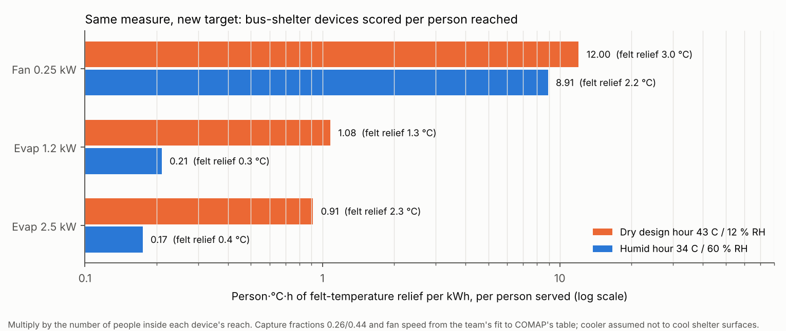

# T06 — What should "cooling efficiency" mean for an open freezer case?

*Research memo for the HiMCM 2026 Problem B team. Task 1 foundation. Not paper text — rewrite in your own words.*

**Files that come with this memo**

| What | Path (inside `sprint_out/`) |
|---|---|
| Main model (all 10 candidates × 11 scenarios) | `code/T06_metrics.py` → prints `code/T06_metrics_output.txt`, writes `code/T06_results.csv`, `code/T06_physics.csv` |
| Decomposition, stored-cold loophole, levers, scale check | `code/T06_extras.py` → `code/T06_extras_output.txt` |
| Bus-shelter carry-over | `code/T06_bus_carryover.py` → `code/T06_bus_output.txt` |
| Figures | `code/T06_figures.py` → `figs/T06_scorecard.png`, `figs/T06_curtain_fan_sweep.png`, `figs/T06_bus_carryover.png` |

Run from `sprint_out/code/` with `python3 T06_metrics.py` (and so on). The code imports the team's `himcm_b/core.py` for the humidity physics.

---

## 0. The answer in one paragraph

We tested ten ways to score how efficient an open freezer case is. We pushed each one through eleven situations where common sense already knows the right answer, for example "the freezer is switched off" or "doors are fitted". **Every measure that looks only at energy, or only at the machine, failed at least one test.** The switched-off case gets the best possible energy score. The empty case scores exactly the same as a full one. The standard engineering ratio (COP: heat moved per unit of electricity) gets **22 % worse when you fit doors**, even though doors cut electricity by 46 %. The "capture fraction" gets **32 % better when you add useless heat-making lights** inside the case. The only measure that passed every test, once three simple rules were added, is a **service-per-energy** measure:

> **η = (kilograms of food × hours that the food stayed inside its legal safe temperature band) ÷ (kWh of electricity)**
> Baseline open case: 7,200 kg·h ÷ 43.1 kWh ≈ **167 kg·h per kWh**. The same case with doors scores ≈ 311.

The three rules are: (1) score a whole cycle, so cold "borrowed" from the food has to be paid back; (2) rate cases at standard store conditions, so the case is not credited or blamed for the weather; (3) a case that lets the food leave the band scores zero for those hours. The recommended **secondary** measure is the capture fraction φ, used only to *diagnose* where the cold goes (never as a target). The same measure carries straight over to the bus shelter: **person × hours × °C of felt relief, per kWh**. So **efficiency must not depend only on energy use.** It needs a "useful output" on top, and that output depends on *what* you are cooling.

---

## 1. Plain-words starting point

**Efficiency** is always a fraction: *what you got* ÷ *what you paid*. The hard part is the top line. What does a freezer case actually *give* us?

- It does **not** "make cold". It pumps heat out of the case and dumps it somewhere else.
- In steady operation it does **not even cool the food down**. The food arrives frozen and the case only *keeps* it frozen. Every watt the case uses fights heat that leaks *in*.
- So the service is **holding**: keeping a certain amount of food inside a safe temperature band for a certain time, while letting shoppers see it and reach it.

That has a surprising consequence, which we use repeatedly below. **The ideal minimum energy needed to hold frozen food is zero.** A perfectly insulated, perfectly sealed box would need no energy at all. Physics sets a minimum for *moving* heat (the Carnot limit), but no minimum for *keeping* something cold. Any honest efficiency therefore has to compare against either (a) a stated useful output, or (b) a realistic reference case. It cannot compare against a law of physics alone.

---

## 2. The baseline case (checked and corrected)

| Quantity | Value used | Status |
|---|---|---|
| Case | 2.5 m open vertical low-temperature ("multideck freezer"), remote condenser | team |
| Total refrigeration load at 24 °C / 55 % RH store | 2.5 kW | [ASSUMED: team number; **probably low**, see §9 item 3] |
| Infiltration share of load | 75 % | [VERIFIED as plausible: Faramarzi et al. 2000 measured ≈80 % (81 % meat, 78 % dairy) on *medium-temperature* open vertical cases, Fig. 2 p. 3.130; the 67–81 % range is quoted from ASHRAE by secondary sources] |
| Per kg of store air drawn in: sensible / latent | 42.3 / 26.7 kJ → 39 % moisture | [VERIFIED by our psychrometric calculation, `core.py`; matches the team's figures] |
| Implied infiltration | 27 g/s of store air ≈ 23 L/s | computed |
| Fans / LED lights / anti-sweat heaters / defrost (electric) | 0.10 / 0.10 / 0.05 / 0.075 kW | [ASSUMED: our split of the team's "13 %"] |
| Machine COP | 1.7 | [ASSUMED: team; bracketed by Eurovent's convention (≈1.3) and AHRI 1200's table (≈2.0), see candidate 3] |
| Evaporator (refrigerant) temperature | −28 °C (10 K below −18 °C case air) | [ASSUMED; for comparison, a Hill Phoenix frozen-food case sheet lists a −17 °F (−27 °C) evaporator with −5 °F (−21 °C) discharge air] |
| Condensing temperature | 35 °C | [ASSUMED: team; also Eurovent's convention, VERIFIED] |
| Product on display | 300 kg | [ASSUMED] |
| Total display area (TDA) | 3.0 m² = 32.3 ft² (2.5 m × 1.2 m visible height) | [ASSUMED] |
| Safe band for frozen food | ≤ −18 °C, with tolerance up to 3 °C in retail display cabinets → **counts as safe while ≤ −15 °C** | [VERIFIED: EU Council Directive 89/108/EEC, Art. 5(1) and 5(2)(a), OJ L 40, 11.2.1989, p. 36] |
| Electricity price | $0.1337 /kWh (US commercial, 2025 average) | [VERIFIED: EIA Electric Power Monthly, Table 5.3] |
| Grid CO₂ | 775.2 lb/MWh = 0.352 kg CO₂e/kWh (US total output rate) | [VERIFIED: EPA eGRID2023 summary data, rev. 1; rev. 2 may differ slightly] |

**Model output for the baseline** (`T06_metrics.py`): electricity **43.1 kWh/day**, which is 55 % of the US legal maximum for this kind of case (below). Of that, about 36.6 kWh goes to the compressor and 7.8 kWh to fans, lights and heaters.

**How the model works, in plain words.** Each day, warm, moist store air slips past the air curtain. Every kilogram that ends up at case temperature brings in 69 kJ, which the machine must pump out. Walls and radiation add a little. The case's own fans and lights add heat too. The machine pumps out the total at COP 1.7. When the load rises, the cold coil runs colder, which slightly lowers the COP. Frost (and therefore defrost energy) grows with the moisture brought in.

**Validation against a published figure.** Faramarzi et al. (2000, p. 3.132) measured that lowering store humidity from 55 % to 35 % cut the *total* cooling load of medium-temperature open vertical cases by **20.7–20.8 %**. Our same physics applied to a medium-temperature case predicts **19.9 %**. That is within 1 percentage point, which supports the humidity part of the model.

---

## 3. The test bench: eleven limiting cases

A good efficiency score must move the way common sense says it should:

| Scenario | What changes in the model | Score should get… |
|---|---|---|
| Switched off | no electricity; food warms | **worse** (the food is lost) |
| Empty case | 0 kg of product, same energy | **worse** (energy, no service) |
| Doors fitted | infiltration −80 % [team ASSUMED]; +0.15 kW door anti-sweat heaters, frames conduct a bit more, glass blocks some radiation [ASSUMED] | **better** |
| Night cover 12 h | infiltration −43 % for 12 h, calibrated to give 17 % daily saving, inside the measured 10–22 % range [VERIFIED range: Datta, Watkins & Tassou 2004] | **better** |
| Winter store | store 21 °C / 30 % RH; condensing 25 °C (cool outdoor air) [ASSUMED] | **the same** (the case did not change) |
| Very humid store | 24 °C / 75 % RH [ASSUMED] | **the same** for a *design* rating |
| Air-curtain fan +50 % | fan power × 1.5³ = ×3.4 (fan affinity law); infiltration rises because a jet that is too strong drags in more aisle air [ASSUMED shape] | **worse** |
| +0.3 kW lights inside | pure extra heat inside the case | **worse** |
| Aisle draft × 1.3 | infiltration × 1.3 (e.g. an air-conditioning vent blowing across the case) | **worse** |
| Draft × 1.3 with an oversized coil | same, but the coil is large enough that its temperature never sags | **worse** |

---

## 4. The ten candidates, one at a time

Each entry gives plain words, then the formula with units, then the baseline number, then a one-line verdict. The full table of numbers is `code/T06_results.csv`. The picture is Figure 1.

*Figure 1. Each cell shows the % change against the baseline and whether that change is sensible. The bottom row is the recommended measure with its three rules.*

### (1) Energy per day
- **Words:** how much electricity the case uses in a day.
- **Formula:** E = Σ (power × time), in kWh/day.
- **Baseline:** **43.1 kWh/day** (costs $5.76/day ≈ $2,100/year).
- **Tests:** a switched-off case scores the best possible value, **0 kWh/day**. An empty case scores the same as a full one. Weather moves it 34 % (winter) and 15 % (humid store).
- **Verdict: FAIL.** It is a cost, not an efficiency. It belongs on the bottom of the fraction.

### (2) COP: "heat removed per unit of electricity"
- **Words:** how many kWh of heat the machine pumps out for each kWh of electricity.
- **Formula:** COP = Q / W. Q = heat removed from the case (kWh). W = electricity (kWh). The result has no units.
- There are two versions, and the difference matters.
  - **(2a) Machine COP** counts only the compressor: 2.5 kW ÷ 1.47 kW = **1.70**.
  - **(2b) System COP** counts all the electricity, including fans, lights, heaters and defrost: 60 kWh ÷ 43.1 kWh = **1.39**.
- **Does COP reward infiltration? We tested it.**
  - With a realistic coil, an aisle draft (+30 % infiltration) raises electricity **+25 %** while system COP *falls* by just **1 %**. The COP barely notices.
  - With an oversized coil (no temperature sag), system COP *rises* **+2 %**: more waste, better score. The reason is that the fixed fan and light electricity is spread over more "heat removed".
  - So the effect is **real but tiny**. The honest word is that COP is **blind** to infiltration, not that it "strongly rewards" it. (This corrects the team document, which says the case "scores better".)
- **The bigger absurdity:** **fitting doors makes system COP 22 % worse** (1.39 → 1.09), while electricity falls 46 %. Doors remove most of the *easy* heat (infiltration). What remains is a larger share of heat from the case's own lights and door heaters, and every kWh of that heat costs a kWh of electricity *plus* the compressor's work to pump it out. Machine COP (2a) happens to improve with doors (+13 %), because a smaller load lets the coil run warmer. That is a side effect, not because COP "knows" doors are good. The night cover leaves system COP unchanged (blind).
- **Verdict: FAIL.** COP measures the *machine*, not the *job*. Keep machine COP as one factor (see §6), never as the score.

### (3) Second-law (Carnot) efficiency
- **Words:** how close the machine gets to the best that physics allows.
- **Formula:** η_II = COP / COP_Carnot, with COP_Carnot = T_cold / (T_hot − T_cold). Temperatures are in kelvin (K = °C + 273.15).
- **Worked numbers. The answer depends on which temperatures you pick:**

| Choice of "cold" and "hot" | COP_Carnot | η_II with COP 1.7 |
|---|---|---|
| Team: −18 °C → 35 °C | 4.81 | 35 % |
| Refrigerant: −28 °C evaporator → 35 °C condenser | 3.89 | 44 % |
| Reservoirs: food −18 °C → outdoor air 25 °C | 5.93 | 29 % |
| Reservoirs: food −18 °C → winter outdoor 0 °C | 14.2 | 12 % |

- One case, one machine, and four "efficiencies" from 12 % to 44 %. Using system COP and the 25 °C reservoir gives **23.5 %**, the number used in Figure 1.
- **Cross-check with published conventions.**
  - Europe's display-case energy recommendation computes compressor energy as REC = t_R × Φ₀ × (T_C − T₀)/(0.34 × T₀), with T_C fixed at 35 °C. "The average value 0,34 reflects the Carnot efficiency of refrigerating systems used in Commercial Refrigeration" [VERIFIED: Eurovent/Cecomaf, *Recommendation for energy consumption evaluation of remote refrigerated display cabinets*, Dec 1997, item 3]. Applied at −28 °C, that convention gives **COP ≈ 1.32**.
  - The US rating standard instead looks up a fixed compressor EER. At −20 °F (−29 °C) adjusted dew point it lists **6.88 Btu/W·h, i.e. COP ≈ 2.02** [VERIFIED: ANSI/AHRI Standard 1200-2023 (I-P), Table 1, p. 8].
  - The team's 1.7 sits between these two.
- **Tests:** the measure is blind to an empty case and to the night cover, and falls 22 % with doors (same reason as COP). In winter it gets *worse* (−10 %), because the ideal improves faster than the real machine.
- **Deep problem:** as explained in §1, the ideal energy for *holding* food is zero. A true second-law efficiency of the *service* is 0 ÷ (something) = 0 for every real case, so it cannot rank anything.
- **Verdict: FAIL.** It is useful for one sentence ("the machine runs at about ⅓ of the Carnot limit"). It is useless as the case score.

### (4) Energy per display area per day (the US federal standard)
- **Words:** electricity per square metre of food that shoppers can see.
- **Formula:** e_A = E / TDA, in kWh/(day·m²). TDA = total display area, "the sum of the projected area(s) of visible product" [VERIFIED: AHRI 1200-2023 §3.2.19 and App. D, TDA = D_h·L + A_e].
- **Verified detail.** The US standard does not cap e_A itself. It caps daily energy as a straight line in TDA:
  - Vertical **open** low-temperature remote case (class VOP.RC.L): **max = 2.2 × TDA(ft²) + 6.85 kWh/day**.
  - Vertical **glass-door** low-temperature remote case (VCT.RC.L): **max = 0.49 × TDA + 2.61**.
  - These apply to cases made on or after 27 March 2017 [VERIFIED: 10 CFR 431.66(e)(1), text current to 2 Jan 2025 via FindLaw]. A tighter rule published 21 Jan 2025 was disapproved by Congress and withdrawn, effective 20 May 2025, so the 2017 limits still apply [VERIFIED: DOE notice, 90 FR 21392, as summarised in search results].
  - Tests run at a store of 75 °F / 55 % RH (ASHRAE 72) [VERIFIED via manufacturer sheets citing ASHRAE 72-2005], with test packages held at an average of 0 °F ± 2 °F (−17.8 °C) [VERIFIED: AHRI 1200-2023 §4.1.1.3].
- **Baseline:** 43.1 / 3.0 = **14.4 kWh/(day·m²)**.
  - US cap at TDA 32.3 ft²: **77.9 kWh/day**, so the baseline uses 55 % of it.
  - Doored cap: 18.4 kWh/day. **The regulator itself assumes an open freezer may use 4.2× a doored one.**
  - Europe uses the same idea. The standard annual energy for a vertical supermarket freezer is SAE = 365 × P × (M + N × TDA) × C, with M = 7.5, N = 19.3 (TDA in m²), and C = 1.0 for temperature class L1 [VERIFIED: Reg. (EU) 2019/2018, Annex IV, Tables 3 and 4]. That gives 65.4 kWh/day, so the baseline's EEI = 66 %. Europe tests at 25 °C / 60 % RH (climate class 3) [VERIFIED via Datta et al. 2004, Table 1], so EU and US numbers cannot be compared directly.
  - For scale, the 1997 European *average* glass-door freezer used 28.5 kWh/(day·m²) [VERIFIED: Eurovent 1997, table].
- **Tests:** switched-off scores 0 (best). Empty case: unchanged. **But** the standard is protected in a way our bare formula is not: the test is only valid if the packages *stay at 0 °F ± 2 °F*. That is a hidden service constraint, which matters for §6.
- **Verdict: FAIL as written. PASS as a *design* rating** once the "food must stay in band" rule and the standard conditions are included, which is exactly what regulators do.

### (5) Service per energy: kg × hours in the safe band, per kWh
- **Words:** how many kilogram-hours of food the case kept legally frozen, per kWh of electricity.
- **Formula:** η_S = S / E, with S = Σ over items of (mass × hours with temperature ≤ −15 °C), in kg·h, and E in kWh. Units: kg·h/kWh.
- **Baseline:** S = 300 kg × 24 h = 7,200 kg·h, so η_S = 7,200 / 43.1 = **167 kg·h/kWh**. Its inverse is 6.0 Wh per kg·h, i.e. **0.14 kWh to keep 1 kg frozen for a day**.
- **Tests:** empty case → **0** (correct). Doors **+86 %**, night cover **+20 %**, stronger fan **−33 %**, extra lights **−22 %**, draft **−20 %** (all correct). Winter +52 % and humid −13 %: **confounded by weather** (fixed by Rule 2 below).
- **Switched off → infinity.** The food stays below −15 °C for about 14 minutes (lumped model, [ASSUMED] c = 2.0 kJ/kg·K), so S = 69 kg·h for 0 kWh. We call this the **stored-cold loophole**. The case is spending cold "saved" in the food earlier, which looks free. Fix (Rule 1): score full cycles and charge the energy needed to restore the food's temperature.
  - Worked example: a 10-minute outage lets the food absorb 2.17 kW × 10 min. Pumping it back out at COP 1.7 costs 0.21 kWh. The outage then scores 50 kg·h / 0.21 kWh = 234 kg·h/kWh. That is no longer infinite. It is higher than the running baseline (167) only because fans and lights were also off, which is fair.
  - A permanent switch-off fails Rule 3: the food left the band, so S = 0 from then on.
- **Weakness:** it treats 1 kg of peas the same as 1 kg of ice cream, and it rewards packing more kilograms into the same case. The overstuffing problem limits itself: food piled above the load line breaks the air curtain and leaves the band.
- **Verdict: PASS with three rules → RECOMMENDED PRIMARY** (§6).

### (6) Capture ("delivery") fraction φ
- **Words:** the share of the cooling that was *not* spent on store air sneaking in.
- **Formula:** φ = 1 − Q_inf / Q_tot, with no units. (In steady state the food is not getting colder, so "cooling that ends up on the product" has to be read this way.)
- **Baseline:** 1 − 1.875/2.5 = **0.25**. The literature range 67–85 % gives φ = 0.15–0.33.
- **Tests:** doors **+157 %** (correct). But **+0.3 kW of lights inside → +32 % (better!)**, and **curtain fan +50 % → +7 % (better!)**. φ goes *up* whenever you add any other kind of waste heat, because it is a *share*. Figure 2 shows its peak sitting far from the energy minimum.
- **Verdict: FAIL as a target, EXCELLENT as a diagnosis.** It answers "where does the cold go?" and is the natural bridge to the bus shelter. **RECOMMENDED SECONDARY**, never to be optimised on its own.

### (7) Benchmark ratio: energy of an ideal reference ÷ actual energy
- **Words:** how close the case gets to a realistic best practice, here *the same case with doors* in the same conditions.
- **Formula:** B = E_ref / E, with no units (1 = as good as the reference).
- **Baseline:** 23.1 / 43.1 = **0.54**. The open case uses 1.86× the doored version.
  - The literature range for "open ÷ doored" is wide. A field study of a real lineup (medium temperature, in Kansas) found **1.3×** [VERIFIED: Fricke & Becker 2011, ASHRAE Trans. 117(1):847–858, abstract], with no effect on sales. The US caps imply 4.2×. Our model's 1.86× falls in between.
- **Tests:** switched-off → **∞** (fail, same loophole as candidate 5). Empty case blind. **Extra lights → +16 % better**, because the reference also gets the lights and has a smaller base, so the ratio rises. Weather confounded.
- This is the structure of the EU energy label (EEI = AE/SAE), but there the reference is a regulatory formula, not a physical twin.
- **Verdict: FAIL as primary.** Excellent for the Task 5 memo sentence "this case uses 1.9× what the same case with doors would".

### (8) Marginal efficiency: extra service per extra kWh
- **Words:** if I spend one more kWh (or save one), how much service do I gain (or lose)?
- **Formula:** η_M = ΔS / ΔE, in kg·h per kWh.
- **Baseline:** from "off" to "on", the case buys 7,200 kg·h for 43.1 kWh. Once the food is in band, **one more kWh buys nothing**, so η_M = 0. Saving kWh costs no service until the band is threatened.
- **Where it is the right tool:** ranking *upgrades*. Model savings in kWh/day: doors **20.0**, night cover **7.3**, a better compressor (COP 1.7 → 2.0) **5.3** (`T06_extras.py`). Divide by each upgrade's cost to get kWh saved per dollar, which is exactly what Task 4 needs.
- **Verdict:** not a rating (it is 0 or ∞ almost everywhere), but **the right decision tool for Task 4**.

### (9) Net benefit
- **Words:** value of the service minus the cost of everything used.
- **Formula:** NB = V − p·E − c·CO₂e, in $/day. V = value of the service ($/day), p = electricity price ($/kWh), c = carbon price ($/kg).
- **Baseline:** a working case: NB = −$5.76/day (electricity only). Switched off: the stock is lost, −$1,800 (300 kg × $6/kg [ASSUMED price]).
- **Insight:** the food in the case is worth about **300×** a day's electricity. So NB shouts "keep the freezer running" and then has nothing more to say. For any two working cases it collapses to "compare costs". It could only tell open and doored cases apart if you priced the *sales* value of an open display, and Fricke & Becker (2011) found doors had no effect on sales.
- **Verdict:** right for "should we run it at all?" and for Task 4's trade-offs. Not a rating.

### (10) Multi-resource versions (cost, CO₂e including refrigerant leaks)
- **Words:** count every resource the case consumes, converted into one unit (dollars or kg of CO₂-equivalent).
- **Formula (TEWI style):** CO₂e/yr = E_yr × β + m × L × GWP.
  - β = grid emissions factor (kg CO₂e/kWh)
  - m = refrigerant charge allocated to this case (kg)
  - L = leak fraction per year
  - GWP = global warming potential (kg CO₂e per kg leaked)
  - This is the standard "total equivalent warming impact" form. Sources differ on whether L is a fraction or a mass, so check units.
- **Inputs:**
  - EPA: centralized supermarket systems hold "3,000 – 4,000 pounds" of refrigerant and "can leak in excess of 20 percent of their charge each year". EPA's advanced-system target is ≤ 1.75 lb per 1,000 Btu/h of evaporator load, which is 2.7 kg per kW [VERIFIED: EPA GreenChill, *Advanced Refrigeration Technologies* page].
  - R-404A GWP = 3,922 (AR4) [VERIFIED: Australian government GWP table; Daikin].
- **Baseline per case:**
  - Electricity: 43.1 kWh/day × 365 × 0.352 = **5.5 t CO₂e/yr**.
  - Refrigerant: 2.5 kW × 2.7 kg/kW = 6.8 kg of charge (advanced target) to about 13.5 kg (conventional, [ASSUMED] ≈2×). At 20 %/yr leakage that is **5.3–10.6 t CO₂e/yr**.
- **Leaks can match or double the electricity's climate impact.** Switching to R-448A (GWP 1,387) or CO₂ (GWP 1) changes the "efficiency" without changing a single kWh. A climate-based score therefore needs the refrigerant.
- **Tests:** they behave like energy (they fail the switch-off and empty-case tests). Leaks also continue when the case is off.
- **Verdict:** keep as the *cost* in the denominator for Task 4, not as the score.

### Two extra candidates we added
- **(11) Energy per kg of product per day (kWh/kg·day):** this is just 1/η_S without the band rule. The band rule is what saves η_S from the switch-off and overload tests, so this is strictly worse.
- **(12) Exergy of the service:** the minimum work to *hold* food cold is zero (§1), so this is undefined. That is the deepest reason Carnot cannot be the yardstick for a holding service.

---

## 5. The air-curtain fan: where the measures disagree

*Figure 2. (a) Daily electricity against curtain fan flow. The U-shape follows from a curtain that is too weak (warm air breaks through) or too strong (it drags in aisle air, and fan power grows with flow³). The literature supports that an optimum exists, but this exact curve is **illustrative/ASSUMED**: a CFD study and a patent describe a too-low velocity that destroys curtain stability and an optimum at the lowest velocity that keeps the curtain intact; Al-Sahhaf's Brunel thesis finds the velocity profile matters too. (b) Each score indexed to baseline = 1. Only the service measure η_S peaks where energy is lowest. The capture fraction φ peaks at about 1.4× flow, where energy is already 34 % above the minimum.*

**Insight:** if a store manager tuned the curtain fan to maximise φ, they would **raise** the bill. Tuning to maximise η_S lowers it. This is the cleanest single demonstration that φ must be a diagnosis, not a goal.

---

## 6. Recommendation

### Primary measure: service delivered per kWh, with three rules

> **η_S = S / E**, where S = Σ (mass of food × hours at or below −15 °C), in kg·h, and E = electricity, in kWh.

1. **Full-cycle rule:** evaluate at least a whole day (including defrosts), starting and ending at the same food temperature, or else add the energy needed to restore it. This closes the stored-cold loophole.
2. **Standard-conditions rule:** to *compare cases*, rate them at a fixed store (24 °C / 55 % RH, close to the US test's 75 °F / 55 %). To *run a store*, report the actual-weather value separately. This removes the weather confounding (winter +52 %, humid −13 %).
3. **Band rule:** hours outside the band count as zero service. This is the same idea as the US/EU tests, which are only valid if the test packages stay in their temperature class.

**Why this one, in plain words:** it is the only score that knows what the freezer is *for*. It goes to zero for an empty or failed case, rises with doors and night covers, falls with waste of any kind, and it is the one measure whose best point is also the lowest-energy point. It is not exotic either. **The US federal standard is this same measure in disguise.** Swap "kg of food" for "m² of display area" (because an open case's job is also to *show* food), and rules 2 and 3 become the AHRI/ASHRAE test conditions. Then 1/η_S is exactly kWh/day per unit display. That lets us say in the paper: *"Regulators already agree with us; we make their hidden rules explicit."*

### Secondary measure: the capture fraction φ, as a diagnosis only

A neat identity (exact, checked in `T06_extras.py`) shows how the pieces fit:

> **η_S = σ × φ × COP_sys**
> - σ = S / Q_captured: service per kWh of heat that was *not* infiltration (kg·h per kWh of heat)
> - φ = Q_captured / Q_total: capture fraction
> - COP_sys = Q_total / E: heat removed per kWh of electricity

| | σ | φ | COP_sys | η_S |
|---|---|---|---|---|
| Baseline open | 480 | 0.25 | 1.39 | **167** |
| Night cover | 493 | 0.29 | 1.39 | **201** |
| Doors fitted | 443 | 0.64 | 1.09 | **311** |

*This means:* efficiency has **three doors to push on**: the machine (COP: hard, Carnot-capped, and +18 % at best for the 1.7 → 2.0 upgrade), the seal (φ: the big lever, ×2.6 with doors), and the loading (σ). Doors make two factors *worse* (σ, COP) and still win overall because φ jumps. **Neither COP nor φ alone can be the score, but together with σ they explain it.**

### "Should efficiency depend only on energy use?" — No

An energy-only score says a switched-off freezer is perfect and an empty freezer is fine. Efficiency must also include:
- **(a) the service:** how much food, kept safely frozen, for how long;
- **(b) the conditions:** store temperature and humidity, which change energy by −34 % to +15 % without the case changing;
- **(c) where the cooling goes:** φ = 0.25, so ¾ of the work fights store air;
- **(d) the other resources:** refrigerant leaks worth as much CO₂e as the electricity, plus money;
- **(e) for a whole-store view, what the case does to the building** (§9 item 2).

---

## 7. Carrying the measure to the bus shelter

The structure stays the same. Only the target changes, which is the team's spine ("what you are cooling changes, so the measure must change").

| | Freezer | Bus shelter |
|---|---|---|
| Target | kg of food | people waiting |
| What "good" means | **actual** temperature ≤ −15 °C (a legal step) | **felt** temperature lowered (graded: every degree helps) |
| Service S | kg × hours in band | **person × hours × °C of felt relief** |
| η | kg·h per kWh | **person·°C·h per kWh** |
| φ | share of cooling not lost to store air | share of cooled air that reaches the people (team fit: 0.26 / 0.44) |
| Rule 2 (conditions) | standard store | stated design hour **and** real weather by climate |

**Worked example** (`T06_bus_carryover.py`, per person served). "Felt relief" is measured on the same scale as COMAP's "feels 3 °C cooler". It is ASHRAE 55's cooling-effect definition: how many °C the air and surfaces would need to drop, in still air, to feel the same.

| Device (power) | Dry hour 43 °C / 12 % RH: relief → η | Humid hour 34 °C / 60 % RH: relief → η |
|---|---|---|
| Fan (0.25 kW) | 3.0 °C → **12.0** person·°C·h/kWh | 2.2 °C → **8.9** |
| Evap. 1.2 kW (φ = 0.26) | 1.3 °C → **1.08** | 0.25 °C → **0.21** |
| Evap. 2.5 kW (φ = 0.44) | 2.3 °C → **0.91** | 0.44 °C → **0.17** |

What this example shows:
- **The COP trap again.** An evaporative cooler's "machine efficiency" is huge. At 43 °C / 12 % RH, a 1.1 m³/s pad produces about 24 kW of sensible cooling from 1.2 kW, a "COP" of about 20 (airflow is the team's ASSUMED value). Yet it delivers the *least* felt relief per kWh, because ¾ of the cool air blows away (φ) and it does not cool the hot roof and pavement the person sees. This is the same lesson as the freezer: machine efficiency ≠ service efficiency.
- **Number of people decides the ranking.** η scales with the number of people N inside each device's reach. The large cooler matches the fan only if it reaches **13× more people** (12.0 / 0.91). If the cooled air also cooled the shelter's surfaces, its relief would rise to 6.7 °C, and it would need about 4.5× more people. Coverage per device is therefore the key Task 2a measurement.
- **Climate flips magnitudes.** In humid air, the coolers lose 80 % of their relief and the fan loses about 25 %.
- **Caveats:** the capture fractions and the fan speed (1.17 m/s) come from the team's one-parameter fit to COMAP's table, not independent data. The radiant temperature is assumed unchanged by the coolers.

---

## 8. Insights other teams will probably miss

1. **COP punishes the best fix.** Fitting doors cuts electricity 46 % but makes "heat removed per kWh" 22 % worse. That is a sharper and more defensible point than "COP rewards infiltration", which our test shows is only a ±2 % effect.
2. **The ideal energy to *hold* food cold is zero.** So no Carnot-based score can rate a display case. Every real yardstick has to be a reference case or a stated service.
3. **The capture fraction can be gamed by adding waste of another kind** (lights +32 %, a stronger curtain fan +7 %). Use it to diagnose, never to optimise.
4. **The US federal standard is a service-per-energy measure in disguise**, with the service constraint hidden in the test rules. We are not inventing an odd metric; we are making the regulator's logic explicit.
5. **The stored-cold loophole:** any short-window ratio can be gamed by switching off and "spending" the food's cold. Rules for full cycles are needed in Task 2 as well (for example, pre-cooled shelter surfaces).
6. **Refrigerant leaks can match the electricity.** For R-404A, leakage is 1–2× the electricity CO₂e per case.

---

## 9. Where this contradicts or refines the shared-context numbers

1. **"Carnot limit for −18 °C evaporating → 35 °C condensing ≈ 4.8."** The arithmetic is right (255.15/53 = 4.81), but a −18 °C case cannot have a −18 °C evaporator. The coil must be colder, about −25 to −30 °C (Hill Phoenix sheet: −27 °C evaporator for −21 °C discharge air). That gives a refrigerant Carnot of **≈3.9**, and COP 1.7 is then **44 %** of ideal, not 35 %. With reservoir temperatures (food −18 °C, outdoor 25 °C) the ideal is 5.9. **Say which definition you use.** Eurovent's convention (0.34 × Carnot at the real evaporating temperature) gives COP ≈ 1.3, AHRI's table gives ≈ 2.0, so 1.7 is plausible.
2. **"Net heat a case adds to the store = its electricity; in winter the escaping cold offsets store heating."** This is **true only for a self-contained (plug-in) case whose condenser sits in the shop.** Multideck supermarket freezers are normally **remote**: the condenser is outdoors. Such a case *removes* heat from the store, about **52 kWh/day** in our baseline (heat drawn in from the store minus the case's own fan, light and heater heat). The winter direction is then reversed. **Escaping cold *increases* winter heating and *helps* summer air conditioning.** This is the industry's "case credits" idea (Pitzer & Malone 2005, *ASHRAE Journal* 47(2)). Even for a plug-in case, the thing that offsets winter heating is the *condenser's* heat, not the escaping cold. Fix the wording before Task 1 is written.
3. **"Refrigeration load ~2.5 kW for a 2.5 m open low-temperature case"** is probably **low**.
   - Measured *medium-temperature* open vertical cases need 1,500–1,779 Btu/h per foot, i.e. 1.4–1.7 kW/m or **3.6–4.3 kW per 2.5 m** (Faramarzi et al. 2000 Fig. 5 and Table 2; Hussmann sheet), and that is with half the temperature lift.
   - On the other side, the US cap (77.9 kWh/day at an assumed TDA of 3 m²) means a *compliant* case at COP 1.7 can have at most about **4.5 kW** of load. Our 5 kW scale check came out at 111 % of the cap.
   - So use **2.5–4.5 kW**. All verdicts in Figure 1 are unchanged at 5 kW (`T06_extras.py`). I found no published load figure for an open vertical *low-temperature* case (these cases are rare in US stores).
4. **"Fitting doors saves 60 %"** (team doc): our model gives 46 % once door anti-sweat heaters are counted. The field evidence is lower (open = 1.3× doored, about 23 % saving, medium temperature; Fricke & Becker 2011), while the US caps imply up to 76 %. Quote a range, not 60 %.
5. **"COP rewards infiltration"** (team doc, Task 1): only weakly true, see insight 1. Use "COP is blind to infiltration and punishes doors".
6. **Infiltration 67–85 %:** consistent. Faramarzi et al. (2000) is the cleanest primary source (≈80 %). Note that it is *medium temperature*. I did not personally verify the Brunel "≥85 %" or Howell & Adams numbers.
7. **Code bug (minor):** `core.SET` uses pythermalcomfort's default `round_output=True`, so SET jumps in 0.1 °C steps. The fan calibration then gives 1.25 m/s instead of **1.17 m/s** unrounded, and small ΔSETs look quantised (1.80 / 0.70 / 1.30 °C). Pass `round_output=False` (done locally in `T06_bus_carryover.py`; `core.py` was not modified).
8. **New number for the team:** the legal band. Frozen food must be ≤ −18 °C, with up to 3 °C tolerance allowed in retail display cabinets (EU Dir. 89/108/EEC, Art. 5). That is the "safe band" boundary of −15 °C used above.

---

## 10. End matter

### (a) Key findings with numbers
1. **Energy-only and machine-only measures fail basic sanity tests.** A switched-off case scores 0 kWh/day ("perfect"). An empty case scores the same as a full one. Fitting doors lowers "heat removed per kWh" by **22 %** while cutting electricity by **46 %**.
2. **The capture fraction φ = 0.25 is a good diagnosis but a bad target.** It improves **32 %** when 0.3 kW of lights are added, and peaks at a curtain fan setting that uses about **34 % more** energy than the optimum.
3. **Service per kWh passes every test once three rules are added.** It is 167 kg·h/kWh at baseline, 201 with a night cover and 311 with doors. It is the US federal standard's logic made explicit.
4. **Weather alone moves energy −34 % (winter) to +15 % (humid store)**, so case ratings need standard conditions. The model reproduces Faramarzi's measured 20.7–20.8 % humidity effect to within 1 point (19.9 %).
5. **Refrigerant leakage (R-404A) adds 5–11 t CO₂e/yr per case, against 5.5 t from electricity.**

### (b) Verified vs assumed
- **VERIFIED:** US caps 2.2·TDA + 6.85 and 0.49·TDA + 2.61 kWh/day; AHRI 1200-2023 test temperature (0 °F) and EER table (6.88 at −20 °F); TDA definition; EU SAE formula and coefficients (7.5, 19.3, C = 1.0 for L1); Eurovent 0.34 × Carnot convention with T_C = 35 °C, and the 1997 glass-door average of 28.5 kWh/day·m²; Faramarzi infiltration ≈80 % and the 20.7–20.8 % humidity effect; night blinds save 10–22 %; Fricke & Becker 1.3×; EU −18 °C and 3 °C tolerance; EIA price; eGRID factor; EPA charge (3,000–4,000 lb, >20 % leak, 1.75 lb/MBH target); R-404A GWP 3,922.
- **ASSUMED:** case load 2.5 kW (and its split); COP 1.7; −28 °C evaporator; 300 kg product; TDA 3 m²; doors −80 % infiltration plus 0.15 kW heaters; the shape of the curtain U-curve; winter/humid store conditions; $6/kg product value; conventional charge ≈2× the EPA target; c = 2.0 kJ/kg·K; bus-shelter capture fractions, fan speed and unchanged radiant temperature (team fit).

### (c) Decisions the team must make
1. Adopt **η_S (kg·h in band per kWh)** as the Task 1 measure, or its display-area twin (m²·h per kWh, DOE-compatible)? *I suggest kg·h in the text and a note that DOE uses m²; that way the "food" spine stays visible.*
2. Which Carnot definition to quote (refrigerant 3.9 / team 4.8 / reservoirs 5.9)? Pick one and state it.
3. Fix the winter/summer "case credits" statement (§9 item 2) and choose remote vs plug-in for the baseline case.
4. For the bus shelter: graded relief (°C, as above), or a convex heat-risk weight (`core.heat_risk`, which favours relief at the hottest hours)? Graded is simpler. Heat-risk is more defensible for *safety*.
5. How to count people per device (coverage) in Task 2a. It decides the ranking (the cooler needs 4.5–13× the fan's reach).

### (d) How this feeds the rest of the paper
- **Task 1:** §4 is the "propose, then demolish" section (Figure 1 is the one-picture argument). §6 gives the definition and the yes/no answer. The identity η = σ·φ·COP is the bridge.
- **Task 2a:** the same η, with person·°C·h replacing kg·h. φ comes from the team's calibration. Rule 2 maps to "climate conditions" and N to "number of people benefiting", both named in the task.
- **Task 2b (rail station):** the new ingredient fits the same formula. Crowd heat raises the load the cooling must fight, like infiltration did in the freezer, so φ and σ change, not the measure.
- **Task 3:** run η over hourly weather (Phoenix vs Houston data already in `himcm_b/data/`). Rule 2 tells you to separate "device quality" from "climate".
- **Task 4:** marginal efficiency (ΔS/ΔE per $) and multi-resource cost (candidate 10) rank upgrades. The freezer levers are doors 20.0, night cover 7.3 and better compressor 5.3 kWh/day.
- **Task 5 memo:** "This case uses 1.9× what the same case with doors would" (benchmark, candidate 7) is a COO-friendly sentence.

### (e) Weaknesses and open questions
- The model is a steady daily average. It does not simulate defrost cycles, door-opening transients or product temperature differences between shelves.
- The "switched-off" time to leave the band (about 14 min) is a lumped upper-speed estimate. Real packages warm unevenly (the team's product time constant is about 1 h).
- No primary data was found for an open vertical **low-temperature** case load or infiltration share. All infiltration data quoted is medium temperature.
- The kg·h service treats all food as equal and is binary. It ignores quality loss *inside* the band and the sales value of an open display.
- The bus-shelter numbers depend on the team's calibrated φ and fan speed, and on the assumption that radiant temperature is unchanged.
- I could not read the full Amin/Navaz papers (the server returned 503) or the original SCE night-curtain report, so the curtain U-shape is qualitative only.

---

## References (all accessed 5 Nov 2026)

1. Faramarzi, R., Sarhadian, R., Sweetser, R. S. (2000). *Assessment of Indoor Relative Humidity Variations on the Energy Use and Thermal Performance of Supermarkets' Refrigerated Display Cases.* ACEEE Summer Study, pp. 3.125–3.136. https://www.aceee.org/files/proceedings/2000/data/papers/SS00_Panel3_Paper10.pdf (abstract; Fig. 2 p. 3.130; Fig. 5 and text p. 3.132; Table 2 p. 3.127).
2. US Code of Federal Regulations, 10 CFR 431.66(d)–(e), commercial refrigeration equipment standards (via FindLaw, current to 2 Jan 2025). https://codes.findlaw.com/cfr/title-10-energy/cfr-sect-10-431-66/ ; DOE withdrawal of the Jan 2025 rule: Federal Register 2024-31214 and 90 FR 21392. https://www.federalregister.gov/documents/2025/01/21/2024-31214/
3. AHRI (2023). *ANSI/AHRI Standard 1200 (I-P)-2023, Performance Rating of Commercial Refrigerated Display Merchandisers and Storage Cabinets*: §3.2.19 TDA, §4.1.1.3 (0 °F), §5.1 Eq. 1–2, Table 1 p. 8, App. D. https://law.resource.org/pub/us/cfr/ibr/inc/ansi/ahri.1200.2023.pdf
4. Eurovent/Cecomaf WG14 (Dec 1997). *Recommendation for Energy Consumption Evaluation of Remote Refrigerated Display Cabinets* (REC 05). https://www.eurovent.eu/wp-content/uploads/publications-files/eurovent-rec-14-5-energy-consumption-evaluation-of-remote-refigerated-display-cabinets-1997-en.pdf
5. Commission Delegated Regulation (EU) 2019/2018, Annex IV (SAE, EEI; Tables 3–4). https://www.legislation.gov.uk/eur/2019/2018/annex/IV/2020-01-31
6. Council Directive 89/108/EEC (quick-frozen foodstuffs), Art. 5, OJ L 40, 11.2.1989, p. 36. https://legislation.gov.uk/eudr/1989/108/pdfs/eudr_19890108_adopted_en.pdf
7. Datta, D., Watkins, R., Tassou, S. A. (2004). *Effect of night blinds on open integral display cabinets.* HPC 2004, 3rd Int. Conf. on Heat Powered Cycles (abstract; Introduction, which also summarises Faramarzi et al. 1999 night-blind savings of 9 %/36 % and Clodic & Pan 2002). https://kar.kent.ac.uk/id/document/39617
8. Fricke, B. A., Becker, B. R. (2011). *Comparison of vertical display cases: energy and productivity impacts of glass doors versus open vertical display cases.* ASHRAE Transactions 117(1): 847–858. https://impact.ornl.gov/en/publications/comparison-of-vertical-display-cases-energy-and-productivity-impa/
9. Pitzer, R. S., Malone, M. (2005). *Case credits and return air paths for supermarkets.* ASHRAE Journal 47(2) (abstract via IIR FRIDOC). https://iifiir.org/en/fridoc/case-credits-and-return-air-paths-for-supermarkets-125187
10. US EPA GreenChill, *Advanced Refrigeration Technologies*. https://www.epa.gov/greenchill/advanced-refrigeration-technologies
11. US EIA, *Electric Power Monthly*, Table 5.3 (commercial price 2025 = 13.37 ¢/kWh). https://www.eia.gov/electricity/monthly/epm_table_grapher.php?t=epmt_5_3
12. US EPA eGRID2023 summary tables rev. 1 (US total output CO₂e rate 775.218 lb/MWh). https://www.epa.gov/system/files/documents/2025-01/egrid2023_summary_tables_rev1.pdf
13. Australian Government, *Global warming potential table — HFCs and blends* (R-404A 3,922; R-448A 1,387). https://www.nationalepa.gov.au/sites/default/files/documents/global-warming-potential-table-hfcs-blends.pdf
14. Hill Phoenix, O2MZD technical reference sheet (frozen food: −17 °F evaporator, −5 °F discharge air). https://www.hillphoenix.com/wp-content/uploads/2019/05/O2MZD-display-case-tech-recference-sheet-4.pdf ; Hussmann Impact D5/E5 sheets (medium temperature, ≈1,500 Btu/h·ft), via search results.
15. Curtain-velocity optimum (qualitative): University of Beira Interior CFD study (ubibliorum.ubi.pt) and US patent 9,265,359 (*Refrigerated display appliances*), via search summaries; Al-Sahhaf, Brunel PhD thesis, https://bura.brunel.ac.uk/bitstream/2438/7456/1/FulltextThesis.pdf (not read in full).
16. pythermalcomfort `set_tmp` (SET) and ASHRAE 55 cooling-effect definition, as used in the team's `himcm_b/core.py`.
