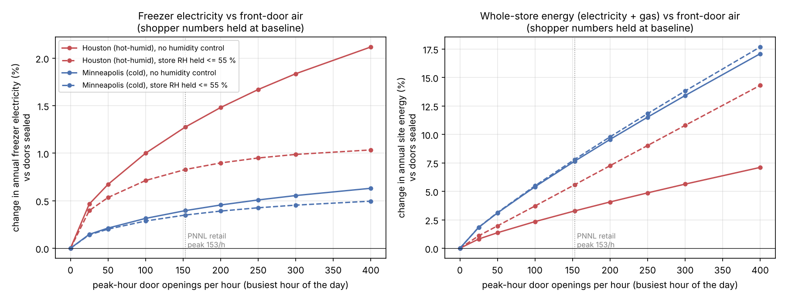
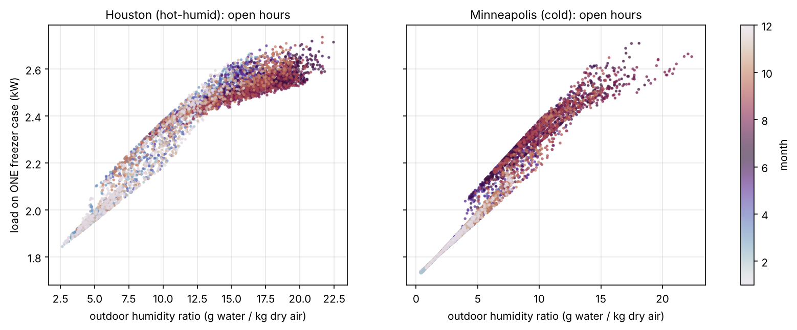
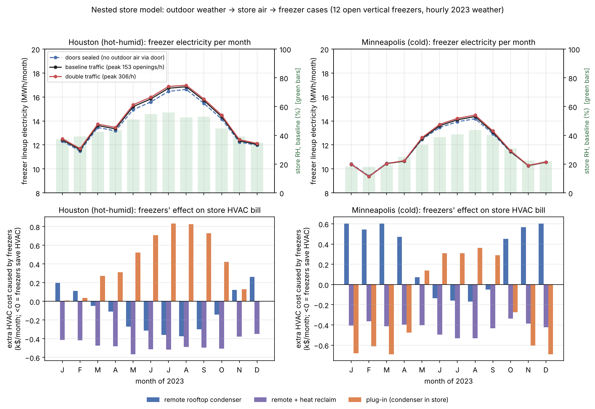

# T07 — The supermarket as a nested system: outdoors → store → freezer case

*Research and modelling memo for the HiMCM 2026 Problem B team. This is not paper text. Rewrite it in your own words.*

**Files that go with this memo**

| What | Where (inside `sprint_out/`) |
|---|---|
| Model (store heat and moisture balance plus cases) | `code/T07_store_model.py` |
| All scenarios, tables and figures | `code/T07_runs.py` → output in `code/data_T07/T07_runs_output.txt` |
| Sensitivity (14 assumptions changed one at a time) | `code/T07_sensitivity.py` → `code/data_T07/T07_sensitivity_output.txt` |
| Worked one-hour examples and the boundary totals | `code/T07_worked_examples.py` → `code/data_T07/T07_worked_examples_output.txt` |
| Cached weather (Open-Meteo, 2023, hourly) | `code/data_T07/wx_houston_2023.json`, `wx_minneapolis_2023.json` |
| Figures | `figs/T07_monthly_freezer_hvac.png`, `figs/T07_freezer_vs_door_openings.png`, `figs/T07_case_load_vs_outdoor_humidity.png` |

Run everything with `cd sprint_out/code && python3 T07_runs.py`. It takes about 3 s.

---

## 0. The short version (read this first)

1. **Front-door traffic hardly changes the freezers' own electricity bill.** Over a full year, doors at normal supermarket traffic raise freezer electricity by only **+1.3 % in Houston and +0.4 % in Minneapolis**, compared with doors that let in no outdoor air. Doubling the traffic gives +2.1 % and +0.9 %. Across 14 sensitivity tests the range is **+0.2 % to +3.0 %**. That is far below the team's preliminary **8–27 %**. The reason is that the store's air conditioner, its ventilation and the cases themselves act like a large "humidity buffer", so the door shifts store humidity by only about 2–4 RH points.
2. **The door does cost a lot, but the cost lands on the store's HVAC, not on the freezers.** The same door traffic raises **whole-store** energy by **+3.3 % (Houston)** and **+7.7 % (Minneapolis)**. Each door opening costs about **50 Wh in Houston and 150 Wh in Minneapolis**, and only about 5 % (Houston) or 0.4 % (Minneapolis) of that is freezer electricity.
3. **Escaping cold changes sign with the season, and which way it flips depends on where the condenser sits.** This is the system boundary at work.
   - With a **remote rooftop condenser**, the layout most supermarkets use, escaping cold *helps* the air conditioner in summer and *adds* to the heating bill in winter. In Minneapolis the extra heating adds **+45 %** to the freezers' own bill in December to March.
   - With **plug-in (self-contained) cases**, the condenser heat stays inside the store. Then the freezers *add* to the summer AC bill (up to **+40 %** of their bill in Houston in July and August) and *offset* winter heating (**−43 %** in Minneapolis in winter).
   - This **contradicts our shared context**, which says that in winter the escaping cold offsets heating. That holds only for plug-in cases or for heat reclaim.
4. **Drawing the boundary in a different place changes the freezer's annual energy by up to 6×.** Take the remote rack in Minneapolis. The freezer meter reads **141 MWh/yr**. Counting what the freezers do to the store's HVAC, they actually cost **256 MWh/yr** of site energy (+82 %). The same freezers as plug-in cases cost only **43 MWh/yr** at the store boundary, because their heat displaces gas heating.
5. **The bigger "nested" effect comes from the climate, not the door.** Through the store air, outdoor humidity moves the load on one freezer case between about **1.75 and 2.7 kW** over the year (rated 2.5 kW). The rooftop condenser's temperature moves the freezer's COP between **1.5 and 2.2**. Together these give a **+36 %** swing from January to August in Houston.

---

## 1. What "nested system" and "system boundary" mean

**Plain words.** A *system* is the part of the world we choose to do bookkeeping on. Its *boundary* is the imaginary line around it. Anything that crosses the line counts as *input* or *output*. Anything inside the line is internal and does not count. If you move the line, the same physical event can switch between "waste" and "service".

A supermarket freezer sits inside three boxes, one inside the next, like Russian dolls:

```
 OUTDOORS (weather: temperature, humidity)
   └── STORE AIR (thermostat 21–24 °C, humidity floats)   <- front door, ventilation, walls
         └── FREEZER CASE (air at −18 °C)                  <- air curtain
               └── FOOD (the thing we actually want cold)
```

- **Boundary A = the case.** Efficiency = cold delivered to the food ÷ case electricity. Cold that spills out through the air curtain is pure loss.
- **Boundary B = the store.** The spilled cold does not vanish. It cools and dries the store air. Engineers call this the **"case credit"** [VERIFIED: EnergyPlus Engineering Reference, *Refrigeration Equipment*, "sensible case credit" and "latent case credit" equations; ASHRAE also uses the term (search summary, see §9)]. In summer it is a gift to the air conditioner. In winter the heater has to pay it back.
- **Boundary C = the site (meter plus gas bill).** Here we also ask *what kind* of energy pays: electricity for AC and compressors, gas for the furnace.

**Why this matters for the paper.** The question "is the escaping cold waste?" has no single answer. It depends on the boundary, the season, and where the condenser heat goes. §6 puts numbers on this, and §7 applies the same logic to the bus shelter.

---

## 2. The store-level model (Task item 1)

### 2.1 Why algebra each hour, not a differential equation

The store air's time constant is roughly its air mass divided by the air flows through it. At 17:00 on a July day in Houston that is
τ = ρV / ṁ_total = (1.2 kg/m³ × 13,993 m³) / ≈11.8 kg/s ≈ 1,400 s ≈ **24 min**.
This is shorter than our 1-hour weather step. So each hour the store is close to its own steady state, and we solve *algebra* each hour. This agrees with the team's timescale analysis (store air about 30 min) [ASSUMED: team's own estimate; our 24 min is from this model's flows].

### 2.2 The store we model

| Quantity | Value | Tag |
|---|---|---|
| Floor area, height | 2,294 m² (24,695 ft²), 6.1 m (20 ft) | [VERIFIED: PNNL-20026, Table 1, "Stand-alone Retail" prototype, p.7] |
| Peak door openings | 153 per hour; off-peak = 1/10 of peak | [VERIFIED: PNNL-20026, Table 5, p.11; field data from Yuill (ASHRAE RP-763), 52 stores] |
| Shoppers in store | openings per hour ÷ 2 (each shopper uses the door twice) | [VERIFIED: PNNL-20026, footnote 4, p.11] |
| Heat per shopper | 75 W sensible + 55 W latent (standing, light work, retail) | [VERIFIED (secondary): ASHRAE 1997 Fundamentals Ch.28 Table 3, as quoted in a PDH course; check the original table] |
| Thermostat | heat below 21 °C, cool above 24 °C, float in between | [ASSUMED; 23.9 °C is the case rating temperature] |
| Envelope heat loss UA | 2.0 kW/K | [ASSUMED] |
| Envelope leakage | 0.1 air changes per hour | [ASSUMED] |
| Ventilation | 0.3 L/s per m² + 3.8 L/s per person, open hours only | [ASSUMED: ASHRAE 62.1 retail values recalled from memory, not re-checked] |
| Lights, checkouts, deli, fans | 25 W/m² open, 5 W/m² closed | [ASSUMED] |
| Opening hours | 07:00–22:00 | [ASSUMED] |
| AC | COP 3.0; supply air leaves the coil at 13 °C, saturated at 12 °C | [ASSUMED] |
| Gas furnace | efficiency 0.80 | [ASSUMED] |
| Freezers | 12 open vertical cases, each 2.5 m, rated 2.5 kW at 23.9 °C / 55 % RH | [ASSUMED count; 2.5 kW is the team baseline; rating point VERIFIED: EnergyPlus Eng. Ref.] |
| Fridges (MT) | one lumped 45 kW line-up, case air +3 °C, COP 2.5 at 35 °C condensing | [ASSUMED size; COP 2.5 VERIFIED: Westphalen et al. 1996 via ORNL 2011, Table 6, p.28] |

### 2.3 Door infiltration: how much outdoor air does one opening let in?

**Plain words.** When an automatic door opens, wind and the "chimney effect" push outdoor air in. ASHRAE's method says the airflow grows with how often the door opens, but less than in proportion, because a door that opens constantly never fully closes.

**Equation** (ASHRAE Fundamentals method as used by PNNL) [VERIFIED: PNNL-20026, p.3, equation Q = C_A·A·R_p]:

> **Q = C_A · A · R_p**

- Q = airflow through the doorway (cfm, cubic feet per minute; 1 cfm = 0.000472 m³/s)
- C_A = airflow coefficient (cfm per ft² per (in. of water)^0.5). It rises with door openings per hour N (PNNL Fig. 1, from ASHRAE RP-763)
- A = door area (ft²). PNNL uses a 3 ft × 7 ft = 21 ft² door
- R_p = pressure factor (in. of water)^0.5. It depends on building height and outdoor temperature (PNNL Fig. 2)

PNNL tabulate the resulting Q against N (Tables 6 and 10). We fitted a power law through their 13 no-vestibule points and their 7 vestibule points:

> **Q(N) = 40.9 · N^0.855 cfm** (no vestibule) **Q(N) = 21.6 · N^0.902 cfm** (with vestibule)

- N = door openings per hour (1/h)

**Worked example.** N = 153/h gives Q = 40.9 × 153^0.855 = **3,024 cfm** (PNNL's table: 3,006 cfm) = 1.43 m³/s. Spread over 153 openings, that is 1.43 × 3600 / 153 ≈ **34 m³ of outdoor air per opening**, about 40 kg, roughly the air in a small bedroom.

**This means:** every shopper who walks in drags in a bedroom-full of outdoor air. That air brings its heat and water into the store.

Temperature correction: PNNL's Table 9 shows Q rises by only 7 % going from 60 °F to −40 °F (p.25). We use +0.07 % per °F below 60 °F [VERIFIED: derived from PNNL-20026 Table 9]. PNNL also note that **door-opening frequency matters far more than weather** (p.25).

### 2.4 Store heat balance (sensible = temperature)

**Plain words.** Each hour, add up every heat flow into the store air. If the total would push the store above 24 °C, the AC removes the excess. If it would let the store fall below 21 °C, the furnace supplies the shortfall. Otherwise the temperature floats in between.

> **G(T_i) = (UA + ṁ_out·c_p)(T_o − T_i) + Q_int + Q_cond,in − Σ Q_cc,sens(T_i)**

- G = net heat gain of the store air (kW) if the store were at temperature T_i
- T_i = store air temperature (°C); T_o = outdoor temperature (°C)
- UA = envelope conductance (kW/K)
- ṁ_out = mass flow of outdoor air entering (door + leakage + ventilation) (kg/s); the same mass leaves
- c_p = 1.006 kJ/(kg·K), specific heat of air
- Q_int = lights, equipment and shoppers' sensible heat (kW)
- Q_cond,in = condenser heat released *inside* the store (kW). It is zero for a rooftop condenser
- Q_cc,sens = sensible case credit: heat the cases pull out of the store air (kW)

Rule: if G(24) > 0, AC load = G(24). If G(21) < 0, heating = −G(21). Otherwise T_i solves G(T_i) = 0. G is a straight line in T_i, so this is one interpolation.

### 2.5 Store moisture balance (latent = water)

**Plain words.** Store humidity is a **weighted average** of the humidities of everything "plumbed" to the store air: outdoor air (door, leaks, ventilation), the cold case coils, and the AC coil. Each is weighted by its air flow. Shoppers' breath and sweat are added on top.

> **W_i = (ṁ_out·W_o + G_p + Σ ṁ_c·W_c + ṁ_sup·W_coil) / (ṁ_out + Σ ṁ_c + ṁ_sup)**

- W_i, W_o = store and outdoor humidity ratio (kg water per kg dry air)
- G_p = water from shoppers (kg/s) = 0.055 kW × people ÷ 2501 kJ/kg
- ṁ_c, W_c = air flow through each case's curtain (kg/s) and the humidity the case air is dried to (kg/kg)
- ṁ_sup = AC supply air flow (kg/s) = AC sensible load ÷ (c_p × (T_i − 13 °C))
- W_coil = humidity of air leaving the AC coil, 8.73 g/kg (saturated at 12 °C)
- The AC term is used only when W_i > W_coil, because a coil cannot add water

**Worked example (Houston, 20 July 2023, 17:00):** outdoor 34.7 °C, 49 % RH, W_o = 17.1 g/kg. Flows: door 1.67, leakage 0.47, ventilation 1.18 kg/s (outdoor total 3.31); cases 1.50 kg/s; AC supply ≈ 7.0 kg/s. The door's *weight* in the average is only 1.67 / 11.8 ≈ **14 %**. Result: store W_i = **10.72 g/kg (57.5 % RH)**. With the door sealed it would be 9.81 g/kg (52.7 % RH). Busiest hour, humid day: the door adds about 5 RH points.

**This means:** the AC coil has the biggest weight. In summer it "anchors" store humidity close to its own leaving humidity, so the door can only nudge it. This one equation explains why the door's effect on the freezers is small (§4).

---

## 3. Coupling to the freezer case (Task item 2)

### 3.1 Case load as a function of store air

**Plain words.** Store air tumbles through the air curtain. The case must cool it from store temperature to −18 °C (sensible) and freeze out its water as frost (latent). Walls and radiation leak a little more heat in. Fans, lights and heaters inside the case add their own electricity as heat.

> **Q_case = ṁ_c·[c_p·(T_i − T_c) + h_sg·(W_i − W_c)] + Q_wr·(T_i − T_c)/(T_r − T_c) + P_int**

- Q_case = refrigeration load of one case (kW)
- ṁ_c = store air entrained through the curtain (kg/s)
- T_c = −18 °C, case air temperature; W_c = 0.82 g/kg (−18 °C, 90 % RH, team baseline)
- h_sg = 2835 kJ/kg, heat released when vapour turns straight to frost
- Q_wr = 0.30 kW, wall and radiation gains at the rating point (scaled with temperature difference) [ASSUMED]
- T_r = 23.9 °C, rating temperature
- P_int = 0.325 kW, fans, lights, anti-sweat and defrost heaters inside the case [ASSUMED split of the non-infiltration 25 %]

**Calibration (worked):** at the rating point (23.9 °C, 55 % RH, W = 10.18 g/kg), one kg of store air costs 1.006 × 41.9 + 2835 × (0.01018 − 0.00082) = 42.2 + 26.5 = **68.7 kJ**. Infiltration is 75 % of 2.5 kW = 1.875 kW, so ṁ_c = 1.875 / 68.7 = **0.0273 kg/s** per case.

**Checks against the literature:**

| Check | Our model | Literature |
|---|---|---|
| Latent share of case load at 55 % RH (LHR) | 0.29 | 0.1–0.3 [VERIFIED: EnergyPlus Eng. Ref., "rated LHR typically ranges from 0.1 to 0.3"] |
| Change in latent load per +1 % RH | +2.0 % of latent | +1.86 % of latent (horizontal case at −18 °C, EnergyPlus "Case Temperature Method" coefficients m, n, o, p) [VERIFIED: EnergyPlus Eng. Ref.] |
| Change in total load per +1 % RH | +0.58 % | +1.1 % compressor power, +0.91 % total LT system power per +1 % RH (15-day field data, Auckland) [VERIFIED: Getu & Bansal 2006, as reported in ORNL 2011, p.5] |
| LT coffin case, 55 → 35 % RH | −11.6 % (our vertical case) | −12.6 % evaporator load (lab test) [VERIFIED: Faramarzi et al. 2000, via ORNL 2011, p.4] |

The EnergyPlus "multi-shelf vertical" coefficients give a **negative** slope (−1.96 %/RH) at −18 °C, which is physically implausible. We think that curve was fitted for warmer (medium-temperature) cases [ASSUMED interpretation], so we did not use it.

**Our model is gentler than the field data by about 1.6–1.9×**, because it leaves out the humidity-driven parts: extra defrost, anti-sweat heaters and frost-clogged coils. ORNL's summary of Khattar (1992) says that removing moisture with low-temperature cases costs **1.8–2.7 kWh per lb (≈4.0–6.0 kWh/kg)**, against **0.25–0.45 kWh/lb (≈0.55–1.0 kWh/kg)** with the HVAC [VERIFIED: ORNL 2011, p.1]. Our pure-compressor physics gives 2835 / 1.7 / 3600 = **0.46 kWh/kg**. So all door and humidity effects on the freezer below are **lower bounds**. Multiplying them by about 2 is a fair upper bracket.

### 3.2 Freezer electricity and the condenser

> **E_LT = n · (Q_case / COP + P_int)**, with **COP = 1.7 × [T_e/(T_cond − T_e)] / [T_e/(35 + 273.15 − T_e)]**

- E_LT = freezer line-up electricity (kW); n = 12 cases
- T_e = evaporating temperature = case air − 10 K = −28 °C = 245.15 K [ASSUMED offset]
- T_cond = condensing temperature (K). **Remote rooftop condenser:** outdoor + 10 K, never below 21 °C [ASSUMED floating-head floor]. **Plug-in:** store + 12 K [ASSUMED]
- The 1.7 at 35 °C condensing is the team baseline. Westphalen et al. (1996) use **1.3** for a low-temperature rack [VERIFIED: via ORNL 2011, Table 6, p.28]. The sensitivity test with 1.3 changes no conclusion

**Worked example:** at T_cond = 21 °C, COP = 1.7 × (245.15/49) / (245.15/63) = 1.7 × 5.00 / 3.89 = **2.19**. At 45 °C it is 1.47.

### 3.3 Case credit: what the case does to the store

> **Credit = Q_case − P_int** (heat and water the case takes *out of the store air*, kW)

> **Net heat into store (plug-in) = n·Q_case·(1 + 1/COP) − Credit = n·(Q_case/COP + P_int) = E_LT**

> **Net heat into store (remote) = −Credit**

- The **team's identity "net heat a case adds to the store = its electricity" is exactly right, but only for plug-in cases** (condenser in the room). For a rooftop condenser, the case is a net **heat sink** of about 2 kW per case. EnergyPlus states it directly: a rack that "rejects condenser waste heat directly to the zone ... offsets some or all of the sensible case credits", and racks can reject heat "either outdoors or to a zone" [VERIFIED: EnergyPlus Eng. Ref.]. Self-contained cases release their heat into the store and raise AC use, while remote cases put the condenser outside [VERIFIED (secondary): Hillphoenix, "Self-contained vs. Remote Display Case", via search summary].
- **A subtle point worth a sentence in the paper:** the identity holds for *total* energy (enthalpy). For a plug-in case, the store's thermostat sees *more* sensible heat than the electricity. The latent part of the credit (water frozen out of the air) reappears as sensible heat at the condenser, while the water itself leaves down the defrost drain. So a plug-in freezer heats *and* dries the store.

---

## 4. Results: front-door traffic and freezer energy (Task items 3–4)

Weather: Open-Meteo archive, hourly 2023, Houston (29.76 N, 95.37 W; mean 22.0 °C, mean W 12.9 g/kg) and Minneapolis (44.98 N, 93.27 W; mean 8.9 °C, min −28 °C, mean W 6.0 g/kg) [VERIFIED: downloaded data, cached].

### 4.1 Annual effect of the door (12 freezers, remote rack, no humidity control)

| | Houston | Minneapolis |
|---|---|---|
| Freezer electricity, doors sealed | 167.9 MWh | 140.2 MWh |
| … with vestibule, normal traffic | **+0.9 %** | **+0.3 %** |
| … normal traffic (peak 153/h), no vestibule | **+1.3 %** | **+0.4 %** |
| … double traffic (peak 306/h) | **+2.1 %** | **+0.9 %** |
| Whole-store site energy, normal traffic vs sealed | **+3.3 %** | **+7.7 %** |
| Whole-store site energy, double traffic | +6.6 % | +14.2 % |
| Store RH, annual mean (sealed → normal traffic) | 43.1 → 45.8 % | 28.7 → 29.5 % |
| Energy per door opening: freezers / AC / gas / **whole store** | 2.6 / 24.7 / 19.0 / **50 Wh** | 0.6 / 3.9 / 144 / **150 Wh** |

(465,174 door openings per year at baseline. Marginal values come from a finite difference of +10 % traffic.)

**If the store holds RH ≤ 55 % with extra dehumidification** (case makers recommend ≤ 55 % [VERIFIED (secondary): search summary; ORNL 2011 discusses the 55 % practice]), the door's effect on the freezers in Houston *shrinks* to +0.8 %. The store pays instead: whole-store energy rises to **+5.6 %**. **The door's water is paid for by whoever dries the air.** That is either the freezers (at about 0.46–5 kWh/kg) or the HVAC (at about 0.23–1 kWh/kg). Moving that job from the freezers to the HVAC is the whole idea behind supermarket dehumidification [VERIFIED: ORNL 2011, p.2: "shifting the dehumidification to the more efficient HVAC system"].



*Figure 2. Left: change in annual freezer electricity against busiest-hour door openings, with shopper numbers held fixed. Only the air through the door changes. Right: the same for whole-store energy (electricity plus gas). The freezer effect bends over and saturates. The whole-store effect grows almost in a straight line.*

**Why the door barely touches the freezers (three reasons):**
1. **The humidity weighted average (§2.5).** The door is about 14 % of the flows that set store humidity, even in the busiest hour.
2. **The thermostat.** Store temperature is held at 21–24 °C, so the door hardly changes the freezer's *sensible* load. Over the year, **87–94 % of the door's effect on the freezer is moisture** (absolute-value share). This contradicts the team's 73 % moisture / 27 % temperature split, which assumed the store warms up.
3. **Winter flips the sign.** Cold outdoor air is very dry. In Minneapolis from November to March the door *dries* the store and **cuts** freezer electricity by 0.2–0.5 % per month (figure 1, top right). In the sealed case store RH would be about 1 point higher.

**Monthly door effect on freezer electricity (remote rack), % vs sealed:**

| | J | F | M | A | M | J | J | A | S | O | N | D |
|---|---|---|---|---|---|---|---|---|---|---|---|---|
| Houston | +0.9 | +1.0 | +1.2 | +1.3 | +1.7 | +1.6 | +1.6 | +1.3 | +1.5 | +1.4 | +0.9 | +0.5 |
| Minneapolis | −0.5 | −0.5 | −0.4 | 0.0 | +0.6 | +1.1 | +1.2 | +1.3 | +1.0 | +0.3 | −0.2 | −0.2 |

Worst single hour (Houston, 20 July, 17:00): one case's load is 2.545 kW against 2.475 kW sealed, **+2.8 %**.

### 4.2 The nested effect that *is* big: climate through the store



*Figure 3. Load on one freezer case in every open hour of 2023, against the outdoor humidity ratio. The freezer never touches outdoor air, yet its load follows outdoor humidity closely, because outdoor air reaches the store through ventilation, leaks and the door together.*

- Annual mean load per case: **2.27 kW (Houston)** and **2.01 kW (Minneapolis)**, against 2.5 kW rated. **The rating point (55 % RH) is a summer condition, not a typical one.** Minneapolis store RH sits at **18–22 % in winter**. This matches field reports of 22–25 % winter store RH in a UK supermarket, where a dairy case needed 50 % fewer defrosts in winter [VERIFIED: Tassou & Datta 1999, via ORNL 2011, p.5].
- Houston freezer electricity rises **+36 %** from January (12.4 MWh) to August (16.9 MWh). Mean COP falls by 24 % (2.01 → 1.53) because the **rooftop condenser gets hot**. Mean case load rises by 13 % (2.12 → 2.39 kW) because the **store gets humid**. Comparing the two on a log scale, about 70 % of the swing comes from the condenser and 30 % from the store air. So the outdoor-to-freezer link runs mostly through the **condenser**, a second boundary crossing that is easy to forget.

---

## 5. Is escaping cold waste or recovered? (Task item 3)

**Plain-words rule.** One kWh of cold that spills from a freezer into the store:
- costs **1/COP_LT ≈ 0.59 kWh of electricity** to make (≈ $0.076 at $0.13/kWh [ASSUMED price]);
- in a **cooling hour**, saves the AC **1/COP_AC ≈ 0.33 kWh** (≈ $0.043). About **57 % of the cost comes back**;
- in a **heating hour**, must be replaced by the furnace at **1/η ≈ 1.25 kWh of gas** (≈ $0.050 at $0.04/kWh [ASSUMED]). The total is now **≈ 165 % of the making cost**: you pay twice;
- in a **float hour** (21–24 °C, no HVAC running), it just nudges the store cooler and costs nothing extra.

For a **plug-in** case the bookkeeping flips. What reaches the store is the freezer's *electricity* as heat (§3.3). That heat costs the AC $0.13/3 = $0.043 per kWh in summer and saves $0.04/0.8 = $0.050 per kWh of gas in winter.

**Simulated: what the 12 freezers do to the store's HVAC bill, as a fraction of their own electricity bill (remote vs plug-in vs heat reclaim):**

| Month | J | F | M | A | M | J | J | A | S | O | N | D | **Year** |
|---|---|---|---|---|---|---|---|---|---|---|---|---|---|
| Houston, remote | +0.12 | +0.07 | −0.03 | −0.06 | −0.14 | −0.15 | −0.16 | −0.17 | −0.15 | −0.08 | +0.08 | +0.17 | **−0.06** |
| Houston, plug-in | 0.00 | +0.02 | +0.14 | +0.17 | +0.26 | +0.36 | **+0.40** | **+0.40** | +0.37 | +0.22 | +0.07 | 0.00 | **+0.21** |
| Minneapolis, remote | **+0.45** | **+0.45** | +0.44 | +0.34 | +0.04 | −0.08 | −0.09 | −0.09 | −0.03 | +0.30 | +0.43 | +0.44 | **+0.19** |
| Minneapolis, plug-in | −0.43 | −0.43 | −0.43 | −0.29 | +0.08 | +0.17 | +0.16 | +0.19 | +0.16 | −0.16 | −0.38 | −0.43 | **−0.13** |
| either city, remote + heat reclaim (80 % of condenser heat usable in heating hours [ASSUMED]) | −0.21 to −0.29 every month | | | | | | | | | | | | **−0.25 / −0.26** |

(+ = the freezers *add* this fraction of their own bill to the HVAC bill: waste on top of waste. − = they *save* HVAC money: part of the "waste" is recovered.)



*Figure 1. Top: monthly freezer electricity (remote rack) for sealed doors, normal traffic and double traffic. The green bars show store RH. Bottom: the extra HVAC cost caused by the freezers each month, for three condenser arrangements. Positive means the freezers make the HVAC work harder.*

**The answer to "in which months is the waste most wasteful?"**
- Remote rack (most supermarkets): the **cold-climate winter**, Minneapolis December to March. Each dollar of freezer electricity drags in **$0.45** of extra gas heating.
- Plug-in cases: the **hot-climate summer**, Houston July and August. **$0.40** of extra AC per dollar of freezer electricity.
- Heat reclaim (condenser heat piped into the store's heating) makes the freezers a net HVAC *saving* in every month in both cities. That is the engineering answer to the sign problem.

**Robustness.** In all 14 one-at-a-time sensitivity cases (internal gains ±40 %, ventilation 0 or ×2, leakage ×0.5 or ×3, 6 or 24 freezers, no fridges, COP 1.3, AC COP 4, infiltration share 85 %, UA ×2, door air ×0.5 or ×2), these always hold:
- remote rack in Minneapolis in winter → penalty;
- plug-in in Houston in summer → penalty;
- plug-in in Minneapolis in winter → saving.

The *annual* sign for a remote rack in Houston is fragile: it ranges from −0.22 to +0.02 depending on internal gains and the fridge line-up. Call Houston-remote "roughly neutral".

---

## 6. Net effect on total store energy: where you draw the line (Task item 4)

Annual freezer energy (MWh) seen through three boundaries. "Store boundary" = freezer electricity + change in AC electricity + change in gas, all compared with the same store without the 12 freezers:

| | Case boundary (freezer meter) | Store boundary (site energy) | Ratio |
|---|---|---|---|
| Houston, remote | 170.0 | 213.0 | 1.25 |
| Houston, plug-in | 176.8 | 177.6 | 1.00 |
| Houston, remote + reclaim | 173.6 | 107.3 | 0.62 |
| Minneapolis, remote | 140.7 | **255.5** | **1.82** |
| Minneapolis, plug-in | 157.9 | **42.8** | **0.27** |
| Minneapolis, remote + reclaim | 151.2 | 53.0 | 0.35 |

**This means:** the same 12 freezers in the same Minneapolis store "cost" anywhere from 43 to 256 MWh a year, depending on where the condenser heat goes and where you draw the line. That is a factor of 6. *Caution:* site energy adds kWh of gas to kWh of electricity, which flatters plug-in cases (electricity is worth about 3× gas in price in our assumptions, and more in primary energy). In **cost**, the Minneapolis plug-in is −13 %, not −73 %.

Door traffic and whole-store energy: Houston **+29 MWh/yr (+3.3 %)**, Minneapolis **+84 MWh/yr (+7.7 %)**. The freezers' share of that damage is about 7 % in Houston and under 1 % in Minneapolis. **A vestibule** removes about a third of it (PNNL: vestibule airflow ≈ 66 % of no-vestibule at 153/h [VERIFIED: Table 6]). This is consistent with PNNL's whole-building estimate of **2.38 %** national-average savings from vestibules in stand-alone retail [VERIFIED: PNNL-20026, Table S1].

---

## 7. The system boundary at the bus shelter (Task item 6)

**The question:** an evaporative cooler at an open bus shelter spills cold air onto the pavement where pedestrians walk past. Is that waste, or a service we forgot to count?

**The supermarket lesson, carried over.** In the store, the escaping cold was *not automatically waste*. Inside the store boundary it did useful AC work in summer. At a bus shelter there is **no store**: no thermostat, no AC to relieve, no heater to burden. The spilled cold mixes into the street and is gone. So the only way it can count as service is if it lands on **people** while they are there.

**A defensible counting rule (proposal):**

> **Service = Σ over people (felt cooling, °C) × (time exposed, s)**, counted only inside the boundary we declare.

- Waiting passenger: exposed for minutes. For example, 5 min = 300 s [ASSUMED].
- Passer-by: crosses a spill plume a few metres long at walking speed, roughly 2–3 s [ASSUMED: about 3 m at about 1.3 m/s], and feels a weaker effect because the plume is already mixed.
- So one waiting passenger is worth on the order of **100–150 passers-by** in degree-seconds. Spill onto a pavement only "counts" if the pavement is extremely busy, *and* passers-by would not have wanted the cooling anyway. Their short exposure gives almost no thermal comfort.

**How to write this up (one paragraph in the paper):** "We draw the boundary around the people the device is meant to serve: the waiting area. Cold that leaves this boundary is counted as loss (1 − capture fraction φ). Including passers-by would raise the measured efficiency by less than X %, because their exposure time is about 100× shorter (sensitivity test)." This keeps the capture-fraction definition clean and shows the judges we *considered* the alternative boundary. The supermarket's *cold-aisle* effect is the mirror image. There, spilled cold lands on shoppers too, but as discomfort rather than service. We found **no source quantifying shopper discomfort in cold aisles**, so treat that as a hypothesis.

**The general lesson for the whole paper:** efficiency = useful service ÷ resources, and *both* depend on the boundary. Freezer → the boundary is the case, but the bill depends on the store (§6). Bus stop → the boundary is the waiting zone; spill is loss. Rail station → the boundary is a semi-enclosed hall, so spill *partly stays in* and becomes like the store: it cools the crowd zone next door. The rail station is the bus shelter moving toward the supermarket.

---

## 8. Endings

### (a) Key findings, with numbers

1. **Door traffic changes annual freezer electricity by only +1.3 % (Houston) and +0.4 % (Minneapolis)** at normal supermarket traffic (peak 153 openings/h). The sensitivity range is +0.2 % to +3.0 %, and +2.8 % in the worst single hour. Doubling traffic gives +2.1 % / +0.9 %. Likely ×2 higher if defrost and anti-sweat effects are added. Still well below the team's 8–27 %.
2. **The door's real cost is whole-store HVAC: +3.3 % (Houston) and +7.7 % (Minneapolis) of site energy**, about 50 and 150 Wh per opening. Only about 5 % (Houston) and under 1 % (Minneapolis) of that lands on the freezers.
3. **The door's effect on the freezer is about 90 % water, not temperature** (the thermostat absorbs the temperature). In cold-climate winters the door *dries* the store and slightly *reduces* freezer energy.
4. **Escaping cold has a seasonal sign set by the condenser location.** Remote rack: summer partly recovered (−0.17 of the freezer bill), winter doubly wasteful (+0.45 in Minneapolis). Plug-in: the reverse (+0.40 in Houston summer, −0.43 in Minneapolis winter). Heat reclaim: always a saving (about −0.25).
5. **The boundary changes the freezer's annual energy by up to 6×**: 141 MWh at the case boundary vs 256 MWh at the store boundary (Minneapolis, remote), and 43 MWh for plug-in cases.

### (b) Verified vs assumed

**Verified (source checked by us in the original document):**
- PNNL-20026: door method, door flows, 153 openings/h, shoppers = openings/2, temperature effect, store geometry, vestibule savings.
- ORNL 2011 (Fricke & Sharma): Getu & Bansal +0.91 %/RH; Faramarzi coffin −12.6 % and latent shares; Khattar moisture-removal costs; Westphalen COPs 1.3 / 2.5; 15.6 % refrigeration saving from 55 → 35 % RH; Tassou & Datta winter RH; refrigeration ≈ 50 % and HVAC ≈ 10 % of supermarket electricity.
- EnergyPlus Engineering Reference: case-credit equations, rating point 23.9 °C / 55 %, LHR 0.1–0.3, latent-curve coefficients, condenser heat to zone offsets credits.
- Open-Meteo 2023 weather.

**Verified only through a secondary source or search summary:** occupant heat gains (75 / 55 W); self-contained cases heating the store (Hillphoenix); the 55 % RH manufacturer guidance; the existence of the "case credits" term in ASHRAE.

**Assumed:** store UA, leakage, ventilation (62.1 values from memory), internal gains, opening hours and traffic shape, 12 freezers and a 45 kW fridge line-up, case wall/internal split, evaporator offset 10 K, condensing-temperature rules, AC COP 3, furnace 0.8, heat-reclaim 80 %, prices $0.13 and $0.04 per kWh, a perfectly mixed store (no cold aisle), no solar gains, no humidity-dependent defrost or anti-sweat.

**Could not access:** the NREL/DOE reference supermarket documents (the docs.nrel.gov host was not reachable from our session) and the original ASHRAE Refrigeration Handbook chapter on case credits.

### (c) Decisions the team must make

1. **Drop or rescope the "+8–27 %" claim.** Either present it as a *what-if* ("if store RH rose to 65–75 %") or replace it with the simulated +0.4–1.3 % (doors) and the climate swing (case load 1.75–2.7 kW).
2. **Fix the winter statement.** Say: "For a remote condenser, escaping cold *adds* to winter heating. Only plug-in cases or heat reclaim turn it into recovered heat."
3. **Pick the boundary for the Task 1 efficiency measure.** We suggest *case boundary for the measure* plus a *store-interaction correction factor* (our ratio column, 0.27–1.82) as a context term.
4. **Choose the energy currency:** site kWh, cost, or primary energy. The plug-in vs remote ranking flips depending on this choice.
5. **Bus shelter:** adopt the "waiting zone = boundary, spill = loss" rule, with the passer-by test as a sensitivity.

### (d) How this feeds the rest of the paper

- **Task 1 (freezer):** gives the "what aspects should be considered" list a defensible extra item: *the case's interaction with the building* (condenser location, store humidity, season). It also gives one clean figure (figure 1, bottom) showing that the same machine is good in one month and bad in another.
- **Task 2a (bus shelter):** justifies treating all spilled cold as lost (φ) by contrast with the store, where it is not (§7).
- **Task 2b (rail station):** the new ingredient is a *partially enclosed* boundary. Spill is partly retained, as in the store. Our weighted-average humidity equation (§2.5) transfers directly to a station concourse with a crowd as the moisture source.
- **Task 3 (venues / climates):** Houston vs Minneapolis is a ready-made two-climate comparison with real hourly data, and it shows that *the most efficient configuration depends on climate* (plug-in is fine in Minneapolis and bad in Houston).
- **Task 4 (trade-offs):** the door/vestibule numbers (door air costs ≈$3–4k/yr per store here; a vestibule saves ≈$1.0–1.3k/yr of it) and the heat-reclaim result are concrete levers. Door air per opening (34 m³) is a good public-facing number for the blog post.

### (e) Weaknesses and open questions

- **Perfect mixing:** the store is one well-mixed box. Real stores have cold aisles and a humid entrance zone, so cases near the door probably see more door moisture than our average. A two-zone model (entrance zone plus sales floor) is the obvious upgrade; PNNL already model doors as flowing into an "entrance zone".
- **Humidity-driven defrost and anti-sweat heaters are missing**, so our humidity sensitivity is about half the field value (§3.1). T04 (frost / defrost) can plug in here.
- **No solar gains, no night setback, no night blinds on cases.** Houston needs heating at night in our model because the cases keep pulling heat from a dark, empty store. Real stores may use night curtains, which would shrink the winter penalty.
- **Ventilation is treated as unconditioned air entering the room.** Real rooftop units mix and condition it first, and they pressurise the store, which would *reduce* door infiltration. Both push the door effect lower, not higher.
- **Door model:** a fit to PNNL tables based on ASHRAE RP-763 design assumptions (15 mph wind). Real doors vary a lot, which is why we tested ×0.5 and ×2.
- **Cost vs energy:** conclusions about plug-in vs remote depend on the gas/electricity price ratio and on whether primary energy is used.
- **One year (2023)** per city. Inter-annual variability is untested.
- **Open question:** is there any measured study of *door traffic → case energy* in a real store? We found measured RH → case energy (Getu & Bansal; Faramarzi) and modelled doors → whole-building energy (PNNL), but **no direct door → freezer measurement**.

---

## 9. Sources

1. **Cho, H., Gowri, K., & Liu, B. (2010).** *Energy Saving Impact of ASHRAE 90.1 Vestibule Requirements: Modeling of Air Infiltration through Door Openings.* PNNL-20026, Pacific Northwest National Laboratory. https://www.pnnl.gov/main/publications/external/technical_reports/PNNL-20026.pdf. Used: equation Q = C_A·A·R_p (p.3); Table 1 (p.7); Table 5 and footnote 4 (p.11); Table 6 (p.15); Tables 9–10 (p.25); Table S1 (p.iii). The method comes from Yuill, G.K. (1996), *Impact of High Use Automatic Doors on Infiltration*, ASHRAE RP-763 (not read directly).
2. **Fricke, B.A., & Sharma, V. (2011).** *Isolated Sub-Dehumidification Strategies in Large Supermarkets and Grocery Stores.* Final report, Oak Ridge National Laboratory, for the Retail Energy Alliance. https://info.ornl.gov/sites/publications/files/Pub31293.pdf. Used: p.1 (refrigeration ≈50 %, HVAC ≈10 % of supermarket electricity; Khattar 1992 moisture-removal costs); p.2 (2 % per 1 °C dew point, Capozzoli et al. 2006; shifting dehumidification to HVAC); pp.4–5 (Faramarzi et al. 2000; Getu & Bansal 2006; Tassou & Datta 1999); pp.27–30 Tables 5–9 (Westphalen et al. 1996: COPs, 15.6 % saving).
3. **U.S. DOE / Big Ladder Software.** *EnergyPlus Engineering Reference, "Refrigeration Equipment"* (v22.1). https://bigladdersoftware.com/epx/docs/22-1/engineering-reference/refrigeration-equipment.html. Used: case-credit equations, rating 23.9 °C / 55 % RH, LHR 0.1–0.3, Case Temperature Method coefficients, condenser heat to zone.
4. **ASHRAE (1997).** *Fundamentals*, Ch.28, occupant heat-gain table (standing, light work, retail: 75 W sensible, 55 W latent), as reproduced in https://www.tagengineering.ca/wp-content/uploads/2015/01/1997-Fundamentals_28.pdf and a PDH course. Seen via search summary only; check the table yourself.
5. **Hillphoenix.** *Self-contained vs. Remote Display Case — Which One Suits Your Business Best?* https://www.hillphoenix.com/self-contained-vs-remote-display-case-which-one-suits-your-business-best/. Seen via search summary only.
6. **Open-Meteo Historical Weather API.** https://archive-api.open-meteo.com/v1/archive. Hourly `temperature_2m`, `relative_humidity_2m`, 2023, Houston and Minneapolis. Downloaded 5 Nov 2026.
7. Psychrometric formulas (Hyland–Wexler saturation pressure, humidity ratio): ASHRAE *Fundamentals* Ch.1, as implemented in the team's `himcm_b/core.py`.
