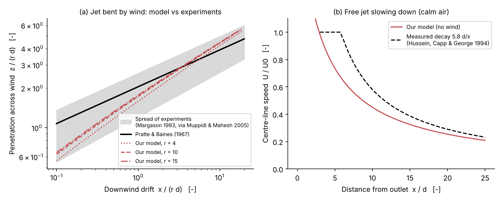
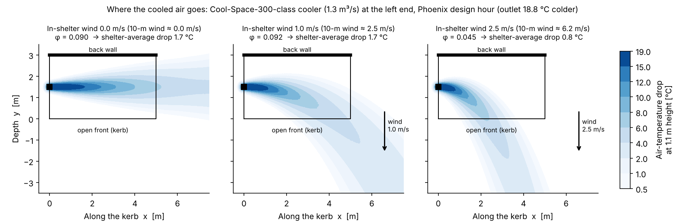
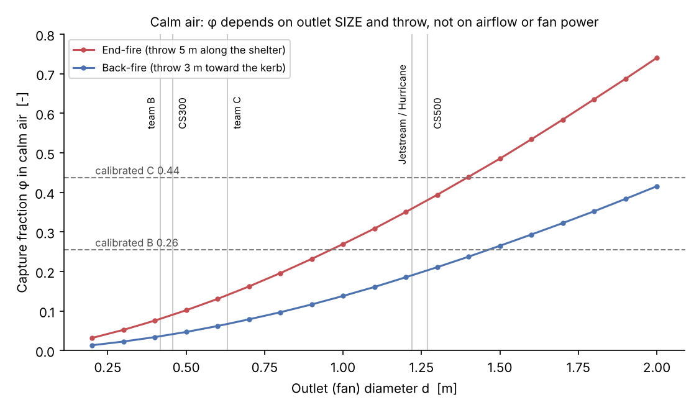
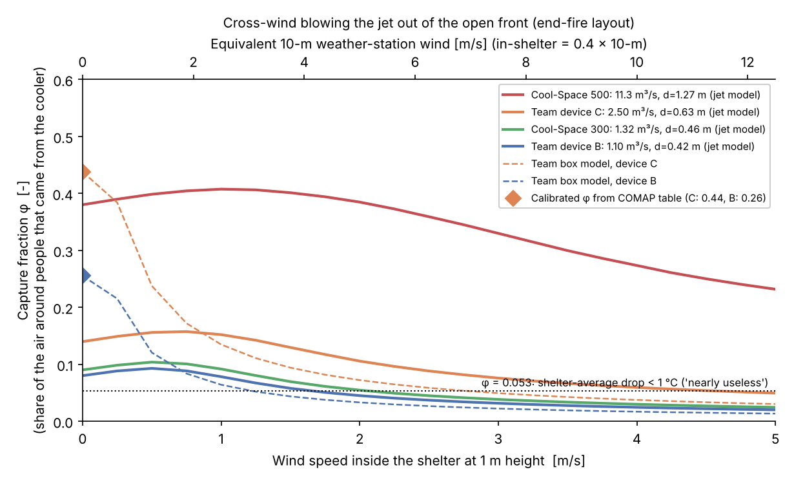
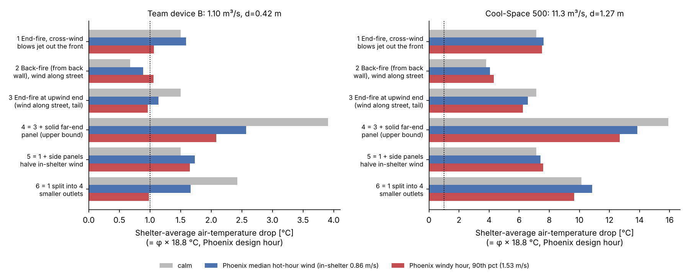
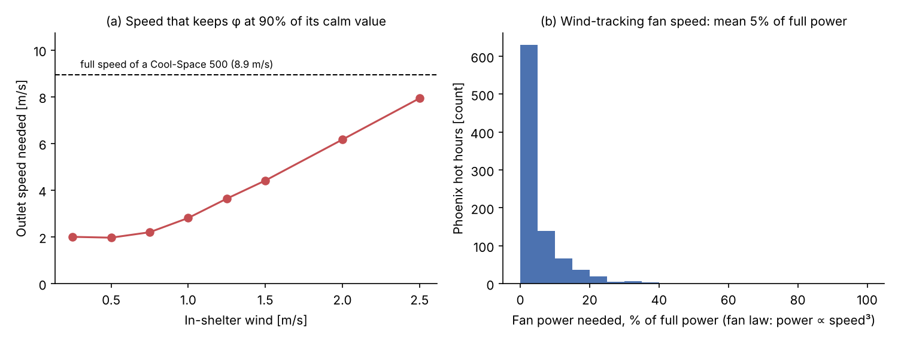

# T08: Where the cold air goes at a windy bus stop
### Carrying the air-curtain physics from the freezer case to an open bus shelter

*Research memo for the team. This is not paper text: read it, check it, then rewrite it in your own words.*
Code: `sprint_out/code/T08_jetmodel.py` (the model), `T08_validate.py` (checks against experiments), `T08_analysis.py` (every number in this memo, output saved in `T08_analysis_output.txt`), `T08_sensitivity.py` (+ `_output.txt`). Figures: `sprint_out/figs/T08_fig1…fig6`.

---

## The short version (read this first)

1. **Calm air: φ depends on the SIZE of the outlet, not on fan power.** With no wind, a cooler's jet of cold air flows straight through the shelter and out the far side. The amount of cooled air inside the waiting zone at any moment is *airflow × time spent in the zone*. A faster fan sends more air, but each bit of air leaves sooner, so the two effects cancel. Our model shows calm-air φ stays at 0.079–0.081 when the airflow through a 0.42 m outlet goes from 0.5 to 4.4 m³/s.
2. **With the team's airflows, jet physics gives about one third of the calibrated φ.** If the team's devices B and C (1.10 and 2.50 m³/s, from `scenario.py`) blow out at a realistic 8 m/s, calm-air φ is **0.080 and 0.140**. The calibration says **0.26 and 0.44**. That means a shelter-average drop of only 1.5 °C and 2.6 °C, not COMAP's 5 °C and 8 °C.
3. **Real coolers of COMAP's power class do match the calibration.** Real 1.1–1.8 kW portable coolers move 11–13 m³/s through 1.2–1.3 m fans, about 10× the team's airflow. A Cool-Space 500 (1.1 kW motor) gives calm φ = **0.38**, which is a 7.1 °C shelter average. That falls between COMAP's 5 °C and 8 °C. Reproducing 0.26 and 0.44 exactly needs outlets of about **0.96 m and 1.40 m** in diameter.
4. **The bus-stop version of air-curtain "breakthrough".** The jet's centreline gets blown out of the open front before it reaches the far end of the waiting area when U₀·d / (U_wind·L) < **0.59**. Here U₀ is the outlet speed, d the outlet diameter, U_wind the wind inside the shelter and L the distance to the far end of the waiting area. For a team-B-sized cooler this starts at about **1.1 m/s** of wind inside the shelter (≈2.8 m/s at a 10 m weather mast). The cooler becomes **"nearly useless"** (shelter average under 1 °C at the Phoenix design hour) at **1.7 m/s** in the shelter (≈4.1 m/s at the mast). That happens in **12% of Phoenix, 30% of Las Vegas and 25% of Seville hot daytime hours**. A warehouse-class 1.3 m outlet never breaks through in normal wind.
5. **Design changes that pay off.** Blow along the long axis, not from the back wall: φ is 2.2× higher (0.080 vs 0.036). Do not let the prevailing wind blow the jet out of the open front. Side panels that halve the in-shelter wind keep φ about 54% higher on windy hours (0.088 vs 0.057). Use a big outlet at low speed, with **fan speed ≈ 3 × in-shelter wind**. In Phoenix hot hours that would need on average about **5% of full fan power** (ideal fan law) for 90% of the calm-air cooling.

---

## 0. What question this memo answers

The team's bus-shelter model uses a **capture fraction φ**. This is the share of the air around a waiting person that came out of the cooler:

  T_zone = φ · T_supply + (1 − φ) · T_ambient    (this is `core.mix()`)

So far φ came from a "well-mixed box" formula, φ = Q/(Q + C_d·A·v), fitted to COMAP's table. This memo asks what real jet physics says φ is, and how it changes with wind.

---

## 1. The picture in plain words

A cooler blowing into a shelter behaves like a **garden hose spraying air instead of water**. It does two things:

* **It swallows the air around it.** The edges of a fast stream of air drag still air in with them, a process called **entrainment**. So the stream grows wider and slower as it travels, and its cold air gets diluted with hot air.
* **Wind bends it.** A sideways wind pushes the stream, just as wind bends the spray from a hose. A strong jet in a weak wind goes nearly straight. A weak jet in a strong wind is swept away almost at once.

This is the same physics as the freezer **air curtain** (Task 1). The air curtain is a jet that must reach the far side of the case before the "cross-pressure" (warm store air pushing in) bends it away. When it fails to reach, warm air breaks through. At the bus stop the cold jet must reach the people before the wind bends it out of the open side. **Same physics, different target.**

---

## 2. Concept 1: a jet in still air (the free jet)

**Plain words.** The air leaves the outlet at speed U₀. For the first ~5–6 outlet diameters a cone of untouched air keeps that speed. After that, the centre speed falls in proportion to 1/distance, because the jet keeps swallowing still air.

**Equation (measured, round jet):**

  U_c / U₀ = B · d / x,  with B ≈ 5.8

* U_c = speed on the jet's centre line at distance x (m/s)
* U₀ = outlet speed (m/s)
* d = outlet diameter (m)
* x = distance from the outlet (m)
* B = decay constant (no units). B = 5.8 and spreading rate S = 0.094 are the laser-Doppler values of Hussein, Capp & George (1994) [VERIFIED via a secondary table; we did not read the original]. S means the jet's half-width grows by 0.094 m for every metre travelled.

*This means a jet drops to half its outlet speed after about 12 outlet diameters.*

**Worked example.** Take a 0.42 m outlet blowing at 8 m/s. At 2.5 m from the outlet, U_c ≈ 8 × 5.8 × 0.42/2.5 = **7.8 m/s**. This is still inside the core region (2.5 m ≈ 6 d), so it really is ≈ 8 m/s. At 5 m it falls to about 3.9 m/s.

**How much air the jet swallows.** Our model treats the jet as a "top-hat" tube that grows. We chose its swallowing rate so that it reproduces B = 5.8 far from the outlet:

  Q(x) / Q₀ = 1 + 4α · x/d,  α = 0.086

* Q₀ = the cooler's airflow (m³/s)
* Q(x) = total air moving in the jet at distance x (m³/s)
* α = entrainment coefficient (no units). We derived it: the Gaussian centre speed is 2× the top-hat speed, so 4α = 2/5.8 = 0.345 [derived from Hussein et al.].

*This means that 5 m from a 0.42 m outlet the jet carries 1 + 0.344 × 11.9 ≈ 5 times the cooler's own airflow. Only one-fifth of it is cooled air.*

### The key result: cooled-air volume held in the shelter

Every metre of jet holds a volume of *pure cooled air* equal to Q₀ / U (airflow divided by how fast it moves on). Add this up over a throw of length L:

  **V_cool = (π d²/4) · (L + 2α L²/d)**    and    **φ_calm ≈ V_cool / V_zone**

* V_cool = volume of pure cooled air inside the waiting zone at any instant (m³)
* L = throw length inside the shelter (m)
* V_zone = waiting-zone volume (m³): 15 m² footprint × 0.1–1.8 m height = 25.5 m³ [ASSUMED: footprint from `scenario.py`; zone heights from feet to standing head height]

**Worked example.** End-fire layout (cooler at one end blowing along the 5 m length), d = 0.42 m:
V_cool = 0.1385 × (5 + 2 × 0.086 × 25 / 0.42) = 0.1385 × 15.2 = 2.11 m³, so φ ≈ 2.11/25.5 = **0.083**. The full 3-D model, which also clips the parts of the jet that leave the zone, gives **0.080**.

**Intuition: U₀ is not in the formula.** In still air, doubling the fan speed doubles the cold air sent, but it also halves how long that air stays. The 3-D model confirms this: for d = 0.42 m and Q₀ = 0.5 / 1.1 / 2.2 / 4.4 m³/s, φ_calm = 0.079 / 0.081 / 0.081 / 0.081. In still air, φ is bought with **outlet area and throw length**, not with kilowatts (Fig. 4).

---

## 3. Concept 2: a jet in a crosswind (jet in crossflow)

**Plain words.** What counts is how strong the jet is compared with the wind, measured by the **velocity ratio r**.

  r = U₀ / U_a  (constant density). The general form is r = √(ρ_j U₀² / ρ_a U_a²) [VERIFIED: Muppidi & Mahesh 2005, eq. 1.1, p. 81].

* U_a = wind speed across the jet (m/s)
* ρ_j, ρ_a = densities of jet air and wind air (kg/m³). Cooled air is ~6% denser, so r changes by about 3%, which we ignore.

**Trajectory (where the centre of the jet goes):**

  z / (r d) = A · (x / (r d))^B,  with A = 2.05 and B = 0.28 (Pratte & Baines 1967)

* z = how far the jet has got in its own starting direction (m)
* x = how far it has drifted downwind (m)
* r·d = the **one length that controls everything** (m): the distance over which the jet "wins" against the wind

[VERIFIED: Muppidi & Mahesh 2005, eq. 1.3, p. 82. That page states "Pratte & Baines (1967) obtain A = 2.05 and B = 0.28". It also says that across all experiments reviewed by Margason (1993), 1.2 < A < 2.6 and 0.28 < B < 0.34. We did not read the original 1967 paper or the Margason review.]

*This means a jet's reach scales with r·d: twice the wind halves the reach. A big outlet resists wind as well as a fast one does.*

**Worked example (team device B: d = 0.42 m, U₀ = 8 m/s, cooler at the end of a 3 m-deep shelter, centred 1.5 m from the open front).**
* In-shelter wind 1 m/s: r = 8, r·d = 3.34 m. When the jet has drifted 1.5 m (to the open front), z = 2.05 × 3.34 × (1.5/3.34)^0.28 = **5.5 m**, so it reaches the far end (5 m) first.
* In-shelter wind 2 m/s: r = 4, r·d = 1.67 m, so z = 2.05 × 1.67 × (1.5/1.67)^0.28 = **3.3 m**. The jet leaves through the front 1.7 m before the far end, and that part of the bench gets almost nothing.

### The bus-stop "breakthrough" rule

Set "drift = distance to the open side X_e" exactly when "penetration = distance to the far end of the waiting area L_p":

  **r_crit = (L_p / (A · X_e^B))^(1/(1−B)) / d**,  or as one group: **Π = U₀ d / (U_a L_p) must exceed (L_p/X_e)^0.389 / 2.71**

For our end-fire shelter (L_p = 5 m, X_e = 1.5 m), **Π_crit = 0.59**. The momentum form is M₀/(ρ U_a² L_p²) = (π/4) Π² = **0.27**. This is the bus-stop analogue of the air-curtain **deflection modulus**: jet momentum divided by the cross-pressure force. For air curtains, Hayes & Stoecker (1969, *Trans. ASHRAE* 75) found a minimum of about 0.15 for a stable curtain [quoted in secondary air-curtain literature found by our search; original not read; T01 should own this number]. **The two numbers are defined differently, so do not compare 0.27 and 0.15 directly.** The point is the shared structure: *both devices fail when jet momentum loses to a sideways force.*

---

## 4. Our 3-D model (what the code does)

* **Jet:** a standard "integral" jet model (`integrate_jet`). It is a growing tube that swallows air in two ways. The jet's own shear swallows at rate α = 0.086 (fixed from the free-jet decay above). The crosswind pushes extra air in at rate β. The swallowed wind air brings its sideways push with it, and the cold jet sinks slightly because it is denser.
* **β is fitted, not assumed.** We chose β = **0.209** so that the model's trajectory matches Pratte & Baines (`T08_validate.py`). The fit is within ±12% (rms) in penetration over x/(rd) = 0.3–10. Fig. 1a shows the model inside the band of experiments. Near the outlet the model bends the jet *more* than Pratte & Baines do, so our wind losses are on the pessimistic side.
* **φ:** each slice of jet holds Q₀·ds/U of pure cooled air. We spread it as a bell-shaped (Gaussian) cross-section, bounce it off the floor, roof and back wall (image method), and count the part inside the 15 m² × 0.1–1.8 m waiting zone. That gives φ exactly as `core.mix()` uses it.
* **Wind:** in-shelter wind at 1 m = 0.4 × 10 m weather wind [ASSUMED, same factor as `scenario.py`'s `v_local_base`].

*Fig. 1. (a) Jet trajectory: our model (red) vs Pratte & Baines (black) and the spread of published experiments (grey band, drawn from the A and B ranges quoted by Muppidi & Mahesh 2005). (b) Calm-air speed decay vs Hussein et al. (1994). The model has no "potential core", so it under-predicts speed in the first ~6 diameters.*

*Fig. 2. Plan view at 1.1 m height: Cool-Space-300-class cooler at the left end. As the wind rises the cold plume is bent out of the open front, and φ falls from 0.090 to 0.045.*

---

## 5. Real spec sheets: the team's airflows are about 10× too low for the stated power

| Model | Airflow | Power | m³/s per kW | Fan diameter | Outlet speed (fan disc) | Source |
|---|---|---|---|---|---|---|
| Hessaire MC37M | 3,100 cfm = 1.46 m³/s | 250 W | 5.9 | n/a | n/a | retailer spec page (alphachooser) [VERIFIED-retailer] |
| Portacool Cyclone 120 | 2,000 cfm = 0.94 m³/s | 2.5 A × 120 V = 0.30 kVA | 3.1 | n/a | "top velocity 30 mph" | Portacool page via search summary [VERIFIED-secondary] |
| Big Ass Fans Cool-Space 300 | 700–2,800 cfm = 1.32 m³/s max | 4.1 A @120 V (0.49 kVA); 0.37 kW motor | 2.7 | 0.457 m | 8.1 m/s | BAF cut sheet [VERIFIED] |
| Portacool Jetstream 270 | 22,500 cfm = 10.6 m³/s | 15.2 A (1.82 kVA) | 5.8 | 1.22 m (48 in) | 9.1 m/s | Portacool legacy page via search [VERIFIED-secondary] |
| **Big Ass Fans Cool-Space 500** | 16,500–24,000 cfm = **11.3 m³/s** | 16.5 A @120 V (1.98 kVA); **1.1 kW motor** | 5.7 | **1.27 m** | 8.9 m/s | BAF cut sheet [VERIFIED] |
| Portacool Hurricane 370 | 28,500 cfm = 13.5 m³/s | 15.2 A (1.82 kVA) | 7.4 | 1.22 m | 11.5 m/s | Portacool page via search [VERIFIED-secondary] |

Notes. 1 cfm = 0.000471947 m³/s (definition). kVA = amps × volts, an upper bound on real power. The outlet speed is airflow divided by fan-disc area [ASSUMED: real outlets have louvres, so actual speed is a little higher]. The BAF Cool-Space 300 and 500 sheets claim "up to 33 °F (18 °C)" of cooling, which matches the team's 18.75 °C outlet drop at the 43 °C / 12% design hour (eps 0.85). That is a nice independent check on the team.

**Contradiction.** `scenario.py` gives device B 1.10 m³/s at 1.2 kW (0.92 m³/s per kW) and C 2.5 m³/s at 2.5 kW (1.0 m³/s per kW). Market units deliver **2.7–7.4 m³/s per kW**, so a 1.2 kW cooler moves **3.2–8.8 m³/s** and a 2.5 kW one **6.7–18.4 m³/s**. The Cool-Space 500 (1.1 kW motor, 11.3 m³/s) is the closest real match to COMAP's 1.2 kW cooler.

**Water (a free check on running cost).** Water evaporated = ρ·Q·c_p·ΔT / h_fg, with ρ = 1.12 kg/m³, c_p = 1.006 kJ/(kg·K) and h_fg ≈ 2420 kJ/kg [standard property values, ASSUMED rounded]. At the design hour (ΔT = 18.75 °C) this is **35 L/h** for team B, **79 L/h** for team C, **42 L/h** for a CS300 and **356 L/h** for a CS500. A retailer gives the Hessaire's water use as 2.58 gal/h [retailer listing via search; not opened]. That matches only a **4 °C** drop at full airflow, so published water ratings must refer to mild conditions.

---

## 6. Results: φ from jet physics vs the calibration

| Device (end-fire, calm) | Q₀ (m³/s) | d (m) | **φ jet, calm** | Shelter drop at design hour | Calibrated φ (box model) |
|---|---|---|---|---|---|
| Team B | 1.10 | 0.42 [ASSUMED U₀ = 8 m/s] | **0.080** | 1.5 °C | 0.255 → 5 °C |
| Team C | 2.50 | 0.63 [same] | **0.140** | 2.6 °C | 0.438 → 8 °C |
| Cool-Space 300 | 1.32 | 0.457 | 0.090 | 1.7 °C | – |
| Cool-Space 500 | 11.3 | 1.27 | **0.380** | 7.1 °C | – |
| Outlet needed for 0.26 / 0.44 | any | **0.96 / 1.40** | 0.26 / 0.44 | 5 / 8 °C | – |

Back-fire (from the back wall toward the kerb, 3 m throw) gives roughly half: 0.036 (team B), 0.066 (C), 0.203 (CS500).

**Verdict.** Jet physics **supports** φ ≈ 0.26–0.44 only for warehouse-class coolers with ~1–1.4 m outlets, which is what 1.2–2.5 kW actually buys on the market. With the team's 1.1 and 2.5 m³/s, jet physics gives φ ≈ 0.08 and 0.14. The box model reached 0.26 and 0.44 only because its fitted open area (10.7 m²) is smaller than the shelter's 24 m² open perimeter. With real airflows the same box fit needs A ≈ **104 m²**, which is unphysical. The calibrated φ values are plausible numbers, but the box model's internals (Q, A) are not.

*Fig. 4. Calm-air φ against outlet diameter. Dashed lines are the calibrated values; vertical lines are real fan diameters.*

---

## 7. φ vs wind, and when the cooler becomes useless

*Fig. 3. φ vs wind blowing the jet out of the open front. Solid lines: jet model. Dashed lines: the team's box model, which uses the 10 m wind as `scenario.py` does. Dotted line: φ = 0.053, the level that gives under 1 °C of shelter-average cooling at the design hour.*

**What the figure shows:**
* **Light wind does not hurt and even helps a little.** Up to ~0.5–1 m/s in the shelter, φ *rises* by about 5–16%: the bent jet lingers and slows inside the zone. The box model instead loses half its φ by 10 m wind ≈ 1.25 m/s (0.255 → 0.121). **The box model badly exaggerates wind losses at low wind.**
* **Then φ falls off once the jet is bent out of the shelter.**

| Device | Centreline blown out before far end (Pratte & Baines) | φ halves | **Nearly useless (<1 °C)** |
|---|---|---|---|
| Team B | 1.14 m/s (mast 2.8) | 2.3 m/s (mast 5.7) | **1.7 m/s (mast 4.1)** |
| Cool-Space 300 | 1.25 (3.1) | 2.5 (6.2) | **2.1 (5.2)** |
| Team C | 1.71 (4.3) | 3.3 (8.3) | 4.6 (11.4) |
| Cool-Space 500 | 3.85 (9.6) | not reached by 5 m/s | not reached |

(All speeds are in-shelter at 1 m height; mast = 10 m weather-station speed = in-shelter / 0.4.)

**Wind direction matters as much as wind speed** (team B, in-shelter wind 1 m/s): wind blowing the jet out of the front φ = 0.078; tailwind along the jet 0.058; wind pushing the jet against the back wall 0.127 (an upper bound from the image method). With a headwind the jet stalls and turns back. Integral models fail there, so the code returns "no answer" rather than a number.

**City check** (`T08_analysis.py`, Open-Meteo hourly data 1 Jun–15 Sep 2025; 10:00–19:00; T ≥ 35 °C, or ≥ 32 °C for Houston and Singapore). Share of hot hours with shelter average under 1 °C, worst wind direction:

| City | Hot hours | Median 10 m wind | Median outlet drop | Team B useless | Team C useless | CS500 useless |
|---|---|---|---|---|---|---|
| Phoenix | 908 | 2.1 m/s | 17.4 °C | **12%** | 0% | 0% |
| Las Vegas | 812 | 2.9 | 18.8 | **30%** | 0% | 0% |
| Seville | 426 | 2.0 | 14.7 | **25%** | 0% | 0% |
| Houston | 321 | 2.0 | 7.4 | 97% | 40% | 0% |
| Singapore | 78 | 2.7 | 5.7 | 100% | 95% | 0% |

*In dry cities a small cooler fails because of **wind**. In humid cities it fails because of **humidity** (the outlet drop is small), whatever the wind.*

---

## 8. Design recommendations (with numbers)

*Fig. 5. Shelter-average drop for six layouts: calm, median Phoenix hot-hour wind (0.86 m/s in shelter) and windy hour (90th percentile, 1.53 m/s).*

1. **Buy outlet area, not kilowatts.** φ_calm ≈ (πd²/4)(L + 2αL²/d) / V_zone. In a 15 m² shelter, φ = 0.26 needs about a 1 m outlet (≈0.75 m²).
2. **Throw along the long axis.** End-fire gives φ = 0.080 vs 0.036 for back-fire with team B (×2.2), and 0.38 vs 0.20 for the CS500 (×1.9). A longer path inside the zone means more residence time.
3. **Orient against the prevailing hot-hour wind.** The worst case is wind blowing the jet out through the open front. Put the cooler where the prevailing wind pushes the cold air into a wall or a closed corner, or carries it along the bench. Side panels that **halve** the in-shelter wind keep team B at φ = 0.088 instead of 0.057 on a windy Phoenix hour (+54%) [the 50% wind reduction is ASSUMED. CFD of panels at an open-air auditorium found 60–80% reductions (Vera Rodrigues et al., HARMO 19), via search summary; we found no bus-shelter study].
4. **Close the downwind end.** A solid panel at the far end, with the cooler at the upwind end, raises φ from 0.080 to *at most* 0.209 for team B in calm air (calculated by reflection, which is an **upper bound**; the true gain lies between).
5. **Many small outlets help only where it is calm.** Splitting team B's outlet into 4 with the same total area raises calm φ by 61% (0.080 → 0.129), but on windy hours it gives nothing extra (0.052 vs 0.057). Small jets have small r·d and bend sooner. **Calm sites: diffuse. Windy sites: one strong jet.**
6. **Track the wind with fan speed.** Keeping 90% of the calm-air φ needs **U₀ ≈ 3 × in-shelter wind** (Fig. 6). A big 1.27 m outlet run at 2–4 m/s gives the same calm-air cooling as full speed (8.9 m/s). Under the fan law (power ∝ speed³) [VERIFIED-secondary: standard affinity laws, e.g. engineeringdesignresources.com/fan-laws], Phoenix hot hours would need on average **5%** of full fan power. This ignores pump and motor losses at low speed [ASSUMED]. A bonus: at full speed the CS500 blasts ~9 m/s at people, well above the Lawson comfort limits of 4 m/s for sitting and 6 m/s for standing [VERIFIED-secondary: Lawson criteria as quoted in Irish EIAR wind chapters].

*Fig. 6. (a) Outlet speed needed to keep 90% of calm φ. (b) Fan power needed in Phoenix hot hours with wind-tracking control.*

---

## 9. Sensitivity (team B, `T08_sensitivity.py`)

| Change | Calm φ | Useless wind (in-shelter) |
|---|---|---|
| Base | 0.080 | 1.66 m/s |
| β = 0.10 / 0.30 / 0.45 | 0.080 | 1.80 / 1.57 / 1.46 |
| Zone top 1.5 m / 2.1 m | 0.094 / 0.068 | 1.94 / 1.40 |
| Shelter 4×2 m / 8×2 m | 0.105 / 0.156 | 2.36 / 1.11 |
| Outlet drop 8 / 25 °C (buoyancy) | 0.081 / 0.080 | – |
| Same 1.10 m³/s at U₀ = 4 m/s (d = 0.59) / 12 m/s (d = 0.34) | 0.126 / 0.062 | 1.94 / 1.51 |

The main conclusions hold across these changes. A slower, wider outlet wins on both counts. Long, narrow shelters hold more cooled air in calm conditions but lose it at lower wind.

---

## (a) Key findings

1. In calm air, φ depends on outlet size and throw, **not airflow**: φ_calm ≈ (πd²/4)(L + 2αL²/d)/V_zone, with α = 0.086.
2. Jet physics with the team's 1.10 / 2.50 m³/s gives calm φ = **0.080 / 0.140**, about one third of the calibrated 0.26 / 0.44. A real 1.1 kW cooler (11.3 m³/s, 1.27 m fan) gives **0.38**.
3. Real coolers move **2.7–7.4 m³/s per kW**, but `scenario.py` assumes about 0.9–1.0.
4. Breakthrough: Π = U₀d/(U_a L_p) < **0.59**. A small cooler becomes nearly useless at **≈1.7 m/s** in the shelter (≈4 m/s mast wind), which covers 12–30% of hot hours in Phoenix, Las Vegas and Seville.
5. End-fire beats back-fire by **×2**. Halving the wind with panels gives **+54%** on windy hours. Wind-tracking fan speed (U₀ ≈ 3·U_a) needs about **5%** of full fan power on average in Phoenix.

## (b) Verified vs assumed

* **VERIFIED (read in source):** Pratte & Baines A = 2.05, B = 0.28 and Margason's range 1.2–2.6 / 0.28–0.34 (Muppidi & Mahesh 2005, p. 82); Cool-Space 300 and 500 specs (BAF cut sheets).
* **VERIFIED-secondary** (search summary or secondary table, original not opened): B = 5.8 and S = 0.094 (Hussein et al. 1994); Portacool and Hessaire specs; Lawson criteria; fan laws; air-curtain D_m ≈ 0.15.
* **ASSUMED:** shelter 5 × 3 × 2.5 m with the back wall closed; waiting zone 0.1–1.8 m; outlet at 1 m height; U₀ = 8 m/s for the team's devices; in-shelter wind = 0.4 × mast wind; uniform crosswind inside the shelter; the 50% panel effect; reflection (image method) at walls as an upper bound.
* **FITTED:** β = 0.209, matched to Pratte & Baines.
* **NOT FOUND:** the counter-flow (headwind) penetration constant (Beltaos & Rajaratnam 1973 could not be retrieved); any bus-shelter-specific wind or CFD study.

## (c) Decisions the team must make

1. **What is COMAP's cooler?** Either it is a warehouse unit (≈11 m³/s, ~1.2 m fan), in which case keep φ ≈ 0.26–0.44 but fix Q in `DEVICES`. Or it really is 1.1 m³/s, in which case φ ≈ 0.08 and COMAP's "5 °C" cannot be a shelter average at 43 °C / 12% RH.
2. **Swap the box model for this one, or keep it with a wind-direction factor?** The box model overstates wind losses below ~1 m/s.
3. **Re-word φ.** It is the share of the *air around people* that came from the cooler, not "the share of the cooling produced". Doubling the fan doubles the cooling produced (and the water used) but leaves calm-air φ unchanged.
4. **Fix an inconsistency in `scenario.py`.** It uses the raw 10 m wind for leakage but 0.4 × wind for local air speed.

## (d) How this feeds the rest of the paper

* **Task 1 → 2a bridge:** "the air curtain fails when jet momentum loses to cross-pressure; the bus-stop jet fails when U₀d/(U_a L) < 0.59." This is one physical idea in two venues and fits the paper's spine.
* **Task 2a:** replace `capture_fraction()` with an interpolation table of φ(U_a, wind direction, d, layout) from `T08_jetmodel.phi_device`.
* **Task 2b (rail station):** semi-enclosed walls change two things. (i) The image/wall terms become real, so φ goes up. (ii) Crowd heat matters. The same code works with a larger zone and more walls.
* **Task 3:** the city table shows how wind and humidity sort the climates.
* **Task 4:** wind-tracking fan control is a cheap optimisation, and the Lawson speed limit is a comfort constraint.
* **Memo/blog:** "a cooler is a hose of cold air: a big gentle one beats a small fast one."

## (e) Weaknesses and open questions

* The model is an integral model. It has no potential core near the outlet, it cannot handle a stalled headwind jet, and it assumes a uniform crosswind. Real shelters have a recirculating wake behind the back wall, gusts, and buses passing (they cause transient breakthrough).
* Wall reflection is an upper bound; real impinging jets spill out of open sides.
* "Nearly useless = 1 °C" is our threshold, not a published perception limit.
* Fan diameter is used as the outlet diameter. Louvres and centrifugal outlets differ.
* There is no validation against a measured bus shelter. A field test would be: one cooler, thermometers at 1.1 m on a 1 m grid, logged together with wind.

---

### Sources

* Muppidi, S. & Mahesh, K. (2005). *Study of trajectories of jets in crossflow using direct numerical simulations.* J. Fluid Mech. 530, 81–100. doi:10.1017/S0022112005003514. https://dept.aem.umn.edu/~kmahesh/globalassets/publpdf/journal/suman_jfm_scaling.pdf (eqs 1.1, 1.3, p. 81–82)
* Pratte, B.D. & Baines, W.D. (1967). *Profiles of the round turbulent jet in a cross flow.* J. Hydraulics Div. ASCE 93(HY6). https://ascelibrary.com/doi/10.1061/JYCEAJ.0001735 (cited through Muppidi & Mahesh)
* Margason, R.J. (1993). *Fifty years of jet in cross flow research.* AGARD-CP-534. https://ntrs.nasa.gov/citations/19940023520 (cited through Muppidi & Mahesh)
* Hussein, H.J., Capp, S.P. & George, W.K. (1994). J. Fluid Mech. 258, 31–75 (B = 5.8, S = 0.094; seen in a secondary table)
* Big Ass Fans, *Cool-Space 500 cut sheet*: https://cdn.shopify.com/s/files/1/0972/5538/files/Cutsheet_Cool-Space_500_1.pdf; *Cool-Space 300 cut sheet*: https://cdn.shopify.com/s/files/1/0972/5538/files/Cutsheet_Cool-Space_300_1.pdf
* Hessaire MC37M specs: https://www.alphachooser.com/air_conditioners--hessaire_mc37m--air_conditioner-specs-and-profile ; water 2.58 gal/h: https://www.desertcart.vn/products/18058766-hessairemc37m-3100cfm-evaporative-cooler (not opened)
* Portacool Jetstream 270: https://www.portacool.com/legacy-evaporative-coolers/jetstream-series/jetstream-270-evaporative-coolers/ ; Cyclone 120 / Hurricane 370: portacool.com product pages (via search summaries)
* Hayes, F.C. & Stoecker, W.F. (1969). Trans. ASHRAE 75 (air-curtain deflection modulus; secondary only)
* Vera Rodrigues et al., HARMO 19 (Bruges): https://harmo.org/Conferences/Proceedings/_Bruges/publishedSections/H19-111%20Vera%20Rodrigues.pdf (panel wind attenuation, via search summary)
* Lawson comfort criteria, as quoted in Irish EIAR wind chapters, e.g. https://www.pleanala.ie/publicaccess/EIAR-NIS/309026/3.%20EIAR/Chapter%2011-%20Wind%20and%20Microclimate.pdf
* Fan affinity laws: https://ae.engineeringdesignresources.com/fan-laws
* Weather: Open-Meteo historical archive API (via `himcm_b/fetch.py`)
