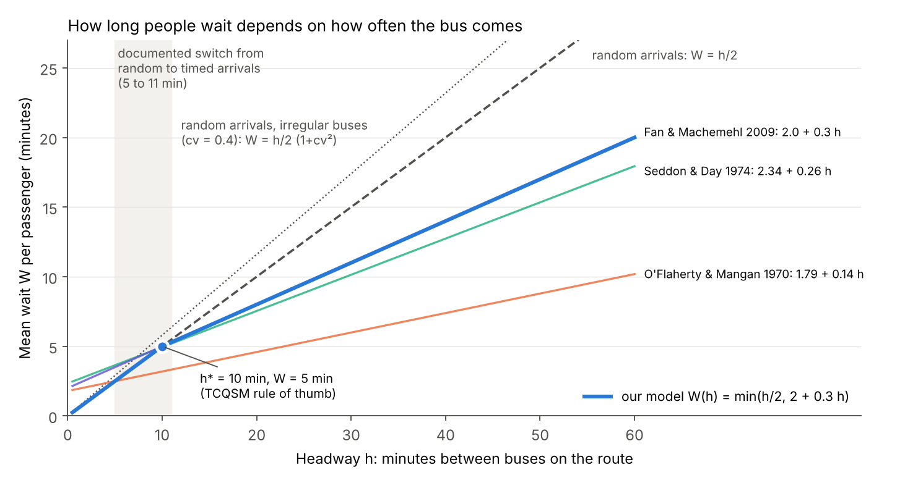
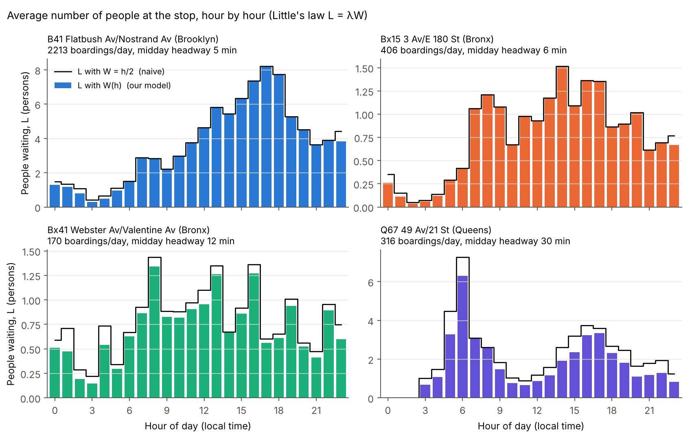
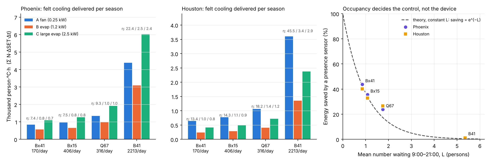
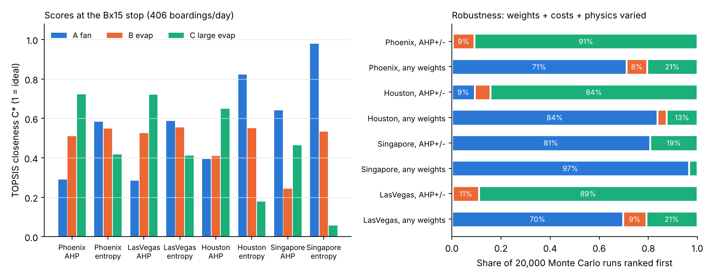

# T09: How many people are waiting, and a fair way to compare fan A, cooler B and cooler C

*Research memo for the HiMCM 2026 Problem B team. Not paper text: rewrite it in your own words.*

**Files.** Code: `sprint_out/code/T09_*.py` (run in the order gtfs_headways, ridership_pull, occupancy, service, topsis, fig3_and_checks). Figures: `sprint_out/figs/T09_fig1` to `T09_fig4`. Downloaded data and intermediate tables: `sprint_out/dl_T09/`.

---

## 0. The short version

1. **When do people stop arriving at random?** Studies put the switch at a headway (time between buses) of **5 to 11 minutes**. The US *Transit Capacity and Service Quality Manual* uses **10 minutes**. Below that, people turn up at random and wait about **half the headway**. Above it, many check the timetable, and the wait grows more slowly, about **W = 2 + 0.3h minutes** (Fan & Machemehl 2009, Austin buses). Our model is **W(h) = min(h/2, 2 + 0.3h)**. The two lines cross at exactly **h\* = 10 min** (Fig 1).
2. **Real ridership data.** New York's MTA publishes *hourly, stop-level* bus boardings, counted by automatic passenger counters (data.ny.gov dataset `fvdm-uavx`). We joined this to the MTA's published bus schedules (GTFS) to get each hour's headway. Four real stops have **170 to 2,213 boardings per weekday**. Through Little's law they hold **0.8 to 4.7 people on average** between 6:00 and 22:00, with peaks of **1.3 to 8.2**. That is **17 to 88 person-hours of waiting per day** (Fig 2).
3. **Occupancy multiplies how much cooling people receive, but it almost never changes which device is most efficient per kWh.** It is a common multiplier, so it cancels in the comparison. Across 5 climates and 4 real stops, the fan's lead per kWh over the large cooler stays between **9.5x and 23x**, and moving between stops changes it by at most about 15%. What occupancy *does* change: (a) **total** cooling delivered, (b) the **control strategy**: a presence sensor saves **24 to 44%** of energy at ordinary stops but **about 1%** at the busy stop, and (c) the total-service ranking when the fan can cover only a few people (Fig 3).
4. **The multi-criteria comparison (TOPSIS) is decided by one value judgement**: how much weight goes on "heat-safety" (UTCI-based heat-stress relief), the one criterion on which our model gives the fan almost no credit.
   - With safety-first AHP weights, the **large cooler C wins** in Phoenix, Las Vegas and Houston, and keeps first place in **84 to 91%** of Monte Carlo runs.
   - With entropy, equal or random weights, the **fan wins** (70 to 97%).
   - The flip happens when heat-safety carries about **23% (Phoenix), 32% (Houston) or 54% (Singapore)** of the weight.
   - A ±20% change to any single weight changes nothing. The ranking is stable to small changes in weights but entirely set by which value judgement you choose (Fig 4).
5. **Model-forcing warning.** Use TOPSIS only for Task 4 (balancing performance, experience, energy and cost). Do not use it for Task 2a's "measure of efficiency". There, physics already gives one currency (person·°C·h per kWh), and TOPSIS adds false precision: entropy weights put the most weight on *water*, only because the fan uses none, and adding a "shade only" option flips the winner (rank reversal).

---

## 1. How long does a passenger wait? W as a function of headway

### 1.1 The idea in plain words
If buses come every 4 minutes, nobody checks a timetable; you just walk up. If buses come every 30 minutes, you check the app and arrive a few minutes early. So **the average wait does not keep growing as h/2**. It grows more slowly once headways get long. The wait W matters to us because the number of people standing in the shelter is set by how long they stay (Section 2).

### 1.2 The random-arrival formula
**Words.** If people arrive at random times and buses are perfectly regular, a person lands on average halfway through the gap, so they wait half the headway. If buses bunch (irregular gaps), more people land in the long gaps, and the average wait is longer.

**Equation** (Osana & Newell 1972; Newell 1982; as given in Singh et al. 2021, eq. 1):

  E[W] = (h / 2) · (1 + cv²)

| Symbol | Meaning | Units |
|---|---|---|
| E[W] | mean wait per passenger | min |
| h | mean headway (time between buses on the route) | min |
| cv | coefficient of variation of headways (standard deviation ÷ mean) | none |

**Intuition.** Perfect regularity (cv = 0) gives h/2. Bunched buses (cv = 0.4) make everyone wait 16% longer.
**Worked example.** h = 12 min, cv = 0.3: E[W] = 6 × (1 + 0.09) = **6.5 min**.

### 1.3 What studies measured: the switch from random to timed arrivals

| Study | Place, mode | Finding | Tag |
|---|---|---|---|
| O'Flaherty & Mangan 1970, *Traffic Eng. & Control* 11:419–421 | Leeds, bus | E[W] = 1.79 + 0.14h; equals h/2 at **h ≈ 5 min** | [VERIFIED: coefficients as quoted in Singh et al. 2021, p.5; original not seen] |
| Seddon & Day 1974, *Traffic Eng. & Control* 15 | Manchester, bus | E[W] = 2.34 + 0.26h; switch at **≈ 10 min** | [VERIFIED: Singh et al. 2021, p.5; original not seen] |
| Turnquist 1978, *TRR* 663 | US bus | proposed the two types: random vs timed passengers | [VERIFIED: Singh et al. 2021, p.4; TRB PDF exists] |
| Bowman & Turnquist 1981, *Transp. Res. A* 15(6):465–471 | Chicago, bus | waits are **more sensitive to regularity than to the headway itself** (no single threshold) | [VERIFIED: citation via TRID; finding as summarised by Singh et al. 2021, pp.5–6] |
| Luethi, Weidmann & Nash 2007, TRB | Zurich, bus/tram/rail | switch at **≈ 5 min** | [VERIFIED: Singh et al. 2021, p.5] |
| Fan & Machemehl 2009, *TRR* 2111:169–176 | Austin, bus, 8–60 min headways | E[W] = 2 + 0.3h; switch at **11 min**; **all** passengers timed above **38 min** | [VERIFIED: Singh et al. 2021, p.5, and the abstract at worldtransitresearch.info/research/70] |
| TCQSM, 3rd ed. (Kittelson & Assoc. et al. 2013) | US manual | switch at **10 min** | [VERIFIED: as quoted in Singh et al. 2021, p.4; manual itself not opened] |
| Nygaard & Torset 2016 | Trondheim, bus | non-random already at 10, 15, 20 min; E[W] = 0.32h at 10 min | [VERIFIED: Singh et al. 2021, p.5] |
| Ingvardson, Nielsen, Raveau & Nielsen 2018, *Transp. Res. C* 90:292–306 | Copenhagen rail | **43%** of passengers timed at 5 min, **52%** at 10 min (when a timetable exists) | [VERIFIED: abstract; 52% via Singh et al. 2021, p.5] |
| Berggren et al. 2019 | Lund/Malmö | non-random at 5 min | [VERIFIED: Singh et al. 2021, p.5] |
| Singh, Graham, Hörcher & Anderson 2021, *Transp. Res. C* 130:103267 | London Underground smart cards | marginal wait drops from >½ to **≈ ⅓ of headway** between **2 and 3 min** | [VERIFIED: preprint abstract, p.1] |
| Watkins et al. 2011, *Transp. Res. A* 45(8):839–848 | Seattle, bus | riders with real-time apps wait **"almost 2 min less"** | [VERIFIED: abstract via RePEc/worldtransitresearch] |

Main source for the review rows: Singh et al. (2021), open preprint at <https://spiral.imperial.ac.uk/server/api/core/bitstreams/d3b1d171-cdc7-4a7d-9fe7-38d2cecffc20/content>, Section 2.1, pp. 4–5. I could not get the 1970/1974 originals. Cite them as "as reported by Singh et al. (2021)".

**Bottom line.** For buses, the documented threshold is **5 to 11 min**, and the US convention is **10 min**. Newer smart-card and app-era studies push it *lower*. That makes sense: real-time apps let people time their arrival even for frequent service.

Small inconsistency to note: Fan & Machemehl's line 2 + 0.3h crosses h/2 at 10.0 min, but they report the switch at 11 min. Their 11 min probably comes from a separate test. I could not check this without the full paper.

### 1.4 Our model W(h)
**Words.** Below the switch, use the random formula. Above it, use the timed-arrival line from the US bus study.

**Equation:** W(h) = min( h/2 · (1 + cv²), a + b·h ), with a = 2.0 min and b = 0.30 (Fan & Machemehl 2009, US buses). Default cv = 0 [ASSUMED: the Austin regression already absorbs real irregularity; cv is tested below].

| Symbol | Meaning | Units |
|---|---|---|
| a | the wait a timed passenger keeps as a safety margin | min |
| b | the share of extra headway that still turns into waiting | none |
| h\* = a / (½(1+cv²) − b) | headway where the two branches meet | min |

**Intuition.** With cv = 0 the branches meet at h\* = 2 / (0.5 − 0.3) = **10 min**, which is the TCQSM number, so the model is continuous and agrees with the US manual. With irregular buses the switch comes earlier: cv = 0.2 gives 9.1 min, cv = 0.3 gives 8.2 min, cv = 0.4 gives 7.1 min (`T09_occupancy.py` output).

**Worked examples.** h = 5 min gives W = min(2.5, 3.5) = **2.5 min** (random). h = 30 min gives W = min(15, 11) = **11 min** (timed), which is 27% less than the naive 15 min.

*Fig 1. Mean wait against headway: the random-arrival lines, three published timed-arrival fits, and our model (thick blue).*

---

## 2. Real hourly arrival rates λ and occupancy L at real stops

### 2.1 Data source [VERIFIED]
- **Boardings:** *MTA Bus Stop Ridership Estimates: Beginning 2024*, data.ny.gov id **fvdm-uavx** (<https://data.ny.gov/d/fvdm-uavx>). One record per route × direction × stop × month × weekday × hour. Counts come from Automatic Passenger Counters (APCs) on buses. Coverage is January 2024 to September 2026.
- **Headways:** MTA bus GTFS schedule feeds (`https://rrgtfsfeeds.s3.amazonaws.com/gtfs_{b,bx,m,q,si,busco}.zip`). Service is valid from 9 October 2026; we used Wednesday 14 October 2026. Scheduled departures per stop, route and hour come from `T09_gtfs_headways.py`.
- **Cross-checks:** *MTA Bus Hourly Ridership 2020–2024* (`kv7t-n8in`, fare-system counts by route) and *MTA Daily Ridership* (`vxuj-8kew`).

### 2.2 What the APC number means: a check we had to do
The dataset page does not say whether `estimated_ridership` is a daily average or a **monthly total** for that weekday-hour. The test: in July 2024, the stop-level totals divided by the fare-system totals for the same weekdays give a nearly constant ratio:
- Mondays (5 in the month): 2.04
- Wednesdays (5): 2.05
- Thursdays (4, including July 4): 2.07
- Saturdays (4): 2.15

The Thursday stop-level total (8.40 M) is 0.71 × the Wednesday total (11.77 M), exactly as the fare data shows (4.06 M vs 5.74 M). So the values are **monthly totals**, and we divide by the number of such weekdays in the month. [VERIFIED by our own query; code in this memo's Bash log; numbers from data.ny.gov]

After dividing, APC boardings are about 2.35 M per Wednesday. The fare system recorded 1.15 M paid trips (or 1.36 M including transfers), and the official daily count on 10 July 2024 was 1.25 M. A ratio of about 1.7 to 2 is consistent with the MTA's reported **bus fare evasion of 44 to 48% in 2024** [VERIFIED: Citizens Budget Commission, "No Fare" (cbcny.org/research/no-fare); MTA figures reported by Gothamist]. Fare counts miss people who do not pay; APCs count everyone, and everyone needs shade. **For people in the shelter, the APC count is the right one.**

### 2.3 Data-quality lesson: pool the data
One stop in one month is noisy. One weekday-hour can jump fivefold. At Bx41 Webster Av, the July 2025 Wednesday total suggested 438 boardings per day, but pooling 30 samples (June to August of 2024 and 2025 × Monday to Friday) gives **170 ± 103 per day**. Choosing the stop *because* it looked busy on one noisy day overstated it 2.6x. This is the "winner's curse". **Always pool.** Spread of daily boardings across the 30 samples:

| Stop (route) | Boardings/day, mean ± sd | Buses/day | Headway, peak / midday (min) |
|---|---|---|---|
| B41 Flatbush Av/Nostrand Av, Brooklyn | 2,213 ± 138 | 243 | 4.9 / 4.6 |
| Bx15 3 Av/E 180 St, Bronx | 406 ± 130 | 217 | 4.4 / 5.6 |
| Bx41 Webster Av/Valentine Av, Bronx | 170 ± 103 | 100 | 12.0 / 12.2 |
| Q67 49 Av/21 St, Queens | 316 ± 82 | 55 | 13.3 / 30.0 |

[VERIFIED: data.ny.gov fvdm-uavx and MTA GTFS, our processing in `T09_ridership_pull.py`]. Headways come from the *autumn 2026* timetable, applied to *summer 2024/25* ridership [ASSUMED: timetables change little; summer service is often slightly thinner].

### 2.4 Little's law: people in the shelter
**Words.** The number of people at a stop equals how fast they arrive multiplied by how long each one stays.

**Equation** (Little 1961, *Operations Research* 9(3):383–387): **L = λ · W**

| Symbol | Meaning | Units |
|---|---|---|
| L | average number of people waiting | persons |
| λ | arrival rate = boardings per hour | persons/h |
| W | mean wait, from W(h) in Section 1.4 | h (divide minutes by 60) |

**Intuition.** It holds for any arrival pattern, as long as the hour is roughly steady. That is why it suits hourly data.

**Worked example 1.** Bx15 at 14:00: λ = 36.4 per hour, 12 buses per hour so h = 5 min, W = 2.5 min. L = 36.4 × 2.5 / 60 = **1.52 people**.

**Worked example 2.** Q67 at 06:00: λ = 58.2 per hour, h = 15 min, W = 2 + 0.3 × 15 = 6.5 min. L = **6.3 people**. The naive h/2 = 7.5 min would give 7.3 people.

**A second queueing fact we use.** With random (Poisson) arrivals, the *number* of people waiting at any moment is Poisson-distributed with mean L, whatever the wait-time distribution. This is the M/G/∞ result in standard queueing textbooks [VERIFIED: standard result, e.g. Ross, *Introduction to Probability Models*]. So **P(shelter empty) = e^(−L)**. At L = 1 the shelter is empty 37% of the time. At midday, Bx15, Bx41 and Q67 are empty **36 to 40%** of the time; B41 only 2% (`T09_stop_summary.csv`).

*Fig 2. Average number of people waiting, hour by hour, at four real NYC stops (bars: our W(h) model; black line: naive h/2).*

**Results (weekday, `T09_occupancy.py`):**

| Stop | Mean L, 6–22 h | Peak L (hour) | Person-hours/day, W(h) | Person-hours/day, h/2 |
|---|---|---|---|---|
| B41 (2,213/day) | 4.70 | 8.2 (17 h) | 87.9 | 89.6 |
| Bx15 (406/day) | 1.01 | 1.5 (14 h) | 18.5 | 18.8 |
| Bx41 (170/day) | 0.84 | 1.3 (8 h) | 17.1 | 19.1 |
| Q67 (316/day) | 2.14 | 6.3 (6 h) | 41.4 | 51.4 |

**Non-obvious point.** Q67 has *fewer* boardings than Bx15 but **2.2 times the person-hours in the shelter**, because its buses are 2 to 6 times less frequent. **Shade is worth more at infrequent stops**, even with fewer riders. Cutting service frequency raises the cooling need of the stop. The timed-arrival correction matters only where headways are long: it cuts Q67's person-hours by 20% and the frequent stops' by 2%.

**Sensitivity of person-hours/day to the W model** (B41 / Bx15 / Bx41 / Q67):
- O'Flaherty & Mangan (threshold 5 min): 81.8 / 16.6 / 10.4 / 23.8
- Seddon & Day: 87.5 / 18.4 / 16.5 / 39.0
- Fan & Machemehl, our base case: 87.9 / 18.5 / 17.1 / 41.4
- Random branch with cv = 0.4: 99.9 / 20.9 / 17.1 / 41.4
- Everyone using a real-time app ("2 min less", capped at half of W): 46.1 / 9.8 / 11.4 / 30.8

So the wait model moves occupancy by up to about ±45% at long-headway stops, and real-time apps could roughly halve shelter occupancy at frequent stops.

**Check on the team's existing code (`scenario.py`).** It assumes 420 boardings per day with a 12-min headway and h/2, which gives 42 person-hours per day. A real NYC stop with about 400 boardings per day (Bx15) runs every 5 min and has **18.5** person-hours. A 12-min stop (Bx41) has only 170 boardings. The default pairs high ridership with low frequency and **overstates occupancy by about 2.3x** for a stop of that ridership. Its hourly *shape* is reasonable (AM 7–9 h share 0.23 vs real 0.10–0.25; PM 15–18 h share 0.32 vs real 0.21–0.40), but it misses the large night share at some stops (0.06 assumed vs up to 0.16 real at Bx41).

---

## 3. People-weighted service: does occupancy change which system is "most efficient"?

### 3.1 Definition
**Words.** Count every degree of felt cooling, for every person, for every hour.

**Equation:** S = Σ_t N_t · ΔSET_t · Δt  (person·°C·h), and **η = S / E**  (person·°C·h per kWh)

| Symbol | Meaning | Units |
|---|---|---|
| N_t | people waiting in hour t (= L_t from Little's law) | persons |
| ΔSET_t | drop in Standard Effective Temperature the device gives in hour t (felt cooling, from `core.py`); counted only when positive | °C |
| Δt | 1 hour | h |
| E | electricity used | kWh |

**Intuition.** One person cooled by 2 °C for 1 hour equals 2 people cooled by 1 °C for 1 hour; both are 2 person·°C·h.

**Worked example.** Bx15, Phoenix, at 14:00 on a day when the large cooler gives ΔSET = 0.6 °C: N = 1.52, so S for that hour = 1.52 × 0.6 × 1 = **0.91 person·°C·h** for 2.5 kWh × P(occupied) = 2.5 × (1 − e^(−1.52)) = 1.95 kWh.

**Set-up.** The team's calibrated shelter model is used unchanged: capture fraction φ = 0.255 for B and 0.438 for C; residual ±0.21 °C. This reproduces the shared-context values. Inputs: 2,568 hours of summer-2025 weather per city, and the NYC weekday profile placed in each city [ASSUMED: transferable; weekends would be lower]. Control rules: **always on**; **smart** (on when SET without cooling is ≥ 30 °C and the device helps); **smart + presence sensor** (expected on-time = 1 − e^(−L)).

### 3.2 Why occupancy almost never changes the per-kWh ranking: a 3-line proof
Write N_t = k · n_t, where k is the size of the crowd and n_t its daily shape. Then for any device

  η_A / η_C = (P_C / P_A) · Σ n_t ΔSET_A,t / Σ n_t ΔSET_C,t

if both devices run the same hours. **The crowd size k cancels.** Only the *timing* of the crowd can matter: whether people are there in the hours when one device is relatively better. That timing effect is small in our runs.

| City | fan ÷ large-cooler η, range over 4 stops + flat profile (smart + sensor) | range (always on) |
|---|---|---|
| Phoenix | 9.5 – 10.0 | 7.4 – 7.8 |
| Las Vegas | 9.7 – 10.1 | 6.1 – 6.5 |
| Seville | 9.5 – 9.7 | 8.9 – 11.2 |
| Houston | 15.6 – 16.2 | 17.9 – 20.5 |
| Singapore | 22.2 – 23.3 | 20.5 – 21.7 |

[Model output, `T09_service.py`]. Per kWh, the **fan wins everywhere** under the team's current physics, by 10x to 23x. No occupancy profile we tested comes close to flipping it.

### 3.3 Where occupancy *does* matter
1. **Total service (not per kWh).** In Phoenix the large cooler delivers the most person·°C·h at every stop. At Bx15: 1,266 for C vs 960 for the fan vs 656 for B. In Houston and Singapore the fan delivers the most. Occupancy scales these totals 5x between Bx15 and B41 (Fig 3).
2. **Coverage limits.** A fan cools only the people standing in its jet. If the fan can serve at most c people at once, the people it reaches are E[min(N, c)] with N ~ Poisson(L).
   - Per kWh, the fan still beats C even at c = 1 (Phoenix B41: 4.7 vs 2.4).
   - For *total* service at the busy B41 stop in Houston, the fan beats C only if it covers **4 or more people** (c = 3: 1,910 vs 2,364; c = 4: 2,403 vs 2,364 person·°C·h).
   - The fan's coverage [ASSUMED: no data] is therefore a design decision that occupancy turns into a ranking decision.
3. **Control strategy.** With a presence sensor, the energy saved in an hour is e^(−L).
   - At Bx41, Bx15 and Q67 a sensor saves **24 to 44%** of the large cooler's energy.
   - At B41 it saves **1%**.
   - Smart "only when hot and helpful" control cuts always-on energy by 60% (Phoenix) to 96% (Singapore).
   - **Occupancy decides the controller, not the device.**

*Fig 3. Left and middle: felt cooling delivered per season at each stop; the small labels give η (person·°C·h per kWh) for A / B / C. Right: energy a presence sensor saves, against mean occupancy (dashed: e^(−L)).*

**Season totals at Bx15, smart + sensor** (from `T09_service.py`):

| City | Device | Felt cooling (person·°C·h) | Heat-safety (person·risk·h) | kWh | Water (m³) | η |
|---|---|---|---|---|---|---|
| Phoenix | A fan | 960 | 0.8 | 127 | 0 | 7.5 |
| Phoenix | B evap | 656 | 319 | 804 | 21.1 | 0.8 |
| Phoenix | C large | 1,266 | 598 | 1,676 | 48.0 | 0.8 |
| Houston | A fan | 770 | 13.2 | 54 | 0 | 14.3 |
| Houston | B evap | 287 | 36.0 | 269 | 2.8 | 1.1 |
| Houston | C large | 501 | 65.3 | 562 | 6.4 | 0.9 |

Water is computed from physics: water = ρ_air · Q · (W_out − W_in). For example, C in Phoenix at 16:00 evaporates about 77 L/h (median hour) [model output; ρ_air = 1.15 kg/m³ ASSUMED; no pad bleed-off water included].

---

## 4. Multi-criteria comparison: AHP, entropy and TOPSIS

### 4.1 Criteria (season totals, Bx15 stop, smart + sensor)
- C1 **felt cooling**, person·°C·h (benefit)
- C2 **heat-safety**, person-hours of UTCI heat-risk removed, from `core.heat_risk` (benefit)
- C3 **energy**, kWh (cost)
- C4 **water**, m³ (cost)
- C5 **money**, $ per season (cost) = capex ÷ life + maintenance + kWh × $0.1337 + m³ × water price

Prices and costs:
- $0.1337/kWh is the US commercial average for 2025 [VERIFIED: EIA *Electric Power Monthly* Table 5.3].
- Capex, central value (Monte Carlo range): A $800 (300–2,000), B $2,500 (1,000–5,000), C $5,000 (2,000–10,000).
- Maintenance per season: A $20, B $200, C $300.
- Life 7 years (5–10); water $4/m³ (2–8).
- [ASSUMED: we found no published bus-shelter install costs; the ranges are wide on purpose and every one is varied in the Monte Carlo.]

### 4.2 AHP weights (stated judgement)
**Words.** AHP (Analytic Hierarchy Process) asks "how many times more important is X than Y?" for every pair of criteria. The weights are the principal eigenvector of that table. A consistency ratio (CR) below 0.10 means the answers do not contradict each other.

Our judgement: heat-safety > felt cooling > money > energy > water. Public-health duty comes first. Water comes last because a shelter's use is tiny compared with a city's supply; that is debatable in Phoenix.

Pairwise matrix (rows and columns in the order C1…C5):

| | C1 | C2 | C3 | C4 | C5 |
|---|---|---|---|---|---|
| C1 | 1 | 1/2 | 3 | 4 | 2 |
| C2 | 2 | 1 | 5 | 6 | 3 |
| C3 | 1/3 | 1/5 | 1 | 2 | 1/2 |
| C4 | 1/4 | 1/6 | 1/2 | 1 | 1/3 |
| C5 | 1/2 | 1/3 | 2 | 3 | 1 |

Result: **w = (0.256, 0.440, 0.091, 0.058, 0.156)**, λ_max = 5.046, CI = (λ_max − n)/(n − 1) = 0.0115, random index RI(5) = 1.12 (Saaty), **CR = 0.010**, which is consistent.

### 4.3 Entropy weights (data-driven)
**Words.** A criterion on which the options differ a lot gets a large weight. One on which they are all similar gets a small weight.

**Equation:** p_ij = x_ij / Σ_i x_ij; e_j = −(1/ln m) Σ_i p_ij ln p_ij; w_j = (1 − e_j) / Σ(1 − e_j), where m = 3 options.

Phoenix result: **(0.022, 0.293, 0.200, 0.317, 0.168)**. Water gets the *largest* weight and felt cooling almost none. This happens only because the fan uses zero water and the three devices give similar felt cooling. Entropy measures **spread, not importance**, and with three options it is unstable. That is a red flag (Section 5).

### 4.4 TOPSIS
**Words.** Put every option as a point in "criteria space". Find the imaginary best option (best value on every criterion) and the imaginary worst. Score each real option by how close it is to the best relative to the worst.

**Equations:**
- r_ij = x_ij / √(Σ_i x_ij²) and v_ij = w_j r_ij
- D⁺_i = distance to the best point; D⁻_i = distance to the worst point
- **C\*_i = D⁻ / (D⁺ + D⁻)**, which runs from 0 to 1, and 1 is ideal

**Worked fragment (Phoenix, felt cooling column).** √(960² + 656² + 1266²) = 1,719, so r = (0.559, 0.382, 0.737). Times 0.256 gives v = (0.143, 0.098, 0.189).

**Results, Bx15 stop** (`T09_topsis.py`):

| City | AHP weights: C\* for A / B / C | winner | Entropy weights: winner | Equal weights: winner |
|---|---|---|---|---|
| Phoenix | 0.29 / 0.51 / **0.72** | C | A (0.58) | A |
| Las Vegas | 0.28 / 0.53 / **0.72** | C | A | A |
| Houston | 0.40 / 0.41 / **0.65** | C | A (0.82) | A |
| Singapore | **0.64** / 0.24 / 0.46 | A | A | A |

### 4.5 Robustness
- **±20% on any single AHP weight**, then renormalised: **no change of winner** in any of 6 city-stop cases.
- **Monte Carlo, 20,000 runs per case.** Each run draws:
  - weights from a Dirichlet distribution around the AHP weights (concentration 40), or uniformly from all possible weights;
  - capex, maintenance, life and water price from uniform ranges, and electricity price ±20%;
  - 20% lognormal noise on the two physics benefits, separately for each device.

| Case | P(A first) | P(B first) | P(C first) |
|---|---|---|---|
| Phoenix, weights near AHP | 0.3% | 8.9% | **90.8%** |
| Phoenix, any weights | **71.1%** | 8.3% | 20.6% |
| Houston, near AHP | 9.3% | 6.4% | **84.3%** |
| Houston, any weights | **83.7%** | 3.7% | 12.6% |
| Singapore, near AHP | **80.7%** | 0.1% | 19.3% |
| Las Vegas, near AHP | 0.4% | 10.6% | **89.0%** |

*Fig 4. Left: TOPSIS scores at the Bx15 stop under AHP and entropy weights. Right: share of Monte Carlo runs in which each device ranks first.*

**Structural checks** (`T09_fig3_and_checks.py`):
- **Heat-safety is the hinge.** Drop C2 and the fan wins in every city (Phoenix C\* = 0.78 / 0.42 / 0.37). The weight on heat-safety needed to knock the fan off first place is **0.23 (Phoenix), 0.32 (Houston), 0.54 (Singapore)**.
- **Why the fan scores about 0 on heat-safety.** In Phoenix at 16:00 (median: 41 °C, 13% RH), the fan's UTCI change is 0.0 °C while its SET change is only +0.2 °C. UTCI's wind input was designed as weather-station wind (the team's `core.py` notes validity 0.5–17 m/s at 10 m [NOT independently checked in this sprint]), not a fan jet. So the C2 score for fans reflects a modelling choice, not a measured fact.
- **Double counting.** C1 and C2 come from the same physics. Across 15 device-city cases their correlation is 0.67; energy and money correlate at 0.83. TOPSIS counts correlated criteria twice.
- **Occupancy is invisible to TOPSIS.** B41 has 5.4 times the riders of Bx15, but the closeness scores are identical to 2 decimals (Phoenix 0.291/0.509/0.722 vs 0.290/0.506/0.721). Vector normalisation divides out a common multiplier, the same algebra as in Section 3.2.
- **Method dependence.** In Houston with AHP weights, TOPSIS picks C but the simple weighted sum (min–max composite index) picks A.
- **Rank reversal.** Adding a "shade only" option (all zeros) makes it the TOPSIS winner under entropy weights in Phoenix and Las Vegas, and reorders the others.

---

## 5. Where multi-criteria methods fit here, and where they would be "model forcing"

**Appropriate (use it):**
- **Task 4** ("balance cooling performance, visitor experience, energy use and cost"). The quantities really are in different units, and the trade-off really is a value judgement for the city. AHP makes that judgement visible and checkable (CR = 0.01). The Monte Carlo shows the reader which judgement drives the answer: "If you weight heat-safety above about 25–30%, buy C in dry cities; otherwise buy A".
- **Task 5 memo to the COO**: one sentence about that switching weight is better decision support than a single ranking.

**Model forcing (avoid it):**
- **Task 2a's "measure of cooling efficiency".** The problem asks for *a measure*. Physics already gives one: η = person·°C·h per kWh, with area, climate, energy and people all inside it. Wrapping that in TOPSIS replaces a quantity you can check with a score you can only argue about.
- **Entropy weights.** With 3 options, "most spread" ≠ "most important". In our runs it gave water 32–41% of the weight and felt cooling 2–6%. Report entropy only as a contrast, never as the answer.
- **Treating occupancy as a separate criterion.** It is a multiplier on the benefits (Section 3.2), not an extra goal. Listing it separately double-counts it.
- **Claiming TOPSIS proves C is best.** The result is decided by one criterion whose fan score depends on an index (UTCI) used outside its design range. The honest statement is conditional.
- **Adding or removing options to get a "nicer" ranking.** Rank reversal makes TOPSIS results depend on the option list.

---

## (a) Key findings with numbers
1. The documented random-to-timed arrival switch for buses is at **5–11 min** headway (TCQSM: 10 min; smart-card era: as low as 2–3 min on the London Underground). Our W(h) = min(h/2, 2 + 0.3h) has its switch at **10 min**, and gives W = 11 min instead of 15 at a 30-min headway.
2. Real NYC stops (MTA APC data, pooled over 30 summer weekday samples) hold **L = 0.8–4.7 people on average (6–22 h)**, with **17–88 person-hours/day**. An infrequent stop (Q67, 30 min midday) has **2.2x** the person-hours of a frequent stop with more riders (Bx15). The existing `scenario.py` default overstates occupancy about **2.3x** for a stop of its ridership.
3. Occupancy is a common multiplier. The fan-to-large-cooler efficiency ratio stays at **9.5–10 (dry cities) and 16–23 (humid cities)** whatever the occupancy profile. Occupancy changes total service, the value of a presence sensor (**24–44%** energy saved at ordinary stops vs **1%** at the busy stop), and, through the fan's coverage, the total-service ranking (Houston B41: the fan needs to cover **4 or more people** to beat C).
4. TOPSIS with safety-first AHP weights (CR 0.010) ranks **C first in dry cities and Houston (84–91% of Monte Carlo runs)** and the **fan first in Singapore (81%)**. With unconstrained weights the fan wins **70–97%**. ±20% weight changes never flip it. The switch happens at a heat-safety weight of **0.23–0.54**.

## (b) Verified vs assumed
- **Verified:** the literature thresholds and fits (mostly through the Singh et al. 2021 review; 1970/1974 originals not seen); data.ny.gov datasets and GTFS feeds; the monthly-total reading of the APC data (our own check); fare evasion 44–48% (CBC/MTA); EIA price of 13.37 ¢/kWh; Little's law; Poisson occupancy.
- **Assumed:** cv = 0 in W(h); NYC hourly profiles transplanted to Phoenix/Houston/etc.; weekday profile for every day; autumn-2026 timetable for summer ridership; capex, maintenance, life and water price; fan coverage c; ρ_air; no pad bleed-off water; AHP judgements; the team's physics in `core.py`/`scenario.py` (not re-checked here).

## (c) Decisions the team must make
1. **Which wait model?** Recommended: W(h) = min(h/2, 2 + 0.3h) with the O'Flaherty & Mangan line as a sensitivity case.
2. **Which venue numbers in the paper?** Recommended: replace `scenario.py`'s 420/day at 12 min with a real stop (Bx15 for frequent service, Q67 for infrequent), and say so.
3. **Is "heat-safety" a criterion?** If yes, fix the UTCI-for-fans issue first (coordinate with T10/T11) or say plainly that the fan's score is a lower bound.
4. **Where does TOPSIS go?** Task 4 only. Task 2a should stay with η.
5. **State the AHP judgement in the paper and defend it.** Judges reward a judgement that is stated openly.

## (d) How this feeds the rest of the paper
- **Task 2a:** N_t = λ_t W(h_t) gives the "number of people benefiting" term. η = Σ N ΔSET / E is the efficiency measure. Section 3.2's proof explains why per-kWh rankings do not depend on crowd size.
- **Task 2b (rail):** the same machinery, with rail headways (often < 5 min, so random arrivals) and much larger λ. Coverage and crowd heat become the new ingredient, consistent with the team's "crowd" spine.
- **Task 3:** the "characteristics that matter" are climate (sets the per-kWh ranking), headway (sets dwell time and so occupancy), ridership (sets the total), and fan coverage.
- **Task 4:** the TOPSIS + Monte Carlo + switching-weight result.
- **Task 5:** COO memo line: "Put sensors on cooling at ordinary stops; prioritise infrequent routes; the choice between fan and cooler is a heat-safety value decision." Blog line: "Shade matters most where buses come least often."

## (e) Weaknesses and open questions
- The 1970/1974 originals and the TCQSM text were not read directly. Fan & Machemehl's reported 11-min switch does not quite match their line (10 min).
- APC estimates are noisy (sd 82–138 boardings/day; CV 0.6 at Bx41), and APCs may miss boarders who do not use the shelter.
- Not everyone waiting stands *in* the shelter. A shelter-capacity cap would reduce the benefit at B41 at peak (L ≈ 8).
- NYC ridership placed in desert weather is a thought experiment. Heat itself may change behaviour (people time arrivals more tightly on hot days). Data from a hot-city agency (Phoenix's Valley Metro, Las Vegas's RTC) would be better, but we found no public stop-hour data for them.
- Device costs are guesses. The cost criterion is mostly capex, so treat it as illustrative.
- An aside from the Portacool Jetstream sell sheet (PARMKTLT305): the Jetstream 220 moves 2,400 CFM (1.13 m³/s) at 3.4 A (about 0.39 kVA at 115 V), roughly a third of COMAP's 1.2 kW for similar airflow [VERIFIED sheet values; amps × volts is apparent power, not exact real power]. COMAP's powers may be pessimistic for cooler B.

## Contradictions with the shared context
1. The brief lists **Bowman & Turnquist 1981** as a threshold source. As reported by Singh et al. (2021), their key finding is that waits depend **more on regularity than on headway**. They do not give a single threshold value.
2. `scenario.py`'s occupancy (h/2 at 12 min, 420 boardings/day) is inconsistent with real data. At 12 min arrivals are already partly timed, and real stops with that ridership run every ~5 min.
3. The task expects occupancy to change "which system is most efficient". For per-kWh efficiency it mathematically cannot (it is a common factor). It changes totals, control strategy and coverage-limited rankings instead.
4. The team's two comfort currencies disagree for the fan: SET says it helps, UTCI-based risk says it does nothing. Any multi-criteria ranking inherits this disagreement.

## References
- Little, J.D.C. (1961). A proof for the queuing formula L = λW. *Operations Research* 9(3):383–387.
- Singh, R., Graham, D.J., Hörcher, D., Anderson, R.J. (2021). The boundary between random and non-random passenger arrivals: robust empirical evidence and economic implications. *Transportation Research Part C* 130:103267. Preprint: spiral.imperial.ac.uk (link in §1.3).
- Fan, W., Machemehl, R.B. (2009). Do transit users just wait for buses or wait with strategies? *Transportation Research Record* 2111:169–176. doi:10.3141/2111-19.
- Bowman, L.A., Turnquist, M.A. (1981). Service frequency, schedule reliability and passenger wait times at transit stops. *Transportation Research A* 15(6):465–471. trid.trb.org/View/180496.
- Turnquist, M.A. (1978). A model for investigating the effects of service frequency and reliability on bus passenger waiting times. *TRR* 663. onlinepubs.trb.org/Onlinepubs/trr/1978/663/663-012.pdf.
- O'Flaherty, C.A., Mangan, D.O. (1970). Bus passenger waiting times in central areas. *Traffic Engineering & Control* 11:419–421 (via Singh et al.).
- Seddon, P.A., Day, M.P. (1974). Bus passenger waiting times in Greater Manchester. *Traffic Engineering & Control* 15 (via Singh et al.).
- Ingvardson, J.B., Nielsen, O.A., Raveau, S., Nielsen, B.F. (2018). Passenger arrival and waiting time distributions dependent on train service frequency and station characteristics. *Transportation Research C* 90:292–306.
- Luethi, M., Weidmann, U., Nash, A. (2007). Passenger arrival rates at public transport stations. TRB Annual Meeting. andynash.com/nash-publications/Luethi2007-pax-arrivals-TRB-paper.pdf.
- Watkins, K.E., Ferris, B., Borning, A., Rutherford, G.S., Layton, D. (2011). Where Is My Bus? *Transportation Research A* 45(8):839–848.
- Kittelson & Associates et al. (2013). *Transit Capacity and Service Quality Manual*, 3rd ed., TCRP Report 165 (10-min threshold as quoted by Singh et al.).
- MTA / data.ny.gov: fvdm-uavx (stop-level APC ridership), kv7t-n8in (hourly bus ridership 2020–2024), vxuj-8kew (daily ridership). MTA GTFS: rrgtfsfeeds.s3.amazonaws.com.
- Citizens Budget Commission, "No Fare" (cbcny.org/research/no-fare): bus fare evasion 48% (Q1 2024), 44% (Q1 2025).
- U.S. EIA, *Electric Power Monthly*, Table 5.3 (2025 commercial average 13.37 ¢/kWh).
- Saaty, T.L. (1980). *The Analytic Hierarchy Process*. McGraw-Hill (consistency ratio, RI(5) = 1.12).
- Portacool, Jetstream series sell sheet PARMKTLT305 (updated 12/9/22), portacool.com.
