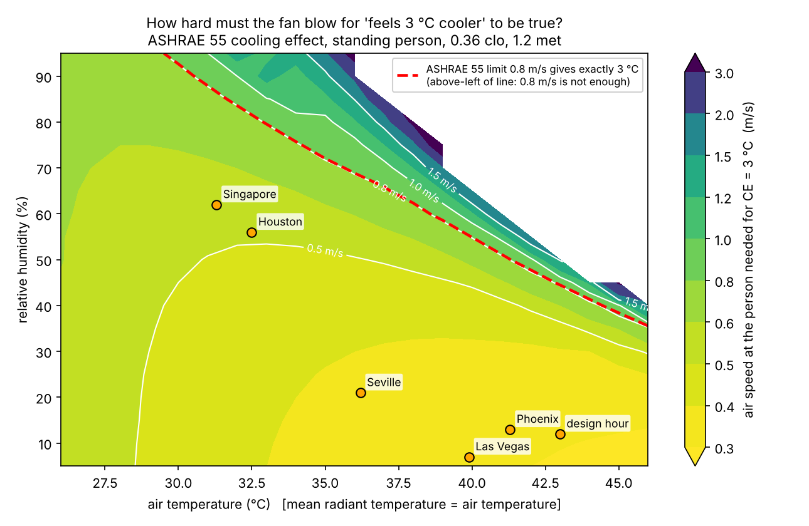
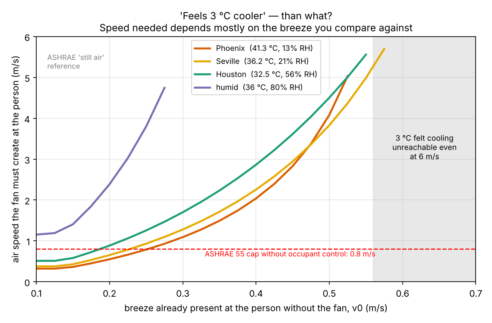
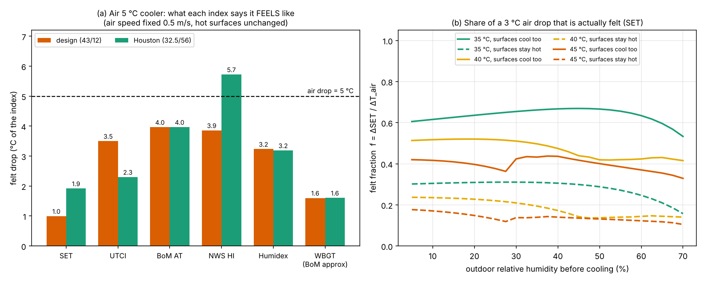
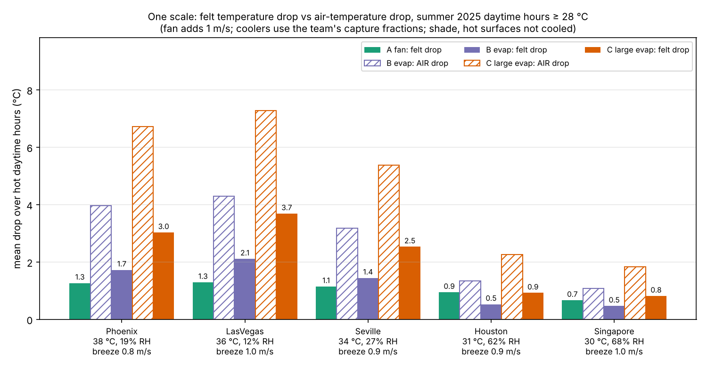
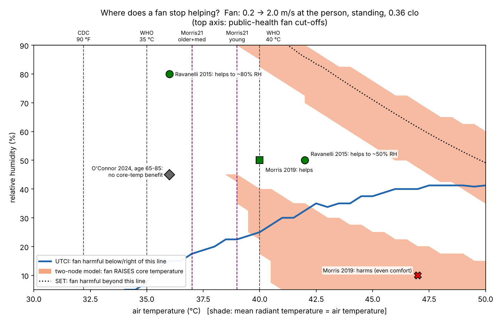

# T10 — One scale for "feels 3 °C cooler" and "air 5 / 8 °C cooler"

**Research memo for the HiMCM 2026 Problem B team. This is not paper text. Read it, then write the paper in your own words.**

Code: `sprint_out/code/T10_lib.py` and `T10_1` to `T10_5_*.py`. Each script has a saved `*_output.txt`.
Figures: `sprint_out/figs/T10_*.png`. Downloaded source pages: `sprint_out/dl_T10/`.
Python 3.13, pythermalcomfort 4.8.0. Weather: the team's cached Open-Meteo hourly data, 1 Jun to 15 Sep 2025.

---

## 0. The short version

1. **The fan and the coolers are measured in different units.** "Feels 3 °C cooler" is a *cooling effect*, which ASHRAE Standard 55 defines using the SET comfort model. "Air 5 °C cooler" is a *thermometer reading*. To compare them, we turn the cooler's air-temperature drop into the same cooling-effect unit. We call this unit the **felt temperature drop (FTD)**.
2. **The fan's "3 °C" is cheap or impossible, depending on what you compare it with.** Compared with ASHRAE's "still air" (0.1 m/s), the fan only needs **0.31 m/s at the person in dry heat** (Phoenix-type afternoon, 41 °C / 13 % RH). It needs **0.51–0.54 m/s in humid heat** (Houston or Singapore afternoon) and **1.15 m/s in a humid heatwave** (36 °C / 80 % RH). A real shelter already has a breeze of about 0.8–1.0 m/s. Compared with that breeze, **no fan speed up to 6 m/s gives 3 °C**.
3. **An evaporative cooler feels like much less than its air-temperature drop.** In a shaded shelter whose roof and ground stay hot, "air 5 °C cooler" feels like **1.7–2.3 °C**. If every hot surface cooled as well, it would feel like 3.8–4.4 °C. The humidity rise costs about **1 °C**. Leaving the hot surfaces uncooled costs about **2 °C**.
4. **SET says fans help almost everywhere, but lab experiments disagree.** UTCI and the two-node body model do match the four lab results we checked. In dry heat, a fan starts to raise core temperature at about **40 °C** (two-node model) or **36–39 °C** (UTCI). In very humid heat the limit is higher: about 42–46 °C.
5. **Recommendation.** Use **SET, expressed as FTD**, as the single comfort currency. It is the only index that responds to air speed, humidity, radiation, clothing and activity, and it is the unit in which the fan claim is written. Add a **safety gate** from the two-node core-temperature model, with UTCI as a cross-check. The gate turns the fan's benefit to zero or negative where lab evidence says fans harm.

---

## 1. Why the two claims are different quantities

### 1.1 Plain words

Your body makes heat all the time (about 100 W while standing still) and has to get rid of it. It has three main exits:

- **Convection.** Air touching your skin carries heat away, but only if the air is cooler than your skin (about 34–36 °C).
- **Radiation.** You swap infrared heat with every surface you can see: the roof, the pavement, the bus. A hot roof radiates heat *into* you even when it shades you from the sun.
- **Sweat evaporation.** Turning sweat into vapour takes heat out of the skin. Damp air slows this down.

A **fan** does not change the air temperature. It changes **how fast air moves past your skin**. That speeds up convection, and it also speeds up evaporation by blowing away the damp layer of air next to your skin. When the air is *hotter* than your skin, faster air brings heat *in*. The question is whether the extra sweat evaporation outweighs that.

An **evaporative cooler** does change the air temperature. Water evaporates into the air and the air gets colder, but it also gets **more humid**. The process just swaps one kind of heat for another; no energy is removed from the air. The cooler also does nothing to the hot roof and pavement.

So the fan changes *air speed* and the coolers change *air temperature and humidity*. A thermometer only sees one of these, so we need a model of the person.

### 1.2 The equation: the body's heat balance

$$M - W = C + R + E_{sk} + C_{res} + E_{res} + S$$

| Symbol | Meaning | Units |
|---|---|---|
| M | metabolic heat made by the body | W/m² of skin |
| W | mechanical work done (≈ 0 when waiting) | W/m² |
| C | heat lost by convection = h_c·(T_skin − T_air) | W/m² |
| R | heat lost by radiation = h_r·(T_skin − T_r) | W/m² |
| E_sk | heat lost by sweat evaporation, at most h_e·(p_sk − p_a) | W/m² |
| C_res, E_res | heat lost by breathing (dry and moist parts) | W/m² |
| S | heat stored. If S > 0, body temperature rises | W/m² |
| h_c | convective heat-transfer coefficient. The SET code uses h_c = 8.6·v^0.53 | W/(m²·K) |
| h_r | radiative coefficient, ≈ 4.7 in the SET code | W/(m²·K) |
| T_r | mean radiant temperature: the "average temperature of everything you can see" | °C |
| p_a, p_sk | water-vapour pressure of the air, and at wet skin | kPa |
| v | air speed at the person | m/s |

[VERIFIED: h_c = 8.600001·(v·p_atm)^0.53 and h_r = 4.7 are read directly from the pythermalcomfort 4.8.0 source, `models/two_nodes_gagge.py`, which implements Gagge et al. 1986.]

**What this means.** A fan raises v, so h_c goes up, which makes both C and the maximum possible E_sk bigger. An evaporative cooler lowers T_air but raises p_a, so it helps C and hurts E_sk. Neither device changes T_r. Every "felt temperature" index is just a way of squeezing this equation into one number.

**Worked example (by hand).** Air at 43 °C, skin at 36 °C, v = 0.5 m/s. Then h_c = 8.6 × 0.5^0.53 = 5.95 W/(m²·K), and C = 5.95 × (36 − 43) = **−42 W/m²**. The minus sign means the air is *heating* you. Doubling v to 1 m/s gives h_c = 8.6 and C = −60 W/m². So the fan adds 18 W/m² of heat. It only helps if sweat evaporation rises by *more* than that.

---

## 2. The candidate indices

### 2.1 What each one takes in, and what it can "see"

| Index | Inputs | Stated validity | Sees **air speed**? | Sees **humidity**? | Sees **radiation**? |
|---|---|---|---|---|---|
| **Steadman apparent temperature, BoM form** | T, RH, 10 m wind (+ optional net radiation Q) | Australian climate norms. No range is stated on the BoM page | Weakly. A straight line: −0.70 °C per m/s at *every* temperature | Yes | Only in the Q version |
| **NWS heat index** | T, RH | The Rothfusz regression "is not valid for extreme temperature and relative humidity conditions" beyond Steadman's data | **No** (fixed light wind is built in) | Yes | **No** (shade assumed) |
| **Humidex** (Environment Canada) | T, dew point | No range given | **No** | Yes | **No** |
| **WBGT** (ISO 7243) | natural wet-bulb, globe temperature, (air temperature) | Workplace heat-stress screening over a working day, not brief exposures | Only indirectly, through the instruments | Yes | Yes (globe) |
| WBGT, BoM approximation | T, RH | "Assumes a moderately high radiation level in light wind" | **No** | Yes | No (fixed) |
| **UTCI** | T, T_r, RH, 10 m wind | −50 ≤ T ≤ 50 °C; −30 ≤ T_r − T ≤ 70 °C; **0.5 ≤ v₁₀ ≤ 17 m/s**; vapour pressure ≤ 5 kPa | Yes, but only for *weather* wind of 0.5 m/s or more at 10 m | Yes | Yes |
| **SET** (Gagge two-node) | T, T_r, v, RH, **met, clo** | pythermalcomfort limits: 10–40 °C, v < 2 m/s, 1–4 met, 0–1.5 clo | **Yes**, at the person | Yes | Yes |
| **ASHRAE 55 cooling effect (CE)** | as SET | Elevated-air-speed method: 1.0–2.0 met, 0–1.5 clo, average air speed > 0.1 m/s | Yes (this is its whole purpose) | Yes | Yes |

Sources:
- AT: [VERIFIED: BoM thermal-stress page].
- Heat index: [VERIFIED: NWS WPC heat-index page].
- Humidex: [VERIFIED: ECCC hourly-data technical documentation].
- WBGT weights: [VERIFIED: pythermalcomfort `wbgt`, implementing ISO 7243:2017; the ISO text itself was not opened].
- BoM WBGT: [VERIFIED: BoM page].
- UTCI ranges: [VERIFIED: pythermalcomfort `utci` docstring; the primary source, Bröde et al. 2012, could not be downloaded (HTTP 403)].
- SET limits: [VERIFIED: pythermalcomfort `set_tmp` docstring].
- CE scope: [VERIFIED: ASHRAE Addendum c to Standard 55-2020, which also lowered the minimum air speed from 0.20 to 0.10 m/s].

### 2.2 Formulas and checked constants

**Steadman apparent temperature, Australian Bureau of Meteorology (BoM) form.** We checked this on the official BoM page (saved as `dl_T10/bom.html`), which cites Steadman 1994, *Aust. Met. Mag.* 43, 1–16.

$$AT = T_a + 0.33\,e - 0.70\,ws - 4.00 \qquad\text{(no radiation)}$$
$$AT = T_a + 0.348\,e - 0.70\,ws + 0.70\,\frac{Q}{ws+10} - 4.25 \qquad\text{(with radiation)}$$
$$e = \frac{rh}{100}\times 6.105\,\exp\!\left(\frac{17.27\,T_a}{237.7+T_a}\right)$$

Here T_a is the dry-bulb temperature (°C), e is the water-vapour pressure (hPa), ws is the wind speed at **10 m height** (m/s), Q is the net radiation absorbed per m² of body surface (W/m²), and rh is relative humidity (%). [VERIFIED: BoM page, quoted exactly. The constants 0.33 / 0.70 / 4.00, 0.348 / 0.70 / 0.70 / 4.25, and 6.105 / 17.27 / 237.7 all match.]

- *Worked example* at 43 °C / 12 % RH, ws = 0.74 m/s: e = 0.12 × 6.105 × exp(2.646) = **10.3 hPa**, so AT = 43 + 3.41 − 0.51 − 4.00 = **41.9 °C**.
- *Cross-check:* pythermalcomfort's `at()` uses the same constants with a slightly different saturation formula. The two agree within 0.05 °C (`T10_1_output.txt`, section A).
- *What this means:* a fan at 2 m/s *always* lowers AT, by 1.5 °C, even at 50 °C. AT has no physics that could make wind heat you.

**NWS heat index.** First compute HI = 0.5·{T + 61 + 1.2(T − 68) + 0.094 RH} in °F. If the average of that and T is 80 °F or more, use the Rothfusz regression instead:
HI = −42.379 + 2.04901523T + 10.14333127RH − 0.22475541T·RH − 6.83783×10⁻³T² − 5.481717×10⁻²RH² + 1.22874×10⁻³T²RH + 8.5282×10⁻⁴T·RH² − 1.99×10⁻⁶T²RH².
There is a subtraction for RH < 13 % and an addition for RH > 85 %. T is in °F and RH in %. [VERIFIED: NWS WPC page.]

**Humidex.** H = T + 0.5555(e − 10), with e = 6.11·exp[5417.7530·(1/273.15 − 1/T_dew,K)]. [VERIFIED: ECCC. Older sources print 273.16, which changes the result by less than 0.05 °C.]

**WBGT.**
- In shade: WBGT = 0.7 T_nwb + 0.3 T_g.
- In sun: WBGT = 0.7 T_nwb + 0.2 T_g + 0.1 T_a.
- BoM approximation: WBGT ≈ 0.567 T_a + 0.393 e + 3.94.

T_nwb is the natural (unventilated) wet-bulb temperature and T_g is the black-globe temperature.

**UTCI** is a large polynomial fitted to a detailed body model (Fiala), with clothing that adjusts to the weather. Its wind input is the wind at 10 m. **SET** is the temperature of a standard room (50 % RH, still air, standard clothing) in which you would have the same skin temperature and skin wetness as in the real place.

### 2.3 Test: change one thing and see which index notices

Reference hour: 35 °C, 40 % RH, 0.5 m/s at the person, T_r = T. Output of `T10_1_index_compare.py`:

| Index | Base (°C) | Air +1 °C | **Fan 0.5→2 m/s** | **RH 40→60 %** | **Hot surfaces +10 °C** |
|---|---|---|---|---|---|
| BoM AT (no rad.) | 37.9 | +1.42 | −1.54 | +3.70 | **0.00** |
| BoM AT (rad.)* | 38.0 | +1.44 | −1.54 | +3.90 | +4.41 |
| NWS heat index | 37.2 | +1.93 | **0.00** | +7.83 | **0.00** |
| Humidex | 42.0 | +1.73 | **0.00** | +6.47 | **0.00** |
| WBGT (BoM approx) | 32.6 | +1.06 | **0.00** | +4.40 | **0.00** |
| UTCI | 35.5 | +1.20 | −1.00 | +2.50 | +2.40 |
| **SET** | 30.5 | +0.95 | **−2.08** | +2.61 | +3.09 |

\*For the radiation version, Q was crudely set to the extra long-wave gain, only to show that the term exists.

**What this means.** The heat index, Humidex and the BoM WBGT give the fan exactly **zero** benefit, so they cannot rank option A at all. They also ignore the hot shelter roof. Only UTCI and SET respond to all three things the devices change.

---

## 3. Inverting the ASHRAE 55 cooling effect: how hard must the fan blow?

### 3.1 The definition

**In plain words:** "The fan makes it feel X °C cooler" means that turning the fan off and lowering *both* the air temperature *and* the surrounding surface temperatures by X °C would feel the same.

$$\text{SET}(T - CE,\; T_r - CE,\; v_{still},\; RH) = \text{SET}(T,\; T_r,\; v_{fan},\; RH)$$

CE is the cooling effect (°C). v_still = 0.1 m/s is ASHRAE's still-air reference. v_fan is the air speed at the person with the fan on (m/s). SET is computed in "CE mode", which switches off the extra convection from body movement, as ASHRAE 55 Appendix D requires. [VERIFIED: ASHRAE 55 definition, quoted in the pythermalcomfort `cooling_effect` docstring. The still-air value of 0.1 m/s comes from Addendum c to 55-2020. The CE-mode switch was read in the pythermalcomfort source.]

**Inverse problem:** find v_fan such that CE = 3 °C. We solve it by bisection (repeated halving of the search interval), assuming a standing person (1.2 met) in shorts and a T-shirt (0.36 clo). [VERIFIED: these are ASHRAE 55 typical values, as tabulated in pythermalcomfort `met_typical_tasks` and `clo_typical_ensembles`.]

**Validation.** Our own solver reproduces pythermalcomfort's `cooling_effect` to within 0.005 °C at three test points. At 24.4 °C / 50 % RH / 0.6 clo / 1.13 met / 0.5 m/s it gives CE = 2.39 °C. The Berkeley CBE fan guidebook says "approximately 2 °C" for those conditions [VERIFIED: CBE guidebook text], so the order of magnitude is right.

### 3.2 Results (`T10_2_output.txt`, Figure 1)

| Case (T, RH) | CE at 0.5 m/s | CE at 0.8 m/s | CE at 2 m/s | **v needed for CE = 3 °C** |
|---|---|---|---|---|
| Team design hour 43 °C / 12 % | 4.32 | 5.31 | 6.56 | **0.31 m/s** |
| Phoenix typical peak 41.3 / 13 | 4.16 | 5.13 | 6.38 | **0.32 m/s** |
| Seville 36.2 / 21 | 3.64 | 4.54 | 5.81 | 0.38 m/s |
| Houston 32.5 / 56 | 2.96 | 3.79 | 5.07 | **0.51 m/s** |
| Singapore 31.3 / 62 | 2.86 | 3.68 | 4.96 | **0.54 m/s** |
| Humid heatwave 36 / 80 | 1.93 | **2.55** | 3.60 | **1.15 m/s** |

The "typical peak" is the median of each day's hottest hour, June to September 2025 (`T10_1`, section D).

**Worked example.** At Phoenix's typical peak, SET drops from about 35 °C at 0.1 m/s to the same SET you would get at 0.1 m/s with air and surfaces 3 °C cooler, once v ≈ 0.32 m/s. That is a *gentle* breeze.

**Dry versus humid.** In dry heat the fan reaches 3 °C easily, because faster air speeds up sweat evaporation a lot. In humid heat sweat evaporates poorly, so the fan needs about 1.6 times more speed (0.51 versus 0.32 m/s), or 3.6 times more in a humid heatwave.

**Comparison with the ASHRAE cap.** If occupants cannot control the fan (true at a public bus stop) and the operative temperature is above 25.5 °C, ASHRAE caps the average air speed at **0.8 m/s** [VERIFIED: ASHRAE Addendum d to 55-2013, §5.3.3.4a, saved as `dl_T10/ash55d.pdf`]. ASHRAE 55 is an indoor standard, so we use the cap only as a guide. Above and to the left of the red line in Fig. 1, which includes humid heatwaves, even the maximum allowed fan speed gives less than 3 °C.

**Sensitivity.** In dry heat the needed speed only moves between 0.29 and 0.41 m/s when we vary met from 1.0 to 1.4 and clo from 0.36 to 0.57. In humid heat it moves between 0.43 and 0.79 m/s. Hotter surfaces (T_r = T + 5) lower it slightly.

**A sanity check against WHO.** WHO says that air conditioning at 27 °C plus an electric fan "will make the room feel 4 °C cooler" [VERIFIED: WHO Q&A "Heatwaves: how to stay cool"]. Our inversion says that needs about **1.05–1.1 m/s** at 27 °C, a normal desk or pedestal fan speed. So WHO's figure is physically reasonable.

### 3.3 The non-obvious catch: "3 °C cooler" than what? (Figure 2)

ASHRAE compares with *still* air (0.1 m/s). A bus shelter is not still. Assuming the shelter keeps 40 % of the 10 m wind [ASSUMED: same factor as the team's `scenario.py`], the median afternoon breeze at the person is 0.84–1.2 m/s in all five cities (`T10_2`, section C). We generalised CE to "3 °C cooler than the breeze already there, v0":

| v0 already present (m/s) | 0.1 | 0.2 | 0.3 | 0.5 | ≥ 0.8 |
|---|---|---|---|---|---|
| Phoenix 41.3/13 (dry) | 0.32 | 0.55 | 1.09 | 4.08 | **not reachable with ≤ 6 m/s** |
| Houston 32.5/56 (humid) | 0.51 | 0.89 | 1.70 | 4.50 | **not reachable** |
| Humid heatwave 36/80 | 1.15 | 2.39 | not reachable | — | — |

**What this means.** The benefit of air speed levels off: going from 0.1 to 0.3 m/s helps far more than going from 1 to 3 m/s. So the claim "up to 3 °C" is a best-case number that is **only true on a calm day**. On a typical breezy afternoon in our cities, adding 1 m/s of fan air gives only **0.7–1.3 °C** of felt cooling (`T10_5`, Fig. 5). That calm-day best case is the honest reading of "up to".

---

## 4. An evaporative cooler's felt benefit is smaller than its air drop

### 4.1 Plain words, then the equation

Evaporating water takes heat out of the air (so the air gets colder), but that heat is now hidden in the water vapour (so the air gets more humid). The total heat content of the air, its **enthalpy** h, stays the same:

$$h = 1.006\,T + W\,(2501 + 1.86\,T) = \text{constant}$$

h is the enthalpy (kJ per kg of dry air), T is the air temperature (°C), and W is the humidity ratio (kg of water per kg of dry air). Cooling the air by ΔT therefore adds about ΔW ≈ 1.006·ΔT/2501 of water.

*Worked example:* a 5 °C drop adds 0.0020 kg/kg, which is **2.0 g of water per kg of air**. At 43 °C / 12 % RH, the air becomes 38 °C / **20.4 %** RH. Its vapour pressure rises by about 3.2 hPa.

A sweating person "feels" that extra humidity because their sweat evaporates more slowly. Also, the cooler only cools the **air**. The roof, the pavement and the bus stay just as hot. With hot surfaces unchanged, the part of the air drop your skin actually feels is roughly

$$\frac{h_c}{h_c+h_r} = \frac{8.6\,v^{0.53}}{8.6\,v^{0.53}+4.7}$$

This is 0.56 at 0.5 m/s and 0.65 at 1 m/s.

*Worked example by hand:* 5 °C × 0.56 = 2.8 °C of "operative" drop. Subtract a humidity penalty of about 1.1 °C (next table) and you get **1.7 °C**. The full SET model gives **1.68 °C**.

### 4.2 Results on the one scale (FTD, in the fan claim's own units). `T10_3_output.txt`, section C

| Case | Air drop | Breeze | **FTD, surfaces stay hot** | FTD, surfaces cool too | Humidity cost | Radiant cost |
|---|---|---|---|---|---|---|
| Design 43/12 | 5 °C | 0.5 m/s | **1.68** | 3.94 | 1.06 | 2.26 |
| Design 43/12 | 8 °C | 0.5 m/s | **2.79** | 6.58 | 1.42 | 3.80 |
| Phoenix 41.3/13 | 5 | 1.0 | 2.29 | 4.16 | 0.84 | 1.87 |
| Seville 36.2/21 | 5 | 0.5 | 2.01 | 4.26 | 0.74 | 2.25 |
| Houston 32.5/56 | 5 | 0.5 | 1.68 | 3.84 | 1.16 | 2.16 |
| Singapore 31.3/62 | 5 | 0.5 | 1.79 | 4.06 | 0.94 | 2.26 |
| Houston / Singapore | 8 | — | **impossible**: the wet-bulb depression is only 7.3 / 6.0 °C | | | |

**What this means.** "Air 5 °C cooler" in a shelter **feels like about 2 °C**: about 35–45 % of the air drop when the surfaces stay hot. In ASHRAE terms, that is *less* than the fan's claimed 3 °C. It takes an air drop of **9–13 °C** to feel as good as a fan with a true CE of 3 °C (`T10_3`, section B). In Houston and Singapore, even fully saturating the air only gets to 3.0 and 2.7 °C.

### 4.3 What the other indices say about the same "air 5 °C cooler" (Figure 3a)

| | SET-ΔSET | UTCI | BoM AT | NWS HI | Humidex | WBGT (BoM) |
|---|---|---|---|---|---|---|
| Design 43/12 | 1.0 | 3.5 | 4.0 | 3.9 | 3.2 | 1.6 |
| Houston 32.5/56 | 1.9 | 2.3 | 4.0 | **5.7** | 3.2 | 1.6 |

- **The heat index overshoots.** For Houston, NWS HI claims the cooler feels 5.7 °C cooler, *more than the air dropped*. This is an artefact of using the regression outside its design purpose, and one more reason not to use it.
- **WBGT barely moves (1.6 °C).** WBGT is dominated by the wet-bulb temperature, and evaporative cooling leaves the wet-bulb temperature unchanged. For a person already sweating at their limit, wet-bulb is what decides survival. So in *heat-stress* terms, evaporative coolers buy very little safety. This is a defensible and unusual point.
- **ΔSET ≠ FTD.** A 1 °C change in SET is not the same as a 1 °C change in the environment. Always convert to FTD, as in §4.2, before comparing with the fan.
- **The kink in Fig. 3b** near 45 °C / 28 % RH is a switch between sweating regimes inside the SET model, not a real effect.

### 4.4 A whole summer on one scale (Figure 4, `T10_5`)

Assumptions:
- Daytime hours 07–20 with T ≥ 28 °C, every second hour.
- Fan adds 1 m/s, combined with the breeze as a vector sum [ASSUMED].
- Coolers: air drop = φ·0.85·(T − T_wb), with the team's capture fractions φ = 0.26 / 0.44 [ASSUMED: team calibration, not independently checked].
- Shade, surfaces not cooled.

| City | Fan felt | B air → felt | C air → felt | Felt °C per kW: A / B / C |
|---|---|---|---|---|
| Phoenix | 1.26 | 3.97 → 1.72 | 6.71 → 3.03 | 5.1 / 1.4 / 1.2 |
| Las Vegas | 1.29 | 4.29 → 2.11 | 7.27 → 3.68 | 5.2 / 1.8 / 1.5 |
| Seville | 1.15 | 3.18 → 1.44 | 5.38 → 2.53 | 4.6 / 1.2 / 1.0 |
| Houston | 0.94 | 1.34 → 0.53 | 2.26 → 0.92 | 3.8 / 0.4 / 0.4 |
| Singapore | 0.67 | 1.08 → 0.47 | 1.83 → 0.81 | 2.7 / 0.4 / 0.3 |

Across a whole summer, the felt drop is consistently **39–51 % of the air drop**. But the fan's "felt" number counts hours where the fan is harmful as if it were helping. In Phoenix, UTCI says the fan harms in **46 %** of these hours and the two-node model says **19 %**. See §5.

---

## 5. Fans in extreme heat: when does a fan stop helping?

### 5.1 Evidence

| Study | Who | Conditions | Fan air speed | Result |
|---|---|---|---|---|
| Ravanelli, Hodder, Havenith & Jay 2015, *JAMA* 313(7):724–5 | 8 young men | 36 °C (RH rising 25→95 %) and 42 °C (RH 20→70 %) | **4.0 m/s** | Fan delayed heart-rate and core-temperature rises. Heart rate started climbing at 83 % RH with the fan versus 62 % without (36 °C), and at 47 % versus 38 % (42 °C). Core temperature started climbing at 55 % versus 48 % RH (42 °C). Sweat 399 versus 241 g/h at 42 °C [VERIFIED: JAMA page] |
| Gagnon et al. 2016, *JAMA* | adults aged about 60–80 | ~42 °C (108 °F), RH 30→70 % | 16-inch fan | Fan gave **higher** heart rate (about +10 bpm) and higher core temperature (about +0.5 °F); sweat did not rise [VERIFIED only from secondary news summaries] |
| Morris, English, Hospers, Capon & Jay 2019, *Ann Intern Med* 171:675–7 | 12 young men, 2 h | **47 °C / 10 %** (heat index 46) and 40 °C / 50 % (heat index 56) | not reported in sources seen | Fans **harmful on every measure, including comfort**, at 47 / 10. Helpful at 40 / 50 [VERIFIED from the Healio and University of Sydney summaries; paper is closed access] |
| Morris et al. 2021, *Lancet Planet Health* 5:e368–77 | modelling, 108 cities | 2007–2019 | — | Simple fan cut-offs: **< 39 °C** healthy young, **< 38 °C** healthy older, **< 37 °C** older adults on anticholinergic drugs. Fans would have been beneficial on 96.6 % of hot days for the young [VERIFIED: Europe PMC abstract] |
| O'Connor, Meade, …, Kenny 2024, *JAMA* 332(20):1752–4 | 18 adults aged 65–85, 8 h | 36 °C / 45 % | 2 and 4 m/s | **No** change in peak core temperature (38.3 °C in all three conditions). Less thermal discomfort. The authors do not support fans as a standalone measure above about 33–35 °C [VERIFIED: JAMA page] |

**Public-health thresholds**
- **CDC:** "Use fans, but only if indoor temperatures are less than 90°F. In temperatures above 90°F, a fan can increase body temperature." 90 °F is 32.2 °C. [VERIFIED: cdc.gov/heat-health/about]
- **WHO** says both: "Use electric fans only when temperatures are below 40 ˚C. In temperatures above 40 ˚C fans will heat the body." and "Electric fans may provide relief, but when the temperature is above 35 °C, may not prevent heat-related illness." [VERIFIED: WHO Q&A page]
- These thresholds depend on **temperature only**. The lab evidence shows the limit **depends strongly on humidity**.

### 5.2 Do UTCI and SET agree? (Figure 5, `T10_4`)

The fan raises the air speed at the person from 0.2 to 2.0 m/s [ASSUMED]. T_r = T. Three model verdicts:

| T / RH | ΔSET | ΔUTCI | Δ core temp (two-node) | Lab says |
|---|---|---|---|---|
| 36 / 80 | +3.5 | +1.5 | +0.24 | helps (Ravanelli) ✓ all |
| 40 / 50 | +3.9 | +0.8 | +0.16 | helps (Morris 2019) ✓ all |
| 42 / 50 | +3.2 | +0.6 | +0.24 | helps up to ~50 % (Ravanelli) ✓ all |
| 42 / 15 | +3.1 | **−0.7** | −0.03 | no inflection either way (Ravanelli) |
| **47 / 10** | **+2.8 (helps)** | **−1.5 (harms)** | **−0.10 (harms)** | **harms, even comfort (Morris 2019)** |

Positive values mean the fan helps.

**Where each model says the fan starts to harm:**

| RH | SET | UTCI | Two-node core |
|---|---|---|---|
| 10 % | never | 35.5 °C | 40.5 °C |
| 20 % | never | 39.0 | 40.0 |
| 30 % | never | 42.0 | 39.5 |
| 50 % | 50.0 | never (≤ 50) | 46.0 |
| 80 % | 43.5 | never | 40.5 |

**What this means.**
- **SET almost never sees harm.** It measures *sensation* (skin temperature and wetness), not core temperature or cardiovascular strain. It gets the 47 °C / 10 % case wrong.
- **UTCI and the two-node model both get every lab direction right.** They disagree with each other about humid extremes: the two-node model has a second harm band at high humidity, UTCI does not.
- **A practical "fan off" zone:** above about **40 °C in dry air** (UTCI says ~36–39 °C). That matches Morris 2021's 39 °C rule for healthy adults.
- Bus-stop users include older people, and O'Connor 2024 found no core-temperature benefit for them. A **37–38 °C** cut-off is the prudent choice.

**Share of daytime hours (07–20 h) in each zone, summer 2025:**

| City | > 32.2 °C (CDC) | > 35 °C | > 39 °C | > 40 °C (WHO) | UTCI says harmful | Core model says harmful |
|---|---|---|---|---|---|---|
| Phoenix | 83 % | 68 % | 40 % | 32 % | **52 %** | **32 %** |
| Las Vegas | 79 % | 60 % | 30 % | 22 % | 54 % | 19 % |
| Seville | 49 % | 30 % | 10 % | 6 % | 13 % | 6 % |
| Houston | 19 % | 3 % | 0 % | 0 % | 0 % | 0 % |
| Singapore | 3 % | 0 % | 0 % | 0 % | 0 % | 0 % |

**What this means.** In humid cities the fan is never harmful, and it is cheap. In desert cities the fan is harmful for a third to half of daytime hours, which are exactly the hours when cooling matters most. The choice of cut-off rule changes the fan's usable daytime hours in Phoenix by a factor of about 4: 17 % under the CDC 90 °F rule, 48 % under UTCI, 60 % under Morris's 39 °C rule, and 68 % under the two-node model (100 % minus the shares in the table).

---

## 6. Recommendation

**Use SET, reported as the felt temperature drop (FTD), as the one comfort scale. Add a physiological safety gate.**

$$FTD = x \;\text{ such that }\; \text{SET}(T-x,\,T_r-x,\,v_0,\,RH) = \text{SET}_{\text{after device}}$$

x is in °C. v0 is the breeze without the device and RH is the original humidity. For a fan with v0 = 0.1 m/s, FTD *is* the ASHRAE cooling effect.

**Why this index:**
1. It is the only index that responds to all five things that matter here: air speed, humidity, radiation, clothing and activity (§2.3).
2. The fan claim is literally written in this unit (ASHRAE 55 CE), so nothing gets lost in translation.
3. It automatically charges the evaporative cooler for the humidity it adds and the hot surfaces it ignores (§4).
4. It runs in the open-source pythermalcomfort package and has been validated against the package (§3.1).

**Its limits, and how to cover them:**
- SET is a **comfort** index. It says fans help in hot-dry heat where lab subjects got hotter and less comfortable. **Gate:** for each hour, if the two-node model's Δ core temperature is below 0 (pythermalcomfort `use_fans_heatwaves`, same Gagge family as SET), set the fan's FTD to zero or count it as negative. Report UTCI as an independent check, and Morris 2021's 37–39 °C rule as the plain-language version for the blog and the memo to the COO.
- pythermalcomfort only formally validates SET up to 40 °C air and 2 m/s. Our desert hours (up to about 46 °C) are an **extrapolation**. Say so in the paper.
- Fixed met and clo: we use one standing person in summer clothes. Sensitivity is in §3.2.
- **Use UTCI, not SET, for a weather-style "heat risk" warning.** UTCI was designed for outdoor weather and its stress bands are recognised. But it is not built for a fan jet: its minimum is 0.5 m/s of 10 m wind, and we had to convert body-height speed to 10 m speed [ASSUMED: log-wind profile with roughness 0.01 m, factor 1.47].

**Why not the others:**
- Heat index, Humidex and BoM-WBGT cannot see a fan at all.
- Steadman AT treats wind as always cooling, never heating.
- Full WBGT needs globe and natural-wet-bulb measurements we do not have. It is good at showing how little *safety* an evaporative cooler adds, so cite it as a side remark.

---

## (a) Key findings with numbers

1. The fan's "3 °C" needs only **0.31–0.32 m/s** at the person in dry heat but **0.51–0.54 m/s** in humid heat, and **1.15 m/s** at 36 °C / 80 %, *compared with still air*. Compared with a typical 0.8–1.2 m/s shelter breeze it is **unreachable**. Realistic felt benefit of +1 m/s is **0.7–1.3 °C**.
2. "Air 5 °C cooler" in a shaded shelter **feels like 1.7–2.3 °C**: humidity costs about 0.6–1.2 °C and the uncooled hot surfaces cost about 1.9–2.3 °C. Over a whole summer, felt drop is **39–51 % of the air drop**. The 8 °C claim is physically impossible in Houston and Singapore afternoons.
3. On the one scale, the fan delivers **2.7–5.2 felt °C per kW**. The coolers deliver **0.3–1.8**.
4. SET says fans help at 47 °C / 10 %, but measured comfort and core temperature say they harm. UTCI and the two-node model match all four lab directions. The fan becomes harmful above about **40 °C in dry air**: in Phoenix that is **32 % (two-node) to 52 % (UTCI)** of daytime hours.
5. Public cut-offs disagree by 8 °C (CDC 32.2 °C; WHO 35 and 40 °C; Morris 2021 37–39 °C), and none of them uses humidity. The lab data show humidity matters as much as temperature.

## (b) Verified vs assumed

- **Verified (primary or official source opened):**
  - BoM AT and WBGT formulas, all constants
  - NWS heat-index algorithm
  - ECCC Humidex formula
  - ASHRAE 55 0.8 m/s cap (2013 Addendum d)
  - Elevated-air-speed scope and 0.1 m/s still air (2020 Addendum c)
  - CDC 90 °F and WHO 35 / 40 °C wording
  - Ravanelli 2015 numbers, including the 4.0 m/s fan
  - O'Connor 2024 numbers
  - Morris 2021 abstract and thresholds
  - pythermalcomfort formulas (CE definition, SET coefficients, UTCI and SET input limits)
- **Verified only through secondary summaries:** Morris 2019 conditions (47 / 10 and 40 / 50) and its "harmful on all measures"; Gagnon 2016 (+10 bpm, about +0.5 °F).
- **Not verified:** the primary text of the UTCI validity ranges (Bröde 2012, download blocked); the ISO 7243 text itself.
- **Assumed:**
  - person: 1.2 met, 0.36 clo
  - shelter breeze = 0.4 × 10 m wind (team's `scenario.py`)
  - fan adds 1 m/s, or 0.2 → 2.0 m/s in the harm map
  - T_r = T (shade)
  - log-law conversion factor of 1.47 for UTCI wind
  - capture fractions 0.26 / 0.44 and pad efficiency 0.85 (team)
  - harm threshold Δt_core < −0.005 °C for the two-node model, which uses the package's default exposure

## (c) Decisions the team must make

1. **How to read "up to 3 °C".** Either as the ASHRAE CE against still air (honest best case: the fan then needs about 0.3–0.5 m/s), or against the shelter's real breeze. We recommend still air for calibration, the real breeze for performance, and saying so explicitly.
2. **Which harm gate.** The two-node model (recommended), UTCI (more cautious in dry heat), or a simple 37 / 39 °C cut-off. The choice moves Phoenix's fan-usable daytime hours anywhere from 17 % (CDC rule) to 68 % (two-node model).
3. **Is the shelter's mean radiant temperature equal to the air temperature, or hotter (roof heated by the sun)?** This sets the radiant cost of evaporative cooling. T11 or T06 may already have a radiant model.
4. **Whether to fix `core.py`** (see (e) and the contradictions below) before running the main bus-stop model.

## (d) How this feeds the rest of the paper

- **Task 2a (bus stop):** the "service delivered" in efficiency = service / resources becomes **Σ over hours of people waiting × FTD**, with the fan's FTD gated to zero (or negative) in harmful hours. Divide by kWh. FTD puts all three devices on one axis, which answers "develop a measure" directly.
- **Task 2b (rail station):** the same index works. The new ingredient (crowd heat) raises T and humidity, which pushes more hours into the zone where fans struggle in humid heat.
- **Task 3 (venues):** Figure 4 and the city zone table show a climate split. Fans win per kW everywhere on comfort, but are unsafe in desert peaks. Coolers only make sense in dry climates, and even there the felt benefit is less than half the air drop.
- **Task 5 (memo and blog):** two plain-language sentences. "Air 5 °C cooler feels about 2 °C cooler in an open shelter." "Turn fans off above about 38 °C when the air is dry."

## (e) Weaknesses and open questions

- SET above 40 °C is outside the package's validated range. All desert results are extrapolations.
- The two-node harm map uses tiny core-temperature differences (hundredths of a °C over the default exposure). Its *direction* matches the lab, but its *size* is not validated. A longer-exposure run (Morris 2021 used a steady-state heat-balance approach) could change the boundaries.
- UTCI with a fan jet stretches the index beyond its design (it assumes weather wind, plus a 10 m conversion). Our UTCI numbers for fans should be treated as indicative only.
- The lab studies are small (8–18 people), mostly young men, and seated rather than standing.
- We did not model direct sun on waiting people. If people stand outside the shade, T_r ≫ T, every device's felt benefit shrinks, and UTCI and SET become even more necessary.
- The capture fractions and breeze factor come from team calibration, not measurement.

### Contradictions with the shared context and existing code (please read)

1. **`core.py` `cooling_effect_set` / `v_fan_from_claimed_CE` is not the ASHRAE CE.** It uses v_still = 0.3 m/s (ASHRAE uses 0.1) and keeps the metabolic convection floor switched on (ASHRAE turns it off: `calculate_ce=True`). As a result it says the fan needs **1.25 m/s** at the 43 / 12 design hour, while the ASHRAE definition says **0.31 m/s**, and 2.13 versus 0.51 m/s in Houston. Either call `pythermalcomfort.models.cooling_effect` or use `T10_lib.CE_fine`, and state the baseline breeze.
2. **`core.UTCI` passes body-level air speed straight into an index that expects 10 m wind.** This understates the fan's air speed by about 1.47× [ASSUMED log law].
3. **`core.SET` uses met = 1.1.** ASHRAE's "standing, relaxed" is 1.2. This has a small effect.
4. **`fan_paradox.py` says "WHO 40C".** WHO's page gives both 35 °C ("may not prevent illness") and 40 °C ("fans will heat the body"). Morris 2021 treats 35 °C as the WHO rule.
5. **The handover note says "above ~35 °C the fan blows heat into you".** That is true for convection, but the lab and the models show the *net* effect stays helpful up to about 39–42 °C unless the air is dry, because sweat evaporation also rises. The limit depends on humidity.
6. **`fan_paradox.py` says "SET says the fan always helps".** In fact SET does flag harm in very hot, humid air (≥ 43.5 °C at 80 % RH). It misses only the hot-dry harm.

---

## References (all opened or summarised as stated above)

**Standards and official guidance**
- Australian Bureau of Meteorology, "Thermal Comfort observations — About the formula for the apparent temperature". http://www.bom.gov.au/info/thermal_stress/ (cites Steadman R.G. 1994, Norms of apparent temperature in Australia, *Aust. Met. Mag.* 43:1–16; Steadman 1984, *J. Appl. Meteor.* 23(12):1674).
- NOAA NWS Weather Prediction Center, "The Heat Index Equation". https://www.wpc.ncep.noaa.gov/html/heatindex_equation.shtml
- Environment and Climate Change Canada, "Technical documentation: Historical Hourly Climate Station Data" (Humidex). https://www.canada.ca/en/environment-climate-change/services/climate-change/canadian-centre-climate-services/display-download/technical-documentation-hourly-data.html
- ASHRAE, Addendum d to ANSI/ASHRAE Standard 55-2013, §5.3.3.4. https://www.ashrae.org/file%20library/technical%20resources/standards%20and%20guidelines/standards%20addenda/55_2013_d_20150521.pdf
- ASHRAE, Addendum c to Standard 55-2020. https://www.ashrae.org/file%20library/technical%20resources/standards%20and%20guidelines/standards%20addenda/55_2020_c_20210430.pdf
- CDC, "About Heat and Your Health". https://www.cdc.gov/heat-health/about/index.html
- WHO, "Heatwaves: how to stay cool" (Q&A). https://www.who.int/news-room/questions-and-answers/item/heatwaves-how-to-stay-cool

**Studies**
- Ravanelli N.M., Hodder S.G., Havenith G., Jay O. (2015). Heart rate and body temperature responses to extreme heat and humidity with and without electric fans. *JAMA* 313(7):724–725. doi:10.1001/jama.2015.153
- Gagnon D., et al. (full author list not checked) (2016). Cardiac and thermal strain of elderly adults exposed to extreme heat and humidity with and without electric fan use. *JAMA* (research letter, 6 Sep 2016; volume/pages not checked). PubMed 27599335. https://jamanetwork.com/journals/jama/fullarticle/2547743 (details taken from news summaries).
- Morris N.B., English T., Hospers L., Capon A., Jay O. (2019). The effects of electric fan use under differing resting heat index conditions: a clinical trial. *Ann Intern Med* 171:675–677. doi:10.7326/M19-0512 (via https://cm.healio.com/news/primary-care/20190805/fans-harmful-in-heatwaves-with-dry-heat-helpful-in-humid-heat and https://sydney.edu.au/news-opinion/news/2019/08/06/is-it-safe-to-use-an-electric-fan-for-cooling.html)
- Morris N.B., Chaseling G.K., English T., et al., Jay O. (2021). Electric fan use for cooling during hot weather: a biophysical modelling study. *Lancet Planet Health* 5(6):e368–e377. doi:10.1016/S2542-5196(21)00136-4
- O'Connor F.K., Meade R.D., Wagar K.E., Harris-Mostert R.C., Tetzlaff E.J., McCormick J.J., Kenny G.P. (2024). Effect of electric fans on body core temperature in older adults exposed to extreme indoor heat. *JAMA* 332(20):1752–1754. doi:10.1001/jama.2024.19457

**Software and guides**
- Bröde P., et al. (2012). Deriving the operational procedure for the UTCI. *Int J Biometeorol* 56:481–494. doi:10.1007/s00484-011-0454-1 (ranges taken via pythermalcomfort).
- Gagge A.P., Fobelets A.P., Berglund L.G. (1986). A standard predictive index of human response to the thermal environment. *ASHRAE Trans.* 92(2B) (as implemented in pythermalcomfort).
- Tartarini F., Schiavon S. (2020). pythermalcomfort, v4.8.0 used. https://github.com/CenterForTheBuiltEnvironment/pythermalcomfort
- CBE Berkeley, *Fans for cooling people guidebook*. https://cbe-berkeley.gitbook.io/fans-guidebook/full-guidebook/elevated-air-speed-and-thermal-comfort
