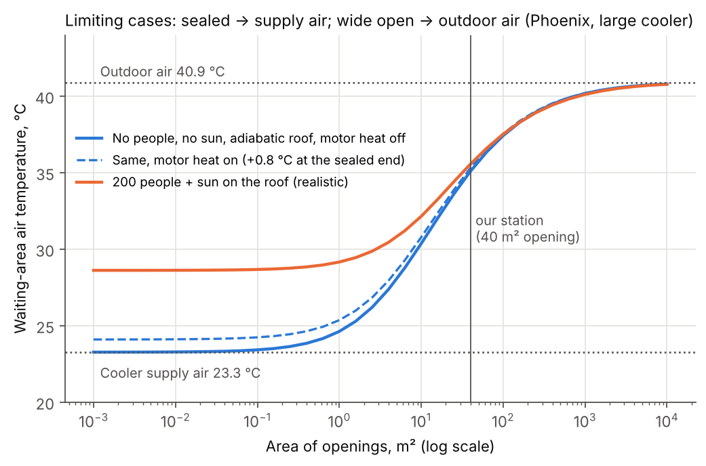
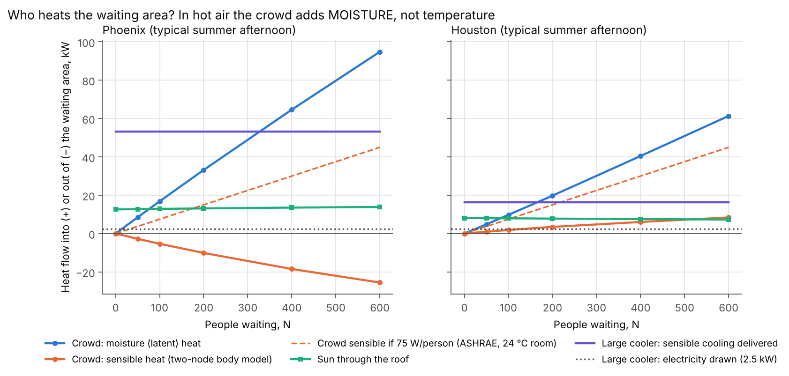
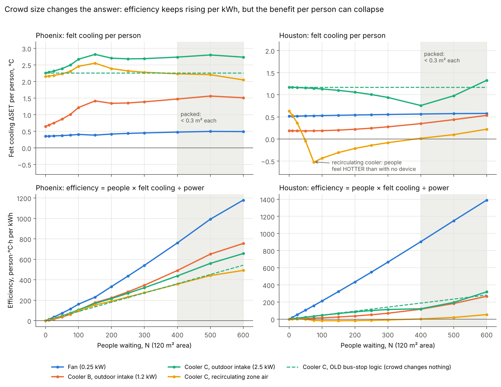
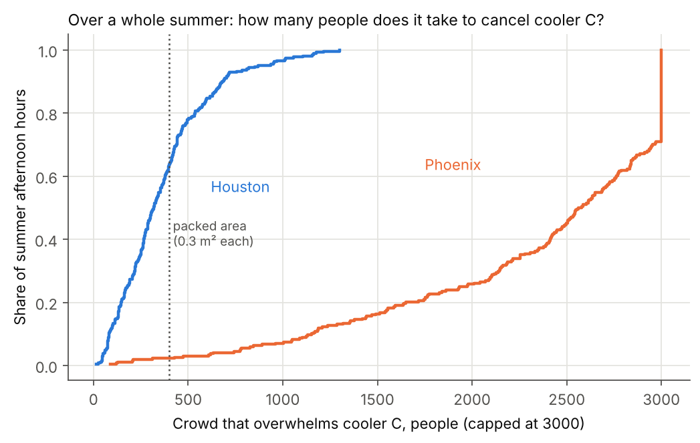
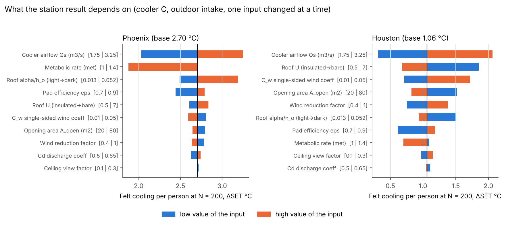
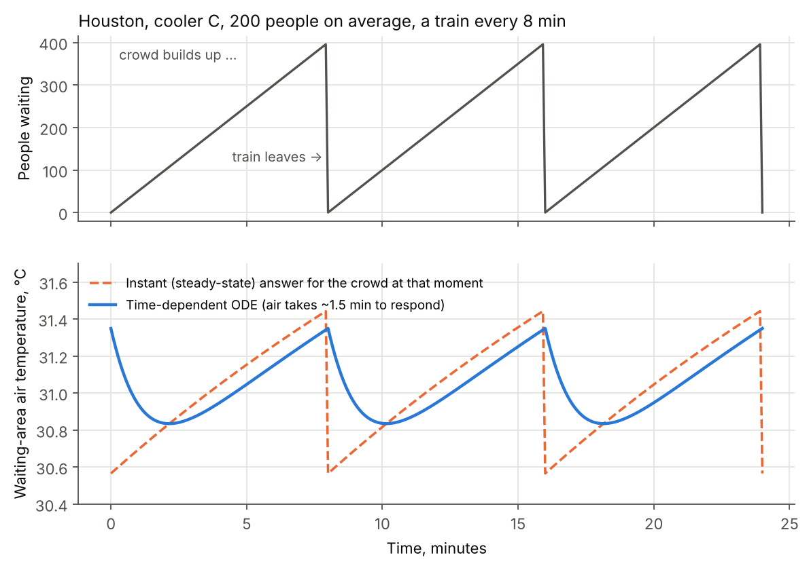

# T11: From bus shelter to rail-station waiting area (Task 2b)

**What this memo is.** This is research for the team to learn from and rewrite in your own words. It is not paper text.
**Task.** Revise the bus-shelter model for a semi-open rail-station waiting area, check its limiting cases, test whether the crowd becomes the main heat load, decide whether an ODE is needed, and answer COMAP's three questions.
**Code.** `sprint_out/code/T11_zone_model.py` (the model), `T11_run.py` (every number below), `T11_seasonal.py` (whole summer), `T11_figs.py` (figures). Raw outputs are in `sprint_out/code/T11_out/`, including the log `T11_log.txt`. Running all three scripts takes about 30 s.
**Tags.** Every number is tagged **[VERIFIED: source]**, **[ASSUMED: reason]** or **[COMPUTED]** (computed by our code from verified or assumed inputs).

---

## 0. The short version

1. **The bus-stop model mixes two airstreams. The station model balances a box of air.** In the station model the box gets two equations, one for heat and one for moisture. The crowd, the roof and the device's motor all sit inside the box. The new model reproduces the old one exactly: with bus-shelter settings it returns COMAP's 5 °C and 8 °C to ±0.21 °C, so the Task 2a calibration still holds.
2. **The shared context says the crowd is a heat source. For a hot station, that is mostly wrong.** Each standing person gives off about 117 W in total, which matches the "~100 W" figure. The catch is the split. In air above about 35 °C, a person *absorbs* heat from the air and releases everything as **sweat vapour**. In a typical Phoenix afternoon station, 200 people pull 10 kW of heat out of the air and add 33 kW as moisture. In Houston, 200 people add only 3.5 kW of temperature-raising heat but evaporate **29 kg of water per hour**. Cooler C's pad evaporates only 24 kg/h [COMPUTED]. **The crowd is a bigger humidifier than the evaporative cooler.**
3. **Comparing "200 people = 20 kW" with the "2.5 kW device" compares heat with electricity.** Cooler C draws 2.5 kW but delivers **16 kW (Houston) to 53 kW (Phoenix)** of air cooling [COMPUTED]. Measured by temperature, the crowd overwhelms Cooler C only at about **400 people in Houston and never in Phoenix**. The flat ASHRAE value of 75 W per person would wrongly predict 85 people.
4. **We found no "optimal crowd size" in the efficiency (people × felt °C per kWh).** Efficiency keeps rising until the platform is physically full, because more people share the same device. What *does* exist is a **crowd that overwhelms the device**: past it, the cooled station feels as hot as the empty uncooled one. On a typical Houston afternoon that crowd is **about 38 people for Cooler B, about 110 for the fan and about 213 for Cooler C**. Over the whole summer, Cooler C's median is **319** (middle half 181–469). In Phoenix it is **beyond the platform's capacity**, because the crowd barely changes how hot the station feels.
5. **Two design choices the bus-stop model could not see.**
   - Where the cooler draws its air from: in Houston a cooler that **recirculates station air makes 50–300 people feel hotter** than having no device.
   - Whether the station is open on one side or both: with openings at both ends, Cooler C's benefit drops from **2.7 to 0.9 °C** (Phoenix).
6. **No ODE is needed.** The station's air replaces itself every **57–98 s**. Trains come every 3–15 min. Treating each moment as steady misses the time-dependent answer by at most **0.33 °C** of felt temperature, and the steady state at the average crowd by at most **0.21 °C**. Both are smaller than the input uncertainty. A bonus rule from Little's law: if the air followed the crowd instantly, people would experience the station as if **4/3 of the average crowd** were present. That is the pessimistic bound.

---

## 1. Why the bus-stop model is not enough (plain words)

The bus-stop model (Task 2a) treats the shelter as a place where two airstreams mix:

- cold air from the cooler, at flow `Q_s`
- warm outside air blowing through, at flow `Q_inf`

The cooled share is the **capture fraction** `φ = Q_s / (Q_s + Q_inf)`. The shelter's temperature is the weighted average of the two streams. The people in it only *receive* cooling; they never change the air. That is fine for 3–4 people in a 15 m² shelter. Our team's own Little's-law code gives at most **4.1 people** waiting [COMPUTED: `scenario.occupancy`].

A semi-open rail waiting area is different in four ways. Each one breaks an assumption of the mixing model:

| What is different | Which bus-stop assumption breaks |
|---|---|
| Walls on three sides, open on one side | Exchange is no longer "wind blows straight through". It becomes slow single-sided exchange, driven largely by **buoyancy**: cold air sinks out of the bottom of the opening. |
| A big roof in the sun | Roof heat (8–13 kW here) is no longer negligible |
| Tens to hundreds of people | The crowd adds heat **and** water vapour to the very air it breathes |
| Trains arrive in surges | The crowd size goes up and down like a sawtooth |

So we draw an imaginary box around the waiting area (a **control volume**). We then do the bookkeeping: *what flows in = what flows out*, once for heat and once for water.

---

## 2. The zone model

### 2.1 The heat balance

**Plain words.** In a steady state, every watt that enters the box must leave it. Heat enters with the cooler's air, with outdoor air coming through the opening, from the people, through the roof, and from the cooler's motor. It leaves with the air flowing out. The box ends up at whatever temperature makes the two sides equal.

**Equation (steady state):**

```
0 = ρ·c_p·Q_s·(T_s − T_z) + ρ·c_p·Q_n·(T_o − T_z) + N·s(T_z) + A_roof·q_roof + P        (1)
```

| Symbol | Meaning | Units |
|---|---|---|
| `ρ` | air density, 1.2 | kg/m³ |
| `c_p` | heat needed to warm 1 kg of air by 1 K, 1006 | J/(kg·K) |
| `Q_s` | airflow pushed in by the cooler | m³/s |
| `T_s` | temperature of the cooler's outlet air | °C |
| `T_z` | temperature of the waiting area (the unknown) | °C |
| `Q_n` | natural exchange with outdoors through the opening | m³/s |
| `T_o` | outdoor temperature | °C |
| `N` | people waiting | persons |
| `s(T_z)` | sensible heat per person (heat that changes air temperature); depends on `T_z` and can be negative | W |
| `A_roof` | roof area | m² |
| `q_roof` | heat through each m² of roof | W/m² |
| `P` | device electricity (all of it ends up as heat in the box) | W |

Solved for `T_z`, with the gains collected into `G = N·s + A_roof·q_roof + P`:

```
T_z = (Q_s·T_s + Q_n·T_o)/(Q_s + Q_n)  +  G / (ρ·c_p·(Q_s + Q_n))                          (1')
    =  T_o − φ·ΔT_dev            +  G / (ρ·c_p·(Q_s + Q_n)),     with φ = Q_s/(Q_s+Q_n), ΔT_dev = T_o − T_s
```

**This means:** the first term is exactly the bus-stop mixing rule. The second term is new. The heat produced inside raises the temperature by an amount that shrinks as more air flows through. If `G = 0`, the station model *is* the bus-stop model. This matches the formula already in `HiMCM_Tasks1and2.md`.

**Worked example** [COMPUTED]. Houston typical summer afternoon, 200 people, Cooler C drawing outdoor air:

- Inputs: `T_o` = 31.5 °C, `Q_s` = 2.5 m³/s, `Q_n` = 2.19 m³/s, so `φ` = 2.5/4.69 = 0.533.
- The cooler's outlet is ΔT_dev = 5.42 °C below outdoors.
- Gains: people 3.49 kW + roof 7.81 kW + motor 2.5 kW = 13.8 kW.
- `T_z` = 31.5 − 0.533 × 5.42 + 13 800 / (1.2 × 1006 × 4.69) = 31.5 − 2.89 + 2.44 = **31.05 °C**. The full code gives 31.05 °C.

### 2.2 The moisture balance

**Plain words.** Water vapour is bookkept the same way. Vapour enters with the cooler air (which the wet pad has humidified), with outdoor air, and from the crowd's breath and sweat. It leaves with the outflowing air.

```
0 = ρ·Q_s·(W_s − W_z) + ρ·Q_n·(W_o − W_z) + N·l(T_z)/h_fg                                (2)
```

| Symbol | Meaning | Units |
|---|---|---|
| `W` | humidity ratio: kg of water vapour per kg of dry air (subscripts s, z, o as above) | kg/kg |
| `l(T_z)` | latent heat per person: the heat that leaves the body as evaporated sweat and breath | W |
| `h_fg` | energy to evaporate 1 kg of water, 2.43 × 10⁶ | J/kg [ASSUMED: textbook steam-table value at about 30 °C, not re-checked online] |

**This means:** the zone's humidity is outdoor humidity, plus the cooler's added water, plus the crowd's water, diluted by the total airflow.

**Worked example** [COMPUTED]. Same Houston case:

- `W_o` = 17.52 g/kg.
- The pad adds ΔW_dev = c_p·ΔT_dev/h_fg = 1006 × 5.42 / 2.43×10⁶ = 2.24 g/kg (the pad trades temperature for moisture one-for-one in energy).
- Each person releases `l` = 98.9 W.
- `W_z` = 17.52 + 0.533 × 2.24 + (200 × 98.9)/(1.2 × 2.43×10⁶ × 4.69) × 1000 = 17.52 + 1.19 + 1.45 = **20.16 g/kg**. The code gives 20.19 g/kg.

The crowd alone adds as much humidity as the cooler's share.

Equations (1) and (2) depend on each other, because `s`, `l` and `Q_n` depend on `T_z` and `W_z`. The code solves the pair together with `scipy.optimize.fsolve`.

### 2.3 The devices

- **Evaporative cooler, outdoor intake (mode O).** `T_s, W_s` come from the team's `core.evaporative_cooler`: constant wet-bulb, pad efficiency ε = 0.85, the same calibration as Task 2a.
- **Evaporative cooler, recirculating (mode R).** Same equations, but the intake air is the *station's* air (`T_z, W_z`). Portable units placed inside a space work this way. **[ASSUMED: we do not know which mode a real station would use. That makes it a design decision, see §7.]**
- **Fan.** It moves no outdoor air and adds its 0.25 kW as heat. It raises air speed to the calibrated `v_fan` = 1.25 m/s [COMPUTED: `scenario.calibrate`], but only over 15 m², the bus-shelter area, which is 1/8 of the floor [ASSUMED].
- **Airflows** are the team's values: 1.1 m³/s for B and 2.5 m³/s for C [ASSUMED: `scenario.py`]. Online listings for portable industrial coolers show **18 000 m³/h (5 m³/s) at 1.1 kW** [VERIFIED: DirectIndustry listing for JH-T9, Fujian Jinghui. This is a seller listing, not a datasheet. https://www.directindustry.com/prod/fujian-jinghui-environmental-technology-co-ltd/product-227607-2355669.html]. Our airflows may therefore be *low* by 2–4×, and airflow turns out to be the most important input (§4.5).
- **Motor heat.** All of `P` ends up as heat inside the box. This was ignored at the bus stop and costs 0.23 °C (B) and 0.36 °C (C) [COMPUTED].

### 2.4 Natural exchange through the opening (wind + buoyancy)

**Plain words.** Outdoor air gets in for two reasons:

- **Wind** pushes it in. Through a single opening that only happens through gusts and eddies, so the flow is small.
- **Buoyancy (stack effect).** Air of different temperature has different weight. If the station is colder than outside, the heavy cold air pours out of the lower half of the opening and warm air flows in over the top half. Picture a fridge door left open.

| Case | Equation | Source |
|---|---|---|
| Single opening, wind | `Q_w = C·A·U`, with C from about 0.01 to 0.05 | [VERIFIED: CIBSE AM10 (2005) §4.3, Eq. 4.13, "Reported values range from about 0.01 to 0.05", reproduced in ASHRAE *Design Guide for Natural Ventilation*, Appendix WA5.1, https://www.ashrae.org/File%20Library/Technical%20Resources/Bookstore/Supplemental%20Files/Natural%20Ventilation/Appendix-WA5.1.pdf] |
| Single large opening, buoyancy | `Q_b = (C_d·A/3)·√(g·h·|ΔT|/T)` | [VERIFIED: Awbi, CIBSE BSG seminar "Basic concepts for natural ventilation", 2010, slide 15, Eq. (10), citing Awbi 1996. The 1/3 comes from integrating the flow profile over the opening height. https://www.cibse.org/media/mtrlmv25/01-hazim-awbi-university-of-reading-basic-concepts-for-natural-ventilation-of-buildings-1.pdf] |
| Open at both ends, wind | `Q_w = C_d·A·U·√(ΔC_p/2)` | [VERIFIED: AM10 Eq. 4.14, same source] |
| Two vents, buoyancy | `A = (q/C_d)·√((T_i+273)/(ΔT·g·h))` | [VERIFIED: AM10 Eq. 4.12; "A typical value for C_d is 0.6"] |
| Wind and buoyancy together | `Q_n = √(Q_w² + Q_b²)` | [VERIFIED (secondary): A. Bhatia, CED Engineering course M04-038 *HVAC – Natural Ventilation Principles and Practices*, p. 11, figure credited to ASHRAE Handbook Fundamentals 2005. https://www.cedengineering.com/userfiles/M04-038%20-%20HVAC%20-%20Natural%20Ventilation%20Principles%20and%20Practices%20-%20US.pdf] |

Symbols:

- `A`: opening area, m²
- `U`: wind speed at the building, m/s. We use 0.7 × the 10 m wind [ASSUMED: town terrain].
- `C`: single-sided wind coefficient. We use 0.025, the middle of the verified range.
- `C_d`: discharge coefficient, 0.6
- `g` = 9.81 m/s²
- `h`: opening height, m
- `ΔT`: inside minus outside temperature, K
- `T`: mean absolute temperature, K

Our station has one opening on the track side: 20 m × 2 m = 40 m² [ASSUMED].

**Worked example** [COMPUTED]. Phoenix, Cooler C, 200 people:

- Wind part: `Q_w` = 0.025 × 40 × (0.7 × 2.31) = 1.62 m³/s.
- The zone is 5.3 K colder than outside, so the total exchange is `Q_n` = 4.91 m³/s.
- That makes the buoyancy part √(4.91² − 1.62²) = 4.64 m³/s. **Buoyancy accounts for 89% of the exchange** (measured as share of `Q_n²`).

**This means something non-obvious: the harder you cool, the faster the cold leaks.** `Q_b` grows like √ΔT. A station that has to "hold" cold air through a vertical opening behaves like an open *upright* freezer case, where cold air spills out of the bottom. That ties straight back to Task 1. A low upstand or sill along the bottom of the opening would hold the cold pool in, just as a chest freezer does. A well-mixed model cannot quantify that; we say so in §8.

**Worked example 2: a station with no device heats itself.** With no device and no wind, the only exit for the gains `G` is buoyancy. Then `G = ρ c_p k √ΔT · ΔT` with `k = C_d A/3 · √(g h / T)`, which gives `ΔT = (G / (ρ c_p k))^(2/3)`.

- Houston: k = 0.6 × 40/3 × √(9.81 × 2/306) = 2.03 m³/(s·K^½).
- Roof gain G = 8 kW gives ΔT = (8000/(1207 × 2.03))^(2/3) = **2.2 K** above outdoors.
- The full model, which also includes wind, gives 1.7 K [COMPUTED].
- Because of the 2/3 power, doubling the gains raises ΔT by only 59%.

### 2.5 Heat through the roof (solar gain)

**Plain words.** Sun heats the roof. The roof then heats the space below, mostly by radiating down onto heads and by warming the ceiling air.

```
q_roof = U_roof · ( T_o + (α/h_o)·I − ΔR − T_z )      (3)   "sol-air temperature" method
```

| Symbol | Meaning |
|---|---|
| `U_roof` | how easily heat passes through the roof. We use 5.2 W/(m²K) for a bare single-skin metal canopy = 1/(1/17 + 1/7.5) [ASSUMED: typical outside/inside surface coefficients]. |
| `α/h_o` | 0.026 m²K/W for a light-coloured roof, 0.052 for a dark one [VERIFIED (secondary): K.A. Al-Saud, King Saud Univ., citing ASHRAE Fundamentals, https://cap.ksu.edu.sa/sites/cap.ksu.edu.sa/files/imce_images/jap_ksu_jan2009_e1.pdf. Seen only in a search snippet, so re-check.] |
| `ΔR` | long-wave sky correction for horizontal roofs, 3.9 °C [VERIFIED (secondary): same paper, citing Bliss 1963] |
| `I` | sunlight on a horizontal surface, W/m², from our weather data |

The hot ceiling also raises the **mean radiant temperature** (MRT), the "feel" of the surrounding surfaces. We combine the team's shaded `mrt_outdoor` (sky view 0.15) with the ceiling temperature `T_z + q_roof/h_in`, weighted by a person-to-ceiling view factor of 0.2 [ASSUMED].

**Worked example** [COMPUTED]. Houston, Cooler C, 200 people:

- Inputs: T_o = 31.5, I = 614 W/m², T_z = 31.05.
- q_roof = 5.2 × (31.5 + 0.026 × 614 − 3.9 − 31.05) = 5.2 × 12.5 = 65 W/m².
- Over 120 m² that is **7.8 kW**: more than twice the crowd's 3.5 kW of sensible heat.

### 2.6 Heat from people: why ASHRAE's 75 W is the wrong number here

ASHRAE's office-load table gives a standing, lightly working person **75 W sensible + 55 W latent**. [VERIFIED (secondary):

- Univ. of Strathclyde ESRU student project page, which cites CIBSE Guide A and ASHRAE Fundamentals 2017: https://www.esru.strath.ac.uk/EandE/Web_sites/17-18/eebuilding/page9.html
- Autodesk Revit help, which cites the ASHRAE Fundamentals table and lists 250 Btu/h sensible + 200 Btu/h latent, about 73 + 59 W.

We could not open the ASHRAE table itself.] **Those values are for a room at about 24 °C.**

At higher room temperatures the skin can lose less heat by contact and radiation, so the body sweats more. The total stays about the same; the **split** moves. The Engineering ToolBox table for "standing, walking slowly" (130 W total) shows this:

| Room temperature | Sensible / latent |
|---|---|
| 24 °C | 70 / 60 W |
| 26 °C | 60 / 70 W |
| 28 °C | 50 / 80 W |

[VERIFIED (secondary): https://www.engineeringtoolbox.com/metabolic-heat-persons-d_706.html. The site notes the values come from "older ISO and ASHRAE standards".] Sensible heat falls by about 5–6.5 W per °C. Extrapolating, it reaches zero at about 35–36 °C, the skin temperature.

Our stations sit at 31–43 °C, so we compute `s` and `l` from a physiological model. We use the **Gagge two-node model** (as implemented in `pythermalcomfort` 4.8.0, `two_nodes_gagge`) for the skin, plus the standard respiration terms `C_res = 0.0014·M·(34 − T)` and `E_res = 0.0173·M·(5.87 − p_a)` [ASSUMED: standard ASHRAE Fundamentals Ch. 9 forms quoted from memory. Their sum agrees with `pythermalcomfort`'s own respiration output within about 10%].

Our model's output, at 1.1 met, 0.35 clo, still air and RH 50% [COMPUTED]:

| Room °C | 24 | 28 | 30 | 32 | 34 | 36 | 38 | 40 |
|---|---|---|---|---|---|---|---|---|
| Sensible, W | 94 | 66 | 49 | 32 | 14 | **−5** | **−24** | **−38** |
| Latent, W | 25 | 51 | 68 | 85 | 103 | 121 | 140 | 135 |
| Total, W | 119 | 117 | 117 | 117 | 116 | 116 | 116 | 97 |

**This means:**

- The total heat (about 117 W) matches the metabolic rate, which checks energy conservation.
- The slope matches the published table: sensible falls by about 6–8 W per °C.
- Above about 35 °C, **people cool the air and humidify it**. They act like a crowd of small evaporative coolers.
- At 40 °C the total drops below the metabolic rate because the body is storing heat: it can no longer sweat enough to keep up. That is the dangerous regime.

### 2.7 How hot it feels

We use the same felt-temperature index as the bus stop, **SET** (Standard Effective Temperature), from `pythermalcomfort.set_tmp` at 1.1 met and 0.35 clo, without rounding. `core.SET` rounds to 0.1 °C, which is too coarse when taking differences. Inputs are `T_z`, the zone RH, the mean radiant temperature above, and the air speed `v = max(0.2, (Q_s+Q_n)/A_cross)` with A_cross = 21 m² [ASSUMED].

### 2.8 Crowd size from trains (Little's law + sawtooth)

- **Little's law.** Average number waiting = arrival rate × average wait. With random arrivals and a train every `H` minutes, the average wait is `H/2`, so `N̄ = λ·H/2` (as in the team's `scenario.occupancy`).
- **Sawtooth.** Between trains the crowd grows steadily from 0 to `λH`, then the train empties the platform.
- **The 4/3 rule (new).** If the air reacts quickly (§5), each person feels the conditions at the moment they are there. Weighting by people:

  `N̄_felt = ∫N² dt / ∫N dt = (2/3)·λH = (4/3)·N̄`.

  **This means** the average passenger experiences the station as if one-third more people were present than the time-averaged count, because most person-minutes are spent when the platform is fullest.

**A reality check on "200 people".** The team's `scenario.py` rail venue (5200 boardings/day, 8-min headway) gives a peak-hour average of only **34 people** waiting [COMPUTED]. An average of 200 needs λ = 2·200/8 = 50 people/min, which is **3000 boardings in the peak hour**. That is a busy commuter station, not a typical one.

---

## 3. Checks

### 3.1 The new model contains the old one (backward compatibility)

Settings: bus-stop geometry, the team's calibrated exchange (0.6 × 10.69 m² × max(U, 0.5)), no people, no sun, design hour 43 °C / 12% RH.

| | Delivered drop | COMAP claim | φ |
|---|---|---|---|
| Cooler B | 4.79 °C | 5 | 0.255 |
| Cooler C | 8.21 °C | 8 | 0.438 |

These are the same ±0.21 °C residuals and φ = 0.26 / 0.44 as Task 2a [COMPUTED]. Adding motor heat moves them to 4.56 and 7.85 °C. Mention that if you keep motor heat in Task 2a.

### 3.2 Limiting cases



*Figure: waiting-area air temperature as the opening area goes from 0.001 m² to 10 000 m² (Phoenix, Cooler C).*

The test case: adiabatic roof, no sun, no people, motor heat off [COMPUTED].

| Limit | Model | Expected |
|---|---|---|
| Opening → 0 | T_z = **23.27 °C** | supply temperature T_s = 23.27 °C ✓ |
| Opening → ∞ (10⁴ m²) | T_z = **40.80 °C** | outdoor 40.9 °C ✓. The 0.1 °C gap closes as A → ∞, since φ = 0.006 at 10⁴ m². |

The sealed limit with gains included:

- **Motor heat on:** sealed station = T_s + P/(ρc_pQ_s) = T_s + 0.83 °C.
- **200 people + sun:** the sealed station sits at 28.6 °C, not 23.3 °C. The supply air has to carry away all the internal gains: T_z = T_s + G/(ρc_pQ_s).
- **Recirculating cooler (mode R), sealed:** **no steady state exists.** An evaporative cooler removes *no* energy. It only swaps temperature for humidity. With people and the motor adding energy, the sealed station's total energy rises without limit. In a bus shelter you could never see this; in a station it shows up as the strong humidity build-up of §4.3.

### 3.3 Units and conservation

- Equation (1) is W = W; equation (2) is kg/s = kg/s.
- Body heat totals 116–119 W per person below 38 °C, equal to 1.1 met × 58.15 W/m² × 1.83 m² = 117 W ✓.

---

## 4. Results

The weather is the median summer-2025 afternoon (13–17 h) from the team's cached Open-Meteo files [COMPUTED]:

| City | Temperature | RH | Wind | Sun (horizontal) | Wet-bulb depression |
|---|---|---|---|---|---|
| Phoenix | 40.9 °C | 13% | 2.3 m/s | 754 W/m² | large |
| Houston | 31.5 °C | 60% | 2.4 m/s | 614 W/m² | small |

The station is 120 m² of floor, 3.5 m high (420 m³), with a 40 m² opening on one side [ASSUMED].

### 4.1 Who heats the station?



*Figure: heat flows into the waiting area against crowd size, with Cooler C running, for Phoenix and Houston.*

Cooler C running, outdoor intake, all values in kW [COMPUTED]:

| | N | Crowd sensible | Crowd latent | Roof | Motor | Cooler C sensible capacity | What ASHRAE 75 W would say |
|---|---|---|---|---|---|---|---|
| Phoenix | 200 | **−10.1** | 33.2 | 13.1 | 2.5 | **53.2** | +15.0 |
| Houston | 200 | **+3.5** | 19.8 | 7.8 | 2.5 | **16.4** | +15.0 |
| Houston | 400 | +6.1 | 40.5 | 7.6 | 2.5 | 16.4 | +30.0 |

**This means:**

- **Is the crowd the dominant load?** Yes, but as a **moisture** load. In temperature terms the roof is the biggest heat source in both cities. In Phoenix the crowd even pulls heat out of the air.
- **Device versus crowd:**
  - Cooler C's "evaporative COP" (sensible cooling ÷ electricity) is 53.2/2.5 = **21** in Phoenix and 16.4/2.5 = **6.5** in Houston [COMPUTED].
  - So the electricity number (2.5 kW) is the wrong yardstick for asking whether the device can keep up.
  - The right yardstick gives a closed form for the **crowd at which the station's air is back to outdoor temperature** (mode O, from equation 1' with T_z = T_o):

```
N_air = ( ρ c_p Q_s ΔT_dev − A_roof q_roof − P ) / s          (4)
```

  - Houston: (16.4 − 7.5 − 2.5) kW / 15.8 W = **402 people**. With ASHRAE's 75 W it would be **85 people**, wrong by about 5×.
  - Phoenix: `s` is negative, so the crowd **never** pushes the air temperature back up [COMPUTED].
- **Water, not heat.** In Houston, 200 people release 29 kg of water vapour per hour; Cooler C's pad evaporates 24 kg/h. In Phoenix the figures are 49 kg/h and 79 kg/h [COMPUTED].

### 4.2 Efficiency against crowd size: is there a peak?



*Figure: top row, felt cooling per person against crowd size; bottom row, efficiency against crowd size. Phoenix left, Houston right. Dashed line = old bus-stop logic.*

Efficiency here is the team's measure: `η = N × ΔSET / P`, in person·°C·h per kWh. ΔSET is how much cooler it feels *with* the device than *without* it, **with the same crowd present in both cases**.

**There is no interior peak.** We searched N = 0–1500 [COMPUTED: `peaks.csv`]. For every device and mode, η in person·°C rises until the edge of the search. The reason is simple: the denominator (power) is fixed, and ΔSET per person never drops fast enough to beat the growing N. The only exception is the recirculating cooler in Houston, where ΔSET goes negative. With a comfort-based currency (the team's logistic "fraction dissatisfied"), peaks appear only at 500 people (fan, Houston) and 975 (mode R, Phoenix). Both are above the packed-platform limit and depend on the assumed logistic, so do not quote them as results.

**So the honest answer to "where does efficiency peak" is: at the platform's physical capacity (a corner solution).** Per kWh, a device is always used "more efficiently" by a bigger crowd. Per *person*, though, the benefit can fall. That gap between energy efficiency and visitor experience is exactly the trade-off Task 4 asks about.

| Packing level (queuing level of service) | Space per person | People in our 120 m² |
|---|---|---|
| LOS E (standing in contact, no circulation) | 0.2–0.3 m² | 400 at 0.3 m² |
| LOS F | ≤ 0.2 m² | 600 at 0.2 m² |

[VERIFIED (secondary): NPTEL *Traffic Engineering* Lecture 47, "Pedestrian Queuing LOS", https://archive.nptel.ac.in/content/storage2/courses/105101008/587_Pedestrian/point7/point.html. We could not open the TCQSM/Fruin original.]

**What the revision does produce: the overwhelm crowd `N_ow`.** We define `N_ow` as the crowd at which *the cooled station feels as hot as the empty, uncooled station*. Beyond it, the device can no longer even cancel what the crowd adds. Typical afternoon [COMPUTED]:

| Device (mode) | Phoenix N_ow | Houston N_ow |
|---|---|---|
| Fan | 459 | **110** |
| Cooler B, outdoor intake | 1660 | **38** |
| Cooler B, recirculating | 1108 | **1** |
| Cooler C, outdoor intake | 2611 | **213** |
| Cooler C, recirculating | 1484 | **38** |



*Figure: share of summer afternoon hours in which a given crowd overwhelms Cooler C, Phoenix and Houston.*

**Over the whole summer** we used 268 afternoon hours per city (every second hour from 13–17 h) [COMPUTED: `seasonal.csv`]:

- **Houston, Cooler C:** median N_ow = **319** (middle half 181–469). In **27%** of afternoon hours, fewer than 200 people overwhelm it. N_ow is lowest, about 180, at 60–70% RH.
- **Phoenix:** median N_ow = 2569. N_ow is below 200 in only **1%** of hours.

**Old versus new model.** Both are Cooler C with outdoor intake, typical afternoon [COMPUTED]:

| | N = 400, η new | N = 400, η old |
|---|---|---|
| Houston | 121 | 187 (old is 35% too high) |
| Phoenix | 438 | 362 (old is 21% too low) |

In Phoenix the crowd makes the device look *better*: the crowd heats and humidifies the uncooled baseline, and the device's outdoor air flushes that out. Across all summer hours the crowd raises ΔSET in 77% of Houston hours and 97% of Phoenix hours. The median ratio of new to old ΔSET at N = 200 is 1.18–1.19. **The sign of the crowd correction depends on the hour's humidity,** which a constant-ΔSET model cannot show.

*Small wiggles in the curves* (about 0.1–0.3 °C, e.g. Phoenix N = 100–150) come from the comfort model switching sweating regimes. The *kink* in Houston near N = 400 (Cooler C) and N = 75 (recirculating) appears where `T_z` crosses `T_o`: buoyancy exchange vanishes there and only the weak single-sided wind is left. That is a real feature of equation (2.4), but nature is smoother than our √|ΔT|.

### 4.3 Where the cooler draws its air matters more than which cooler you buy (humid climate)

- **Recirculating versus outdoor intake, Houston.** Cooler C *recirculating* makes the station feel **0.04–0.52 °C hotter** than no device for N = 50–300. Cooler B recirculating is worse than no device for every N from 10 to 600 [COMPUTED]. In Phoenix the difference between modes is small: 2.39 versus 2.70 °C at N = 200.
- **Pad off versus pad on.** We ran Cooler C with the pad dry (ε = 0), so it is just a 2.5 m³/s outdoor-air fan [COMPUTED]:

| Houston | Wet pad | Dry pad |
|---|---|---|
| N = 0 | 1.17 °C | 0.86 °C (73% of the benefit) |
| N = 200 | 1.06 °C | **1.34 °C** |
| N = 400 | 0.76 °C | **1.86 °C** |

  In Phoenix the dry pad gives only 20–41% of the benefit.

**This means:** in a humid city with a crowd, the useful part of an evaporative cooler is the **outdoor air it pushes through**, which flushes out the crowd's moisture. The water makes things worse. **A practical operating rule: in humid hours with crowds, switch off the pump and keep the fan.**

### 4.4 How open the station is matters

Same station, 200 people, Cooler C, but open at both ends (cross-ventilated) instead of one side [COMPUTED]:

| | Q_n single-sided → cross | φ single → cross | ΔSET single → cross |
|---|---|---|---|
| Phoenix | 4.91 → 14.5 m³/s | 0.34 → 0.15 | **2.70 → 0.90 °C** |
| Houston | 2.19 → 14.5 m³/s | 0.53 → 0.15 | 1.06 → 0.62 °C |

"Semi-open" is not one thing. *Which* sides are open changes the device's benefit about 3× in Phoenix.

### 4.5 What the result depends on



*Figure: tornado chart of ΔSET at N = 200, Cooler C, one input changed at a time, Phoenix and Houston.*

The tornado chart covers ΔSET at N = 200 (Cooler C, mode O). Elasticities `E = (Δy/y)/(Δp/p)` [COMPUTED: `sensitivity.csv`]:

- **Houston** (fragile):
  - cooler airflow `Q_s`: E = 2.8
  - pad efficiency: 2.3
  - metabolic rate: −1.0
  - roof U-value: −0.9; insulating the roof raises ΔSET from 1.06 to 1.85 °C
  - wind factor: 0.7
  - single-sided wind coefficient: 0.6
- **Phoenix** (robust): metabolic rate −0.8, airflow 0.75, pad efficiency 0.54. Every other input is below 0.2.

The most important input in the humid case, the cooler's real airflow, is the one we only assumed. Get a real datasheet.

---

## 5. Is a time-dependent model (ODE) needed?

The time-dependent versions of (1) and (2) are:

```
V·ρ·c_p · dT_z/dt = [right-hand side of (1)]      V·ρ · dW_z/dt = [right-hand side of (2)]
```

where `V` = 420 m³ is the air volume. The **time constant** (how long the station's air takes to "forget" a change) is

```
τ = V / (Q_s + Q_n)
```

It comes out at **57 s (Phoenix) to 90 s (Houston)** with Cooler C, and 110–155 s without a device [COMPUTED].

| Compare | Value |
|---|---|
| Train headway H | 3–15 min (180–900 s) |
| H / τ | about 2–16 |
| Weather data step | 1 h |

We integrated the ODEs through a train sawtooth with `scipy.integrate.solve_ivp` (Houston, Cooler C, 200 people on average) [COMPUTED: `surge.csv`]:



*Figure: top, people waiting over three 8-minute train cycles; bottom, air temperature from the ODE (solid) and the instant steady-state answer (dashed).*

| Headway | ODE air swing | Instant (quasi-steady) swing | Person-weighted SET: ODE | Steady at N̄ | Steady at 4/3·N̄ |
|---|---|---|---|---|---|
| 3 min | 0.27 °C | 0.86 °C | 33.05 | 33.08 | 33.50 |
| 8 min | 0.52 °C | 0.87 °C | 33.17 | 33.08 | 33.50 |
| 15 min | 0.64 °C | 0.88 °C | 33.29 | 33.08 | 33.50 |

Phoenix differences are at most 0.02 °C, because the crowd barely changes SET there.

**Verdict: no ODE.** The time-dependent answer always lies **between two steady-state answers**:

- the steady state at the average crowd `N̄`, which is right when trains are frequent and the air cannot follow the sawtooth
- the steady state at `4/3·N̄`, which is the limit for very long headways (H ≫ τ)

For headways of 3–15 min, using the steady state at `N̄` is off by at most **0.21 °C**. The 4/3 rule is off by at most **0.45 °C**. Treating every moment as instantly steady (quasi-steady) is off by at most **0.33 °C**. All of these are smaller than the input uncertainty (§4.5 shows swings of 0.5–1.8 °C). We recommend steady state at `N̄`, with `4/3·N̄` as the pessimistic bound.

The ODE's damping matches the textbook first-order filter. Amplitude ratio = `1/√(1+(2πτ/H)²)` = 0.65 at H = 8 min, close to the simulated 0.52/0.87 = 0.60. **This fits the team's Task 1 "match the model to its time constant" argument, idea #12 in the log.** The station's air (about 1.5 min) is algebra. Only slow stores such as a concrete floor or roof mass (hours) would deserve an ODE, for example to study pre-cooling at night. We did not model those.

---

## 6. The three answers COMAP asks for

**What changed?**

- The shelter's *mixing rule* (two airstreams averaged) became a *control-volume balance* of **heat and moisture** (equations 1 and 2). The people, the roof and the device's own motor are now **inside** the balance.
- That one ingredient brings three consequences:
  1. people both receive cooling and add heat and water
  2. exchange with outdoors depends on the station's own temperature, through buoyancy
  3. the crowd varies with trains, handled by Little's law plus the 4/3 rule

**Why was it necessary?** Because what the bus stop could ignore is now as big as the device:

- **Moisture.** 200 waiting people evaporate **29 kg/h** of water in Houston, more than the cooler's **24 kg/h**. At the bus stop, 4 people evaporate about 0.6 kg/h.
- **Roof heat.** The roof adds **8–13 kW**, comparable to Cooler C's 16 kW of cooling in Houston.
- **Buoyancy.** Buoyant spill-out is **89%** of the station's air exchange (Phoenix). It grows as you cool, so the capture fraction is no longer a fixed property of the shelter.
- **The old person-gain value** (75 W sensible) is wrong at station temperatures. It has the wrong sign above about 35 °C.

**How did it improve the model?**

1. **No loss.** It reproduces the Task 2a calibration exactly (±0.21 °C), so nothing was thrown away.
2. **It answers questions the old model cannot pose:**
   - how many people a device can handle (N_ow: Houston Cooler C about 213 on a typical afternoon, summer median 319)
   - whether to draw outdoor or station air (recirculating makes it *worse* in Houston)
   - whether to run the pump at all (pad-off beats pad-on above about 130 people in Houston)
   - how the station's openings should be arranged (one side open gives 3× the benefit of two)
3. **It corrects efficiency by −35% to +21%** at 400 people. The sign depends on humidity, which the old constant-ΔSET logic cannot represent.
4. **It passes the limiting cases,** and it exposes one the old model could not have: a sealed space with a recirculating evaporative cooler has no steady state.

---

## 7. Contradictions with the shared context (please read)

1. **"200 people ≈ 20 kW, eight times the largest device."**
   - The total is right: about 117 W per person, 23 kW for 200.
   - The comparison is wrong. 2.5 kW is the cooler's *electricity*; its *cooling* is 16–53 kW.
   - Most of the crowd's heat is latent (moisture). At station temperatures its sensible part is 15–20 W per person (Houston) or negative (Phoenix). Rephrase as: *"the crowd is the dominant **moisture** source, and moisture is what disables evaporative cooling."*
2. **ASHRAE 75 W / 55 W per person.** These values are for about 24 °C rooms. Above about 35 °C people **cool the air**. Using 75 W predicts overwhelm at 85 people instead of about 400 (Houston).
3. **"There is an optimal crowd size" (HiMCM_Tasks1and2.md, Standout move #3).** Not supported in the person·°C per kWh currency: efficiency rises up to platform capacity. A defensible replacement is **"each device has a crowd capacity N_ow beyond which it no longer offsets the crowd,"** and that capacity depends strongly on climate (Houston about 200–300, Phoenix above platform capacity).
4. **"Walls and a roof mean less wind exchange, so φ goes up."** True only if the station is open on one side: φ = 0.34–0.53 versus the shelter's 0.26/0.44. If it is open at both ends, φ falls to 0.15. Also, the leakage is now mostly buoyancy, and it *grows* as you cool.
5. **Crowd size.** The team's own rail scenario (`scenario.py`) has only **34** people waiting at peak. "200 people" needs about 3000 boardings in the peak hour. Pick the venue size deliberately.
6. **"No openings → zone reaches the supply temperature"** holds only without internal gains. With gains it is `T_s + G/(ρc_pQ_s)`. A recirculating cooler in a sealed space has no steady state at all.
7. **Agreement:** the person-weighted logic (Little's law) and the time-constant method of Task 1 carry over unchanged and give a clean "no ODE" verdict.

---

## 8. End matter

### (a) Key findings (with numbers)

1. **The crowd is a moisture source, not a heat source.** At 31–43 °C station temperatures each person releases about 117 W, of which 85–145% is latent. Sensible is +15 W in Houston and −50 W in Phoenix. 200 people humidify more than Cooler C does: 29 versus 24 kg/h in Houston.
2. **Device crowd capacity.** On a typical Houston afternoon, Cooler C (outdoor intake) is overwhelmed at about **213** people, Cooler B at **38**, the fan at **110**. Over the summer, Cooler C's median is 319 (middle half 181–469). In Phoenix every device's capacity exceeds the packed-platform limit (400–600).
3. **No efficiency peak.** Efficiency per kWh rises up to the platform's capacity. Per-person benefit can fall (Houston: 1.17 → 0.76 °C from 0 to 400 people), so energy efficiency and passenger experience diverge as the crowd grows.
4. **Design levers the old model could not see:**
   - outdoor intake beats recirculation (Houston recirculating is worse than nothing)
   - pump off in humid crowded hours (Houston: dry 1.86 °C versus wet 0.76 °C at N = 400)
   - one open side, not two (Phoenix 2.70 versus 0.90 °C)
   - an insulated roof (Houston 1.06 → 1.85 °C)
5. **No ODE needed.** τ = 1–1.5 min against a headway of 3–15 min. The steady state at the average crowd is within 0.21 °C of the ODE; the true answer lies between the steady states at N̄ and 4/3·N̄.

### (b) Verified versus assumed

| Item | Status |
|---|---|
| AM10 single-sided wind coefficient 0.01–0.05; C_d 0.6; cross-flow and two-vent equations | VERIFIED (primary excerpt, ASHRAE appendix of AM10) |
| Single-opening buoyancy `C_d A/3 √(g h ΔT/T)` | VERIFIED (Awbi CIBSE slides) |
| Wind and buoyancy combined in quadrature | VERIFIED (secondary: CED course citing ASHRAE) |
| ASHRAE 75/55 W per standing person | VERIFIED secondary only (Strathclyde, Revit). Table itself not opened. |
| Temperature dependence of the person split | VERIFIED secondary (Engineering ToolBox, older standards) |
| Sol-air α/h_o = 0.026/0.052, ΔR = 3.9 °C | VERIFIED secondary (search snippet only; open the paper) |
| Queuing LOS E 0.2–0.3 m², F ≤ 0.2 m² | VERIFIED secondary (NPTEL) |
| Cooler listing 18 000 m³/h at 1.1 kW | VERIFIED as a seller listing, not a datasheet |
| Station geometry (120 m², 3.5 m, 40 m² single opening, 2 m high) | ASSUMED |
| Cooler airflows 1.1 / 2.5 m³/s; ε = 0.85; v_fan; A_fit | ASSUMED / team calibration (Task 2a) |
| Roof U = 5.2, h_in = 7.5, ceiling view factor 0.2, wind factor 0.7, A_cross 21 m², fan coverage 15 m² | ASSUMED |
| Respiration formulas; h_fg = 2.43 MJ/kg | ASSUMED (standard textbook; not re-fetched) |
| All results in §§3–5 | COMPUTED by the attached code |

### (c) Decisions the team must make

1. Station size and openings: a typical station (about 34 waiting) or a busy one (200+)? One open side or two? Our results change about 3× with this choice.
2. Cooler intake: outdoor or recirculating. Model both, or state one as an assumption? We recommend both, as a finding.
3. Efficiency currency: person·°C per kWh (no peak) versus a comfort or safety currency (peaks depend on assumed parameters). We recommend reporting η **and** N_ow.
4. Whether to keep motor heat in Task 2a: it changes the residuals from ±0.21 to −0.44/−0.15 °C.
5. Whether to replace the fixed 75/55 W people gains with the two-node split everywhere (recommended). It costs one function call.

### (d) How this feeds the rest of the paper

- **Task 2b:** sections 1, 2, 3 and 6 *are* the answer. Use figures `T11_limits`, `T11_heat_budget` and `T11_efficiency_vs_crowd`.
- **Task 3 (venues):** run `solve_zone` with each venue's geometry and city. The characteristics that matter most come from the tornado:
  - wet-bulb depression (climate)
  - cooler airflow
  - which sides are open
  - roof insulation and colour
  - crowd density
- **Task 4 (balance):**
  - N_ow is a natural *capacity constraint*, e.g. number of units ≥ N/N_ow.
  - The divergence between energy efficiency (rises with N) and per-person benefit (can fall) is the Pareto trade-off.
  - Pump-off in humid crowded hours is a zero-cost operating rule.
- **Task 5 (guidelines/memo):** four plain rules, each backed by a number above:
  1. draw outdoor air
  2. turn the water off in humid rush hours
  3. close one side, not both
  4. insulate or whiten the roof first
- **Link to Task 1:** the station's cold air spills out of a vertical opening like an open upright freezer case. The buoyancy equation is the station's equivalent of the air-curtain infiltration term.

### (e) Weaknesses and open questions

- **Well-mixed assumption.** Real stations stratify: cold air pools low, which is good for standing people, and the cooler's jet is uneven. A two-zone (floor/ceiling) model or CFD would refine φ. The "upstand at the opening" idea is untested.
- **No validation data** for a cooled semi-open station. Only the nested bus-stop check and the limiting cases are validated.
- **Cooler airflow** is assumed, and Houston results are most sensitive to it (E = 2.8).
- **SET is a steady-state comfort index,** but passengers wait about 4 min after arriving from the hot street. Transient comfort is not modelled.
- **The single-sided √|ΔT| buoyancy rule** gives an artificial "dead point" when T_z = T_o.
- **Not included:** train-related heat (braking, air-conditioner condensers on train roofs, door-opening gusts). These matter in underground stations; we found no numbers and left them out.
- **The fan is credited** with 1/8 of the floor regardless of crowd density. Crowds block air jets, so this probably overstates the fan at high N.

---

### Sources

1. CIBSE (2005) *AM10 Natural ventilation in non-domestic buildings*, §4.3, Eqs. 4.12–4.14. Excerpt in Simmonds & McConahey, *ASHRAE Design Guide for Natural Ventilation*, Supplemental Appendix WA5.1 (ASHRAE 2021). https://www.ashrae.org/File%20Library/Technical%20Resources/Bookstore/Supplemental%20Files/Natural%20Ventilation/Appendix-WA5.1.pdf
2. Awbi, H. (2010) "Basic concepts for natural ventilation of buildings", CIBSE BSG seminar, slide 15, Eq. (10). https://www.cibse.org/media/mtrlmv25/01-hazim-awbi-university-of-reading-basic-concepts-for-natural-ventilation-of-buildings-1.pdf
3. Bhatia, A. *HVAC – Natural Ventilation Principles and Practices*, CED Engineering M04-038, pp. 3, 10–11. https://www.cedengineering.com/userfiles/M04-038%20-%20HVAC%20-%20Natural%20Ventilation%20Principles%20and%20Practices%20-%20US.pdf
4. University of Strathclyde ESRU (2017–18) student project, occupant gains table citing CIBSE Guide A / ASHRAE 2017. https://www.esru.strath.ac.uk/EandE/Web_sites/17-18/eebuilding/page9.html
5. Autodesk Revit 2014 help, people heat gains citing the ASHRAE Fundamentals table. https://help.autodesk.com/cloudhelp/2014/ENU/Revit/files/GUID-7668C78B-7B33-4D60-B838-57D2656D8AD5.htm
6. The Engineering ToolBox (2004) "Metabolic heat gain from persons". https://www.engineeringtoolbox.com/metabolic-heat-persons-d_706.html
7. Al-Saud, K.A., King Saud University, sol-air temperature paper citing ASHRAE (seen via search snippet). https://cap.ksu.edu.sa/sites/cap.ksu.edu.sa/files/imce_images/jap_ksu_jan2009_e1.pdf
8. NPTEL, *Traffic Engineering*, Lecture 47 "Pedestrian Studies", queuing LOS. https://archive.nptel.ac.in/content/storage2/courses/105101008/587_Pedestrian/point7/point.html
9. DirectIndustry listing, JH-T9 18000 CMH industrial portable air cooler (Fujian Jinghui). https://www.directindustry.com/prod/fujian-jinghui-environmental-technology-co-ltd/product-227607-2355669.html
10. `pythermalcomfort` 4.8.0 (Tartarini & Schiavon): `two_nodes_gagge`, `set_tmp`.
11. Open-Meteo historical archive, summer 2025 hourly data (team cache `himcm_b/data/`).
